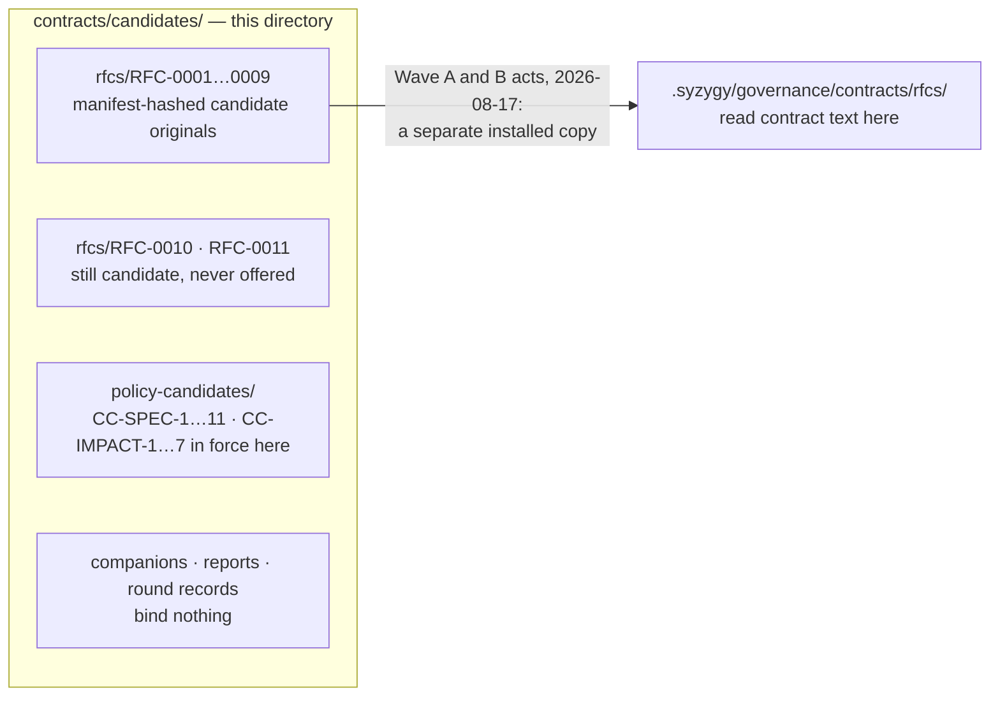

# Candidate contract package — partly accepted, partly still candidate

> **Most of this directory binds nothing — but two files in it are
> authority, and this banner used to deny it.** Craft acts 6 and 7 put the
> specification-acceptance standard (**CC-SPEC-1…11**) and the shape-to-spec
> impact rule (**CC-IMPACT-1…7**) **in force** on 2026-08-17, at their
> committed home under `policy-candidates/` — here, uncopied. They are
> cited as authority, and this tree is their only home. Read "Two in-force
> craft policies live in this tree" below before editing or citing anything
> under `policy-candidates/`. Everything else here is candidate, report, or
> round record, and binds nothing.
>
> What the Wave A and Wave B acts bound was each wave's *manifest digest*;
> what they installed is a separate copy, under
> `.syzygy/governance/contracts/rfcs/`. That home exists and holds those
> modules. Read contract text there, never from here.
>
> The `rfcs/RFC-0001…0009` files under *this* directory are the
> manifest-hashed candidate originals those acts were performed over: package
> identity and review evidence, not a second authority. Where they and
> `contracts/rfcs/` could ever disagree, the installed tree wins.
>
> Still candidate, never offered: **RFC-0010 (Mission Control)** and
> **RFC-0011 (Context Compiler)**, the deferred waves C1/C2/D1/D2, and every
> companion, report, and round record under this tree.

Read contract text in `contracts/rfcs/`, the two in-force craft policies in
`policy-candidates/`, and treat everything else here as candidate or record;
the Layout table routes to each file class.



This directory tracks the final pre-specification candidate package so that
a fresh clone can read, review, and verify the exact artifacts the owner is
being asked to accept (clone-visibility ruling P-9 / FD-037 corollary,
2026-08-05).

- **Provenance:** it was promoted byte-verbatim from the founder-local rev10
  packet, then corrected round by round as each round's semantic-delta
  record states (`round-2026-08/SEMANTIC-DELTAS-THIS-ROUND.md` through
  `round-2026-08e/`).

> **This page does not own any state it reports.** `PROJECT-STATUS.md`
> owns the launch path and `decisions/PENDING-OWNER-DECISIONS.md` owns the
> queue; where this page and one of those disagree, **the owning record
> wins and this page is stale**. Report the disagreement rather than
> resolving it yourself.

**Current state — derived, not owned here.** `PROJECT-STATUS.md` owns every
row below; read it, not this paragraph, and report any disagreement.

- **Waves A and B are accepted.** Both acts were performed 2026-08-17 and
  their modules installed to `.syzygy/governance/contracts/rfcs/`
  (`decisions/ACCEPTANCE-ACT-RECORD.md`, Acts A and B, which state the
  counts). The accepted RFC
  0001–0009 bytes were subsequently amended by the 2026-09-01 general
  trusted-bootstrap transaction and the 2026-09-02 PWB state-(1) amendment
  act, both recorded in that same append-only record.
- **Waves C1/C2/D1/D2 remain visibly deferred** — `DEFERRED-WAVE-POSTURE.md`
  is the disclosure, and RFC-0010/RFC-0011 are their candidate subjects.
- Task routing has one current answer: the generated `TASK-ROUTER.md`.

*Superseded, kept because it is cited elsewhere:* until 2026-09-05 this
paragraph still read "as-of 2026-08-11 … neither act has been offered: Wave
A's offer is withheld solely by owner decision **P-33**, and Wave B follows
Wave A", with both waves at `VERDICT: CONFIRM` (RD-31b, RD-32c). That was
true when written and stopped being true when the two acts were performed on
2026-08-17; the page's own "this page may be stale" banner discharged the
governance check without the sentence ever being corrected.

*Superseded state, kept because it is cited elsewhere:* an earlier revision
of this paragraph said the Wave A/B repair batches "await fresh
exact-package reviews before the acts may be offered". That was true when
written (2026-08-10) and stopped being true when RD-31b and RD-32c
returned; review RD-50 found it still standing here a day later. The
round-2026-08d pass's fifteen `REVISE` verdicts (`round-2026-08d/reviews/`)
are that round's record and are not the current package's state.

## Layout

One row per file class; each file's head banner says what binds.

| Path | What it is |
|---|---|
| `rfcs/` | The 39 active candidate contract modules (RFC 0001–0011; RFC-0010 is a five-module package and RFC-0011 a two-module package since round 2026-08d) |
| `ACTIVE-CONTRACT-MANIFEST.txt` | Per-module sha256 over the whole corpus — package identity, **no act's argument**. Regenerated by `scripts/build_active_manifest.py` only |
| `wave-manifests/` | Six wave manifests (A, B, C1, C2, D1, D2) — each wave act's argument is the sha256 of its manifest file. Same generator; partition-checked |
| `FINAL-FOUNDATIONAL-CONTRACT-ACCEPTANCE-RECORD.md` | The gate definitions and ceremony (six wave acts + craft, topology, overview, optional D3) |
| `history/`, `matrix-rows/` | Non-normative companions: rev9 corpus, Tier-2 rationale, decision censuses. "Nothing in this directory binds" |
| `fixtures/` | Context-selection fixtures for the RFC-0011 Context Compiler |
| `reviews/` | Raw review reports and dispositions for this package — stored verbatim, never edited; the eight files and what each is are named under "[What is in `reviews/`](#what-is-in-reviews)" below, because `DISPOSITIONS.md` itself may not be extended to name them |
| `scripts/` | Self-rooted, portable verification and generation (`verify_final_prespec.py`, `build_contract_index.py`, `build_dependency_index.py`, `build_budget_report.py`, `build_task_router.py`, `build_active_manifest.py`, `build_capability_1_views.py`, `context_load.py`) |
| `TASK-ROUTER.md` | **The one current task router** — generated navigation by `scripts/build_task_router.py`, never authority; supersedes the historical task index (now `history/TASK-TO-CONTRACT-INDEX.md`) and the load map's reader table |
| `CONTRACT-DEPENDENCY-INDEX.md` | Derived module-graph index (generated; never authority) |
| `DEFERRED-WAVE-POSTURE.md` | Current owner-directed posture of Waves C1/C2/D1/D2 (deferred from the Capability 1 launch) |
| `FIRST-OPENSPEC-SEQUENCE.md` | The single current first-spec sequence (revision 3) with per-prerequisite states |
| `HOW-TO-AUTHOR-A-SYZYGY-SPEC.md` | Non-authoritative router to the five spec-authoring authorities (E1) |
| `HISTORICAL-INDEX.md` | Index of every historical/superseded artifact class |
| `ACCEPTANCE-PHRASE-REGISTRY.yaml` | Structured census of current and retired acceptance phrases (record, never authority) |
| `policy-candidates/` | **Mixed — two files here are in force, the rest are candidates.** In force: `SPECIFICATION-ACCEPTANCE-POLICY-CANDIDATE.md` (**CC-SPEC-1…11**) and `SHAPE-TO-SPEC-IMPACT-POLICY-CANDIDATE.md` (**CC-IMPACT-1…7**), by craft acts 6 and 7. Still candidate, each needing its own owner act: term registry, knowledge-hygiene policy (+ compact form), semantic-delta workflow + template, the declined CC-REV-2 lagging-specification offer, and two drafted doctrine-amendment packets (glossary citation P-25(a), actuator definition P-25(c)) |
| `round-2026-08/` … `round-2026-08k/` | Eleven work rounds' process records — never authority and never on a default path; the file count and the four figures other pages quote for it are derived in [`ROUND-ESTATE.md`](ROUND-ESTATE.md) rather than copied here. [`ROUND-ESTATE.md`](ROUND-ESTATE.md) is the one route over them: what each round settled, where that settlement lives now, and the two round files that running software still reads |
| `05-CONTRACT-INDEX.yaml` | Derived per-module index (generated by `scripts/build_contract_index.py`; never authority). **A live view, not packet history** despite its numbered name — `build_capability_1_views.py` and `scripts/build_polaris_project_wide_contract_coverage.py` both read it |
| `CAPABILITY-1-GENERATED-VIEWS.md` | Derived Capability 1 coverage views (generated; never authority) |
| `00-README.md`, `01`–`04-*`, `06`–`10-*`, other top-level reports | The rev10 packet's own delivery reports, kept as packet history |
| `DOCTRINE-AMENDMENT-BOUNDED-MISSION-D3.md` | The D3 proposal, rev1 — act 5's subject (optional). Supersedes `…-DRAFT.md`, which stays in place, banner-marked, as the original the owner may still compare |

### What is in `reviews/`

Eight files: seven raw reviewer reports of the rev10 packet and the lead's
synthesis of them. Read the synthesis, `reviews/DISPOSITIONS.md`, first.

- **`reviews/DISPOSITIONS.md` is the reading order.** It carries every
  finding and its disposition, section by section, and it is the only file
  here that was written by the lead rather than a reviewer.
- **The filename-to-section mapping lives here, in the table below.**
  - `DISPOSITIONS.md` names its sections by short name ("rev10-boundary",
    "rev10-safety") and not by filename, so a sweep looking for a report by
    its own basename finds no citer and reports it unread. That is a false
    absence of the kind verification rule 9 exists to catch.
  - It cannot be repaired where it occurs: the general trusted-bootstrap
    `IMPACT-LEDGER.md` classifies `reviews/DISPOSITIONS.md` as raw-review
    evidence "never rewritten to current semantics", and that ledger is a
    row of its own package's transaction manifest, so the classification is
    bound. The mapping therefore lives here.

| File | Directive | Verdict of record | Disposition section |
|---|---|---|---|
| `reviews/rev10-equivalence-review.md` | §13.1 semantic equivalence | `EXCEPTIONS`, 7 (E1 act-holding) | §6 |
| `reviews/rev10-digestibility-review.md` | §13.2 human digestibility and context | `EXCEPTIONS`, 4 substantive + 4 nits | §2 |
| `reviews/rev10-safety-review.md` | §13.3 mission and autonomy safety | `EXCEPTIONS`, 14 (6 blocking) | §5 |
| `reviews/rev10-boundary-review.md` | §13.4 RFC/OpenSpec boundary | `EXCEPTIONS`, 9 | §3 |
| `reviews/rev10-transaction-review.md` | §13.5 acceptance transaction | `EXCEPTIONS`, 5 | §1 |
| `reviews/rev10-transaction-review-resend.md` | §13.5, same reviewer | `EXCEPTIONS`, identical E1–E5 | §1 |
| `reviews/rev10-portability-review.md` | §13.6 portability | `EXCEPTIONS` (2 must-fix, 6 non-blocking) | §4 |
| `reviews/rev10-confirming-review.md` | final confirming review, 2026-08-03 | `CONFIRM`, 3 residuals | §7 |

Every verdict in the column above is `EXCEPTIONS` except the last. That is
what a working review round looks like, not a troubled one:

- the findings were dispositioned;
- the `rfcs/`-touching fixes were batched so the manifest digest regenerated
  once;
- the confirming review then ran against the repaired bytes.

§7's three residuals include one the lead **declined** rather than fixed — a
stale navigation word-count — because fixing it would have churned the act's
argument digest for a figure that binds nothing. The decline is recorded with
its reasoning; read it as the model for surfacing a cost to the owner instead
of absorbing it.

**Two files, one review.** `rev10-transaction-review-resend.md` is the same
reviewer's fuller retransmission of `rev10-transaction-review.md` after an
idle nudge.

- **The first transmission is the one of record;** it stays exactly as it
  arrived.
- **The resend is retained beside it** because a re-issued raw is kept as a
  second file and never overwrites the first (verification rule 10 — the
  bytes a review is bound to are frozen, and that includes a worse earlier
  draft of the same report).
- **Both carry the same verdict and the same five findings in the same
  locations;** the resend adds per-check evidence only.

### Act packages prepared in this tree

**A performed act's authority is the record in
`.syzygy/governance/decisions/ACCEPTANCE-ACT-RECORD.md`, never the package**;
the package is how the act was prepared and what its argument was computed
over.

- **What a package holds:** five directories hold prepared act packages — a
  semantic delta, a manifest, an impact ledger, a review brief, and an owner
  packet apiece.
- **Why they are listed here:** they were absent from every index in this
  tree until 2026-09-05, which is why a reader could only find the newest and
  most consequential material here by listing the directory.
- **Read the act record, not the banner:** some of these packages still
  carry the "candidate, binds nothing" banner they were drafted with, written
  before the act was performed over them.

*Repaired at the head, 2026-09-06.* Eight package files that assert their own
inertness now open with a dated **PERFORMED** note naming the act record that
performed them; the pre-act banner is kept unedited beneath it as the
drafter's record. Tracked as `syzygy-bba`.

- Two of those files carry a second date: the state-(1) amendment's own
  eleven digests were superseded on 2026-09-05 by the truth-and-readiness
  act.
- Every other file in these four packages was left byte-identical, for one
  of two reasons:
  - **Seven of them are bound** — the five `*-MANIFEST.txt` files, and the
    general trusted-bootstrap package's `ACT-SEMANTICS.md` and
    `IMPACT-LEDGER.md`, both of which that package's transaction manifest
    carries as rows. `ACT-SEMANTICS.md` therefore still opens "**Candidate —
    binds nothing**" about a transaction the owner performed on 2026-09-01,
    and no agent may correct it: the act bound the bytes that say it.
  - **The rest were left because their banner is still true** — a review
    brief that says "review input, never authority" has not stopped being
    one.

| Directory | Subject | Where its authority is |
|---|---|---|
| `general-trusted-bootstrap-authorization/` | The indivisible five-row contract and PWB-coverage amendment | Act record, "General trusted-bootstrap authorization transaction — performed 2026-09-01" |
| `pwb-state1-amendment/` | The two-requirement state-(1) behavioral amendment | Act record, "PWB state-(1) amendment — performed 2026-09-02" |
| `pwb-effect-acts/` | The three effect-specific acts: consent-observation, approve-policy, adopt-registry-entry | Act record, three separate entries, all performed 2026-09-02 |
| `pwb-truth-policy-amendment/` | PWB truth, inert Markdown and readiness repair, plus two effect-act amendments | Act record, three entries performed 2026-09-05 |
| `pwb-walkthrough/` | The Polaris cold-open walkthrough packet — asks the owner for a reading only they can give | No act; the packet performs nothing and is still waiting on the owner |

Eight further top-level files here are the rev10 packet's own working records
— compaction charter, worker-report digest, lead sweep notes, the generated
context-budget report, two Polaris observation deltas, the general
trusted-bootstrap routing delta, and the superseded D3 draft. None is
authority.

- **Seven are unreachable from any route that matters; the eighth,
  `CONTEXT-BUDGET-REPORT.md`, is a live input to the everyday validator.**
  - `scripts/check_governance.py` hard-codes its filename as the single
    sentence a contract module may use to point at a measurement (CG-21).
  - Deleting or renaming it changes what the validator accepts.
  - *(Until 2026-09-06 this sentence read "None is authority, and none is
    reachable from any route that matters" — the first clause is still true;
    the second was never true of this file.)*
- **Two of the eight carried no banner until 2026-09-05 and now do:**
  `COMPACTION-CHARTER.md`, whose head announced "binding rules" and an
  `Authority:` line for a pass that finished in August, and
  `WORKER-REPORT-DIGEST.md`, which declared itself non-normative in its title
  only.

The packet's former `doctrine/` and `craft-and-care/` mirrors are **not**
tracked here — their canonical homes are `.syzygy/governance/doctrine/` and
`.syzygy/governance/policies/craft-and-care/` (one authoritative home per
fact). The former `topology/` directory is tracked at
`.syzygy/map/topology-candidates/`.

## Two in-force craft policies live in this tree

CC-SPEC-1…11 and CC-IMPACT-1…7 are in force at their committed home here,
under banners, filenames and a directory name that all still say candidate.

Craft acts 6 and 7 were performed 2026-08-17 in one sitting, and they bound
their subjects **at the committed home** rather than installing a copy — the
acts-2/4 pattern. The home is `policy-candidates/`, inside this directory:

| Identifiers | File | Act argument, per the act record |
|---|---|---|
| **CC-SPEC-1…11** — specification-acceptance standard | `policy-candidates/SPECIFICATION-ACCEPTANCE-POLICY-CANDIDATE.md` | Act 7's `CONFIRM CRAFT AMENDMENT: CC-SPEC@…`, re-quoted by the 2026-09-01 general trusted-bootstrap transaction when that act amended the file |
| **CC-IMPACT-1…7** — shape-to-spec impact rule | `policy-candidates/SHAPE-TO-SPEC-IMPACT-POLICY-CANDIDATE.md` | Act 7's `CONFIRM CRAFT AMENDMENT: CC-IMPACT@…` |

Three consequences a reader has to know, none of them visible on the files
themselves:

- **Their own head banners are wrong and cannot be fixed.** Both still open
  "Candidate. Binds nothing until its own `CONFIRM CRAFT AMENDMENT` act."
  That act happened. The banner cannot be corrected, because the act binds
  the file's exact bytes and any edit — including an honest one — retires it.
  `policies/craft-and-care/INSTALL-RECORD.md` calls those paragraphs frozen
  historical text superseded by the act record, and that is where the
  correction lives.
- **Their filenames are wrong too.** `-POLICY-CANDIDATE.md` on an in-force
  policy is misleading, and renaming is an edit by another name: the path is
  quoted in the act record and the digest is over the bytes. The names stay.
- **The clause set carries nine disclosed open findings.** RD-69 N1–N5 and
  RD-70 N1–N4 travelled into force with the acts and are not defects
  introduced since; their register is
  `round-2026-08i/reviews/RD-69-DISPOSITION-REGISTER.md`.

[Observed — swept 2026-09-05: nine files under this directory currently hash
to a digest quoted in `decisions/ACCEPTANCE-ACT-RECORD.md`; seven are
manifests, whose digests are act arguments over *other* bytes, and exactly
these two are prose that is itself authority. Method: sha256 every file under
`candidates/`, intersect with every 64-hex token in the act record.
Re-derive rather than trusting this count after any act.]

### CC-IMPACT-7 names a fixture that has since been superseded

CC-IMPACT-7's mandated fixture is fixture 2, whose successor, fixture 3,
documents why it is not sufficient; neither file may be edited to say so.

CC-IMPACT-7 requires the propagation path to be run blind, before the first
real shape amendment, against a fixture it names by path *and* by sha256:
`round-2026-08g/SHAPE-TO-SPEC-PROPAGATION-FIXTURE-2.md`. A later fixture
supersedes that one. **Both facts are true at once, and nothing on either
file's path says so**, which is why it is said here:

- `round-2026-08g/SHAPE-TO-SPEC-PROPAGATION-FIXTURE-3.md` (authored
  2026-08-30) states in its own head that it supersedes fixture 2. RD-59 ran
  fixture 2 blind, passed it, and in passing found defects *in the fixture*
  — chief among them that no mock requirement carried a `topology[]` value,
  so one of the six warrant classes went entirely unexercised and a sweeper
  blind to topology as a trigger could not have been caught failing on it.
- Fixture 2 was **not** given a superseded banner, and correctly so:
  CC-IMPACT-7's operative text names its sha256, so a banner would break the
  clause's own verification. The supersession is recorded in the RD-59
  section of the round's disposition register instead.
- CC-IMPACT-7 itself cannot be repointed at fixture 3 by an edit, for the
  same reason: the clause is in force at a digest. Repointing it needs an
  owner act.

So a reader who follows CC-IMPACT-7 today reaches the fixture whose own
successor documents why it is not sufficient. Read fixture 3 and the RD-59
register alongside the clause; whether the mandated exercise has been run
against a sound fixture is a status question this page does not own.

## Verify

Run these from the package root to check the manifests and generated views.

```sh
cd .syzygy/governance/contracts/candidates
sha256sum -c ACTIVE-CONTRACT-MANIFEST.txt          # every listed module OK
sha256sum -c wave-manifests/WAVE-A-MANIFEST.txt    # per wave, before its act
sha256sum wave-manifests/WAVE-A-MANIFEST.txt       # that wave's act argument
python3 scripts/build_active_manifest.py --check   # all 7 manifests, partition
python3 scripts/verify_final_prespec.py            # clause continuity etc.
python3 scripts/build_contract_index.py --check    # index drift
python3 scripts/build_capability_1_views.py --check # Capability 1 view drift
```

**Structural note, disclosed for owner ratification:** candidate contract
RFC3-15 closes `.syzygy/governance/` to six category names; this package
sits *inside* `contracts/` with an explicit non-accepted lifecycle label
rather than minting a seventh category.

- That arrangement has now been exercised twice: the Wave A and Wave B acts
  fired on 2026-08-17 and their modules installed to `contracts/rfcs/`,
  which is why contract text is read there and not here.
- The `candidates/` tree is retired to history only when the last wave the
  owner intends to accept has fired, and no C or D act has been offered — so
  it stays.

*Superseded, dated:* until 2026-09-05 the two sentences above read "On the
first wave act, that wave's modules install to `contracts/rfcs/`; the
`candidates/` tree is retired to history only when the last wave the owner
intends to accept has fired." Written before any act, in a future tense that
went stale on 2026-08-17 and read, to anyone arriving later, as though no
wave had ever installed.
