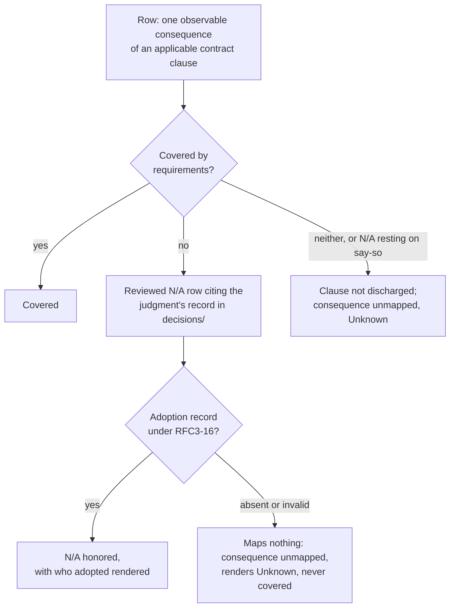

# Specification acceptance policy — candidate craft rule set

> **In force:** acts 6 and 7 confirmed this file,
> `SPECIFICATION-ACCEPTANCE-POLICY-CANDIDATE.md`, and its sibling on
> 2026-08-17, and later performed acts amend them; the acceptance record
> (`../../../decisions/ACCEPTANCE-ACT-RECORD.md`) lists every confirmed
> digest. The path, file name and title still say "candidate"; the act
> record, not the path, decides status.
>
> **Amended by GOVERNANCE-SIMPLIFICATION-D10** (drafted 2026-11-17): this file,
> `SPECIFICATION-ACCEPTANCE-POLICY-CANDIDATE.md`, is in force at the bytes that act installs, from
> the owner's act recorded in
> `.syzygy/governance/decisions/GOVERNANCE-SIMPLIFICATION-D10-ACT.md`. CC-SPEC-8's owner judgment and CC-SPEC-10's owner
> adoption become agent adoption under VIS-4 as amended. Specification changes
> are agent-decided, recorded and reported, except in VIS-4's four owner
> classes.
>
> Proposed at the 2026-08-10 launch-closure pass to close launch-gate
> question E5 (no acceptance criteria existed for a specification itself —
> "spec acceptance would be a vibe check"). Identifiers `CC-SPEC-1…11`;
> amended in place, never renumbered. The testability sub-criterion
> (CC-SPEC-4) is the one E5 limb that had no criterion even in candidate
> form before this file.
>
> **Amended 2026-08-13** — the warrant rule, the requirement forms, the
> adoption clause and the dependency declaration. The delta is
> `../round-2026-08g/SPEC-ACCEPTANCE-AND-IMPACT-SEMANTIC-DELTA.md`, which
> quotes every before/after text; the findings it answers are RD-51's,
> raw at `../round-2026-08f/reviews/RD-51-spec-acceptance-and-impact-RAW.md`.
> **This file and `SHAPE-TO-SPEC-IMPACT-POLICY-CANDIDATE.md` are one
> model** and are reviewed and offered together: CC-SPEC-2 is the single
> home of a requirement's governing identities, and CC-IMPACT-1 generates
> the specification-level declaration from it.
>
> **Amended 2026-08-17** (convergence pass, round 2026-08i, on the owner's
> convergence direction §9) — CC-SPEC-1 re-grounded on the ruled **SDR-37**
> (P-40, 2026-08-16), discharging the "may not be frozen" conditional;
> **CC-SPEC-11** minted, closing RD-51 f14's completeness gap; **CC-SPEC-8**
> completed, closing f15's two open limbs. The delta is
> `../round-2026-08i/SPEC-ACCEPTANCE-AND-IMPACT-SEMANTIC-DELTA-2.md`.
>
> **Reviewed 2026-08-17: RD-69, `VERDICT: REVISE`** (raw at
> `../round-2026-08i/reviews/RD-69-p41-p42-combined-RAW.md`) — one launch
> blocker: the f15 completion had wrongly declared CC-SPEC-8 the reviewed-
> N/A rule's one home over the nine contract modules that already state it
> with a stricter owner gate. **Blocker repaired same day** (D2-6 in the
> same delta): CC-SPEC-8 now cites the nine contract phase rules RFC1-33,
> RFC2-26, RFC3-33, RFC4-30, RFC5-27, RFC6-28, RFC7-38, RFC8-32 and
> RFC9-52 for the judgment's home, gate, unit, and effect, keeping only the
> production obligation and the "applicable" definition. RD-70 confirmed
> the repair (`VERDICT: CONFIRM WITH EXCEPTIONS`, raw at
> `../round-2026-08i/reviews/RD-70-p41-p42-confirming-RAW.md`). RD-69's
> five non-blocking findings are dispositioned open in
> `../round-2026-08i/reviews/RD-69-DISPOSITION-REGISTER.md`.

A specification is accepted against eleven clauses, CC-SPEC-1…11: what it
must show as a whole, what each requirement must carry, what it must cover,
and how its adoption is recorded. It is one model with the sibling
shape-to-spec impact policy, which generates each specification's
declaration from CC-SPEC-2.

- **The specification as a whole:** one clear capability and scope
  (CC-SPEC-1); explicit non-goals and Unknowns (CC-SPEC-5); implementation
  detail only as required behavior (CC-SPEC-7); restatable by a fresh
  technical reader (CC-SPEC-9).
- **Each requirement:** names all its material governing warrants
  (CC-SPEC-2); has a stable identity (CC-SPEC-3); is falsifiable in a named
  form (CC-SPEC-4); silently selects no unresolved shape decision
  (CC-SPEC-6).
- **Coverage:** applicable contract clauses covered or lawfully N/A
  (CC-SPEC-8); the capability's own obligations covered, demonstrably
  (CC-SPEC-11).
- **Adoption:** lawful adoption recorded at the adopting commit (CC-SPEC-10).

## The rule

The eleven clauses follow in order; italic parentheticals mostly record
dated history (CC-SPEC-11's also states its scope against CC-SPEC-8).

**CC-SPEC-1 — Capability and scope are clear.** The specification names
one coherent capability, what is in it, and what is out. A reader can say
what the capability is in one sentence without reading the requirements.

*"One coherent capability" is the granularity rule the owner ruled on
2026-08-16 as **SDR-37** (`../../../decisions/SURFACE-DECISION-RECORD.md`),
quoted exactly:*

> the specification-granularity rule — **one OpenSpec change governs one
> coherent capability, or one coherent change to one**: one owner-readable
> product argument, one acceptance decision per change.

The rule is cited from its recorded home, never restated normatively here.
*(Re-grounded 2026-08-17: P-40 was ruled in the confirming direction — the
drafted rule recorded as SDR-37 — so the 2026-08-13 conditional, "this
clause may not be frozen before P-40 is ruled", is discharged and removed;
the clause now stands on a recorded owner decision. The 2026-08-13
restatement history (RD-51 f3 — a bound clause must not silently re-point)
is preserved in that amendment's delta.)*

**CC-SPEC-2 — Every requirement names all its material governing
warrants.** The rule:

> Every requirement names all material governing warrants. One may be
> marked primary for navigation; none may be hidden merely because another
> is more specific.

The warrant classes are a **closed set of six**, and a requirement's
declaration is machine-readable, one field per class:

```text
doctrine[]              adopted doctrine rule, by rule ID
contracts[]             accepted contract clause, by clause ID
policies[]              approved craft/policy clause, by clause ID
decisions[]             recorded owner product decision, by decision identifier
topology[]              accepted topology identity, by identity
parent_requirements[]   accepted parent requirement or specification,
                        by specification and requirement ID
```

Four rules govern the declaration:

1. **All material warrants, not one.** A requirement genuinely serving
   VIS-2, a reason-vocabulary clause and an owner decision names all
   three. Marking one `primary` is a navigation aid and removes nothing.
2. **Only accepted, adopted, approved or recorded authorities.** A
   candidate contract, an unapproved policy clause, an unaccepted topology
   identity and a **pending owner decision** are not warrants. A pending
   decision cited as a warrant is the CC-SPEC-6 violation with a citation
   attached.
3. **A requirement serving nothing on this list is a finding against the
   spec, not a bonus.**
4. **This declaration is the only home.** The specification-level
   dependency declaration is *generated* as the union of its requirements'
   declarations (CC-IMPACT-1). A hand-authored second list at
   specification level is a defect, not a convenience.

**`lawfully admitted user need` is deliberately not a class.** It appeared
in this clause until 2026-08-13 and is removed: no admission act, register,
or record class for a user need is defined by any authority in this
repository. `[Observed]` — the sweep, re-run 2026-08-13 in the session that
made this amendment rather than quoted from the review that prompted it.
Python `re` `user\s+need`, case-insensitive, over `.syzygy/**`
`*.md|*.yaml|*.json` — **371 files scanned, 2 files with hits**: this
clause's own discussion of the class, and the review that found it. Second
method, repo-wide over `.md|.py|.json|.yaml|.yml|.txt` — **784 files
scanned, 3 files with hits**: those two, plus an untracked file absent from
every commit. **No admission act, register, or record class is defined by
any authority.** A class whose satisfying record an author may name at will
is an unbounded escape hatch in the clause whose purpose is to close one.
**Admitting the class requires first defining the admitting authority and
record in the shape layer** — queued as a question, not assumed here.

*(Widened and restated 2026-08-13, RD-51 f2/f4/f5/f6. The clause previously
required a requirement to trace "to exactly one" of five sources. Three
defects: (i) "exactly one" was ambiguous between "one warrant exists" and
"name one", and supplied no tie-break either way; (ii) approved craft
clauses and accepted topology identities were unwarrantable although the
sibling policy made topology both declarable and sweepable — the two
policies named different authority sets; (iii) the rationale asserted that
P-31, P-36, P-37, P-38 and P-40 "are all owner rulings", which was false —
every one is pending — and that "the first specification is full of them",
describing a specification that does not exist. Those claims are withdrawn.
The true statement: these are **queued** decisions whose rulings, once made,
would become citable under `decisions[]`.)*

**CC-SPEC-3 — Every requirement has a stable identity.** CC-REV-7's
discipline extended to requirement identifiers, including its retirement
limb:

- identifiers are minted once, amended in place, never renumbered or
  reused;
- a withdrawn requirement's identifier is **retired in place with its entry
  marked retired**, never deleted and never reissued.

*(Retirement limb added 2026-08-13, RD-51's finding that the clause
extended CC-REV-7 to a new population while dropping half of it, leaving a
withdrawn requirement with no lawful disposition.)*

**CC-SPEC-4 — Every requirement is falsifiable in a named form.** A
specification's requirements take one of **five forms**, and the
requirement states which:

```text
event-response          a trigger occurs; a response is then observable
state projection/query  a query is made; the projected state is observable
invariant               a stated property holds across a stated scope
prohibition             a stated act or state never occurs within a scope
lifecycle transition    an entity moves between named states under stated
                        conditions
```

**Every form, without exception, names five things:**

```text
reachable/producible case      the case can be produced by a party performing
                               the check, using means the requirement names
observable consequence         what is then visible, and where — human view,
  or violation                 machine endpoint, or both
effective success/failure      how one decides the observation IS (or is not)
  oracle                       the expected one, by a stated procedure that
                               terminates in bounded effort, without judgment
oracle independence            the oracle is not defined by, and does not
                               consult, the implementation under test
concrete falsifying evidence   the specific observation that would show the
                               requirement unmet
```

For an **invariant** or a **prohibition** the "reachable case" is the
**scope of quantification, a counterexample schema, and the sweep whose
denominator bounds it** — a prohibition is satisfied by an exhausted
population, never by an absence of complaints.

**Four oracle forms are rejected outright:**

```text
tautological oracle                    "the value equals the value"
unbounded semantic-equivalence oracle  "the corpus and the code mean the same"
unreachable initiating condition       a case no party performing the check
                                       can produce
oracle equal to "whatever the          the implementation is its own judge
  implementation computes"
```

A requirement whose satisfaction no evidence could ever contradict is not a
requirement.

*(Rewritten 2026-08-13, RD-51 f7. The clause previously demanded four parts
— initiating condition, observable result, positive success oracle,
falsifying evidence — of "a testable observable requirement", and was wrong
at both ends. **Under-inclusive:** a prohibition such as "no surface renders
a green status from evidence whose currency bound is undeclared" — VIS-2's
own shape, and the dominant requirement shape this doctrine generates — has
no initiating condition and no positive success oracle, so the four-part
test rejected it while the clause's own closing sentence admitted it. Either
prohibitions were observable requirements and the clause wrongly rejected
them, or they were not and **no clause stated any testability bar for the
largest requirement class in the corpus**. **Over-inclusive:** the four
parts admitted an unreachable initiating condition ("a repository whose
evidence set has been continuously current for one year") and a tautological
oracle ("the flag equals what the reconciliation engine computes") — the
canonical bar's no-tautologies rule governs *tests*, and a spec's oracle is
not a test, so nothing forbade it. The five forms and the five universal
obligations replace the four parts; the oracle's **effectiveness** and
**independence** are the two additions that close the over-inclusive end.)*

**CC-SPEC-5 — Non-goals and Unknowns are explicit.** What the capability
deliberately does not do is listed; what is not yet known renders
Unknown with its reason, never silently omitted (VIS-2 and CC-REV-5
applied to the spec itself — cited, not restated).

**CC-SPEC-6 — No unresolved shape decision is silently selected.** If a
requirement's content would settle an open owner question, the spec is
blocked on that question — authoring around it by implication is the
violation this rule exists to name.

Following VIS-4's own rule for the analogous judgment, **this
classification is contested by default and is never finally made by the
party authoring the requirement**:

- the spec records which open questions it believes it does not settle, so
  a misclassification is findable after the fact;
- a reviewer or the owner may reclassify at any time.

*(Confirmer limb added 2026-08-13, RD-51's finding that the clause's
trigger was a counterfactual with nobody assigned to evaluate it — the
spec's own author was both the only party positioned to notice and the
party least able to.)*

**CC-SPEC-7 — Implementation detail appears only when it is required
behavior.** A stack, schema, or mechanism appears in a spec only if the
behavior being specified is genuinely about it; otherwise it belongs to
implementation, later.

**CC-SPEC-8 — Applicable contract clauses are covered or lawfully N/A.**
The clause-to-requirement coverage matrix (the phase-rule clauses'
obligation) is produced with the spec.

- Every applicable clause is covered by requirements or carries a reviewed
  N/A judgment.
- The matrix's unit is the contract's, not this clause's: **rows are per
  observable consequence, not per clause** (RFC1-33, RFC6-28) — a clause
  with five observable consequences and one mapped requirement is not
  covered.

**"Applicable", defined.** A contract clause is applicable to a
specification when **the capability uses the entity, behavior, authority
boundary, state vocabulary, or interface the clause governs**.

- A reviewer applies this test clause by clause against the
  specification's CC-SPEC-1 scope statement.
- A clause governing something the capability neither renders, stores,
  transitions, queries, nor crosses is not applicable, and saying so is an
  N/A judgment, not an omission.

**The reviewed-N/A judgment's home, gate, unit, and effect rule are the
contract's, not this clause's.** They are stated by the nine confirmed
contract phase rules **RFC1-33, RFC2-26, RFC3-33, RFC4-30, RFC5-27, RFC6-28,
RFC7-38, RFC8-32, and RFC9-52**:

- a reviewed N/A judgment is a recorded judgment homed in `decisions/`
  (RFC3-15): an agent adoption under VIS-4, or the owner's where the clause
  falls in an owner class *(amended by GOVERNANCE-SIMPLIFICATION-D10; the phase rules' owner
  gate is superseded by VIS-4's lower-rules sentence)*;
- it is honored only with its adoption record under **RFC3-16** as
  amended, with who adopted rendered;
- absent or invalid records map nothing — the consequence remains unmapped and
  **renders Unknown, never covered** (VIS-2).

This clause adds only the specification-side **production obligation**:

- the specification ships with its coverage matrix;
- every N/A row in that matrix cites the judgment's record in
  `decisions/`, so the RFC3-16 gate can find its adoption record.

A matrix whose N/A rows rest on anything less — a judgment with no adoption
record, or one recorded only inside the spec — does not discharge this
clause.

*Diagram (non-normative; the rules govern):* one row of the coverage
matrix, from an applicable clause's observable consequence to what renders.



*(History: a confirmer limb was added 2026-08-13 against RD-51 f15; the
2026-08-17 completion then declared this clause the rule's one home, with a
reviewer-grade confirmer and no provenance predicate, over the nine
contract modules that already state the rule with the owner gate — and
defended that with an absence claim a 398-file sweep falsifies. RD-69
BLOCKER 1. Repaired 2026-08-17: the clause is reduced to a citation of
those modules, keeping only the production obligation and the "applicable"
definition; the contract's owner gate subsumes the 2026-08-13 confirmer
limb.)*

**CC-SPEC-9 — A fresh technical reader can restate it.** A specification is
a normative artifact, so **CC-REV-4** and **VIS-3** apply unmodified: a
reader with no authoring context restates intent and constraints correctly,
and failure is recorded on the artifact's surface. This clause adds nothing
and exists only so that E5's comprehensibility limb has a routed answer;
the obligation is CC-REV-4's.

*(Reduced to a citation 2026-08-13, RD-51 f17 — the clause previously
restated CC-REV-4 normatively, which CC-REV-3 forbids: "documentation cites
authoritative artifacts, it does not restate them normatively — a restated
rule drifts and becomes a shadow authority.")*

**CC-SPEC-10 — Lawful adoption is recorded at the adopting commit.**
*(Amended by GOVERNANCE-SIMPLIFICATION-D10; formerly "Lawful adoption is recorded at the exact
digest".)*

> A specification or specification version is adopted by an agent under
> VIS-4: it lands on the default branch with one row in
> `decisions/AGENT-ADOPTIONS.md` naming the commit, what changed, why and the
> revert command, and the version gets a git tag. The commit identifies the
> exact bytes; no phrase or digest is transcribed.
>
> A specification change that falls in one of VIS-4's four owner classes —
> secrets, writes into repositories the owner does not own, exposure beyond
> the tailnet, release — is adopted only by the owner, recorded as the
> owner's words with the commit.

Until the adoption record exists the spec is a candidate like everything
else. Independent review stays the engineering norm (CC-REV-1, CC-REV-4); it
is not an owner gate.

*(History: the 2026-08-13 text tied adoption to owner adoption at an exact
digest while VIS-4's delegated gate stayed closed, and quoted VIS-4's
always-human-gated class. D10 replaced that gate and class with the four
owner classes. The earlier text is in git history and in the 2026-08-13
semantic delta.)*

**CC-SPEC-11 — The requirement set covers the capability, and the coverage
is demonstrated.** *(Minted 2026-08-17, on the owner's convergence
direction §9.2, closing RD-51 f14 — E5's "complete" limb. Distinct from
CC-SPEC-8, which covers contract **clauses**; this clause covers the
**capability's own obligations**.)*

A specification demonstrates that its requirements cover the capability it
declares, with a **coverage table** produced with the spec.

- The table's **population is the declared capability obligations** —
  each thing the CC-SPEC-1 scope statement says the capability does,
  renders, records, or refuses — counted, and declared by the spec itself.
- Each declared obligation is placed in **exactly one** of three sets,
  which sum to the population:

```text
covered                 named requirement IDs satisfy it
lawfully out of scope   excluded by the spec's own non-goals (CC-SPEC-5),
                        with the excluding non-goal named
Unknown / unresolved    rendered with what would settle it, never
                        silently omitted (VIS-2)
```

- The completeness test is **bounded to the declared scope**: no proof is
  demanded over obligations the specification does not declare, and a
  reviewer who believes an obligation is missing from the population raises
  that against CC-SPEC-1's scope statement, not against this table.
- The table is **confirmed by a party other than the specification's
  author** (the CC-TEST-4 pattern, as CC-SPEC-8).
- A fresh engineer applies this clause by reading the scope statement,
  listing its obligations, and checking each against the table — no other
  context is required.

## What this policy is not

One fact, one home — this policy is:

- not a workflow (the th-projects feature-request workflow is referenced
  process, never authority);
- not a format (P-39 owns the medium);
- not a review procedure (CC-REV-1/2/4 own review).

## Known open findings against this file

`[Observed]` — from RD-51, raw at
`../round-2026-08f/reviews/RD-51-spec-acceptance-and-impact-RAW.md`;
dispositioned in `../round-2026-08g/reviews/DISPOSITION-REGISTER.md`.
Listed here because a candidate that hides its own open findings is the
failure VIS-2 names.

| Finding | State |
|---|---|
| f14 | **Repaired 2026-08-17; RD-69 raised no finding against CC-SPEC-11** — the confirming review of the blocker repair has the last word, not this file |
| f15 | **Repaired 2026-08-17, twice** — the first repair ("applicable" defined; CC-SPEC-8 declared the reviewed-N/A rule's one home) was itself RD-69's BLOCKER 1: the home claim was false against nine contract modules. The blocker repair reduces CC-SPEC-8 to a citation of those modules; "applicable" stays defined. Awaits the confirming review |
| f1 (sibling) | **Open** — the lagging-specification exception is not lawful until CC-REV-2 is itself amended — see `SHAPE-TO-SPEC-IMPACT-POLICY-CANDIDATE.md` CC-IMPACT-6 and the P-44 offer it names |
