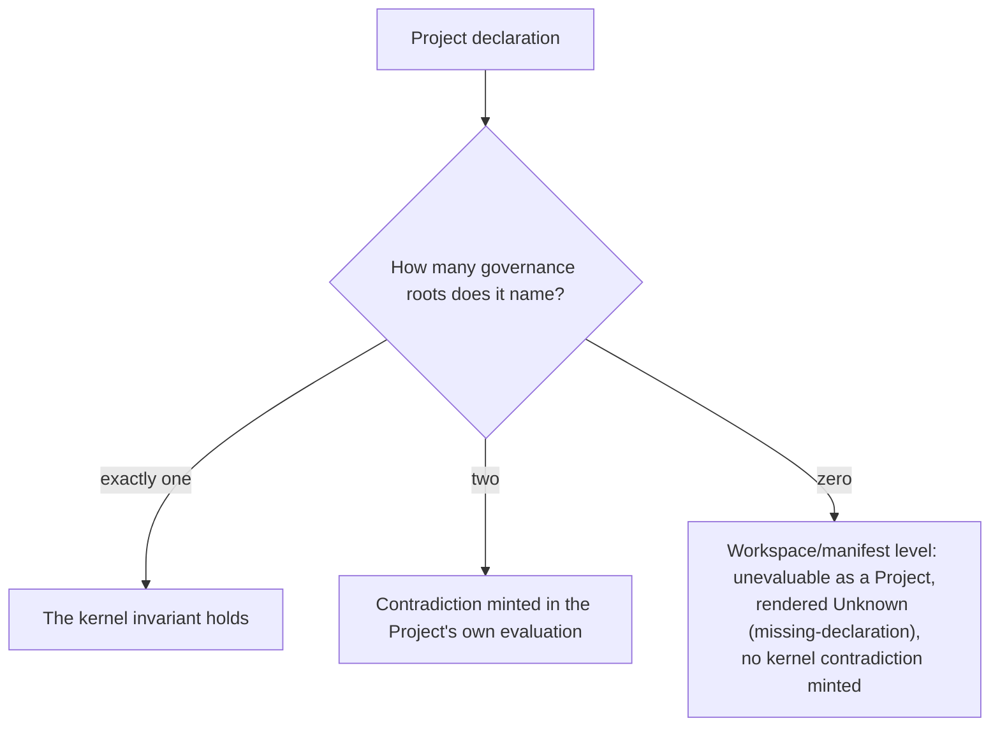
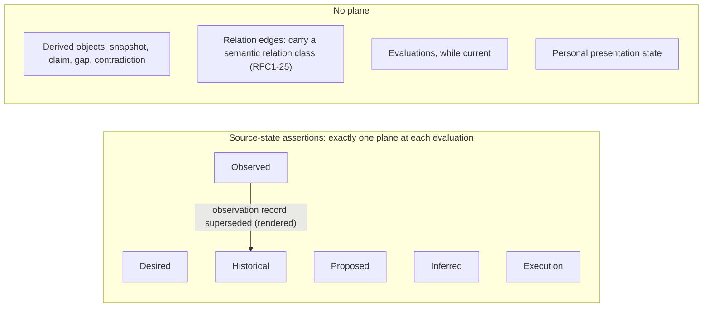
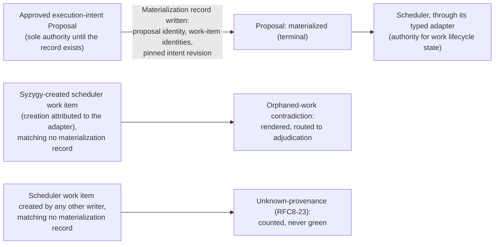

# RFC 0001 — Project Graph, Identity and State Planes

**Status:** Proposed foundational contract (self-declaration at authoring
time). Effective status is established solely by an owner-act record binding
this file's exact content digest — either owner-adopted (bootstrap,
uncorrelated) or Syzygy-verified, with the exact provenance state always
visible (RFC3-16). Absent such a record, this
contract binds nothing.

**Date:** 2026-07-30 (amended through 2026-08-02; compacted at rev10).
**Serves:** VIS-1…VIS-7; SEC-2, SEC-4, SEC-5. Implements owner rulings SDR-1,
SDR-2, SDR-3, SDR-4, SDR-7, SDR-8, SDR-12, SDR-22, SDR-30, and resolves
SDR §5 questions 1–3.
**Rationale, amendment history, and rejected alternatives:**
`../history/RFC-0001-history.md` (non-normative).

---

## 1. Scope, reader's map, and doctrine grounding (non-normative)

*Where this section and a clause disagree, the clause wins.*

This RFC is the semantic kernel every Syzygy surface projects from, and the
**dictionary** every other RFC uses: which entities and relations exist, who
mints each identity, and which state plane each source-state assertion sits
in. Three clauses carry the weight: RFC1-22 (six state planes; edges and
derived objects in none), RFC1-24 (all positive status flows through Claims),
and RFC1-25 with RFC1-26 (the closed relation vocabulary). It is **semantics
only**: no storage engine, serialization, database, or query technology is
chosen or implied.

**What the dictionary fixes:**

- the V0-core entity vocabulary and its extension profiles;
- the identity scheme for each identity-bearing class (who mints; what
  survives rename/split/merge);
- the six state planes and the rule assigning acts to them;
- the closed V0 relation vocabulary with its semantic classes and the single
  evidence-to-status path;
- proposal exclusivity groups;
- entity lifecycles.

Every doctrine-frozen noun gets exactly one kernel construct or a recorded
deliberate non-reification.

**Four load-bearing ideas:**

- **Two dimensions, never one.** Every **source-state assertion** sits in
  exactly one of **six state planes** (Desired, Proposed, Observed, Inferred,
  Execution, Historical). **Relation edges and kernel-derived objects sit in
  no plane** — each relation carries a **semantic class** naming which plane
  assertions it derives from. Asking a plane of an edge is a category error
  (RFC1-22, RFC1-25).
- **Doing work never proves intent is satisfied.** Only evidence, read at an
  identified evaluation, turns a status green, and all status flows through
  Claims — so every green is challengeable (RFC1-23, RFC1-24). **No evidence
  means Unknown** — never a guess, never a silent "fine."
- **The entity and relation lists are closed**; additions require an amendment
  carrying an owner decision (RFC1-26). Two relations were added exactly that
  way at acceptance (`declared-dependency` A6, `placed_in` A7).
- **Conflicts surface, never resolve themselves.** Two governance roots, two
  placements, orphaned work: contradictions for adjudication (an agent's
  recorded adoption, or the owner in an owner class), never silently
  repaired.

**Also fixed here:**

- A **Proposal** is the single container for every unadopted change, and
  approved work crosses a one-way door (**materialization**) — which is how
  the SDR §5 plan-item question is resolved, as a Proposal lifecycle state
  rather than a new entity or a scheduler-native epic (RFC1-28).
- There is deliberately **no "Feature" entity** — Capability is the only
  stable product-behavior identity, and what the map anchors to.

**Doctrine grounding.** Doctrine:

- keeps desired, observed implementation and execution semantically distinct
  and rules that work is never proof intent is satisfied [Observed:
  vision.md, Thesis];
- mandates one shared kernel under three non-authoritative surfaces with map
  geography anchored to capability identity, not file paths [Observed:
  architecture.md; v1.md];
- computes statuses only at identified evaluations (VIS-2, VIS-7);
- requires rebuildability with two closed exceptions (VIS-6); and
- sets a trust floor whose link rule requires every internal reference to
  resolve to an identified target [Observed: trust-and-evidence.md, floor].

[Inferred] The failure mode this contract guards against is the **silent
default** — an unruled identity question answered by whatever the first
implementation does [Observed: ../history/RFC-0001-history.md, the K-F1/K-F2
narrative].

**Reader map.**

- §3 is the contract (RFC1-1 … RFC1-32):
  - §3.1 project, repositories, governance root, consent — RFC1-1 to RFC1-4;
  - §3.2 V0-core entities and extension profiles — RFC1-5 to RFC1-8;
  - §3.3 identity minting and continuity — RFC1-9 to RFC1-13;
  - §3.4 capability, requirements, mapping to code — RFC1-14 to RFC1-17;
  - §3.5 claims, gaps, contradictions — RFC1-18 to RFC1-21;
  - §3.6 state planes and act assignment — RFC1-22, RFC1-23;
  - §3.7 the closed relation vocabulary — RFC1-24 to RFC1-26;
  - §3.8 proposals and the approved plan item — RFC1-27 to RFC1-30;
  - §3.9 entity lifecycle — RFC1-31;
  - §3.10 no Feature entity — RFC1-32;
  - §3.11 the OpenSpec authority boundary — RFC1-33.
- §4 gives recognizable violation cases.
- §5 fixes what downstream RFCs may rely on.
- §6 and §7 point to rejected alternatives and deferred work.
- §8 lists the still-open owner questions.
- Section numbers §3–§8 are unchanged from rev9 so in-clause references stay
  valid; rev9 §2 (motivation narrative) was absorbed into this section, with
  its long form in the history file.

---

## 3. The contract

Clauses are numbered `RFC1-n` for stable citation. Amend in place; retire
rather than renumber. Amendment records live in the history file and carry no
normative force.

### 3.1 Project, repositories, governance root, consent

**RFC1-1.** A **Project** is one or more repositories with exactly one
designated **governance root** — the repository holding the Project's single
`openspec/**` and `.syzygy/**` plane — and one owner [Observed:
architecture.md, Definitions]. "Exactly one governance root per Project" is a
kernel invariant: a declaration naming zero or two governance roots is never
silently repaired and never rendered as an empty project. The two cases
surface in different evaluation contexts. **Two roots** is well-formed and
evaluable — the declaration is readable, so a **contradiction** (§3.5) is
minted in the Project's own evaluation. **Zero roots** is not: with no
designated governance root there is no declared home to read the declaration
from and no snapshot anchor for it, hence no Project evaluation in which to
mint anything. That case surfaces at the **workspace/manifest level** —
unevaluable as a Project, rendered Unknown (`missing-declaration`) in the
observing workspace, with **no kernel contradiction minted**: an evaluation is
identified by a Project's (source snapshot, as-of instant) and by nothing else
(RFC2-3), and the workspace manifest is barred from being a snapshot input, so
there is no evaluation context in which a kernel contradiction could exist.
The unevaluable entry renders Unknown with its reason and is never dropped and
never guessed (RFC 0003's manifest rendering — informative, §5) [Inferred].

*Diagram (non-normative; the clauses govern):* where a declaration's
governance-root count surfaces.

**RFC1-2.** **Repository** is one entity class carrying a declared **role**:
`governance-root` or `observed-source`. Governance root is a role, not a
separate entity — a second entity would split repository identity and the
consent record's subject. Both concepts remain V0-core; only the node count
changes. *(This is an adjustment to owner-ratified SDR §4 text, surfaced as
§8 q5 and confirmed by owner decision **B22** — see history.)* Repository
identity is a declared identity in the project declaration, never a remote URL
or path — URLs and default branches change; identity must not.

**RFC1-3.** Observed-source repositories are read-only to Syzygy unless
separately onboarded. Every observed repository — governance root or not —
requires a recorded **Consent record** (SEC-4). No consent means no
observation, and therefore **Unknown** — never an empty graph read as absence.
SEC-2's scoped egress consent (named providers, content classes) is a
**separate consent-record instance per (Project, provider)** — never folded
into a repository's observation consent (RFC3-7, RFC5-12 — informative, §5);
absent provider consent, the inferred layer renders Unknown rather than being
computed.

**RFC1-4.** A repository's role and membership are answered by the project
declaration; its content by the version-control authority through its typed
adapter. Two questions, two authorities (architecture.md, typed authority); no
kernel construct may merge them into one answer.

### 3.2 V0-core entities and extension profiles

**RFC1-5.** The **V0-core entity vocabulary is closed** at the following
classes. An entity not listed here enters the graph only through an extension
profile (RFC1-7) or an amendment to this RFC.

| Group | Entity | Identity minted by | Notes |
|---|---|---|---|
| Governance / desired | Project | Owner, in the project declaration | RFC1-1 |
| | Repository (role: governance-root \| observed-source) | Project declaration | RFC1-2 |
| | Consent record | Owner (governance plane) | RFC1-3 |
| | Capability | Declaration act in the project's own governance/spec artifacts | §3.4; the map anchor |
| | Requirement reference · Scenario reference | The OpenSpec artifact contract (external authority) | Kernel holds references; content authority is `openspec/**` |
| | Decision (incl. dismissal) | Owner (governance plane) | A warrant, never evidence |
| | Policy | Governance plane | Incl. currency bounds and secret-detection policy |
| | Topology entry | Declared topology (governance plane) | Intended structure, distinct from observed code |
| | Declared region | Region declaration (governance plane) | Handcrafted/non-regeneratable carve-out; universally required Genome, may be empty |
| | Declared implementation mapping | Governance mapping artifact (SDR-4) | The primary declaration site of capability↔code edges |
| Temporal / epistemic | Source snapshot | Kernel (content-derived) | Closed identification of every deterministic input |
| | Evaluation | Kernel: (snapshot identity, as-of instant) — and nothing else | Incl. the **Reconciliation evaluation** kind (SDR-12); evaluation *kind* is descriptive and **never identity-bearing** (RFC2-3) |
| | Observation record | Kernel; identity derived from its evaluation identity + integrity digest | Immutable; a kind of Evidence; VIS-6 exception (b) |
| | Evidence artifact | The artifact's own source authority; identifier + integrity digest | Incl. the **Execution record** kind (SDR-8) — no new doctrine evidence class |
| | Claim | Kernel (derived, two-level — §3.5) | The only carrier of status |
| | Gap | Kernel (derived, two-level — §3.5) | V0 surfaces absence; V1 computes gaps |
| | Contradiction | Kernel (derived, two-level — §3.5): declared scope + canonically ordered durable identities of the cited claims | Adjudicated only (an agent's adoption row, or the owner in an owner class — VIS-4); RFC1-18(b) |
| | Challenge | The declared inference process, **or an attributed human via the governance plane** (RFC2-12); identity bound to one exact claim | V0 carries the admissibility floor only |
| Proposal / work | Proposal | Author (owner, agent, worker); the authority-scoped, collision-free scheme is a named **RFC 0003 obligation** (RFC1-9) | Kinds incl. **execution intent** (the plan item, §3.8) |
| | Materialization record | Kernel, at materialization: (proposal identity, work-item identity set, pinned warranted intent revision) | Immutable, one-way (SDR-7); the pinned revision is what RFC2-18's reconciliation evaluation and RFC4-19's warrant reference resolve (the RFC4-19 reference is informative, §5) |
| | Work item | Scheduler-issued, **mirrored never minted** | Reached only through the typed adapter |
| | Execution run | Toolchain-emitted run identity where one exists, else adapter-derived deterministically and labeled `derived` (RFC4-19 — informative, §5); + parent-run identity | Subagent runs are the same class with `part_of` |
| | Verification run | CI/test adapter; run identity + identity of the revision(s) under test (the run's claimed subject, RFC2-11) | Observed, not execution — §3.6 |
| Structure | Code element | Source adapter — adapter-defined, **not path-only** | Scheme is RFC 0004 material; the obligation (rename-stable enough for the link rule) is fixed here |
| | Observer/adapter identity | Syzygy: (adapter identity, version) | Versions are snapshot inputs |

**RFC1-6.** Two deliberate narrowings of the research catalog, recorded:

- **Doctrine artifacts and accepted contracts are not V0-core graph
  entities.** At V0 they are identified, evidence-linkable artifacts cited by
  their own stable identifiers (`VIS-n`, RFC numbers); doctrine already
  guarantees identifier stability, so no kernel-minted identity is needed
  [Inferred]. Claim-level nodes for them enter via the presentation profile if
  ever needed. *(SDR §4 omits both from V0-core; this clause makes the
  omission deliberate rather than accidental.)*
- **VCS objects (commits, refs) are not V0-core entities.** A commit SHA is a
  named evidence class [Observed: trust-and-evidence.md]; at V0 commits enter
  the graph as Evidence artifacts referenced by materialization and
  verification. First-class VCS entities, if ever warranted, enter only
  through an amendment to this RFC informed by RFC 0004's findings — RFC 0004
  itself declines to mint them; RFC1-5's closure is reopened by amendment
  here, never by delegation.

**RFC1-7.** **Extension profiles** are named, per-project-loadable entity and
relation sets, never presumed present:

- **inference** (inference records, inferred implementation mappings,
  challenge machinery beyond the admissibility floor),
- **presentation** (narrative composition; personal view state is
  deliberately **not** reified even here — it stays outside every state plane
  and is never a snapshot input, RFC1-22),
- **map** (districts, scenes, lenses, layout records),
- **portfolio** (workspace-manifest concerns per SDR-29/30; cross-project
  relationship entities live here, and an undeclared cross-project relation
  renders unconfirmed/asymmetric, never silently reconciled),
- **annotation/dismissal** (designations, milestones, dismissal application
  machinery),
- **mission** (Mission and Attention Item identities and their relations —
  mission-targets, attention-blocks; loadable only where the Mission
  contracts (RFC 0010 and successors) are accepted and active for the project
  or workspace, and never part of any project's unconditional V0 core)
  **[P-28 — the `mission` profile entry is a drafted arm, awaiting an owner
  ruling; the accepting act ratifies it or the owner reverts it (acceptance
  record §7 item 16)]**.

A profile may add vocabulary; it may never alter the semantics of a V0-core
clause. Profile contents are defined by RFCs 0002–0011 and by successor RFCs
accepted into the contract set; a profile-defining RFC names, for every
identity it adds:

- **(i)** exactly one minting authority — which, where that authority is the
  kernel, must derive the identity deterministically from declared inputs in
  RFC1-9's sense — and
- **(ii)** exactly one RFC1-22 **state plane** for every source-state
  assertion the profile adds, so no profile entity enters the graph without
  the plane assignment RFC1-22 requires and a drawer renders.

Both namings are made in the profile-defining RFC, and that is what
discharges RFC1-9's "in RFC1-5" locator for profile classes: a profile
identity is named there rather than in RFC1-5's V0-core table, and RFC1-5's
closure is not thereby widened.

**RFC1-8.** **Frozen-noun mapping.** Every doctrine-frozen noun resolves to
exactly one kernel construct:

- project, capability, gap, contradiction, evidence, snapshot, evaluation,
  observation record → the entities above.
- **Warrant** is deliberately not reified — it is a property of the
  `motivates` edge or of a Decision, never a node.
- **Aligned** is realized as the predicate of a Claim over (observed subject,
  cited normative reference, evaluation) — resolving SDR §5 question 3; there
  is no `aligned` edge, so every alignment stays challengeable (RFC1-24).
- **Converged** and **genome-complete** are aggregate Claim predicates over a
  declared scope.
- **Genome** is a membership predicate answered by the governance plane's
  declared inventory, not an entity.

### 3.3 Identity: minting, continuity, split/merge/rename

**RFC1-9.** Every identity-bearing class names, in RFC1-5, exactly one minting
authority, and the kernel **never mints an identity it does not own**:

- work-item identities are mirrored from the scheduler;
- requirement identities are held as references to the OpenSpec artifact
  contract;
- code-element identities come from the source adapter.

Kernel-owned identities (snapshot, evaluation, claim, gap, contradiction,
materialization record) are **deterministically derived** from their defining
inputs, so two runs over the same inputs mint the same identity (VIS-7).

**The "in RFC1-5" locator is discharged by RFC1-7 for extension-profile
classes**, whose minting authority and state plane are named in the
profile-defining RFC rather than in RFC1-5's closed V0-core table: a profile
identity so named satisfies this clause, and a profile identity minted by the
kernel is subject to this clause's determinism requirement exactly as a
V0-core kernel-owned identity is.

**Author-minted identities** (Proposal) are neither mirrored nor derived, so
determinism protects them from nothing — two authors could otherwise mint
colliding identifiers, and the materialization record, `succeeds` citations
of superseded proposals, and exclusivity groups all key on this identity.

- The authority-scoped, collision-free **identity scheme for Proposals is
  therefore delegated to RFC 0003 as a named obligation** — the delegation
  pattern used for code elements → RFC 0004, because RFC 0003 owns the
  `.syzygy/**` schema plane.
- This RFC fixes the obligation (authority-scoped, collision-free, opaque per
  RFC1-10); the scheme is RFC 0003 material.

**RFC1-10.** **Identifiers are opaque; names are labels.** For every declared
class (Capability, Topology entry, Declared region, Repository, Project,
Proposal): renaming the thing changes its label, never its identifier. An
identifier, once minted, is never reused and never renumbered; retirement is
terminal.

**RFC1-11.** **Split and merge mint successors, never mutations.** The
declaration act mints new identities and records `succeeds` edges from each
successor to its predecessor(s). The predecessor is retired, not deleted:
history and evidence referencing it must keep resolving (trust-floor link
rule). The kernel expresses the identity change to every surface as a
**rendered event, never a silent relocation** — a saved selection on a retired
identity resolves to the retirement record and its successors, not to nothing
and not silently to a successor.

**RFC1-12.** **Judgments do not silently survive identity change.** A
dismissal, challenge, or claim bound to a durable identity whose subject is
split or merged is **not** transferred to successors by the kernel: the
successor's claims and gaps are computed fresh, the predecessor's dismissal
renders as bound-to-retired-identity, and re-dismissal is an owner act.
[Inferred] This is the conservative reading of the temporal rule; an automatic
transfer would let a heuristic decide a governance question.

**RFC1-13.** Capability identity anchors map geography (architecture.md).
RFC 0009 (map contract) may rely on: identifier stability under rename,
successor edges under split/merge, and retirement as a rendered event. Layout
stability is downstream of this clause.

### 3.4 Capability, requirements, and the mapping to code

**RFC1-14.** **Capability** is the stable product-behavior identity: "a named
unit of declared behavior that the project's own spec or shape documents
assert exists, at the granularity a human would use to describe what the
project does" [Observed: architecture.md, Definitions]. Capability identities
come only from the project's own declared artifacts; a drafted (unadopted)
capability renders as unadopted and **may not anchor the map** [Observed:
v1.md]. Code mapping to no declared capability renders Unknown — never
silently inferred into a capability.

**RFC1-15.** **Requirement and Scenario are references, not owned content.**
The OpenSpec artifact contract is the external authority for their content and
identity; the kernel holds (artifact identity, anchor) references and degrades
to Unknown — never guesses — when a reference no longer resolves. Whether
OpenSpec identities survive edit and rename is [Unknown] and is an RFC 0004
adapter-contract obligation; this RFC fixes only the kernel's behavior when
they do not.

**RFC1-16.** Capability↔code relationships are **four distinct classes, never
conflated** (SDR-3):

- (i) declared implementation mapping,
- (ii) inferred implementation mapping,
- (iii) deterministically observed structural relationships,
- (iv) requirement/scenario verification.

A passing test does not by itself prove semantic ownership. Class (i) lives
in the **Declared implementation mapping** governance artifact — the primary
declaration site (SDR-4); optional in-code markers may supplement, never be
required. Class (ii) enters only via the inference profile, challenge
authority only.

**RFC1-17.** A code element may carry declared mappings to **multiple
capabilities** (SDR-22). Aggregation and counting over such edges is
**identity-based**: one code element counted once per query subject, never
once per edge, and never forced into a single arbitrary capability district.

### 3.5 Claims, gaps, contradictions — two-level identity

**RFC1-18.** **Claim and Gap identity has two levels** (SDR-2):

- **Durable identity** — deterministically derived from (subject identity,
  cited normative reference identity, declared scope); the same identity
  across evaluations. Challenges and dismissals bind it: a dismissal recorded
  at one evaluation still binds the same gap at a later one.
- **Evaluation instance** — durable identity + evaluation identity, carrying
  status, epistemic label, rendering tier and Unknown reason where applicable
  (RFC2-24/25), supporting evidence set, freshness state, and challenge state.
  Determinism (VIS-7) binds the instance: one evaluation, one instance,
  identical across runs.

The durable derivation inherits every identity instability beneath it
(capability, requirement, code element); that inheritance is accepted and is
why RFC 0004's identity schemes are load-bearing.

**RFC1-18(a). Declared scope is a typed reference, never a string.**
*(Consumed by RFC1-18's durable derivation, and by RFC2-15, RFC2-16,
RFC2-21.)* A **declared scope** is a canonically ordered set — ascending by
durable identifier, duplicates removed — drawn from the declared
identity-bearing entities of RFC1-5: Project, Capability, Topology entry,
Declared region. Declaring authority is one of exactly two:

- the **governance plane**, for standing scopes — a policy or decision
  artifact that names the member set; and
- the **recorded evaluation request**, for ad-hoc scopes.

Ad-hoc scopes are durable nonetheless, because the canonical form is
**content-derived**: the same member set is the same scope everywhere, whoever
requested it, so a dismissal or challenge recorded under one scope rebinds
under the identical scope later (SDR-2's whole point). A free-form scope
string is **not** a scope: it names no identified targets, so the trust-floor
link rule has nothing to resolve and two conforming implementations would
derive different durable identities for the same aggregate claim [Inferred].

**RFC1-18(b). Contradiction identity, two levels.** *(A deliberate extension
of SDR-2, which rules two-level identity for claims and gaps only; surfaced as
§8 q4 and confirmed by owner decision **B3** — see history.)*

- **Durable identity** — deterministically derived from (declared scope per
  RFC1-18(a), the canonically ordered set of the **durable** identities —
  never evaluation instances — of the cited claims).
- **Evaluation instance** — durable identity + evaluation identity, carrying
  the rendering obligations of RFC1-21 at that evaluation.

**Membership drift** is an identity change, not a mutation: a changed cited
claim set mints a **new durable identity**, which must cite its predecessor
via `succeeds` — here in its **derived** form (RFC1-25), computed at the
evaluation that mints the successor and recorded inside that evaluation's
observation record, not the declared split/merge form of RFC1-11. An
`adjudicates` Decision binds **exactly the durable identity it names** and no
other, so a successor contradiction renders **un-adjudicated with the
predecessor's adjudication cited** — the inheritance question is made visible
to the owner as a question, never carried over silently and never dropped
silently. This is RFC1-12's no-heuristic rule applied to adjudications.

**RFC1-19.** A **status claim** (anything that turns an indicator green,
declares aligned/converged/genome-complete, or asserts a gap factually
resolved or absent) requires current evidence; no evidence means Unknown,
never success (VIS-2). A narrative sentence doing a badge's work is judged as
a badge [Observed: trust-and-evidence.md].

**RFC1-20.** A gap leaves a surface in exactly two non-interchangeable ways:

- **factual resolution/absence** (a status claim, evidence required) or
- **policy dismissal** (a Decision with reason and expiry, rendered
  *dismissed by decision*, never green).

A dismissal without a reason current at the evaluation's as-of instant
renders the gap again — expiry acts only through a new identified evaluation
(VIS-6, exception (a)).

**RFC1-21.** A **Contradiction** (co-unsatisfiable authoritative claims in one
declared scope) renders the affected conclusion Unknown, routes to
adjudication — by an agent's recorded adoption, reported and open to the
owner's veto, or by the owner when it falls in an owner class (VIS-4) — is
never resolved by precedence, and is **never auto-scheduled into work**. A **derived gap is not a work warrant**: it motivates work only
through a confirmation act — a Decision or a declared deterministic Policy —
because doctrine's warrant list admits a *confirmed* finding and
kernel-derived objects are not authorities [Observed: trust-and-evidence.md,
work warrant].

### 3.6 State planes and the act-assignment rule

**RFC1-22.** Every **source-state assertion** in the graph — an entity or
record that asserts project state on its own authority (a declaration, an
observation, a proposal, a challenge, a work item, a superseded record) — is
assigned to exactly one of six **state planes**, always read at an identified
evaluation. Plane membership is a property of source-state assertions
**only**: derived objects and relation edges occupy no plane (see the closure
below, and RFC1-25's semantic relation classes).

| Plane | Contents | Epistemic rule |
|---|---|---|
| **Desired** | Adopted governance and spec state: capabilities, requirement/scenario references, decisions, policies, topology entries, declared regions, declared implementation mappings, consent records, project/repository declarations | Only the owner adopts shape-level deltas (VIS-4) |
| **Proposed** | Unadopted deltas: Proposals, each with an exclusivity group | Never desired, never observed; may not anchor the map |
| **Observed** | What exists: code elements, evidence artifacts, observation records, verification runs | Deterministic, evidence-linked, immutable once recorded |
| **Inferred** | A layer, not a substrate: challenges (V0) and inference-profile artifacts | Challenge authority only; never establishes or raises a status; conservative suspension to Unknown |
| **Execution** | Work items, execution runs, materialization records, approved-unmaterialized execution intent (§3.8); Syzygy's own propagation acts, captured as Execution records (SDR-8) — no separate propagation entity is minted at V0 | **May never satisfy a desired-state claim** — work is never proof |
| **Historical** | The ordered series of superseded evaluations and their immutable observation records | Staleness visible on the primary surface; claims only degrade between evaluations over one snapshot |

Plane assignment is evaluated **per (assertion, evaluation)**, not once and
for all: "exactly one plane" holds *at each evaluation*. **Supersession**
moves an observation record from **Observed** to **Historical** as a rendered
consequence of the superseding evaluation — the record itself is immutable and
is never edited; only its plane assignment at later evaluations changes, and
that move is rendered, never silent.

**The closure, stated so no implementation can disagree.** Derived objects
(snapshot, claim, gap, contradiction) occupy no plane: they identify or
compare planes. **Relation edges likewise occupy no plane** — an edge's
relationship to the planes is carried entirely by its **semantic relation
class** (RFC1-25), which names how an edge of that relation comes to exist and
which state-plane assertions it derives from. "Which plane is this `cites` /
`dismisses` / `adjudicates` edge on?" is a **category error**: a conforming
implementation must have no answer to it — neither a seventh plane value nor a
null that fails — because the question is only ever lawfully asked of
source-state assertions. Evaluations likewise occupy no plane while current;
their superseded series is precisely what the Historical plane contains.
Personal presentation state sits outside every plane (VIS-6, exception (a))
and may never affect truth, work, or status.

*Diagram (non-normative; the clauses govern):* what occupies a state plane
and what occupies none.

**RFC1-23.** **Act-assignment rule.** An act is **observed** when its durable
output is evidence about the *implementation* (a verification run); it is
**execution** when its durable output is evidence about the *work* (an
execution run, a propagation act). The rule is load-bearing, not taxonomic:
execution state never satisfies a desired-state claim, so misclassifying an
act moves its output into the plane that feeds status. Corollaries:

- a verification run sits in the observed plane even when an agent triggered
  it;
- "a worker reported tests passed" is Observed only as a report fact —
  "tests passed" is Observed only when backed by a retained, resolvable gate
  artifact (SDR-9).

### 3.7 Relation vocabulary — closed V0 set

**RFC1-24.** **All positive status flows through Claims.** No edge is itself a
status; evidence reaches status only via `supports` into a Claim, and
challenges attach only to Claims — so a status carried on any other edge would
be unchallengeable, defeating inference's only power. There is no
evidence-to-status backdoor.

**RFC1-25.** The V0 relation vocabulary is **closed** at the following set.
Each relation is typed (domain → range) and carries a **semantic relation
class** — never a plane of its own (RFC1-22's closure). The semantic class
names two things at once: **how an edge of that relation comes to exist**
(declared by a governance act, recorded by an observation, computed by the
kernel, minted by a Decision) and **which state-plane assertions it derives
from**. The class vocabulary is closed at the values the table uses, read as
follows:

- **Desired / Desired (declared)** — derives from a Desired-plane declaration
  or adoption act;
- **Proposed** — derives from a Proposal;
- **Observed** — recorded inside an identified observation record, deriving
  from Observed-plane assertions; an edge instance of this class is a fact
  only when so recorded;
- **Inferred** — minted by the inference layer; challenge authority only;
- **Execution** — derives from Execution-plane records
  (scheduler-authoritative);
- **Derived** — computed by the kernel from other graph objects at an
  evaluation; a fact only when recorded inside an identified observation
  record;
- **Governance act** — minted by a recorded owner Decision;
- **Declared … or inferred** (composite) — two queryably distinct derivation
  sources, disclosed per edge;
- **Desired → execution** (the plane-crossing warrant form, `motivates` only)
  — a Desired-plane warrant licensing Execution-plane work; the class names
  the crossing because neither endpoint's plane describes the edge;
- **Varies by endpoint / Matches endpoint / Follows the containing
  authority** — resolution rules, not classes: each resolves to one of the
  above per (relation, endpoint pair) as RFC1-25(d) fixes.

| Relation | Domain → Range | Semantic class | Rule |
|---|---|---|---|
| `contains` / `part_of` | Project→Repository (declared); Repository→Code element (observed); Requirement ref→Scenario ref; Capability→Capability; Topology→Topology; Execution run→Execution run | Follows the containing authority | Only within one authority's own hierarchy; cross-authority nesting must use a typed relation |
| `declares` | Governance/spec artifact → Capability · Topology entry · Declared region · Declared implementation mapping · Repository role | Desired | The identity-minting edge; a drafted declaration may not anchor the map |
| `refines` | Requirement ref→Capability; Capability→Capability | Desired | Both endpoints adopted |
| `governs` | Policy → Claim classes, evaluations, observation behavior | Desired | A draft governs nothing |
| `motivates` | Requirement ref · Decision · Policy → Work item · Proposal; **Gap → only through a confirmation act** | Desired → execution (the work-warrant edge) | Carries doctrine's four warrant classes, verbatim and closed: {approved requirement/intent, **confirmed** finding, declared policy, explicit owner decision} [Observed: trust-and-evidence.md, "a work warrant"]. Every finding-class warrant requires a **recorded confirmation act** — a derived or inferred finding warrants nothing until confirmed (RFC1-21). SDR-1 is cited here only for the absence of a Feature warrant class (RFC1-32) |
| `implements` | Code element → Capability · Requirement ref | Declared (via mapping artifact) **or** inferred (profile; challenge-only) | The two sources are queryably distinct (SDR-3 i/ii); multi-capability edges permitted with identity-based counting (SDR-22) |
| `structurally_related` (`calls`, `exposes`, `accesses(mode)`) | Code element → Code element | Observed | SDR-3 class (iii); adapter and version identified in the snapshot |
| `realizes` | Code element → Topology entry | Declared or inferred, labelled | Intended-vs-observed structure delta is a gap/contradiction source |
| `covers` | Declared region → Code element | Desired (declared) | Authoritative for *which* region is Genome; never evidence the covered code exists — absent code renders Unknown |
| `verifies` | Code element (test) · Verification run → Requirement ref · Scenario ref · Capability | Observed | SDR-3 class (iv). An input a Claim cites, **never a status itself**; requires an identified deterministic input, read per endpoint — the source snapshot for a Code element (test) edge, the identity of the revision(s) under test for a Verification run edge (RFC1-5; RFC2-11's evidence–revision binding). An external run naming a revision Syzygy did not snapshot still qualifies; it renders stale for any snapshot whose revision differs |
| `depends_on` | Work item→Work item (execution, scheduler-authoritative); Code element→Code element (observed) | Varies by endpoint | Each endpoint cites its own authority. **Four senses must not be conflated, not two** — see the anti-conflation invariant at RFC1-25(b) and the typed relation identity that carries the separation at RFC1-25(d). This relation carries exactly the two endpoint pairs above and admits no third; the portfolio profile's Project→Project `depends-on` (RFC1-7; RFC3-14) and the declared architectural `declared-dependency` below are separate relations, not further endpoint pairs of this one. Adding one would be the re-typing RFC1-26 forbids |
| `declared-dependency` | Capability→Capability; Topology entry→Topology entry | **Desired (declared)** | *Minted by A6.* The declared architectural dependency: a statement that one capability or topology entry is **intended** to depend on another. Owner-adopted via a governance artifact (`declares`); never derived, never inferred, never promoted from an observed or execution edge. It is the declared side of an intended-vs-observed dependency delta, and a divergence between it and the observed `depends_on` (Code element endpoint) is a gap or contradiction source, exactly as `realizes` is for structure. Absence of a declared edge is never evidence that no dependency exists — an undeclared dependency renders Unknown, reason #1 |
| `placed_in` | Topology entry → Capability | **Desired (declared)** | *Minted by A7.* The cross-hierarchy placement edge. `contains`/`part_of` is confined to a single authority's own hierarchy and its rule requires a typed relation for cross-authority nesting; this is that relation. Minted by a governance artifact (`declares`), never by a renderer or a layout algorithm — an undeclared placement decided by an algorithm is a governance answer given by a renderer (RFC9-20). It is the declared basis for the component-block level (RFC9-4) and for district membership including shared infrastructure (RFC9-19(b)); an entry with no `placed_in` edge renders in the unmapped district (RFC9-44), never in a guessed one |
| `proposes_change_to` | Proposal → any desired or observed entity | Proposed | Carries the exclusivity group (RFC1-27); never upgrades without adoption |
| `materializes` | Materialization record: Proposal (execution intent) → Work item set | Execution | Immutable, one-way (SDR-7); commits enter as evidence, not edges, at V0 |
| `addresses` | Work item → Gap | Execution | *Addresses*, never *closes* — gap exit is RFC1-20 only |
| `supports` | Evidence artifact (incl. observation record) → Claim | Observed | The **only** path from evidence to positive status |
| `challenges` | Challenge → Claim | Inferred | Admissibility floor: one exact claim, falsifiable concern, provenance, individually resolvable; an open **admitted** challenge suspends to Unknown with the deterministic basis visible (lifecycle: RFC2-13 — submitted or rejected challenges suspend nothing) |
| `dismisses` | Decision → Gap (durable identity) | Governance act | Reason + expiry mandatory; rendered *dismissed by decision*, never green |
| `adjudicates` | Decision → Contradiction | Governance act | The only lawful contradiction exit |
| `cites` | Claim → Requirement ref · Scenario ref · Capability · Policy · Declared region · Topology entry | Derived | Every status claim names its normative basis |
| `scoped_to` | Claim/Gap/Contradiction instance → Evaluation | Derived | A status without an evaluation is not a status |
| `produced_by` | Evidence → Verification run · Execution run; Observation record → Evaluation | Observed | The provenance backbone |
| `identified_in` | Adapter identity · Policy · Repository state · consumed reports → Source snapshot | Derived | Snapshot closure: an uncaptured source must not influence deterministic claims |
| `supersedes` | Same-class pairs only, enumerated from RFC1-31: (Decision → Decision), (Consent record → Consent record), (Policy → Policy) — the governance-act group, whose lifecycle names `superseded`; (Observation record → Observation record) — observed classes, whose records become historical when superseded; (Proposal → Proposal) — the proposal group's `superseded` state, reachable only before materialization (RFC1-29). The remaining two RFC1-31 groups contribute **no pair**: declared classes are amended in place under the same identifier and mint no successive version, and work-item versioning is scheduler-owned execution state mirrored under RFC1-9, never a kernel-minted edge. No cross-class pair exists | Matches endpoint | Version-level only; never supersedes an identifier. Pair set closed by RFC1-31: a class either versions there or does not, and this row states the answer for each of its six groups; each (C → C) pair resolves per RFC1-25(d) to the superseding endpoint's own assertion class |
| `succeeds` | Same-class pairs only: for each identity-bearing class whose RFC1-11 split/merge or RFC1-18(b) membership drift mints a successor, exactly the pair (that class → predecessor of the same class) — the declared classes of RFC1-31 (Capability → Capability, Topology entry → Topology entry, Declared region → Declared region, Declared implementation mapping → Declared implementation mapping) and (Contradiction → Contradiction); no cross-class pair exists | Matches endpoint | The split/merge continuity edge (RFC1-11); the same relation carries contradiction membership drift, where no declaration act exists to carry it. Each (C → C) pair resolves per RFC1-25(d): the four declared-class pairs resolve to **Desired (declared)**, minted by the declaration act; the (Contradiction → Contradiction) pair resolves to **Derived**, computed at the evaluation that mints the successor and a fact only when recorded inside that evaluation's observation record (RFC1-18(b)) |

**RFC1-25(a) — Two relations minted by owner decision.** `declared-dependency`
(A6) and `placed_in` (A7) are additions to this closed vocabulary made by
explicit owner decision at acceptance, not by a drafter. Both are
Desired/declared and both are minted only through `declares`. RFC1-26's
closure is amended to include them and otherwise stands unchanged: this is an
amendment to a closed list, which the closure permits, and **not** a re-typing
of an existing relation, which it forbids.

**RFC1-25(b) — The dependency anti-conflation invariant.** Four relations in
this project carry a dependency sense, and **two of them differ by one
character**: the core `depends_on` (underscore) and the portfolio profile's
`depends-on` (hyphen, RFC3-14). The owner chose the hyphenated spelling
deliberately at acceptance, having been shown the collision (B20). **The names
therefore do not separate these senses, and the separation is carried entirely
by this invariant, which is normative and mechanically checkable:**

| Sense | Relation | Semantic class | Authority |
|---|---|---|---|
| Work dependency | `depends_on` (Work item→Work item) | Execution | Scheduler |
| Code dependency | `depends_on` (Code element→Code element) | Observed | Adapter + snapshot |
| Architectural dependency | `declared-dependency` | Desired (declared) | Governance artifact |
| Project dependency | `depends-on` (Project→Project, profile) | Desired (declared) | Owner-adopted manifest |

**No edge of any one sense is ever evidence of any other**, in either
direction, at any strength. The checkable form, which every conforming
implementation must be able to demonstrate and which is a named test-coverage
obligation of the first implementation slice: **for each ordered pair of the
four senses, an edge of the first must not cause an edge of the second to be
emitted, counted, rendered, or served** — twelve ordered pairs, each
separately testable. A surface that unions any two of these into one
"dependencies" count violates this clause even if the union is labelled;
disclosure does not cure conflation here, because the four have different
semantic classes — different plane derivations — and therefore different truth
conditions. [Inferred — the invariant follows from the four semantic classes;
it was made a checkable twelve-pair rule after the owner's spelling decision
(B20).]

**RFC1-25(c) — Cardinality of `placed_in`.** `placed_in` is **not
functional**: the kernel accepts more than one adopted `placed_in` edge from a
single topology entry, because the kernel records what is declared and a
governance artifact is fully capable of declaring two homes. The relation
carries **no primacy marker** — there is no "primary" `placed_in`, and no
ordering, timestamp, or lexical property of an edge confers one.

Two or more adopted `placed_in` edges from one entry are therefore a
**declared placement contradiction** (RFC1-21/RFC2-15), not a precedence
problem. The kernel holds all of them, marks the contradiction, and surfaces
the adjudication route; no consumer may select among them. Adjudication is a
governance act — retracting or amending a declaration — and never a read-time
choice. **A surface that picks a home among competing `placed_in` edges by any
rule whatsoever has given a governance answer** (RFC9-20), and a surface that
picks *differently* from another conforming surface breaks RFC6-22/23
equivalence on the entity's location, on every district composition count it
enters, and on whether an adjudication is outstanding.

Zero `placed_in` edges is likewise not an error and not a contradiction: the
entry is simply unplaced, and renders Unknown with `missing-declaration`
(RFC 0009's unmapped district, RFC9-44). [Inferred — the existing
Desired-plane contradiction rule applied to a newer relation; only the
non-functionality and no-primacy statements are new.]

**RFC1-25(d) — Typed relation identity: the spelling is never the identity.**

**What a typed relation is.** A **typed relation** is one (relation name,
ordered endpoint-domain pair) combination from the RFC1-25 table: each row
contributes one typed relation **per endpoint pair it lists**. `depends_on`
therefore names **two** typed relations (Work item→Work item; Code
element→Code element), `contains`/`part_of` names six, and a single-pair row
names exactly one. The table — read this way — **is** the enumeration of V0
typed relations; no separate list exists to drift from it. This reading adds
no relation and re-types none, so RFC1-26's closure stands exactly as written:
the typed-relation set is closed *because* the rows and their endpoint pairs
are closed, and widening either still requires an owner decision.

**Identity and metadata.** Each typed relation's identity is a **stable typed
relation identifier**, never its display spelling. The identifier is a
governed value distinct from the label, and every typed relation carries as
explicit metadata its **ordered endpoint domains** (domain → range entity
kinds) and its **semantic relation class** (RFC1-25's closed class
vocabulary). The class is the RFC1-25 table's value **resolved per endpoint
pair** — per-pair resolution is what discharges the table's "Varies by
endpoint," "Matches endpoint," and "Follows the containing authority" entries
into a single class per typed relation. A semantic class is **not** a state
plane and no edge occupies one (RFC1-22's closure): recording any class value
— `Derived`, `Governance act`, `Observed` — as a plane assignment would break
that closure; machine answers carry it as a class, never as a plane. Binding
consequences:

- **Storage, APIs, query answers, fixtures, and tests reference the typed
  identifier**, never a parsed label: no conforming implementation may
  determine which sense an edge carries by inspecting the spelling
  `depends_on` vs `depends-on`, by guessing from endpoint kinds at read time,
  or by any other label-derived rule.
- **Display labels are derived from identity**, one-way: the owner's chosen
  spellings (`depends_on` for the work and code senses, `depends-on` for the
  portfolio sense, `declared-dependency` for the architectural sense — B20)
  remain exactly as chosen, as *renderings* of the typed identity. Two typed
  relations may lawfully share a spelling because the spelling carries no
  identity; nothing may lawfully share an identifier.
- **Anti-conflation fixtures are required for every ordered pairing** of the
  four dependency-sense typed relations of RFC1-25(b) — the twelve ordered
  pairs, each exercised by a fixture in which an edge of the first typed
  relation exists and the test asserts no edge, count, rendering, or answer of
  the second appears. This is part of the same named
  first-implementation-slice test obligation RFC1-25(b) carries.
- The identifier scheme's concrete syntax is an implementation-slice choice;
  this clause binds only that identifiers exist, are stable, are distinct per
  typed relation, and carry the two metadata dimensions above.

[Inferred — the mechanism; Observed — the four senses, their state classes,
and the owner's spelling decision from RFC1-25(b)/B20; the per-pair reading of
the table and the plane/class distinction from RFC1-22's closure.]

**RFC1-26.** Every rendered internal edge must resolve to its identified
target (trust floor); an edge the kernel cannot resolve is not emitted.
Relations not in this table do not exist at V0; profiles may add relations
under their governing RFCs but may not re-type these. **A relation may be
added to this table only by amendment carrying an owner decision**
(RFC1-25(a) records the two such amendments to date); no drafter, reviewer,
adapter, or profile may widen the core vocabulary by prose.

### 3.8 Proposals, exclusivity groups, and the approved plan item

**RFC1-27.** A **Proposal** is the single entity for every unadopted delta.
Kinds:

- (a) governance delta (doctrine/contract/topology),
- (b) spec delta,
- (c) code change set,
- (d) generated code-shaped artifact,
- (e) **execution intent** — a proposed, decomposable set of work to be
  performed.

Every proposal declares an **exclusivity group**; the kernel refuses to
render a projection that unions two proposals in one group, and refuses to
silently union proposals whose compatibility is undeclared — the honest
render is *N candidate
futures*, selectable one at a time (VIS-1). Competing proposals over one
subject never collapse into a fictitious consensus.

**RFC1-28.** **The approved-but-unmaterialized plan item is a lifecycle state
of the Proposal entity** — resolving SDR §5 question 1. A Proposal of kind
*execution intent*, once approved through its adoption gate, enters state
`approved` and resides under `.syzygy/work/**`, which owns approved execution
intent before materialization (SDR-7). Same entity, same identity; approval
adds the approving Decision and mints nothing new. It sits in the **execution
plane** (intent about work, not a behavioral claim about the system) and is
therefore barred by RFC1-22 from ever satisfying a desired-state claim.

**RFC1-29.** **Materialization is a one-way door.** Materializing an approved
execution-intent Proposal creates an immutable **Materialization record**
mapping the proposal identity to the scheduler-issued work-item identities
**and pinning the exact intent revision — requirement, scenario, or governance
clause version — cited by the proposal's warrant** (SDR-7); the pinned
revision is the one RFC2-18's reconciliation evaluation binds its verdict to.
From that instant the scheduler is authoritative for work lifecycle state, the
proposal transitions to terminal state `materialized`, and the kernel never
edits it again — divergence between record and later scheduler state is a fact
about the scheduler, never grounds to rewrite history. At every instant
exactly one authority answers "what is the state of this planned work": before
materialization the approved Proposal, after it the scheduler through its
typed adapter — the second-source prohibition is honored by *sequencing*
authority, not duplicating it.

**The written materialization record is constitutive.** Because the scheduler
issues work-item identities before the record can name them, the transition
instant is fixed at the record, not at the issuance: **until the record
exists, materialization has not occurred**, and the approved Proposal remains
the sole authority for the state of the planned work, whatever the scheduler
already holds.

**Which unrecorded work is orphaned.** A scheduler work item matching no
materialization record is an **orphaned-work contradiction** (§3.5) **when,
and only when, it is Syzygy-created**: the scheduler's own history
attributes the item's creation to the identity under which Syzygy's adapter
writes (RFC4-17). Such an item is two stores answering one question, with no
pinned intent revision for RFC2-18 to bind to and no warrant traceable
through `materializes`. It is routed to adjudication (RFC1-21) and
**rendered**, never silently adopted into a record, never silently deleted,
and never read as evidence that materialization happened. A work item the
scheduler's history attributes to any other writer — pre-Syzygy backlog, an
import, work filed directly in the scheduler — is **Unknown-provenance**
(RFC8-23), not orphaned work, however old or numerous it is, and whatever
its fields hold: a warrant reference on such an item is a substrate
annotation (RFC4-17), never a claim of materialization. Where the history
names no creator for an item, whether it is orphaned is itself Unknown: it
renders Unknown-provenance with that undecided check disclosed and counted
apart, never green.

**How an orphan leaves.** Adjudication ends the contradiction in one of two
ways: a new materialization record that cites and supersedes the orphan
finding, or a recorded adjudication that disposes of the item otherwise.
In the second case the item renders as that adjudication says and cites it,
and is not minted as a new contradiction at the next evaluation. An agent
assigned to an affected item, or one that worked it, never adjudicates it
[Inferred: it keeps the agent that did the work from ruling on what the
work was for].
Re-materialization after a partial failure must **cite and supersede the
orphan finding** in the new materialization record, so a retry is traceable
rather than a second silent attempt (violation case 10 unchanged) [Inferred].

*Diagram (non-normative; the clauses govern):* which authority answers "what
is the state of this planned work", and where unrecorded work goes.

**RFC1-30.** An approved execution-intent Proposal may be decomposed into
child execution-intent Proposals (`part_of`), each individually materializable
under the parent's warrant. Decomposition is authorship, not adoption:
children inherit the parent's approval only if the approving Decision says so;
otherwise they gate separately.

### 3.9 Entity lifecycle

**RFC1-31.** Canonical lifecycles, per class group:

- **Declared classes** (Capability, Topology entry, Declared region, Declared
  implementation mapping): drafted (unadopted; may not anchor status or the
  map) → adopted → amended in place (same identifier) → split/merged via
  successors (RFC1-11) → retired (terminal).
- **Governance acts** (Decision, Consent record, Policy): recorded/granted →
  in force → expired/narrowed/revoked/superseded — always evaluated at the
  as-of instant, never by ambient wall clock.
- **Observed classes** (Code element, Evidence, Observation record): appear in
  a snapshot → observed across evaluations → absent in a later snapshot
  (absence is a fact, not a deletion); observation records are immutable and
  become historical when superseded, staleness rendered.
- **Proposals**: drafted → under review → approved (kind (e): then `approved`
  → `materialized`, RFC1-28/29) / adopted (kinds (a),(b)) / rejected /
  abandoned / superseded.
  - Kinds (c) *code change set* and (d) *generated code-shaped artifact*
    terminate by being **cited as inputs of a kind-(e) execution-intent
    proposal** — terminal state `incorporated`, recording the citing
    proposal — or else rejected / abandoned / superseded. Their contents
    reach code no other way: only materialized execution intent is worked, so
    an implementation may not auto-wrap or adopt-as-artifact its way around
    the gate (VIS-5).
  - Rejection, abandonment, and supersession are reachable **only before
    materialization** — `materialized` is terminal (RFC1-29), and superseding
    a materialized proposal would recreate the second editable store;
    post-materialization regret is expressed as a *new* proposal citing the
    old one.
- **Work items**: lifecycle owned by the scheduler, mirrored with labeled
  staleness when the adapter degrades — never invisibly.
- **Derived classes** (Claim, Gap, Contradiction): computed at an evaluation;
  instance statuses degrade or are recomputed per the temporal rule; durable
  identities persist across evaluations (RFC1-18 for Claim and Gap, RFC1-18(b)
  for Contradiction) and end only when their subject or normative basis is
  retired (RFC1-12) — or, for a Contradiction, when its cited claim set drifts
  and mints a successor (RFC1-18(b)).

### 3.10 No Feature entity

**RFC1-32.** There is **no Feature kernel entity and no Feature identity**
(SDR-1). Capability is the sole stable product-behavior identity. "Feature"
and "feature request" live as **workflow vocabulary**: the warrant class
*approved intent* on the `motivates` edge, and intake-flow naming in the work
surface's own contract (RFC 0008). UI prose may say "feature" only where it
resolves to a Capability identity; no surface, adapter, or profile may mint a
feature identifier.

### 3.11 Authority boundary at the OpenSpec seam (binding phase rule)

**RFC1-33.** This contract schedules nothing: **it is not a specification of
record from which implementation work may be scheduled**. No implementation
work for user-observable consequences of this contract — project
registration and declaration validation flows, entity and relation rendering,
lifecycle and succession displays, proposal and materialization surfaces, API
answers over graph identities — may be scheduled solely from this RFC. Before
implementation, every observable consequence either:

- maps to an approved OpenSpec requirement and scenario in the governance
  root's `openspec/**` plane, or
- carries a reviewed N/A judgment proving it purely structural with no
  independently testable behavior.

**The reviewed N/A judgment's home and gate.** A reviewed N/A judgment is a
recorded owner judgment homed in `decisions/` (RFC3-15), and the judgment is
honored only through an effective owner act under RFC3-16(a), in state (1) or
state (2), with that state rendered; absent or invalid acts map nothing and
leave the consequence unmapped and Unknown, never covered (RFC3-16(a)'s
effect rule; VIS-2).

**Rows are per observable consequence, not per clause.** A clause with five
observable consequences and one mapped requirement is not covered; the matrix
discloses the consequences it enumerates for each clause, so a
complete-looking matrix over under-enumerated consequences is a defect of the
matrix. At surface specification a clause-to-requirement coverage matrix
over RFC1-1..RFC1-33 is produced — **that matrix is review material, never
authority**. This clause creates no OpenSpec content now (none may exist
during bootstrap). (Shape-parallel with RFC6-28, RFC7-38, RFC8-32, RFC9-52,
RFC10-16, RFC11-12.)

---

## 4. Violation cases

Recognizable, not rhetorical:

1. *(RFC1-1/3)* A declaration lists two governance roots and the kernel picks
   the first. The declaration must yield a Contradiction routed under
   RFC1-21 and RFC2-24 reason 8, with no root picked. Rendering graph
   content for a repository with no consent record also violates this rule.
2. *(RFC1-5/6)* An implementation adds a `Commit` node type "because the
   adapter had the data" — V0-core is closed; commits are evidence at V0.
3. *(RFC1-10/11)* A capability rename mints a new identifier and the map
   relocates; or a split silently reassigns the old identifier to the larger
   fragment.
4. *(RFC1-12)* After a split, an in-force gap dismissal on the predecessor is
   auto-copied to both successors.
5. *(RFC1-14/16)* Unmapped code colored by its nearest capability's status; or
   a passing test treated as proof of semantic ownership.
6. *(RFC1-18/20)* Re-evaluation orphans an open challenge because claims are
   identified per-evaluation only; or a dismissed gap renders green.
7. *(RFC1-22/23)* A completed work item flips a requirement's alignment
   indicator; or a worker's self-reported "tests passed" enters the observed
   plane without a retained gate artifact.
8. *(RFC1-24/25)* A `verifies` edge rendered as a green badge with no Claim
   behind it — an unchallengeable status.
9. *(RFC1-27)* Two proposals in one exclusivity group rendered as one merged
   future scene — comprehensible fiction.
10. *(RFC1-28/29)* An approved plan item edited in `.syzygy/work/**` after its
    materialization record exists; or one plan item materialized twice.
11. *(RFC1-32)* A surface stores `feature_id` alongside capability identities.

---

## 5. Integration

**RFCs 0002–0009 may rely on:** the closed V0-core entity and relation
vocabulary and its clause numbers; identity minting authorities and continuity
rules (rename/split/merge/retire); two-level claim/gap/contradiction identity;
the six state planes, the semantic relation classes, and the act-assignment
rule; all-status-through-claims (RFC1-24); exclusivity-group semantics; the
plan-item resolution (RFC1-28/29); capability as the sole behavior identity
with no feature tier.

**Left to them:**

- **0002** — Unknown-reason vocabulary, rendering-tier registry (report-fact
  vs gate-backed, declared-only), currency bounds per claim class, challenge
  lifecycle beyond the admissibility floor.
- **0003** — `project.yaml` and `.syzygy/**` schemas, versioning,
  identity-preserving migration, the Proposal identity scheme (RFC1-9).
- **0004** — concrete identity schemes for code elements, OpenSpec reference
  stability, adapter version registry, run envelope, reduced-fidelity
  labeling (SDR-31/33), first-class VCS entities if needed.
- **0005** — authentication, execution profiles (SEC-3).
- **0006** — selection/URL/query semantics and the single evidence drawer
  over this RFC's entity references.
- **0007–0009** — surface contracts (narrative model, work ontology incl.
  "feature request" intake vocabulary, map geography/lens grammar over
  capability identities).

Certificate semantics remain post-V1.

**Forward references are informative.** Where a clause of this RFC cites a
sibling *draft* by clause number (RFC2-n, RFC3-n, RFC4-n, RFC5-n, RFC6-n,
RFC9-n — e.g. RFC1-3's consent split, RFC1-5's run-identity and
warrant-reference notes, RFC1-9's Proposal-scheme delegation, RFC1-1's
workspace surfacing path, **RFC1-33's home and gate for the reviewed N/A
judgment**), the citation is **informative until that RFC is accepted**: it
names where the obligation will be discharged, not a dependency of this
contract's meaning. The kernel text is self-standing without them, and a
renumbering in a sibling draft changes nothing here. Only citations to
**adopted doctrine** and to the **SDR** are load-bearing — which is why this
RFC's `depends_on` is empty and stays empty. RFC1-33's limb is the one place
where the staging has a consequence worth stating plainly: **until RFC 0003 is
bound, that limb names no honored home and no verifiable gate**, so the
judgment it governs cannot be honored at all — which is the conservative
direction, since no implementation may be scheduled from this RFC in either
case.

---

## 6. Alternatives considered

Moved wholesale to `../history/RFC-0001-history.md`, section "§6 (rev9) —
Alternatives considered" (five rejected roads,
including the three SDR §5 q1 options behind RFC1-28). One remains
load-bearing for reading a live clause: a **dedicated pre-materialization
plan-item entity** was rejected because it duplicates the Proposal machinery
node for node — a second store of "what we intend to do" — which is why
RFC1-29 honors the second-source prohibition by *sequencing* authority rather
than duplicating it.

---

## 7. Deliberately deferred

- Concrete identity-scheme syntax for code elements and the OpenSpec
  reference stability guarantee → RFC 0004 (obligations fixed here; schemes
  are adapter contracts).
- Snapshot representation (one tuple vs composite) → RFC 0003/0004; the
  closure rule is fixed here.
- Gap *computation* (V1) — V0 surfaces absence; the entities are defined now
  so both share one identity.
- Challenge machinery beyond the admissibility floor, and inference records
  → inference profile / RFC 0002.
- Cross-project relationship semantics → portfolio profile (SDR-30).
- Convergence certificate semantics → post-V1 RFC (future-tagged).
- The confirmation-path enumeration behind RFC1-21 (which acts confirm a gap
  into a work warrant) → RFC 0002/0008.

---

## 8. Open questions for acceptance

Genuine owner-visible choices only. Questions 4, 5 and 6 were **answered at
acceptance** (B3, B22, A6/A7) and are recorded with their answers in the
history file; their outcomes are already carried by RFC1-18(b), RFC1-2, and
RFC1-25/RFC1-25(a)–(b).

1. **RFC1-12 (judgment lapse on split/merge).** The conservative default —
   dismissals and challenges do not transfer to successors — costs the owner
   re-dismissal work after refactors of declared structure. The alternative
   (transfer only where the split declaration explicitly maps predecessor
   judgments to successors) is doctrine-compatible but adds a declaration
   burden at split time. Accept the default, or require the explicit-mapping
   option?
2. **RFC1-6 (no doctrine-claim/contract kernel entities at V0).** Follows
   SDR §4's omission, but means V0 claims cannot cite an individual VIS-rule
   as a graph node — only requirements, capabilities, policies, regions, and
   topology entries. Confirm the narrowing, or direct that a thin
   normative-artifact reference entity be added to V0-core.
3. **RFC1-30 (decomposition approval inheritance).** Children of an approved
   execution-intent Proposal gate separately unless the approving Decision
   says otherwise. Confirm this default (safer, more owner touches) versus
   inherit-by-default (fewer touches, larger blast radius per approval).

---

*End of RFC 0001. Clauses RFC1-1 … RFC1-33, plus sub-clauses RFC1-18(a)
(declared scope), RFC1-18(b) (contradiction identity), and RFC1-25(a)–(d)
(owner-minted relations, the dependency anti-conflation invariant, `placed_in`
cardinality, typed relation identity). No clause is retired, merged, or
renumbered at the rev10 compaction; the range has no gaps. Amendments change
text in place or add lettered sub-clauses, never renumber.*
