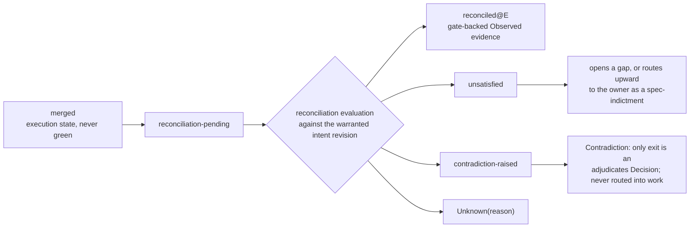

**Status:** Proposed foundational contract (self-declaration at authoring
time). Effective status is established solely by an owner-act record binding
this file's exact content digest — either owner-adopted (bootstrap,
uncorrelated) or Syzygy-verified, with the exact provenance state always
visible (RFC3-16). Absent such a record, this contract binds
nothing.

**Package:** module 3 of 4 of the RFC 0002 contract package. Index, clause map,
lookup rule, package-level scope, integration, deferrals and alternatives:
`README.md`. Rationale, amendment history, and answered §8 questions:
`../../history/RFC-0002-history.md` (non-normative).

**Serves:** architecture.md (Aligned/Converged; broadened contradiction; the
human-triggered loop; idempotence); trust-and-evidence.md (the two gap exits);
vision.md (merging proves nothing); VIS-6 exception (a). Implements **owner
rulings** SDR-7 (the pinned materialization record) and SDR-12 (V0/V1
staging), and the acceptance answers to §8 q3 and q4.

---

## 0. Module scope and reader map (non-normative)

*If this section and a clause disagree, the clause wins.*

This module owns **what happens to work and intent after they meet**: when two
authoritative claims cannot both hold, when desired state simply is not real
yet, when a subject counts as Aligned or a scope as Converged, and what a
merged change has and has not proved. Merging proves nothing until a
reconciliation evaluation checks the merged change against the intent revision
that warranted it (RFC2-18), and a contradiction is never merged with a gap
(RFC2-15, RFC2-17). Read it to answer: *does this merge mean anything yet, and
if not, what would make it mean something?*

- **What it presupposes.** Module 1.
  - A reconciliation evaluation is an ordinary identified evaluation.
  - The chain's verdicts are claim instances inside ordinary observation
    records.
- **Four rules carry most of the weight.**
  - **Contradiction and gap are different entities with different exits** —
    adjudication versus evidence-or-dismissal — and no surface, count, or UI
    string may merge them (RFC2-15, RFC2-17).
  - **Merging proves nothing.** Merged work enters the chain at
    `reconciliation-pending` and stays there until a reconciliation
    evaluation checks it against the *exact intent revision that warranted
    it* (RFC2-18).
    - At V0 the honest rendering of that absence, "a wall of such Unknowns on
      a fleet-built project", is correct output, not a defect (RFC2-19).
  - **Scheduler closure never implies `reconciled`** (RFC2-20).
  - **Chain state is computed from snapshot items alone** — merge facts plus
    the prior verdicts admitted under RFC2-1 item 10 — never from records
    read outside the snapshot.
    - That is what keeps two implementations with different retention from
      disagreeing.
- **What is new here.** [Observed] No surveyed substrate provides the
  reconciliation evaluation — no object, no field, no convention exists for
  it anywhere; this module creates it.

---

## 3. The contract

Clauses are numbered `RFC2-n` for stable citation. Amend in place; retire
rather than renumber.

### Contradiction versus gap, and the two exits

**RFC2-15 — Definitions and exits.** A **contradiction** is a set of
authoritative claims in one declared scope that cannot simultaneously be
satisfied (across or within typed authorities): it renders the affected
conclusion Unknown (reason `contradicted-pending-adjudication`, `suspended`
tier), routes to adjudication — by an agent's recorded adoption, reported and
open to the owner's veto, or by the owner when it falls in an owner class
(VIS-4) — is never resolved by precedence, never auto-scheduled into work. A **gap** is compatible desired state not yet
realized in observed state. [Observed — architecture.md.] A gap leaves a
surface in exactly two non-interchangeable ways: **factual resolution or
absence** — a status claim requiring current evidence; or **decision
dismissal** — a recorded, attributed human decision with reason and expiry,
committed out to the governed plane, always rendered *dismissed by decision*,
never green, resolved, or aligned. A dismissal whose reason or expiry is not
current at the as-of instant renders the gap again — through a new evaluation,
never a wall-clock flip. [Observed — trust-and-evidence.md; VIS-6, exception
(a).]

**Dismissal is not erasure**, in RFC2-14's shape. A dismissed gap's own status
and its Unknown reason stay visible beside the dismissal **on the primary
surface**, for the whole time the dismissal stands: the dismissal replaces the
status *rendering*, never the facts the status rested on. Rendering a
dismissed gap as dismissal alone — the reason, the expiry, and nothing of what
was dismissed — is a violation of this clause, because it makes a human ruling
displace facts that an inferred challenge could not displace (RFC2-14), and
leaves the reader unable to see what returns when the dismissal expires.
[Inferred — RFC2-14's guarantee, applied to the other gap exit.]

### Aligned versus Converged

**RFC2-16 — As claim predicates.** **Aligned**: one observed subject satisfies
one cited normative claim at one identified evaluation, with the evidence trail
current at its as-of instant. **Converged**: an aggregate over a declared
target scope at one identified evaluation — every mandatory claim in scope
aligned; behavioral equivalence under the declared verification oracle; policy
compliance; no unresolved contradiction touching the scope; no actionable gap
open in it. [Observed — architecture.md definitions.] Added operational rules:
a Converged claim renders its oracle's declared coverage alongside it; an
oracle with unassessed adequacy yields Unknown; both predicates are established
only by gate-backed Observed evidence (RFC2-25) and only at a named
evaluation — "Aligned" without an evaluation identity is not a well-formed
claim.

### The post-merge reconciliation chain

**RFC2-17 — Reservation of the words.** Unqualified **reconciliation** means
exactly one thing in Syzygy: the post-merge evaluation of whether a merged
change satisfies the intent revision that warranted it. Work-scheduler
substrates use the same word for **scheduler-state repair** — a substrate label
and its `reconciled`-style state events, meaning "the scheduler's own records
were brought back into agreement" — which is a substrate term the adapter
translates on read; the two senses never share a field, a count, or a UI
string.

The same reservation binds the pair **`unsatisfied`** versus
**`contradiction-raised` / Contradiction** (RFC2-18): an unsatisfied warrant is
a **gap** (compatible desired state not realized); a Contradiction is the
co-unsatisfiable-authoritative-claims entity of RFC2-15, whose only lawful exit
is adjudication. No surface, aggregate, endpoint, count, or UI string may merge
the two, and no substrate's "conflict", "failed", or "blocked" label may be
translated into either without the adapter naming which one it means. [Adopted
here as binding; the substrate survey behind it is archived corpus, informative
only — the rule stands without it.]

**RFC2-18 — The chain.** Every materialized work item that reaches merge enters
a first-class chain on its durable identity:
`merged → reconciliation-pending → (reconciliation evaluation) → reconciled@E | unsatisfied | contradiction-raised | Unknown(reason)`.

Chain state at any evaluation is computed **from snapshot items alone** — the
merge facts carried by RFC2-1 items 1 and 3 plus the prior chain verdicts
admitted under item 10. No implementation may read observation records from
outside the snapshot to decide a chain state; doing so would make the state
depend on an uncaptured input (RFC2-2) and let two implementations with
different record retention compute different chain states over one snapshot
(VIS-7).

- **merged** is execution state: the change reached the integration branch.
  Never proof intent is satisfied; never green. [Observed — vision.md thesis.]
- **reconciliation-pending** attaches automatically and deterministically at
  the first evaluation that captures the merge fact (inside RFC2-19's
  deliberately triggered passes — never on a live merge event) — the honest
  default state of all merged work, asserted from the merge fact plus the
  absence of a reconciliation verdict among the prior observation records
  admitted to that evaluation (RFC2-1 item 10) — two snapshot-identified
  inputs, and nothing else.
- The **reconciliation evaluation** is an ordinary identified status evaluation
  (RFC2-3) whose snapshot must include, at minimum:
  - the post-merge revision of every affected repository;
  - the **exact intent revision** — requirement, scenario, or governance
    clause version — cited by the work item's warrant, as pinned in the
    immutable materialization record (SDR-7);
  - and the verification evidence claimed for satisfaction.

  The chain's verdict binds to the warranted revision.
  - Assessing the same merged change against the *current* intent revision is
    permitted — but as a **second claim within the same evaluation, not a
    second evaluation**: identity is exactly (snapshot, as-of) and both
    revisions are inputs of **one** snapshot, so nothing remains to identify a
    second evaluation with, and inventing a purpose or kind tag to do it
    would reopen the closed identity scheme through a side door.
  - The two assessments are distinguished by their `cites` target — pinned
    versus current intent revision, already different durable identities
    under RFC1-18 — and only the warranted-revision claim carries the chain
    verdict.
  - Intent drift after merge therefore surfaces as a new gap on the
    current-revision claim, never as retroactive failure of the work.

  **The two claims render as one paired state, never as two independent
  numbers** *(ruled at acceptance by owner decision on §8 q4).* Where a
  project's warranted-revision claims are reconciled and its current-revision
  claims are not, the surface renders a **single explained state** naming both
  halves and what separates them — in the shape "reconciled against what was
  approved; N gaps against intent as it now stands" — with each half separately
  expandable to its claims. Rendering them as two unlinked aggregates is a
  violation of this clause even though both aggregates are individually
  accurate. [Inferred] The obligation is on the **pairing**, not on any
  particular wording; RFC6-17's aggregation disclosure applies to each half
  independently.
- **Outcomes.**
  - `reconciled@E`: the merged change satisfies the warranted intent
    revision — a positive status claim requiring gate-backed Observed
    evidence (RFC2-25), always rendered with its evaluation identity.
    - For doc-only and governance-only work the gate may be a **governed
      diff-satisfies-clause check** whose retained output is the gate
      artifact (RFC4-13 route 4 — requiring a lawfully adopted checker
      definition plus an execution artifact binding exact inputs and
      revisions, RFC4-13(b); determinism alone does not suffice).
  - **`unsatisfied`**: the warranted intent revision is not satisfied by the
    merged change and nothing is co-unsatisfiable — by RFC2-15's own
    definitions that is a **gap**, so this outcome opens a gap, or routes
    upward to the owner as a spec-indictment (the loop's one upward arrow);
    it renders *merged, evaluated, unsatisfied*, never silently reopened and
    never green.
  - **`contradiction-raised`**: the evaluation found authoritative claims in
    scope that cannot simultaneously be satisfied —
    - a **Contradiction** is minted per RFC1-5/RFC1-18(b)/RFC2-15,
    - the affected conclusion renders Unknown (reason #8
      `contradicted-pending-adjudication`, `suspended` tier),
    - and its only lawful exit is an `adjudicates` Decision (RFC1-25): never
      resolved by precedence, never auto-scheduled into work, and
      specifically never routed into work through a gap opened on its
      behalf.
  - The two negative outcomes are separately named, separately counted, and
    separately routed — the word reservation of RFC2-17 binds them.
  - `Unknown(reason)`: the evaluation could not decide; rendered with its
    RFC2-24 reason.
- **Record.** The verdict is a claim instance inside an ordinary observation
  record (RFC2-6); no new record type exists. Its durable identity links
  warrant → materialization record → merge fact → reconciliation verdict,
  making "merged-but-unreconciled" a first-class, queryable distinction:
  *reconciled at E with evidence* vs *merged, not yet evaluated* vs *evaluated
  and unsatisfied* vs *evaluated, contradiction raised*. That verdict record is
  what a later evaluation admits under RFC2-1 item 10.

*Diagram (non-normative; the clauses govern):* the RFC2-18 chain and where outcomes route.

**RFC2-19 — Trigger and staging.** The loop is human-triggered: reconciliation
evaluations run inside a deliberately triggered propagate/sync or observation
pass, never autonomously on merge events. [Observed — architecture.md.] Staging
per SDR-12: **V0 renders the absence honestly** — merged-but-unreconciled work
renders "reconciliation evidence absent / Unknown", and a wall of such Unknowns
on a fleet-built project is correct output, not a defect; **V1 computes** the
reconciliation evaluation and its gap as navigable, work-generating objects.
Nothing in V0 may simulate the verdict.

**RFC2-19(a) — What that Unknown carries, and does not** *(drafted arm —
see the bracketed note below; identifier minted 2026-08-10, RD30-12, so
the exemption is anchorable under verification rule 8 rather than citable
only as prose near RFC2-19).* The V0 rendering above is an **absence of a
computed reconciliation verdict**, not a claim whose evidence is missing.

- It is therefore **chain-state-local**: the `reconciliation-pending` state
  and the "reconciliation evidence absent / Unknown" rendering it produces are
  **never stamped with, counted among, or absorbed by an aggregate of RFC2-24
  Unknown reasons**, and never contribute to a project's Unknown-reason
  totals.
- This is the exemption RFC8-12 states for its four absence values, applied to
  the one chain state V0 renders most: no reason from the twelve describes
  "the evaluation that would decide this is deliberately not computed at this
  stage" — #2 `missing-evidence` names a claim whose evidence was sought and
  not found, which misdescribes a verdict never sought — and RFC2-24 forbids
  minting, spelling, or force-fitting one that the list does not carry.
- The condition is disclosed as a **fact of the render** in RFC2-24's own
  terms: named, counted in its own right, expandable, and routed to its
  resolving action (run a reconciliation evaluation).
- The rendering still carries the durable identity, the merge fact, and the
  warranted intent revision the verdict would bind to, so nothing about it is
  silent.

> **[P-31 — drafted arm, awaiting an owner ruling.]** RD-15 finding 3 found
> this rendering bound to no RFC2-24 reason. Two routes close it: a thirteenth
> RFC2-24 reason, which reopens a list owner decision A5 closed at twelve and
> is an owner act, not a drafting one; or the exemption above, modeled on
> RFC8-12's, which stays inside this contract's own bytes. The exemption is
> **drafted here so the owner can rule on a written arm rather than on a
> description**; it is candidate text like every clause around it, and the
> owner ratifies or reverts it at the act that binds this module. If the owner
> instead directs the thirteenth reason, this paragraph is deleted and RFC2-24
> is amended in its place.

**RFC2-20 — The closure fallacy, forbidden.** Work-scheduler closure (`closed`,
merged, abandoned, superseded) is execution state and never implies
`reconciled`. Rendering closed work as "done" without a reconciliation verdict,
or counting scheduler repairs as reconciliations (RFC2-17), violates this
contract. The closed-but-unreconciled distinction is computed the same way as
every other chain state: from the merge and closure facts in the snapshot plus
the prior verdicts admitted under RFC2-1 item 10 — never from records read
outside the snapshot.

### No-gap and fixed-point semantics

**RFC2-21 — What "no gap at evaluation E" means.** Over a declared scope at E:
every mandatory normative claim in scope has a current, gate-backed Aligned
instance; no open admitted challenge or unadjudicated contradiction touches the
scope; every merged change in scope is `reconciled@E'` with evidence still
current at E — as recorded in the prior observation records admitted to E under
RFC2-1 item 10, never as read from outside the snapshot; every dismissal
carries a reason and unexpired expiry. What it does **not** mean: anything
about instants after E's as-of instant; anything beyond the declared oracle's
rendered coverage; genome-completeness (a separate corpus claim); or maturity
on any axis. [Inferred — composition of adopted definitions.]

**RFC2-22 — Fixed point (idempotence).** A pass over an unchanged, no-gap
source snapshot — at any as-of instant — must not mutate authoritative project
artifacts, create or reprioritize work, or establish or improve any status
claim; a later evaluation over the same snapshot may only degrade. [Observed —
architecture.md.] The fixed point is per-snapshot, not perpetual: any new
snapshot input (evidence, intent edit, adjudication) legitimately re-opens
computation.

---

## 4. Violation cases

*Package numbering; cases are distributed across modules, never renumbered.*

4. *(RFC2-15)* A contradiction resolved by precedence, or auto-scheduled.
6. *(RFC2-17/20)* "Reconciled: 12" computed from scheduler-repair events;
   closed work rendered done without a reconciliation verdict.
7. *(RFC2-17/18; RFC2-15)* An `unsatisfied` verdict counted or rendered as a
   Contradiction, or a `contradiction-raised` verdict opened as a gap and
   thereby routed into work without adjudication.
8. *(RFC2-18)* The warranted-revision and current-revision claims rendered as
   two unlinked aggregates rather than one paired state.
9. *(RFC2-2/18/20/21)* A chain state computed from observation records read
   outside the snapshot, rather than from merge facts plus RFC2-1 item 10.
12. *(RFC2-19; SDR-12)* Merged work rendered as anything but
    reconciliation-pending/Unknown at V0.

Case 5 spans this module and module 4 and is held at the package level
(`README.md` §4).

---

## 5. Integration (module-local)

- **Relies on RFC 0001:**
  - the relation vocabulary realizing Aligned as a claim predicate;
  - Contradiction minting (RFC1-5, RFC1-18(b)) and the `adjudicates` Decision
    (RFC1-25) that is a Contradiction's only lawful exit;
  - the `cites` targets (RFC1-18) distinguishing pinned from current intent
    revision;
  - the materialization record (SDR-7) the chain joins through.
- **Relies on RFC 0004:** RFC4-13 route 4 and its governed-checker requirement
  (RFC4-13(b)), the `gate-backed` route by which doc-only and governance-only
  work reaches `reconciled@E`.

- **Provides to RFC 0003:** the chain-state and verdict semantics it must
  physically encode — with no new record type, since a verdict is an ordinary
  claim instance.
- **Provides to RFC 0004:** the substrate-term translation duty of RFC2-17,
  which RFC4-6 realizes.
- **Provides to RFC 0008:** the chain states Trajectory renders and the
  paired-state obligation its aggregates must satisfy.
- **Provides to RFC 0010:** the completion predicates and
  contradiction-escalation conditions a bounded Mission terminates on.
- **Provides to the rest of this package:**
  - the contradiction condition behind Unknown reason #8 and the `suspended`
    tier (module 4),
  - and the gap exit rendered as *dismissed by decision* (module 4's sibling
    surface states).

## 8. Owner questions (stubs; full text and reasoning in history)

- **q3 — Reconciliation evidence class.** Answered at acceptance: a
  deterministic, re-runnable diff-satisfies-clause check is a lawful
  `gate-backed` route (RFC4-13 route 4), which at the rev7 rework additionally
  requires a governed checker (RFC4-13(b)). Bears on module 4's `gate-backed`
  tier. See `../../history/RFC-0002-history.md` §8.
- **q4 — Binding to the warranted intent revision (RFC2-18).** Answered at
  acceptance: the warranted-revision binding **stands**, and the two claims
  must render as **one paired state** naming both halves and what separates
  them, **never as two independent aggregates**. See
  `../../history/RFC-0002-history.md` §8.

Question numbers are RFC-level and immutable; the package index is in
`README.md` §8.
