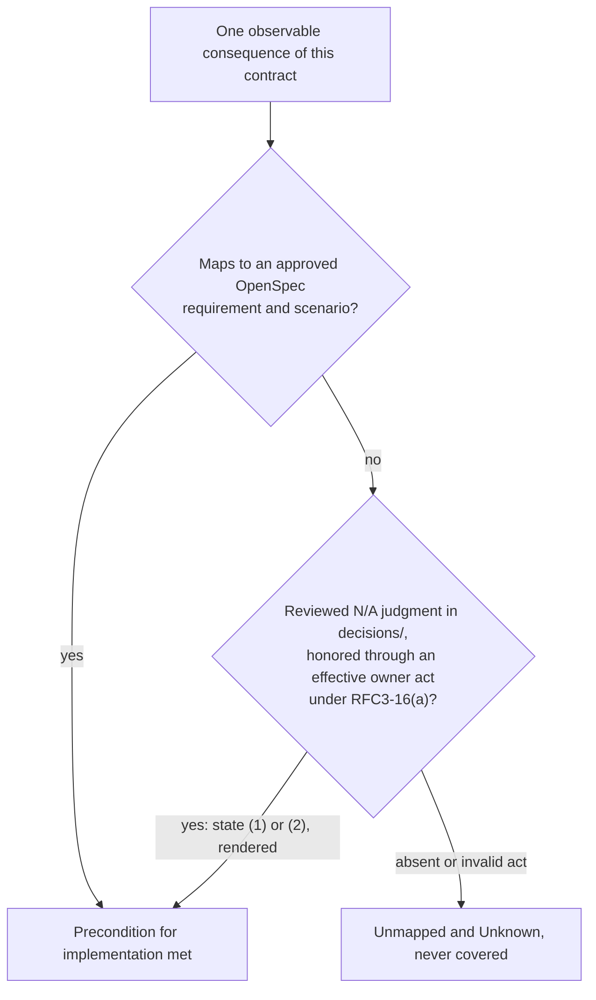

**Status:** Proposed foundational contract (self-declaration at authoring
time). Effective status is established solely by an owner-act record binding
this file's exact content digest — either owner-adopted (bootstrap,
uncorrelated) or Syzygy-verified, with the exact provenance state always
visible (RFC3-16). Absent such a record, this contract binds
nothing.

**Package:** module 4 of 4 of the RFC 0002 contract package. Index, clause map,
lookup rule, package-level scope, integration, deferrals and alternatives:
`README.md`. Rationale, amendment history, and answered §8 questions:
`../../history/RFC-0002-history.md` (non-normative).

**Serves:** architecture.md (the closed snapshot rule behind the degradation states);
trust-and-evidence.md (the three-label rule; staleness; gap exits); VIS-1,
VIS-2; SEC-2, SEC-4, SEC-5; SDR-3, SDR-6, SDR-9, SDR-15, SDR-33; **SDR §5
q4–5**, which this module owns and closes. Implements **owner decisions A5**
(the list closes at twelve) and **B10** (minting `editorial-draft`).

---

## 0. Module scope and reader map (non-normative)

*If this section and a clause disagree, the clause wins.*

This module owns **the three closed vocabularies every surface renders**: the
degradation states an evaluation can fall into, the reasons an Unknown may
carry, and the tiers that qualify how a claim displays. All three are closed —
each changes only by amendment to this RFC — and only `gate-backed` Observed
evidence may support a positive status claim (RFC2-23, RFC2-24, RFC2-25).
Read it to answer: *what exactly may I show, and what words may I show it
in?*

- **What it presupposes.** Module 1 — a tier and a reason stamp a claim
  instance.
  - It is the module every other RFC in the corpus cites most.
- **Three rules carry most of the weight.**
  - **The twelve Unknown reasons are closed, and so is the
    secondary-annotation vocabulary — it is the same twelve** (RFC2-24).
    - No implementation may mint, spell, or force-fit a value the list does
      not carry, because RFC6-14 requires machine answers to carry the reason
      verbatim and RFC6-22/23 make two renderings disagreeing
      release-blocking.
    - A condition genuinely outside the twelve is disclosed as a **fact of
      the render**, never dressed as a reason.
  - **The six tiers are closed and a tier never becomes a fourth epistemic
    label** (RFC2-25).
    - Only `gate-backed` Observed evidence may support a positive status
      claim — Aligned, Converged, reconciled, green.
  - **Absence is never zero.** A missing quantity renders **Unknown, never
    zero** (RFC2-23, SDR-6).
- **What sits outside the tier registry.**
  - Three closed **sibling surface states** — `dismissed-by-decision`,
    `unadopted-draft`, `editorial-draft` — which *replace* a status
    rendering.
  - `challenge-pending` (module 2), which *accompanies* an unchanged one.

---

## 3. The contract

Clauses are numbered `RFC2-n` for stable citation. Amend in place; retire
rather than renumber.

### Failure and degradation states

**RFC2-23 — Six degradation states, closed, each with its rendering
obligation.** [Inferred — composed from trust-and-evidence.md staleness rules,
SEC-2/SEC-5, and the closed snapshot rule.] The list below **is** the
vocabulary:

- it changes only by amendment to this RFC, and no implementation may mint,
  spell, or force-fit a degradation state it does not carry;
- the closure is required for the reason RFC2-24's is — RFC 0004's adapters
  map their internal errors onto these states by declaration (RFC4-2 item 6),
  and a state existing in no vocabulary can be neither declared there nor
  checked for parity across surfaces (RFC6-22/23);
- a degradation genuinely outside the six is disclosed as a fact of the
  render, never dressed as one of them.

| State | Semantics | Rendering obligation |
|---|---|---|
| **Observer failed** | An observer/adapter errored during capture | Degrade to last-good observation record, marked `stale`/`broken` on the primary surface; never fail invisibly; affected new claims → Unknown (`source-uncaptured-or-unreachable`) |
| **Source unreachable** | A declared source could not be read at snapshot time | Source renders unavailable; dependent claims → Unknown (`source-uncaptured-or-unreachable`); the snapshot records the absence as a fact |
| **Consent withdrawn** | SEC-2/SEC-4 consent revoked for a repository or provider | Dependent claims → Unknown (`unconsented-source-or-provider`); inference overlays for that provider are not computed; prior records remain (immutable) but render with the withdrawal visible |
| **Partial snapshot** | Some minimum inputs (RFC2-1) captured, others not | Never presented as complete: captured scope declared explicitly; uncaptured portion → Unknown; no aggregate over the full scope may render as if whole (VIS-1: narrow the declared scope, never fake coverage) |
| **Excluded content** | Secret policy matched, or content unclassifiable (fails closed) | Exclusion rendered with count; nothing derived from excluded content in any surface, label, or endpoint; claims needing it → Unknown (`excluded-content`) |
| **Missing quantity** | Cost/tokens/measures absent | **Unknown, never zero** (SDR-6); no aggregate silently treats absent as 0 |

### The closed Unknown-reason vocabulary

**RFC2-24 — Twelve reasons, closed.** Every Unknown claim instance carries
exactly one primary reason from this list (secondary reasons may annotate); the
list changes only by amendment to this RFC, and covers Unknown states only —
*dismissed by decision*, *unadopted draft* and *editorial draft* are the three
sibling surface states, never Unknown reasons.

**The secondary-annotation vocabulary is closed, and it is this same list.** A
secondary annotation is one or more further reasons **drawn from the twelve
below**; there is no separate secondary vocabulary, and no implementation may
mint, spell, or force-fit a secondary value the list does not carry. This is
not a stylistic preference: RFC6-14 requires every machine answer to carry its
Unknown reason **verbatim from this vocabulary**, and RFC6-22/23 make two
renderings disagreeing over one declared scope release-blocking under the trust
floor — a secondary value existing in no vocabulary can be neither carried
verbatim nor checked for parity, and leaving it unstated is how the value gets
chosen by whoever implements the render first. Which further reasons the
vocabulary carries was the owner's choice, answered at acceptance by decision
**A5**: **#12 `execution-blocked`** added, #11 retained, #10 not split, list
**closed at twelve** — settling §8 q1, RFC 0005 §8 q3 and RFC 0008 §8 q7
together. A condition genuinely not among the twelve is disclosed as a **fact
of the render** — named, expandable, routed to its resolving action — never
dressed as a reason; the honest move is to amend this list, never to annotate
outside it. [Inferred — the closure follows from RFC6-14's verbatim
requirement.]

| # | Reason | Condition | Resolution route |
|---|---|---|---|
| 1 | `missing-declaration` | No governing declaration (capability, topology, mapping, policy) exists | First-pass drafting for owner sign-off (v1.md) |
| 2 | `missing-evidence` | Declaration exists; no current evidence artifact for the claim | Produce/capture evidence |
| 3 | `no-currency-bound-declared` | The claim class has never declared a currency bound, so no evidence can count as current | Declare the bound in quality policy [Observed — trust-and-evidence.md] |
| 4 | `stale-beyond-currency-bound` | Evidence exists but exceeds its declared bound at the as-of instant | Capture fresh evidence via a new snapshot |
| 5 | `mapping-coverage-absent` | No executed mapping with stated coverage backs the claim (empty-plot rule: absence claims need a coverage record) | Run/declare the mapping |
| 6 | `unconsented-source-or-provider` | SEC-2/SEC-4 consent absent or withdrawn for a needed repository or model provider | Record consent |
| 7 | `excluded-content` | Secret-detection policy excluded the content, or it was unclassifiable (fails closed, SEC-5) | Policy change by the owner, or accept the exclusion |
| 8 | `contradicted-pending-adjudication` | An unresolved contradiction touches the conclusion | Adjudication: an agent's recorded adoption, or the owner in an owner class (VIS-4) |
| 9 | `challenge-suspended` | An open admitted challenge conservatively suspends the claim (RFC2-8) | Challenge resolution (RFC2-13) |
| 10 | `source-uncaptured-or-unreachable` | A deterministic input capable of affecting the claim was not captured in the snapshot (RFC2-2), including observer failure and unreachable sources | Repair the observer/source; new snapshot |
| 11 | `reference-unresolvable` | The source **was** captured and the governing declaration **does** exist, but a cited internal anchor no longer resolves — an OpenSpec requirement or scenario reference broken by edit (RFC1-15), a topology or region anchor whose target is gone (RFC1-26) | Repair the reference, owned by the governed project |
| 12 | `execution-blocked` | The declaration and the evidence route both exist, and the **execution that would produce the evidence was refused or prevented** — by execution profile, absent or withdrawn consent for the run, or an environment the profile could not satisfy. Distinct from #6, which is about a *source or provider* being unconsented rather than a *run* being blocked | **Unblock or authorize the run** (execution profile, consent, environment), then capture in a new snapshot |

Reasons are distinct because their **resolution routes** are distinct:

- #9 is not #8 (challenge lifecycle versus adjudication);
- #10 is an input never in the evaluation, versus #2's present-but-unevidenced;
- #11 is a broken anchor over a captured source whose declaration exists, so
  neither #1 nor #10 fits;
- #12 exists rather than annotating #2 because a reason names what would
  resolve it, and "go capture evidence" misdescribes the remedy when the
  capture path is the thing that is blocked.

Per-reason amendment provenance is in the history file.

**Rendering rule.** Unknown regions may aggregate ("Unknown ×40") but must
disclose reason counts and expand; every reason routes to its resolving action;
the vocabulary is shared verbatim across 3D, tabular, and endpoint surfaces.
[Observed — VIS-1.] **Reason counts are this vocabulary's share of a larger
obligation, never a substitute for it:** the disclosure any aggregate owes is
**RFC6-17's in full** — the RFC6-22 equivalence tuple, per-label, per-tier,
per-Unknown-reason and per-freshness-state counts and sibling surface states —
and this rule is that obligation's Unknown-reason component. An aggregate
satisfying this sentence alone still violates RFC6-17. The obligation is cited
here, not restated, so the two cannot drift.

### The closed rendering-tier registry

**RFC2-25 — Six tiers, closed, each inside exactly one parent label.** A tier
qualifies how a claim renders and may only *restrict* its parent label's
authority, never extend it. **No new tier without an amendment to this RFC, and
a tier never becomes a fourth epistemic label** — the three-label rule is
exclusive and exhaustive; an untier'd claim renders at its bare label.
[Observed — SDR §5 q4; three-label rule per trust-and-evidence.md.]

| Tier | Parent label | Semantics | Authority |
|---|---|---|---|
| `gate-backed` | **Observed** | The claim is backed by a retained, resolvable gate artifact (report, log, run record) bound to the exact revision (SDR-9) | The **only** tier that may support a positive status claim (Aligned, Converged, reconciled, green) |
| `report-fact` | **Observed** | "X reported Y" is Observed as a fact about the report; Y itself is not thereby Observed (SDR-9) | Supports claims about the report only; never about the subject matter |
| `reduced-fidelity` | **Observed** | Deterministic at a declared coarse granularity (e.g. PR-level where event-level is unavailable, SDR-33); rendered explicitly as reduced fidelity | Full Observed authority *at its declared granularity*; finer-granularity questions render Unknown, never invented |
| `asserted-by-worker` | **Inferred** | An LLM worker's assertion of an outcome with no retained artifact (an LLM assertion is Inferred, never Observed) | Visible, never green, challengeable, never a status input |
| `declared-only` | **Unknown** | Composite rendering: the declaration is Observed; its satisfaction is Unknown (SDR-3 — a declared mapping or capability with no verification). Both halves must render | The Observed half carries only declaration facts; the satisfaction claim has no positive authority |
| `suspended` | **Unknown** | An Unknown that carries a visible deterministic or authoritative basis under question — open challenge (#9) or contradiction (#8). The basis and, where inferred, the challenger's provenance render alongside | No positive authority while suspended; the basis is never erased (RFC2-14) |

*Deliberately outside the registry — **three** sibling surface states, closed:*
`dismissed-by-decision`, `unadopted-draft` and `editorial-draft`. These are
governed directly by doctrine (trust-and-evidence.md gap exits; v1.md drafting
rule) — equally closed, but not tiers of a claim label: a dismissal claims
nothing about facts, and a draft is not yet a claim source.

**`editorial-draft`** *(minted at acceptance by owner decision B10.)* Narrative
prose under revision — the editorial-draft case SDR-15 names. It is distinct
from `unadopted-draft` in **what each is waiting for and what it becomes**: an
unadopted draft awaits an **adoption gate into authority**, and once through
it, it binds and is citable. An editorial draft awaits a **human authorship act
into a non-authoritative artifact**, and **stays non-citable even after that
act completes** — narrative never becomes a claim source, adopted or not
(RFC7-20). Collapsing the two would misstate both directions at once: prose
would seem to acquire authority on adoption, and a pending requirement would
seem to be merely being written. [Observed — the distinction and its wording
are RFC 0007's; the owner's decision was whether to mint the state.]

**`challenge-pending` (RFC2-13) is outside this registry too, and for a
different reason:** the three sibling surface states *replace* a status
rendering, while `challenge-pending` *accompanies* an unchanged one. It is
neither a tier nor a sibling surface state; look to RFC2-13.

---

### Authority boundary at the OpenSpec seam (binding phase rule)

**RFC2-26.** This contract schedules nothing: **it is not a specification of
record from which implementation work may be scheduled**. No implementation
work for user-observable consequences of this contract — evaluation and
snapshot displays, claim and challenge rendering, Unknown-reason and
rendering-tier presentation, reconciliation-chain and gap surfaces, API
answers over epistemic state — may be scheduled solely from this RFC.

Before implementation, every observable consequence either

- maps to an approved OpenSpec requirement and scenario in the governance
  root's `openspec/**` plane,
- or carries a reviewed N/A judgment proving it purely structural with no
  independently testable behavior.

**The reviewed N/A judgment's home and gate.** A reviewed N/A judgment is a
recorded owner judgment homed in `decisions/` (RFC3-15), and the judgment is
honored only through an effective owner act under RFC3-16(a), in state (1) or
state (2), with that state rendered; absent or invalid acts map nothing and
leave the consequence unmapped and Unknown, never covered (RFC3-16(a)'s effect
rule; VIS-2).

**Rows are per observable consequence, not per clause.**

- A clause with five observable consequences and one mapped requirement is not
  covered; the matrix discloses the consequences it enumerates for each
  clause, so a complete-looking matrix over under-enumerated consequences is a
  defect of the matrix.
- At surface specification a clause-to-requirement coverage matrix over
  RFC2-1..RFC2-26 is produced — **that matrix is review material, never
  authority**.
- This clause creates no OpenSpec content now (none may exist during
  bootstrap).
- This clause binds the whole RFC 0002 package, not this module alone.

(Shape-parallel with RFC6-28, RFC7-38, RFC8-32, RFC9-52, RFC10-16, RFC11-12.)

*Diagram (non-normative; the clauses govern):* RFC2-26's two routes for one consequence.

## 4. Violation cases

*Package numbering; cases are distributed across modules, never renumbered.*

13. *(RFC2-24; SDR-6)* An Unknown rendered without a reason from RFC2-24 or
    with an invented one; a secondary annotation minted outside those twelve;
    an absent quantity rendered as zero.
14. *(RFC2-25)* A rendering tier introduced without amending this RFC; any tier
    rendered as a fourth label.
15. *(RFC2-23)* A partial snapshot's aggregate rendered as full-scope coverage.

Case 5 spans this module and module 3 and is held at the package level
(`README.md` §4).

---

## 5. Integration (module-local)

- **Relies on RFC 0001:** the OpenSpec requirement/scenario references
  (RFC1-15) and topology/region anchors (RFC1-26) whose breakage reason #11
  names.
- **Relies on RFC 0003:**
  - RFC3-15's `decisions/` category as the home of the reviewed N/A judgment
    RFC2-26 admits,
  - and RFC3-16(a)'s owner-act provenance predicate as the condition under
    which that judgment is honored.
- **Relies on RFC 0005:**
  - the consent records (SEC-2/SEC-4) behind reason #6 and the *Consent
    withdrawn* degradation state,
  - and the execution profiles whose refusal reason #12 names.

- **Provides to RFC 0003:** the reason and tier vocabularies it must
  physically encode as closed enumerations.
- **Provides to RFC 0004:**
  - the tiers observers and adapters emit — `gate-backed`, `report-fact`,
    `asserted-by-worker`, and the `reduced-fidelity` tier whose labeling
    schema RFC 0004 defines (SDR-33) —
  - and the degradation states RFC4-2 item 6 maps its internal errors onto.
- **Provides to RFC 0006 and RFCs 0007–0009:**
  - the label+tier+reason triple every surface renders verbatim,
  - the three sibling surface states,
  - and the Unknown-aggregation rule — whose disclosure obligation is
    **RFC6-17's in full**, cited here and never restated so the two cannot
    drift.
- **Provides to RFC 0010/0011:** the Unknown semantics a Mission's evidence
  checks and a context packet's applicability rules resolve against.

## 8. Owner questions (stubs; full text and reasoning in history)

- **q1 — Reason granularity (RFC2-24).** Answered at acceptance — **owner
  decision A5**: the list grows to twelve, #12 `execution-blocked` added, #11
  retained, #10 not split; settles RFC 0005 §8 q3 and RFC 0008 §8 q7 together.
  See `../../history/RFC-0002-history.md` §8, including the compaction note on
  q1(b).

Question numbers are RFC-level and immutable; the package index is in
`README.md` §8.
