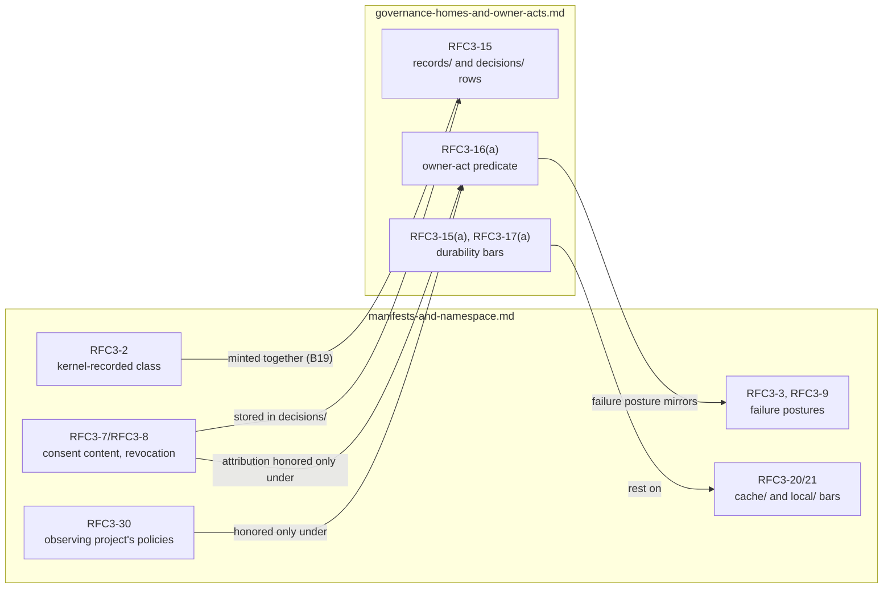

# RFC 0003 — Project, Workspace and .syzygy/** Manifests (contract package)

**Status:** Proposed foundational contract (self-declaration at authoring
time). Effective status is established solely by an owner-act record binding
each module file's exact content digest — either owner-adopted (bootstrap,
uncorrelated) or Syzygy-verified, with the exact provenance state always
visible (RFC3-16). Absent such a
record, this contract binds nothing.

RFC 0003 governs the project and workspace manifests and the `.syzygy/**`
plane: who may write each field, where governance artifacts live, and what
makes an owner act real. To find a clause, use its number alone: RFC3-15,
RFC3-16, RFC3-17 and every lettered sub-clause are in
`governance-homes-and-owner-acts.md`; every other `RFC3-n` is in
`manifests-and-namespace.md` (the lookup rule below).

This index is **navigational and non-normative**. It duplicates no clause. The
binding text lives in the two modules; where this file and a clause disagree,
the clause wins.

---

## Modules and clause sets

| Module | Clauses | What it binds |
|---|---|---|
| `manifests-and-namespace.md` | **RFC3-1 … RFC3-14** and **RFC3-18 … RFC3-33** | The one-writer rule and write containment; the project declaration `.syzygy/project.yaml` and its closed field set; consent records, revocation and withdrawal; the platform-level workspace manifest and asymmetric cross-project relations; surface namespaces and `work/**` authority; `cache/` and `local/`; schema versioning and identity-preserving migration; the `openspec/**` boundary; nesting as composition by declaration. |
| `governance-homes-and-owner-acts.md` | **RFC3-15, RFC3-15(a), RFC3-16, RFC3-16(a), RFC3-16(b), RFC3-16(c), RFC3-16(d), RFC3-17, RFC3-17(a)** | The five constitutional `governance/` categories; category-appropriate lifecycles; the self-declared stamp versus effective status; the owner-act provenance predicate and what any conforming mechanism must bind; the two provenance states of an owner-act record; bounded URL-dossier machine-credential instances; the reserved `declarations/` category; the home of challenge submissions and admission records. |

## Deterministic lookup rule

The second module's clause set is **non-contiguous by design** — it is the
run RFC3-15…RFC3-17 plus every lettered sub-clause. To resolve any citation
without reading either file:

> **`RFC3-15`, `RFC3-16`, `RFC3-17` and every lettered sub-clause
> (`RFC3-15(a)`, `RFC3-16(a)`, `RFC3-16(b)`, `RFC3-16(c)`, `RFC3-16(d)`, `RFC3-17(a)`) are
> in `governance-homes-and-owner-acts.md`. Every other `RFC3-n` number —
> whatever the package's range grows to — is in
> `manifests-and-namespace.md`.**

Equivalently: numeric part in 15–17 → governance-homes; otherwise →
manifests-and-namespace. There is no third location and no clause appears in
both files.

**Clause identity is package-wide, not per-module.** The `RFC3-n` namespace is
single and authoritative across both modules: numbers are never reused,
retired, merged, or renumbered, and the split moved no clause identity. The
range RFC3-1 … RFC3-33 is complete with no gaps. External citations written
against the pre-split single file resolve unchanged — cite the clause ID, not
a file or section number.

## Reader map — which module do you need?

- Implementing or validating `project.yaml`, a repository entry, a consent
  record's *content*, the workspace manifest, `cache/`/`local/`, a schema
  migration, or nesting → **manifests-and-namespace**.
- Deciding **where** a governance artifact may live, **what lifecycle** it
  admits, or **whether an owner act counts** — including any gate that honors
  a consent, approval, adoption stamp, policy, or registry →
  **governance-homes-and-owner-acts**. Most cross-RFC citations into RFC 0003
  land here, at RFC3-16(a).
- Writing a new gate in any RFC → read RFC3-16(a) and RFC3-16(b) in full. The
  predicate, not its example list, is the scope.

## Package-spanning integration

These items cross the module boundary; each is stated once in its owning
module and cited from the other.

- **RFC3-2's `kernel-recorded` class ↔ RFC3-15's `records/` category.** One
  owner amendment (B19) minted both. The write-authority class is defined at
  RFC3-2 (manifests-and-namespace); the category, its contents and its
  no-install-gate row are at RFC3-15 (governance-homes); the minting-trigger
  rule is at RFC3-2 and cited by RFC3-15's `records/` row.
- **Consent records.** Their content model, kinds and revocation semantics are
  RFC3-7/RFC3-8 (manifests-and-namespace); their storage home and install gate
  are RFC3-15's `decisions/` row (governance-homes); their stored attribution
  is honored only under RFC3-16(a) (governance-homes).
- **RFC3-16(a) reaches back into module 1.** An observing project's own
  policies (RFC3-30) are honored only under the predicate, and RFC3-16(a)'s
  failure posture is explicitly the one RFC3-3 takes for an inoperative
  write-expanding field and RFC3-9 takes for an unauthored governance
  artifact.
- **Durability bars.** RFC3-15(a) and RFC3-17(a) (governance-homes) rest on
  RFC3-20/RFC3-21 (manifests-and-namespace) barring `cache/` and `local/` to
  identity-bearing snapshot inputs.
- **Violation case 9 is split by owning clause** — the observation-record and
  `local/` limbs sit with RFC3-20/21 in module 1; the challenge-admission-record
  limb sits with RFC3-17(a) in module 2. All other cases sit whole with their
  owning clause. Original numbering (1–14) is preserved package-wide, so the
  case numbers are non-contiguous within each file.

*Diagram (non-normative; the clauses govern):* the same edges as the list
above, adding nothing to it.

## Forward references are informative (package-level)

Both modules cite sibling contracts that are not yet accepted, and every such
citation is **informative until that RFC is accepted**.

- **Where they appear.** RFC 0007–0011 clause numbers appear in RFC3-16(a)'s
  example list, in its gate inventory, in RFC3-15's `records/` cell, and at
  RFC3-32's narrative-side parallel.
- **What they do.** Such a citation names where an obligation will be
  discharged, or illustrates a class, and is never a dependency of this
  package's meaning; a renumbering in a sibling draft changes nothing here.
- **What is load-bearing.** Citations to **adopted doctrine**, to the
  **SDR**, and to the sibling contracts each module's integration section
  names as reliances.

This section is navigational like the rest of this index — each module states
the same rule in its own integration section, and RFC3-15's `records/` cell,
the one such citation standing inside a normative enumeration, states its
condition in the cell itself rather than relying on either.

## Open questions (navigational — numbering is immutable)

| Question | State | Where |
|---|---|---|
| q1 — Monorepo subprojects (RFC3-29) | **open** | manifests-and-namespace §7 |
| q2 — Workspace manifest classification (RFC3-10) | **open** | manifests-and-namespace §7 |
| q3 — Egress consent granularity (RFC3-7) | answered (B8) | history §8; ruling carried in RFC3-7 |
| q4 — The `declarations/` category (RFC3-17) | **open** | governance-homes §5 |
| q5 — Owner-act provenance predicate (RFC3-16(a)) | answered (A1/A9) | history §8; ruling carried in RFC3-16(a) and RFC3-16(c) |
| q6 — Governance home for challenges (RFC3-17(a)) | answered (B19) | history §8; ruling carried in RFC3-15/15(a)/17(a) |

Questions are **never renumbered**: q3, q5 and q6 keep their numbers although
they no longer appear in an active file, so prior reviews and the history file
continue to resolve.

## Non-normative material

Rationale, amendment history, extracted `*(History: …)*` records, rejected
alternatives and the answered questions with their answers:
`../../history/RFC-0003-history.md`. Clause-by-clause migration from the rev9
single file: `../../matrix-rows/RFC-0003-rows.md`.
