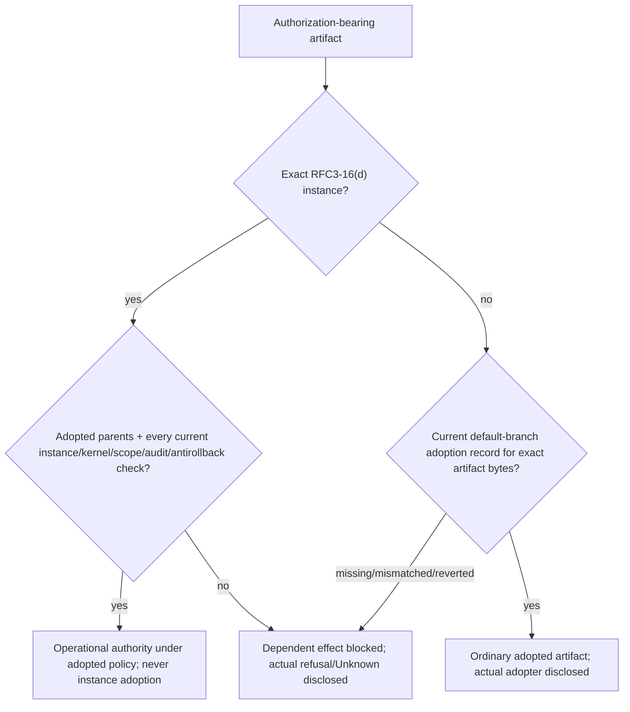
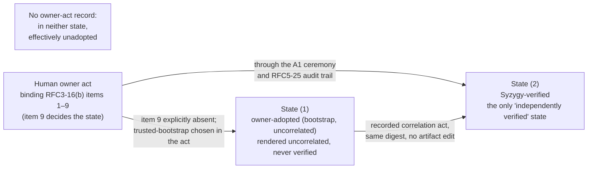

# RFC 0003 — Project, Workspace and .syzygy/** Manifests
## Module: governance homes and owner acts (RFC3-15 … RFC3-17(a))

**Status:** Proposed foundational contract (self-declaration at authoring
time). Effective status is established solely by an owner-act record binding
this file's exact content digest — either owner-adopted (bootstrap,
uncorrelated) or Syzygy-verified, with the exact provenance state always
visible (RFC3-16). Absent such a record, this contract binds nothing.

**Amended by GOVERNANCE-SIMPLIFICATION-D10** (drafted 2026-11-17; in force from the
owner's act recorded in `.syzygy/governance/decisions/GOVERNANCE-SIMPLIFICATION-D10-ACT.md`).
RFC3-15's install gates for `contracts/`, `policies/` and `decisions/`,
RFC3-16, RFC3-16(a)'s predicate and premise, RFC3-16(b) and RFC3-16(c) are
amended in place to VIS-4 as amended by D10: the owner decides doctrine and
four owner classes, agents adopt everything else in the open, and an adoption
is recorded against a commit rather than a typed phrase and digest. Acts
performed before D10 remain history.

**Package:** one of two modules of RFC 0003; see `README.md` for the clause-set
map and lookup rule. The manifest field contracts, workspace manifest,
namespace classes, migration rules and nesting resolution are in
`manifests-and-namespace.md` — cited here by clause ID.

**Serves:** VIS-4, VIS-6, VIS-7; SEC-2, SEC-3, SEC-4, SEC-5; architecture.md
(the `governance/` constitutional minimums, schema ownership split); SDR-4.
Builds on RFC 0001 (RFC1-5, RFC1-27) and RFC 0002 (RFC2-1 snapshot inputs,
RFC2-6, RFC2-13, RFC2-25). Rationale, amendment history and answered
questions: `../../history/RFC-0003-history.md`.

---

## 0. Scope and reader map (non-normative)

*If this section and a clause disagree, the clause wins.*

This module fixes **where governance artifacts live, what lifecycle each
class admits, and what makes an owner act real**. It is the part of RFC 0003
that other RFCs cite most. Its weight sits in **RFC3-16(a)**, the owner-act
provenance predicate that every gate in the corpus honoring a consent, an
approval, an adoption stamp, a policy, or a registry cites rather than
restating the obligation; in **RFC3-16(b)**, what every act must bind; and in
**RFC3-16(c)**, the two provenance states.

- **§1.1 Categories.** The five constitutional `governance/` categories,
  closed except by recorded owner widening (RFC3-15, RFC3-15(a)).
- **§1.2 Lifecycles and provenance.** Category-appropriate lifecycles; the
  self-declared stamp versus effective status.
  - **RFC3-16(a)** the effective-owner-act predicate — an authorization needs
    a real human act, exact-digest and scope bound, in state (1) or state
    (2), with its state rendered.
  - Independent correlation is what permits state (2), not what makes the
    human act effective.
  - **RFC3-16(b)** what every act must bind.
  - **RFC3-16(c)** the two provenance states, which keeps a bootstrap act
    visibly uncorrelated and never independently verified.
- **§1.3 Declarations and challenge records.** The reserved `declarations/`
  category and the home of challenge submissions and their admission records
  (RFC3-17, RFC3-17(a)).
- **§2** violation cases; **§3** integration; **§4** deferred items; **§5**
  the open owner question carried here (q4).

Clause identities are package-wide: this module holds RFC3-15, RFC3-15(a),
RFC3-16, RFC3-16(a), RFC3-16(b), RFC3-16(c), RFC3-17 and RFC3-17(a). No
numbers are retired or merged anywhere in the package.

---

## 1. The contract

Clauses are numbered `RFC3-n` for stable citation. Amend in place; retire
rather than renumber.

### 1.1 Reserved governance categories

**RFC3-15.** The **five** constitutional categories of `.syzygy/governance/`
hold, exclusively — "exclusively" bounding what each category may contain,
and the five-category set itself being closed except by the two lawful
widenings this RFC records:

- the owner amendment that minted `records/` (B19, RFC3-15(a)) and
- the **reservation** of `declarations/` at RFC3-17, which sits beside the
  five as an additional reserved category (drafted default; §5 q4 OPEN)
  rather than inside any of them.

A plane validator therefore accepts exactly these six names and rejects a
seventh; neither rejecting `declarations/` nor admitting an unreserved
directory is conforming:

| Category | May contain | Install gate |
|---|---|---|
| `doctrine/` | Adopted doctrine artifacts; Syzygy-drafted doctrine for undeclared projects, stamped unadopted | Owner adoption (`ADOPT DOCTRINE` in this repo's bootstrap; explicit owner adoption generally). Amendment: owner-only (VIS-4) |
| `contracts/` | Accepted load-bearing contracts (RFCs), including normative data contracts and external service contracts | Agent adoption under VIS-4 (amended by GOVERNANCE-SIMPLIFICATION-D10): a row in `decisions/AGENT-ADOPTIONS.md` naming the commit, reported to the owner, undone by veto. The foundational set's digest-bound acts in the active acceptance record remain history |
| `policies/` | Quality, evidence, and security policies — including currency-bound declarations (RFC2-9), the secret-detection policy (SEC-5), deterministic challenge-resolution policies and challenge sweep policies (RFC2-13) | Agent adoption, as for `contracts/`, except that weakening the secret-detection policy is the owner's decision (SEC-5); policy versions are snapshot inputs (RFC2-1 item 7). The sole mechanical-instance exception is RFC3-16(d): its parent amendment and fixed security policy require ordinary adoption; only its exact bounded runtime credential data instances derive operational authority under that adopted rule without individual adoption. No other policy/path gains this exception |
| `decisions/` | Recorded owner decisions: adoptions, dismissals (reason + expiry), adjudications, consent records (RFC3-7), overrules | Recording by the owner (or attributed on the owner's behalf), or an agent adoption row; a decision is a warrant, never evidence |
| `records/` | **Kernel-authored durable facts minted on a non-owner actor's submission, or by the pre-declared deterministic challenge-sweep policy resolving an expiry-eligible challenge as `expired` (RFC2-13; owner decision B1 — the sweep's policy lives in `policies/`, its resolution record here, and that record is the new snapshot's authoritative input; the record's authority is the kernel's verification that the policy carries an effective owner act under RFC3-16(a), declared before the challenge was admitted — never the record's own say-so, shape-parallel with RFC3-17(a) — and an unbacked resolution record is inadmissible, the suspension holding)** (the only minting triggers — see RFC3-2's transition rule; expiry *eligibility* derives at evaluation and mints nothing): **challenge submissions** (RFC1-5, RFC2-12 — the submission is itself a distinct recorded artifact, per RFC3-17(a)), their admission and rejection records and submitted withdrawals (RFC2-13), and **walkthrough execution records** (the fact a comprehension walkthrough ran and what it walked — RFC7-30, RFC9-45; **this artifact class exists only where those contracts are accepted and active**, so until then the category admits no member of it and a conforming validator rejects one). *Never* owner decisions, never policy, never claims — a walkthrough **judgment** (pass/fail and rationale) is an adjudication and lives in `decisions/` | **No install gate — these are recorded facts, not authorizations.** Minted by the kernel under its own rules; the *submission* they record is attributed, and the record itself is neither adopted nor adoptable. The one non-submission member — the sweep's expiry-resolution record — answers to a gate all the same: the resolving policy's owner-approval gate in `policies/` and its effective RFC3-16(a) act state, carried into the record by the kernel's verification, so no authorization enters this category by riding a record |

**RFC3-15(a) — Why `records/` exists** (owner decision **B19**). A challenge
admission record is an **identity-bearing snapshot input** (RFC2-1 item 9)
and must therefore be durable; `cache/` and `local/` are barred to it
(RFC3-20/21), since a deletion-safe home for a snapshot input would let an
identity-bearing evaluation input vanish between evaluations. But it is not
doctrine, not a contract, not a policy, and **not an owner decision**. The
fifth category is an explicit widening of a structure this RFC calls
constitutional, made by owner amendment rather than by stretching a
category's "exclusively" — the precedent any future widening follows.

### 1.2 Lifecycle status and owner-act provenance

**RFC3-16.** **Lifecycle status: a self-declaration inside content, an
effective status outside it.**

**Category-appropriate lifecycles — there is no universal one.** Each
governance category carries the lifecycle its content class admits, and only
that:

| Content class | Lifecycle | Notes |
|---|---|---|
| `doctrine/`, `contracts/`, `policies/`, `declarations/` (normative artifacts) | draft → adopted/accepted → amended → retired | The adoptable class; RFC3-16(a) governs every act |
| `decisions/` and consent records | active → superseded / revoked / expired | A decision is **made**, never "adopted"; supersession and revocation are themselves recorded acts |
| `records/` (kernel records) | immutable recorded fact; plus withdrawal, supersession, or the sweep's recorded expiry resolution where its governing contract defines them (RFC2-13 — expiry *eligibility* derives; the resolution is a recorded act whose authority is the resolving policy's RFC3-16(a) provenance, never the record's own say-so) | **No adoption lifecycle exists for this class** — nothing here is adopted or adoptable (RFC3-15) |
| Governed presentation artifacts (e.g. the Polaris narrative, RFC 0007) | draft → adopted/published → superseded | Non-authoritative content with an adoption gate on publication |
| RFC3-16(d) closed URL-dossier local machine-credential instances in `policies/` | instantiated → rotated / expired / revoked | Authorization-bearing operational data under the adopted rule/policy and current protected lifecycle, **not independently adopted policy**; only RFC3-16(d) defines the exception |
| `cache/`, `local/` | none | No governance lifecycle; rebuildable / personal (RFC3-20/21) |

**The self-declared stamp.** An artifact of an adoptable or gated class
carries its **self-declared lifecycle status** as machine-readable content,
captured in the snapshot "with adoption status as a fact, not formatting"
(RFC2-1 item 2). A tree-resident stamp is **never self-authenticating**:
`accepted` written in a file is a claim by whoever wrote the file, not proof
of acceptance.

**Effective status is read from the adoption record, not from the stamp.**
*(Amended by GOVERNANCE-SIMPLIFICATION-D10.)* Except for the sole RFC3-16(d) bounded mechanical-instance class, the **effective** lifecycle status of a normative
or authorization-bearing artifact is determined by its **adoption record** on
the default branch:

- for doctrine and the four owner classes (VIS-4), an **owner decision
  record** — the owner's words, dated, naming the commit that applies them;
- for everything else, an **agent adoption row** in
  `decisions/AGENT-ADOPTIONS.md` naming the commit, what changed, why, and
  the revert command.

The commit identifies the exact content, so no separate phrase or digest is
transcribed. Consequences that bind:

- **Adoption does not edit the artifact.** An artifact self-declaring
  `draft` whose commit carries an adoption record **is effectively adopted**;
  the self-declaration is read as the state at authoring time.
- **A later edit is a new adoption, not a broken one.** An artifact edited
  after its adoption is governed by the newest adoption record that covers
  it. Acts performed before D10, and their digests, are history, not locks.
- **The two must be readable apart.** Every surface and query answer
  distinguishes the self-declared stamp (untrusted content) from the
  effective status; where they disagree, the effective status governs and the
  disagreement renders as a disclosed fact, never silently reconciled.
- Outside the sole RFC3-16(d) instance class, an artifact with **no** adoption record at all has effective status
  **unadopted** whatever its stamp claims: it binds nothing, anchors nothing,
  and renders unadopted everywhere (v1.md drafting rule; RFC2-25
  `unadopted-draft`).
- A vetoed adoption is reverted, and the artifact's effective status is that
  of the adoption before it.
- **How other clauses read this one.** Wherever another contract clause
  says an artifact, policy, entry, bound, judgment or amendment is honored
  only through an "effective owner act under RFC3-16(a)", an "owner-act
  record", an "owner decision", an "owner ruling" or "owner sign-off", it
  reads "an adoption record under RFC3-16 as amended": an agent adoption row,
  or an owner decision record where the matter falls in an owner class
  (VIS-4). Wherever a clause requires a consent record before a repository is
  observed or before content goes to a provider, it reads as RFC3-7 and
  RFC5-12 as amended: observation needs no record, and egress needs the
  provider's declaration in the run's own record. Write consent, secret
  screening and the other owner classes are unchanged.

**Scope.** This clause and the RFC3-16(a) predicate govern
**authorization-bearing and normative artifacts** — the adoptable class,
decisions/consents, and gated presentation artifacts. RFC3-16(d) instances remain authorization-bearing and inside this predicate, but obtain operational authority only through that explicit adopted-rule exception, never a self-declared stamp or implicit policy-path exemption. They render `authorized-under-adopted-policy`, `refused` or `Unknown` with their actual parent and current instance bindings, never `agent-adopted`/`owner-decided` per instance. Kernel records carry no
adoption lifecycle and are outside both (their authority is RFC3-2's
`kernel-recorded` class); `cache/` and `local/` are outside governance
entirely.

**RFC3-16(a). The owner-act provenance predicate.** An
**authorization-bearing governance artifact** is any artifact whose presence
**authorizes a dangerous act, unblocks or widens a claim class, fixes the
meaning of a rendered encoding, or otherwise binds project truth in a way no
downstream status check can falsify**.

[Inferred] The fourth limb is deliberately the vaguest and is retained for
that reason: the first three were derived from failures already found, and a
predicate that reaches only the failures already found is an enumeration
wearing a predicate's clothes. Where the fourth limb is the *only* one that
catches an artifact, the honest reading is that the artifact's class has not
yet been thought about properly — treat that as a finding, not as settled
coverage.

**That predicate is the scope; the list below is not.** An artifact
satisfying the predicate is in scope whether or not it appears among the
examples, whether or not the RFC introducing it cites this clause, and
whether or not it existed when this clause was written — a subject fixed by
enumeration leaves whichever class was added or patched last unguarded, the
failure mode this form exists to prevent. A gate reading an artifact not
listed here does not escape the predicate; it applies it. The classes that
follow are **non-exhaustive examples**, load-bearing as illustration and never
as the boundary:

- a **consent record** — observation, write, egress, or execution (RFC3-7;
  RFC5-12);
- an **approval, adjudication, or overrule Decision** (RFC3-15,
  `decisions/`), including the execution-profile approval (RFC5-18(c));
- an **adoption/acceptance stamp** (RFC3-16);
- an **owner-approved policy declaration whose effect is to unblock or widen
  what Syzygy may honor** (RFC3-15, `policies/`) — the marker-adoption policy
  (RFC4-26), the scheduler retention bound (RFC4-16), the currency-bound
  declaration (RFC2-9), the trusted-external-oracle declaration (RFC4-13),
  and the **substrate-to-normalized work-state derivation mapping**
  (RFC8-12) — a mapping row projecting a custom substrate status into `ready`
  or `active` makes the board and the endpoints report dispatch-eligible and
  live work, so a mapping an untrusted writer could mint would widen exactly
  what the surface says remains, is live, and is blocked.
- an artifact that **fixes the meaning of a rendered encoding** rather than
  reporting a fact under it — the channel registry from which all legend text
  is generated (RFC9-26) and the layout version registry (RFC9-18).
  [Inferred] This limb is not about widening a claim, which is why
  enumeration alone would have missed it: a forged registry entry leaves
  every claim, tier, and freshness check passing and changes what a *correct*
  render means, so no downstream status check can catch it (VIS-7's trust
  floor).

**The predicate** *(amended by GOVERNANCE-SIMPLIFICATION-D10)*. Outside the sole explicit RFC3-16(d) mechanical-instance exception, such an artifact is honored
only at bytes that carry an **adoption record** under RFC3-16: an owner
decision record where the artifact falls in one of VIS-4's four owner classes
(for example, a write consent for a repository the owner does not own, a
weakening of the secret-detection policy, or a configuration exposing Syzygy
beyond the tailnet), and an agent adoption row otherwise. Being present and
well-formed *in the tree* is not sufficient; being committed to the default
branch with its record is. RFC3-16(d) does not remove an artifact from this authorization-bearing predicate: it defines a separate, closed derivation of operational authority from an actually adopted governing amendment and fixed issuance/scoping policy, plus every current instance, kernel, scope, protected audit and antirollback check. An applicability judgment, controller assertion, well-formed record or policy filename cannot create this exception. Any member or write outside its exact class uses the ordinary per-artifact adoption predicate.

**The trust premise, stated honestly.** The plane is in-tree and agents
commit into it, so every record, owner decision records included, lies within
agent write reach. The project trusts its git history and the owner's review
of what agents report, with veto; it does not claim that a record proves who
wrote it, and no surface claims independent verification for any adoption. A
machine may record an owner decision only from the owner's own words, and may
never mint, widen or reinterpret one; a forged owner decision is a
trust-floor violation, not authority.

**The state-(2) mechanism class** (decision A1: correlation through an
independently kept audit trail) remains available for owner decisions as a
future option; no gate requires it.

**RFC3-16(b). What an adoption record binds** *(amended by GOVERNANCE-SIMPLIFICATION-D10;
formerly "What an owner act binds: protocol-neutral semantics")*. Every
adoption record, owner or agent, binds at minimum:

1. the **project identity**;
2. the **stable identity of the artifact** adopted;
3. the **commit** that carries the adopted bytes — approving a path never
   approves future content at that path; a later edit needs its own record. The sole RFC3-16(d) exception permits only that explicitly adopted fixed-policy mechanical operational-instance transition, not arbitrary future bytes or parent-policy edits;
4. the **kind** of adoption (adopt, amend, retire, consent, revoke, veto);
5. **who decided** — the owner, or the agent session that adopted;
6. the **date**;
7. the **scope**, where the kind carries one (a write consent's repository);
8. what earlier adoption, if any, it **replaces or reverts**;
9. *(retired by GOVERNANCE-SIMPLIFICATION-D10: the A1 audit-record identity or its explicit
   absence; no adoption claims independent verification.)*

For an agent adoption, items 1 to 8 are the `AGENT-ADOPTIONS.md` row and its
revert command; no phrase is typed and no digest is transcribed.

**Effect when the adoption record is missing.** For ordinary artifacts and for the parent amendment/fixed policy of RFC3-16(d), a missing, mismatched or
reverted adoption record blocks the dependent effect and renders the authorization
Unknown. An RFC3-16(d) instance instead must satisfy every adopted-rule derivation/currentness predicate of that clause at the next act; missing instance adoption alone is not a failure only within that exact exception. Any failed parent or instance predicate blocks the effect and renders its operational authorization refused/Unknown as warranted; for an owner-class artifact it also routes to the owner. Blocking is
not deletion: the artifact and its record state both remain rendered.

**One predicate, one home.** Every consuming gate **cites this clause rather
than restating the obligation**. The gates today:

- RFC5-15 and RFC5-18(c) cross-check it before acting;
- honored only under it are RFC5-14, RFC5-16 (also read at RFC4-12 and
  RFC3-30), RFC4-13, RFC4-13(b) (a governed checker that can unblock positive
  status fixes the meaning of a certification), RFC4-16, RFC4-26, RFC4-7,
  RFC2-13, RFC4-23(2), RFC8-16, RFC9-26, RFC9-18, RFC9-45's walkthrough
  release policy and its leg-2 map walkthrough **judgment**, and RFC 0007's
  owner judgments RFC7-21, RFC7-25 and RFC7-31.

On both walkthrough surfaces the *execution record* is `kernel-recorded` and
authorizes nothing, so it sits outside this predicate. [Inferred] Stating the
obligation per artifact class instead would leave whichever class was patched
last unguarded — the failure mode this single-predicate form exists to
prevent, and the same reason the clause's **subject** is the predicate rather
than the examples beneath it. **This list tracks the gates; it does not bound
them.**

*Diagram (non-normative; the clauses govern):* how a gate treats an
authorization-bearing artifact under RFC3-16(a) and RFC3-16(b).

**RFC3-16(c). Owner-adopted bootstrap act versus Syzygy-verified act.** An
owner-act record exists in exactly one of **two provenance
states**. Both are first-class and real; they are **never conflated**:

*(Amended by GOVERNANCE-SIMPLIFICATION-D10: the two states below describe acts performed before
D10, which keep their renders. An adoption after D10 renders as
`owner-decided` or `agent-adopted`, and never as `verified`.)*

**(1) Owner-adopted (bootstrap, uncorrelated).** A real human/social governance
act, preserved as the **exact owner phrase**, **exact content digest**, act
record and **recording commit/tag**.

- It may be performed before or after an A1 mechanism exists; after A1
  exists, the act must explicitly select state (1).
- It is effective only for its exact act type and scope.
- It is durable historical evidence — it is **not** independently verifiable
  to Syzygy. Every tree-resident record lies within the untrusted actor
  class's write reach (RFC3-16(a)'s premise), **including a committed
  acceptance-act record under `.syzygy/governance/decisions/`**; a same-tree
  committed record is therefore never, by itself, the independently verified
  effective status.

**(2) Syzygy-verified.** An owner act either performed through the independent
A1 ceremony and audit mechanism, or first recorded in state (1) and later
correlated through that mechanism. Both paths bind RFC3-16(b)'s nine items.
**Only this state supports the claim "independently verified."**

Consequences that bind:

- Syzygy **never claims independent verification for an uncorrelated
  bootstrap act** — not on any surface, in any query answer, in any
  certificate, and not by implication from the presence of a committed
  record.
- Provenance **renders the correlation gap honestly** (the A9 posture). The
  truthful render of state (1) is **"owner-adopted (bootstrap,
  uncorrelated)"**; **never "verified."**
- A recorded correlation act under RFC3-16(b) **upgrades state (1) to state
  (2) without editing the artifact**: it binds the same exact digest, so
  correlation adds provenance and changes no content (RFC3-16's rule that
  acts never edit what they act on).
- **A git commit or tag alone is never sufficient to establish a human act or
  state (2)**: the governed tree cannot prove who pushed it; it may serve as
  recorded context for a human-attended state-(1) act or as evidence within a
  correlation, never as the mechanism (RFC3-16(b)). An artifact with **no
  owner-act record at all** is in neither state and is effectively unadopted
  whatever its stamp claims (RFC3-16).
- Both valid provenance states may carry an effective owner act. Surfaces and
  APIs always expose the exact state and authorization basis. Correlation may
  upgrade state (1) to state (2) through a new evaluation; it never changes the
  historical fact that earlier effects ran under owner-trusted, uncorrelated
  provenance.
- An effective owner act is a warrant, never evidence that an effect succeeded,
  a claim is true, completion occurred, effects were applied, recovery worked
  or a release gate passed. A1 correlation and RFC5-25 audit evidence establish
  provenance or occurrence only; they do not establish substantive success.

[Inferred — the two-state distinction and its render vocabulary; Observed —
the untrusted-tree premise (RFC3-16(a)), the A1 mechanism class and A9
interim posture, and the never-sufficient rule for commits and tags
(RFC3-16(b)).]

*Diagram (non-normative; the clauses govern):* the two provenance states of
RFC3-16(c) and the one path between them.

**RFC3-16(d). Bounded mechanically instantiated URL-dossier local machine-credential data.** This is the sole explicit exception to RFC3-16/(a)/(b)'s individual-adoption-of-authorization-bearing-bytes rule. It defines operational application of an adopted rule, not adoption of new intent or policy at runtime. It applies only when **all** of the following hold; a path, format label, controller claim or parent policy alone supplies no authority.

1. **Adopted parents before use.** This exact governing amendment and the fixed URL-dossier issuance/scoping/origin policy SHALL each have current effective ordinary default-branch adoption under RFC3-16/(a)/(b) and VIS-4 in the observing project:syzygy governance root. The package's behavioral specification version receives its required tag. The rule/policy adoptive commit, artifact identity and exact content identities, project/root, policy schema/scopes, supported kernel/controller/adapter profile and installed controller identity SHALL be independently resolved and bound before any instance grant. Their self stamps or candidate presence never suffice. Parent amendment/policy edits are ordinary new adoptions, never mechanical-instance writes. Missing/unknown/mismatched/reverted/vetoed/retired parent or changed unsupported controller/policy profile refuses every next act; no grandfathering or automatic migration/re-adoption escapes a veto.

2. **Closed class and canonical data home.** Members are exclusively secret-free polaris-dossier-local-machine-client/1 data instances for one bounded URL-dossier run's pinned role-cli/mcp-shim/inference-bridge machine clients under RFC5-7(d), in .syzygy/governance/policies/dossier-machine-clients/<opaque-client-id>.json of the **observing Syzygy project**. No observed foreign repository or supplied clone is written. The fixed adopted policy SHALL close the exact record/instance/verifier schema, immutable project/source pin/run/role/kind/scopes/policy/client/issuance bindings, finite timestamps and bounds, nonsecret attested process/channel verifier metadata and one-way lifecycle transitions specified by complete REQ-polaris-generation-048. The policy is normative and adopted; an instance is authorization-bearing operational governance data, never an independently adopted policy, kernel-recorded fact, owner credential, anonymous client class or general exemption for policies/. Outside this exact class, ordinary RFC3-16/(a)/(b) remains mandatory.

3. **Single mechanical writer and immutable boundaries.** Every instance field has RFC3-2's Syzygy-maintained authority, exercised only by the one fixed-policy-pinned typed trusted host controller; a role/MCP/bridge client cannot administer or mint credentials. The only permitted writes instantiate a never-reused identity under an already validated permitted run binding, append a permitted unique increasing instance generation, advance revision, shorten finite expiry, and set one-way retirement/revocation. Immutable identities/policy/project/source/run/role/kind/scopes and historical verifier bindings cannot be changed or deleted under an existing identity. No new scope, operation species, provider, client kind, policy discretion, arbitrary authorization artifact or secret may be added by runtime. A genuinely different binding requires a new policy-permitted never-reused identity and cannot bypass an existing identity/run revocation. No reusable bearer or adapter secret enters role/observed namespaces; implementation code stays outside .syzygy. The explicitly authorized typed local-machine-verifier adapter writes only bounded protected verifier projection/currentness anchor and lifecycle audit at its fixed host state root, never governing policy or foreign repository content.

4. **Effective operational authority, not individual artifact adoption.** A current member derives permission only from the conjunction of current adopted parent identities, validated fixed-policy membership/transition, complete atomic expected-revision canonical publication, matching protected verifier/currentness projection, actual independently supported kernel peer/process-lifetime/dedicated-channel binding and separately authorized deny-default project/source/run/role/operation scope. The canonical governance record is the current identity/scope/lifecycle datum required by RFC5-6; the policy/rule is its authorization warrant, and the protected projection is only a verifier/currentness safeguard, never independent governance authority. Neither absent individual default-branch commit/adoption row/tag nor absence of a per-instance owner ceremony blocks a member that satisfies this explicit rule; no such per-instance act is required or fabricated. Conversely these operational bytes do **not** acquire agent-adopted/owner-decided status, and earlier parent or path adoption never approves arbitrary future content. Readers disclose the actual adopted parent commit/policy identities, current instance/revision and operational-authority state with captured scope, never independent proof of adoption or a false per-instance adoption claim.

5. **Every-next-act currentness and antirollback.** Before any protected data delivery, reply registration, tool/adapter effect or dependent forwarding, including queued work/open connections/attach/resume, re-read current parent effective adoption, actual canonical instance, protected projection/currentness anchor, kernel identity/lifetime, policy membership, expiry/revocation and separate scopes. Enforce monotonic revision/generation/never-reused issuance identity and an independently protected per-client high-water revision/digest/lifecycle binding, coupled to the durable lifecycle trail. A replay of old canonical bytes or both file and ordinary projection cannot reset revocation/currentness. The anchor is not governing authority and cannot grant on its own; its protection/rollback-detection scope SHALL be independently proved for the supported profile. Missing, inconsistent, unreadable, reset, partial, tampered, rolled-back or unsynchronized parent/record/anchor/audit state refuses; do not reconstruct a grant from mutable run history or an unverified projection. Atomic compare-and-publish and mediation serialization prevent a stale concurrent writer from winning; failed publication/synchronization/audit has no grant. Exactly zero-overlap identity-preserving rotation retires the old instance; identity/instance/run stop, expiry or revocation blocks the next act even on existing connections. Resume cannot restore retired authority or widen original deadline/pin/policy/provider/role. Already attempted sends are truthfully captured, never represented as undone.

6. **Protected evidence, finite limits and unchanged safeguards.** Safe durable integrity-verifiable lifecycle audit binds actual trusted controller/client/instance/project/run, parent commit/policy identities, previous/next revision/digest, issuance/rotation/revocation/publication/currentness decision, time/outcome and scope **before** any corresponding grant/effect. No bodies/secrets/unsafe metadata enter it; failure blocks. Maintain finite record/instance/client/parse/I/O/lock/output/wall bounds under the original run deadline, rejecting exhaustion instead of dropping revocation/history or silently reissuing identities. Captures remain attributed Inferred history, missing evidence Unknown; supported live kernel/currentness observations name their actual scope/instant, never prove all past behavior. Independent positive and missing-parent, wrong-peer/scope, unsupported writer/field, rollback, atomic race, audit failure, next-act revocation and resume counterexamples are mandatory. Every source admission, complete request screening, provider declaration, no-observed-code-execution, secret fail-closed rule and owner class remains unchanged; this exception cannot authorize an owner-class change. Actual adoption of this amendment and fixed policy is prerequisite to activation; this candidate creates none.

### 1.3 The `declarations/` category, and where challenge records live

**RFC3-17.** This RFC reserves an additional category,
`.syzygy/governance/declarations/`, as the governance-plane home for the
declaration artifacts RFC 0001 names: capability declarations, declared
topology, declared regions, declared implementation mappings (SDR-4), and
promoted annotations/designations. Doctrine leaves their placement within
`governance/` to RFCs (architecture.md); their internal schemas belong to RFC
0004 and the surface RFCs. Install gate: owner sign-off (they are
shape-defining, VIS-4); Syzygy-drafted entries stamp unadopted per RFC3-16.

**RFC3-17(a). Where challenges and their admission records live.** Challenge
submissions (RFC1-5, RFC2-12) and their admission-or-rejection records
(RFC2-13) live in **`.syzygy/governance/records/`** — RFC3-15's fifth
constitutional category — under write authority **`kernel-recorded`**
(RFC3-2's fourth class). There is no `governance/challenges/` category; a
conforming implementation may not create one, and may not choose any home for
these artifacts other than `records/`.

**Why `records/` and nothing else** (full reasoning: history RFC3-17(a)).
RFC2-13 makes the admission-or-rejection record a *kernel fact written to the
governed plane* and RFC2-1 item 9 makes it a **snapshot input**, so it is
identity-bearing, durable and deletion-unsafe:

- `cache/` and `local/` are barred (RFC3-20/21);
- `intent/`/`work/`/`map/` are surface namespaces (RFC3-18) and no surface
  owns challenge state;
- and the artifact is not doctrine, not a contract, not a policy, and —
  decisively — **not a recorded owner decision**.

The one challenge-adjacent thing `governance/` holds elsewhere is the
*resolution policy* in `policies/`, which is not the challenge.

**Consequences that bind.**

- The records are **minted by the kernel, never owner-authored**; the
  challenger's inference provenance — or a human challenger's attribution —
  is a **field of the record**, never its write authority.
- They are **immutable once written** (RFC2-6); a challenge is never edited
  to change its verdict.
- A `kernel-recorded` value is **never authorization-bearing** (RFC3-2), so
  nothing in `records/` is adopted or adoptable.
- **Resolution acts that are owner acts** — upholding, dismissing, or
  expiring a challenge — are recorded in `decisions/` (RFC3-15) and
  *referenced* from the challenge record, never embedded in it.
- Because `records/` sits inside `governance/**`, which fleet workers can
  write (the untrusted-writer premise at RFC3-16(a), extending SEC-3's actor
  class), an admission record's authority is the kernel's recomputation of
  the RFC2-13 check over the snapshot, never the file's own say-so.

[Observed — home, authority class and gate column from RFC3-15/RFC3-2 as
amended by B19; durability and snapshot-input facts from RFC2-1 and
RFC2-13.]

---

## 2. Violation cases

*(Cases for the manifest, workspace, namespace, migration and nesting clauses
are in `manifests-and-namespace.md` §3. Original numbering is preserved
package-wide; this module carries 7, 13, 14 and the challenge-record limb of
9.)*

7. *(RFC3-15/16)* A drafted, unadopted doctrine file is cited as binding; or
   an accepted RFC is installed into `contracts/` with no owner acceptance
   recorded.
9. *(RFC3-17(a); RFC3-20)* A challenge admission record — a snapshot input
   under RFC2-1 item 9 — is written to `cache/` and a purge silently
   un-suspends every claim it suspended. *(The observation-record and
   `local/` limbs of case 9 are carried at `manifests-and-namespace.md` §3
   under RFC3-20/21.)*
13. *(RFC3-16(a))* A fleet worker commits an egress-consent record naming a
    new provider plus the matching `consents[]` reference, and the next
    evaluation honors it because the record's attribution field says "owner";
    or an authorization with a missing or invalid human act is quietly dropped
    from the plane instead of rendering Unknown and minting a contradiction.
14. *(RFC3-16(c))* An artifact carrying only a bootstrap-act record — phrase,
    digest, commit and tag, no correlation — renders as "verified"; or the
    committed acceptance-act record in `governance/decisions/` is treated as
    itself the independent verification; or a correlation act is performed by
    editing the artifact's stamp, changing the digest the act was made against.

---

## 3. Integration

**Relies on RFC 0001:** the challenge entity and materialization-record rows
(RFC1-5); the Proposal gate this module's failure posture mirrors (RFC1-27).
**Relies on RFC 0002:** snapshot inputs (RFC2-1 items 2, 7 and 9) that make
adoption stamps, policy versions and open challenges identity-bearing;
kernel-fact immutability (RFC2-6); the challenge admission check and
resolution policy (RFC2-13); the `unadopted-draft` surface state (RFC2-25).

**Relies on RFC 0005:** RFC5-25's out-of-tree location constraint on the audit
trail, on which RFC3-16(a)'s chosen mechanism class rests — a trail inside
`.syzygy/**` or inside the untrusted actor class's write reach would make the
correlation forgeable from within the governed tree, and the predicate would
prove nothing.

**Relies on the package's other module:** RFC3-2's four write-authority
classes (the `kernel-recorded` class this module's `records/` category
pairs with); the consent records stored under `decisions/` (RFC3-7); the
cache/local bars (RFC3-20/21); the surface namespaces (RFC3-18); and the
inoperative-field and unauthored-artifact postures RFC3-16(a)'s failure rule
mirrors (RFC3-3, RFC3-9).

**Not a reliance:** RFC 0004. Every RFC4-n citation in this module sits inside
RFC3-16(a)'s **non-exhaustive examples** or its gate inventory, both of which
say so of themselves ("the list below is not [the scope]"; "this list tracks
the gates; it does not bound them"). They are citations, never dependency
edges, and this module's front matter says so.

**Forward references are informative.** Where a clause of this module cites a
not-yet-accepted sibling contract by clause number (RFC7-n, RFC8-n, RFC9-n,
RFC10-n, RFC11-n), the citation is **informative until that RFC is accepted**:
it names where an obligation will be discharged or illustrates a class, never a
dependency of this contract's meaning, and a renumbering in a sibling draft
changes nothing here. Only citations to **adopted doctrine**, to the **SDR**,
and to the sibling contracts this section names as reliances are load-bearing.
Where such a citation appears inside a normative enumeration — RFC3-15's
`records/` cell is the one instance — the cell states the condition in its own
text rather than relying on this paragraph.

**Provides to every downstream RFC, 0004–0011:** the owner-act provenance
predicate **RFC3-16(a)**, its binding set **RFC3-16(b)**, and the two
provenance states **RFC3-16(c)** — consuming gates are enumerated at *One
predicate, one home*, and **that enumeration tracks the gates and does not
bound them**, so a new gate in any RFC applies the predicate whether or not
it appears there. **To RFCs 0004 and 0006–0009 in particular:** the
`declarations/` category as the governance-plane home for capability,
topology, region and implementation-mapping artifacts (RFC3-17), whose
internal schemas those RFCs own.

---

## 4. Deliberately deferred

- The internal schemas of the declaration artifacts homed at RFC3-17 → RFC 0004
  and the surface RFCs.
- The ceremony UI, transport, audit-store technology and record encoding of
  the A1 mechanism → first implementation slice, bounded by RFC3-16(b)'s
  binding set.
- The one-time bootstrap correlation act's operational procedure → the
  implementation slice that first provides the mechanism; RFC3-16(c) fixes
  what it must achieve, not how it runs.

---

## 5. Open questions for acceptance

*(Package-wide numbering is immutable. q1 and q2 are carried by
`manifests-and-namespace.md`; q3, q5 and q6 are answered and recorded in
history §8. No question is renumbered.)*

**q4. The `declarations/` category (RFC3-17) — OPEN.** Confirm reserving a
further governance category for declaration artifacts, or direct that they be
distributed among the constitutional minimums (five since B19) — topology and
mappings as `contracts/`? regions as `decisions/`? Distribution avoids a new
category but blurs each category's one-line meaning. B19 settled only the
*challenge* half of the original pairing (q6) and did **not** rule on
`declarations/`. **Drafted default in force until the owner rules:**
RFC3-17's reservation of `declarations/` **outside** RFC3-15's constitutional
five stands as written, reversible by amendment. B19's precedent — widen
explicitly rather than stretch a category's "exclusively" — is the pattern
either answer should follow.

---

*End of module. Clauses RFC3-15, RFC3-15(a), RFC3-16, RFC3-16(a), RFC3-16(b),
RFC3-16(c), RFC3-17 and RFC3-17(a). **Every other `RFC3-n` number, whatever the
package's range grows to, is in `manifests-and-namespace.md`**; no number is
retired or merged.*
