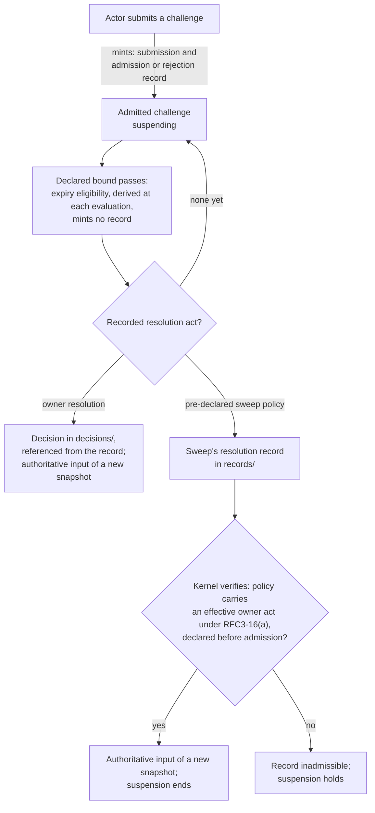
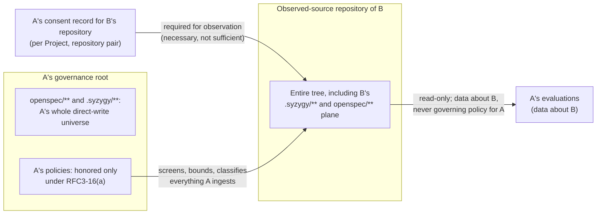

# RFC 0003 — Project, Workspace and .syzygy/** Manifests
## Module: manifests and namespace (every `RFC3-n` except RFC3-15…RFC3-17 and the lettered sub-clauses)

**Status:** Proposed foundational contract (self-declaration at authoring
time). Effective status is established solely by an owner-act record binding
this file's exact content digest — either owner-adopted (bootstrap,
uncorrelated) or Syzygy-verified, with the exact provenance state always
visible (RFC3-16). Absent such a record, this
contract binds nothing.

**Amended by GOVERNANCE-SIMPLIFICATION-D10** (drafted 2026-11-17; in force
from the owner's act recorded in
`.syzygy/governance/decisions/GOVERNANCE-SIMPLIFICATION-D10-ACT.md`).
RFC3-5's authority column, RFC3-6, RFC3-7, RFC3-8 and RFC3-9 are amended in
place to security.md SEC-2 and SEC-4 and vision.md VIS-4 as amended by D10:
reading a repository needs no consent and no record; content goes only to a
run's declared provider; write consent remains, for repositories the owner
does not own. Identifiers are unchanged. Effective status now follows
RFC3-16 as amended (`governance-homes-and-owner-acts.md`).

**Package:** one of two modules of RFC 0003; see `README.md` for the clause-set
map and lookup rule. Governance categories, artifact lifecycles and the
owner-act provenance predicate (RFC3-15…RFC3-17(a)) are in
`governance-homes-and-owner-acts.md` — cited here by clause ID.

**Serves:** VIS-3, VIS-4, VIS-5, VIS-6, VIS-7; SEC-2, SEC-4; architecture.md
(governance-root invariant, two-namespace plane, `.syzygy/` layout, schema
ownership split); SDR-7, SDR-28, SDR-29, SDR-30, SDR-32; resolves SDR §5
question 6. Builds on RFC 0001 (RFC1-28/29) and RFC 0002 (RFC2-1/2,
RFC2-23/24). Rationale, amendment history, rejected alternatives and answered
questions: `../../history/RFC-0003-history.md`.

---

## 0. Scope and reader map (non-normative)

*If this section and a clause disagree, the clause wins.*

This module is the semantic contract for **what lives on disk and who may
write it**: field *meanings* and *write authority*, never storage engines or
serialization beyond what authority requires. Its weight sits in **RFC3-2**
(every field has exactly one writer, from four classes), **RFC3-3** (no
manifest field may widen Syzygy's two-namespace write universe) and
**RFC3-4** (location, not any field value, designates the governance root).

- **§2.1 Principles and containment.** The one-writer rule and write
  containment — no manifest field may widen Syzygy's two-namespace write
  universe.
- **§2.2 The project declaration.** `.syzygy/project.yaml` (location is
  designation; closed field set) and consent.
  - Consent is recorded, revocable, per-(project, repository) and
    per-(project, provider).
  - Withdrawal degrades claims to Unknown rather than erasing history.
- **§2.3 The workspace manifest.** Personal presentation state, never
  authoritative for project-internal truth; asymmetric relation rendering.
- **§2.4–§2.7 Namespaces and migration.** Surface namespaces and `work/**`
  authority, cache/local, identity-preserving migration, the `openspec/**`
  boundary.
- **§2.8 Nesting.** **Composition by declaration** — a subproject is a whole
  governed Project related by declared edges, never a second root inside one
  repository.
- **§2.9** the OpenSpec seam; **§3** violation cases; **§4** integration;
  **§7** the open owner questions carried by this module (q1, q2).

Clause identities are package-wide: this module holds **every `RFC3-n` number
other than RFC3-15, RFC3-16, RFC3-17 and their lettered sub-clauses**, which
are in `governance-homes-and-owner-acts.md`. No numbers are retired or merged
anywhere in the package.

---

## 1. Motivation and doctrine grounding

[Observed] Doctrine fixes the shape and defers the contract: a governed
project has exactly one governance root holding the single `openspec/**` +
`.syzygy/**` plane; `project.yaml`'s representation is "RFC material"; the
`governance/` categories are constitutional minimums whose deeper
organization "remains RFC material"; `.syzygy/**` is migratable only through
"explicit, reviewable, identity-preserving migrations" (architecture.md).
SDR §5 q6 routes `project.yaml`, the workspace manifest, and `.syzygy/**`
versioning here; SDR-28/29/30 resolve OQ-010's portfolio tension — portfolio
truth is derived.

[Inferred] The failure mode this contract guards against is **authority creep
through configuration**: manifests are where write universes quietly grow,
where portfolio state accretes inside Syzygy against VIS-6, and where a
migration silently renames an identifier a dismissal, consent, or map anchor
depended on. Every clause below makes one of those creeps a recognizable
violation instead of a default.

---

## 2. The contract

Clauses are numbered `RFC3-n` for stable citation. Amend in place; retire
rather than renumber.

### 2.1 Manifest principles and write containment

**RFC3-1.** Manifests are **semantic contracts**: which fields exist, what
each means, and who may write it.

- Serialization is bound only where doctrine already binds it: the project
  declaration is the file `.syzygy/project.yaml` (name and location fixed by
  architecture.md's layout); everything else in this RFC names no file
  format, storage engine, or wire encoding.
- The `.yaml` filename is already a wire-format commitment, so its **exact
  dialect** (YAML version, coercion rules, duplicate-key handling) **is fixed
  by the first accepted spec that parses it, and is a conformance item from
  then on**.
- Two implementations disagreeing on whether one `project.yaml` parses — and
  therefore on whether a governance root exists — is a contradiction routed
  to the owner, never a dialect-preference each side may keep.

**RFC3-2.** **Every manifest field names exactly one write authority**, from
**four** classes:

- **owner-adopted** (only the owner adopts the value; Syzygy may draft, per
  VIS-4);
- **Syzygy-drafted** (Syzygy authors, value renders unadopted until owner
  sign-off);
- **Syzygy-maintained** (mechanical values Syzygy writes under this RFC's own
  rules, e.g. schema-version stamps under §2.6);
- **kernel-recorded** (values the kernel writes as a factual record of a
  **non-owner actor's** submission).

For the narrow RFC3-16(d) URL-dossier local machine-credential instance class, every closed-schema identity, binding, verifier and lifecycle field has the **Syzygy-maintained** authority, exercised only by the one policy-pinned typed trusted controller under that clause. This is an explicit authorization-data maintenance rule of this RFC, not kernel-recorded authority, generic permission for mutable policies or a second writer. The adopted parent rule/policy fields retain their ordinary adoption authority.

No field has two writers; a field whose authority is not declared by its
governing RFC may not exist.

**The fourth class, `kernel-recorded`** (owner decision **B19**, minted with
RFC3-15's `records/` category), covers a fact the kernel authors **on someone
else's act**: a challenge admission or rejection record, a submitted
withdrawal, a walkthrough execution record.

- The writer is single, so the one-writer rule holds; what distinguishes the
  class is that the **content originates outside the kernel and outside the
  owner**, so the record asserts *that a submission occurred*, never that its
  content is true.
- **A `kernel-recorded` value is never authorization-bearing**: it records,
  and recording authorizes nothing.
- Anything in this class that *would* authorize — a resolution policy, a
  sweep policy, an approval — is by that fact not in this class and falls
  under RFC3-16(a) instead.

**Which lifecycle transitions mint a record.** A `records/` fact is minted
on exactly **two triggers**, and no others — the same set RFC3-15's
`records/` cell states, so the two clauses can never be read apart:

- **(1) an actor's submission** — a challenge submitted (and its admission or
  rejection), a withdrawal submitted, a walkthrough run submitted;
- **(2) the pre-declared deterministic challenge-sweep policy resolving an
  expiry-eligible challenge as `expired`** (RFC2-13; owner decision B1).

**Owner resolution acts** — upholding, dismissing, or expiring a challenge by
decision — are Decisions in `decisions/` (RFC3-15), referenced from the
record, never minted into `records/`. **Kernel-computed expiry
*eligibility*** — a challenge's declared bound having passed (RFC2-3,
RFC2-13) — is **derived state computed at each evaluation** from the
admission record's instant and the declared bound; the *eligibility* mints
**no record**, because it involves no act and is reproducible from snapshot
inputs the tree already holds, so minting it would add a snapshot input
(RFC2-1 item 9) that pure recomputation created.

The **resolution** that ends the suspension is a different thing:

- Per RFC2-13 (owner decision B1), an expiry-eligible challenge keeps
  suspending until a **recorded resolution act** — a human resolution in
  `decisions/`, or the pre-declared deterministic policy sweep's resolution
  record in `records/` (RFC3-15's `records/` cell names it) — and that act is
  an authoritative input of a new snapshot.
- The sweep's resolution is not eligibility wearing a record: eligibility is
  a pure function of (snapshot, as-of) and re-derives at every evaluation,
  while the resolution happens **once, at the sweep execution's own
  instant** — *when* the suspension lifted is derivable from no snapshot
  input the tree already held, and that instant is exactly what the record
  fixes as the new snapshot's authoritative input.
- And the record authorizes nothing of itself: its authority is the kernel's
  verification that the resolving policy carries an effective owner act under
  **RFC3-16(a)** and was declared before the challenge was admitted (RFC2-13's
  pre-declaration requirement) — never the record's own say-so — so an
  unbacked resolution record is inadmissible and the suspension holds.
  (Shape-parallel with RFC3-17(a)'s admission-record authority rule.)

*Diagram (non-normative; the clauses govern):* which steps in a challenge's
expiry path mint a `records/` fact.

**RFC3-3.** **Direct-write containment.** No field of any manifest — project
declaration, workspace manifest, or any `.syzygy/**` artifact — may
authorize, imply, or configure a Syzygy direct write outside `openspec/**`
and `.syzygy/**` (VIS-5).

- Fields naming paths outside the two namespaces are **read/observation
  declarations only** (declared source roots, evidence locations).
- A field purporting to grant write access elsewhere is **inoperative** —
  Syzygy must not honor it — and its presence is surfaced as a contradiction
  routed to the owner, never silently ignored or silently obeyed.

### 2.2 The project declaration — `.syzygy/project.yaml`

**RFC3-4.** **Location is designation.** The project declaration lives at
`.syzygy/project.yaml` in exactly one repository, and that location — not any
field value — is what designates the repository as the Project's governance
root.

- A repository carries at most one `.syzygy/` plane, at its root, and is the
  governance root of at most one Project.
- A declaration purporting to designate a *different* repository as root
  is a contradiction per RFC1-1 — routed to the owner, never repaired
  silently.
- A Project resolving to two roots is a Contradiction per RFC1-1, routed
  under RFC1-21 and RFC2-24 reason 8. No root is picked and the
  contradiction is never repaired silently.
- A Project resolving to **zero** roots mints no contradiction: RFC1-1's
  zero-roots rule (cited, not restated) surfaces that case at the
  workspace/manifest level, unevaluable as a Project and rendered Unknown
  (`missing-declaration`), with no kernel contradiction to route.

*(Designation by field value was rejected: a field can dangle or lie; a
file's location cannot — history §6.)*

**RFC3-5.** The declaration's top-level field set is **closed** at:

| Field | Meaning | Authority (RFC3-2) |
|---|---|---|
| `schema_version` | The `.syzygy/**` plane schema version (§2.6) | Syzygy-maintained (migration rules only) |
| `project` | Opaque project identifier + display-name label (RFC1-10: rename changes the label, never the identifier) | Owner-adopted |
| `owner` | Attribution of the single accountable owner | Owner-adopted |
| `repositories[]` | Declared membership: per entry an opaque repository identifier (RFC1-2), role (`governance-root` \| `observed-source`), mutable non-identity locator hints (URL, path, default branch), and a consent-record reference | Owner-adopted; Syzygy-drafted entries render unadopted |
| `consents[]` | References to consent records in `governance/decisions/` (RFC3-7); never the records themselves | Owner-adopted (the referenced records are governance acts) |
| `declarations` | References locating the project's declaration artifacts: capability, topology, declared-region, and implementation-mapping artifacts (`governance/` per RFC3-19) and the spec root (`openspec/`, fixed) | Syzygy-drafted, owner-adopted |
| `relations[]` | **Outbound** declared cross-project relations (RFC3-14, RFC3-31): (relation type, counterpart project identifier) | Owner-adopted |
| `profiles[]` | Extension profiles loaded for this project (RFC1-7); never presumed present | Owner-adopted |

Additions to this field set require an amendment to this RFC. Sub-schemas
beneath `declarations` targets belong to RFCs 0004 and 0007–0009.

*(Amended by GOVERNANCE-SIMPLIFICATION-D10.)* In the Authority column,
"Owner-adopted" and "owner-adopted" read "adopted under RFC3-16 as amended":
an agent adoption, or the owner's decision where the field falls in an owner
class (vision.md VIS-4). A `repositories[]` entry's consent-record reference
is needed only for a write consent (RFC3-7); `consents[]` references write
consents only.

**RFC3-6.** **Repository entries.** *(Amended by
GOVERNANCE-SIMPLIFICATION-D10.)* Repository identity is the declared opaque
identifier — never a URL, path, or branch (RFC1-2); locator hints may change
without touching identity. A declared entry may be observed with no consent
record (security.md SEC-2 and SEC-4 as amended). An entry Syzygy cannot read
renders Unknown, never an empty graph read as absence (RFC1-3).
`unconsented-source-or-provider` (RFC2-24 #6) is no longer rendered for a
read; it remains for content withheld because no provider is declared for
the run.

**RFC3-7.** **Consent records** *(amended by
GOVERNANCE-SIMPLIFICATION-D10)* are governance acts stored in
`.syzygy/governance/decisions/`, referenced — never embedded — from the
declaration. One kind remains:

- **Write consent** (SEC-4): subject is the pair *(Project, repository)* for
  a repository that is not on the owner's list of owned repositories
  (`.syzygy/governance/decisions/OWNED-REPOSITORIES.md`, which only the
  owner changes); scope is write (governance-root plane only). A repository
  on the owner's list needs no write consent.

Observation consent and egress consent are retired. Reading a repository,
public or private, needs no record of any kind; content goes only to a
provider the run declares in its own record, and secrets never leave
through Syzygy (RFC5-12 and RFC5-14 as amended); a dossier session's own raw
reads are SEC-2's one disclosed exception (D11; RFC5-15). Execution is governed by SEC-3 as amended:
the agent decides sandboxed runs and records them in the run's record; a run
outside a sandbox is the owner's per-run decision.

Every write consent carries attribution, grant timestamp, and scope, and is
individually revertable. Attribution is a stored field and therefore a
*claim* about who granted it; it is honored only under RFC3-16(a).
[Inferred] Scoping write consent to the *(Project, repository)* pair, not
the bare repository, follows §2.8's dual-role rule: consenting to writes by
one project must not silently admit another.

**RFC3-8.** **Revocation and withdrawal.** *(Amended by
GOVERNANCE-SIMPLIFICATION-D10: it governs revoking a write consent and
withdrawing a provider from a run's declaration. With observation consent
retired, no read-dependent claim turns Unknown by revocation.)* Revoking
consent is a recorded governance act — narrowing or withdrawal — never
deletion of the record.

- Effect on **claim values**, always through the next identified evaluation
  (RFC2-4):
  - dependent claims render Unknown (`unconsented-source-or-provider`);
  - inference overlays for a withdrawn provider are not computed (RFC2-7);
  - prior observation records remain — immutable, VIS-6, exception (b) — but
    render with the withdrawal visible (RFC2-23, "Consent withdrawn").
- Effect on **rendering**, immediately at the revocation record: every
  subsequent served render of a dependent claim carries the withdrawal label
  before and independent of that evaluation (RFC5-11).
- Enforcement — what may be read, egressed, or launched — stops at the next
  act, not at the next evaluation (RFC5-11).

Withdrawal never rewrites history and never silently empties a surface.

**RFC3-9.** **Drafting and repair.**

- On a newly governed or undeclared project, Syzygy may draft declaration
  content (membership, declaration references) as first-pass work [Observed:
  v1.md, non-code writes]; drafted values render unadopted and bind nothing
  until adopted (RFC3-16 as amended by GOVERNANCE-SIMPLIFICATION-D10: an
  agent adoption, or the owner's decision in an owner class).
- An unparseable or invalid `project.yaml` renders every dependent claim
  Unknown; Syzygy never auto-repairs it — a repair is a Proposal (RFC1-27)
  adopted like any other change (RFC3-16 as amended), and Syzygy never overwrites a governance artifact it
  did not author without surfacing the conflict (SEC-4).

### 2.3 The workspace manifest (platform level)

**RFC3-10.** The **workspace manifest** is the owner's platform-level
manifest, living **outside every governed plane** (in Syzygy's own home, not
in any governed repository). It is classified under **VIS-6, exception (a)**
— personal presentation state: it may never affect truth, work, status, or
certificates, and it is never a snapshot input (RFC2-1). [Inferred] That
classification is what makes a platform-level file lawful at all: the only
doctrine-recognized states outside the governed planes are the two closed
VIS-6 exceptions, and the manifest's SDR-29 concerns are presentation-shaped.

**RFC3-11.** Its field set is **closed at SDR-29's list**: local project
membership (which governed projects this workspace shows), grouping and
ordering, saved cross-project views, and owner-specific portfolio
narrative/dashboard preferences. Additions require an amendment to this RFC.
Authority: owner-adopted or Syzygy-maintained-as-preference; never
Syzygy-inferred into semantic content.

**RFC3-12.** **Never authoritative for project-internal truth (SDR-30).** No
kernel fact, claim, gap, consent, capability, or relation may cite the
workspace manifest as its source. Adding or removing a project from the
workspace changes what is *rendered*, never any project's state, consent, or
membership. Portfolio truth is **derived** from governed projects' own
declarations (SDR-28) — computed, rebuildable (VIS-6), and re-derivable from
the planes alone with the workspace manifest deleted.

**RFC3-13.** The workspace manifest **references project identities minted in
project declarations; it never mints one**. An entry whose project identifier
cannot be resolved (repository unreachable, plane absent, consent withdrawn)
renders Unknown with its RFC2-24 reason — never dropped, never guessed.

**RFC3-14.** **Asymmetric relation semantics.** Cross-project semantic
relationships come only from project declarations (`relations[]`, RFC3-5).
When Project A declares a relation to Project B and B declares no counterpart:

- rendered **from A's side**: *declared by A, unconfirmed by B* — a declared
  fact about A's intent, never evidence about B;
- rendered **from B's side**: *asserted by A, undeclared here* — visibly
  external, never entering B's own declared state;
- a relation renders **confirmed** only when both projects declare compatible
  counterparts; incompatible mutual declarations render both claims side by
  side, attributed — never silently reconciled and never auto-completed by
  Syzygy or the workspace manifest.

[Inferred] Mutually incompatible declarations are *not* a kernel
contradiction — each lives in its own project's declared scope — so the
honest rendering is both-visible-unconfirmed, routed to the owner as a
finding, not adjudication-blocked.

**The Project→Project dependency relation is named `depends-on`, and the name
collides deliberately** (owner decision **B20**, taken having been shown the
collision and its consequence).

- It is a **portfolio-profile** relation (RFC1-7), Project→Project, of
  **Desired (declared)** semantic class and **owner-adopted** authority.
- RFC1-25's V0 `depends_on` is a different relation entirely, closed to two
  endpoint pairs — Work item→Work item (execution class,
  scheduler-authoritative) and Code element→Code element (observed class).
- RFC1-26 permits profiles to **add** relations but not to **re-type** the
  closed set: this relation is an addition, and `depends_on` is not widened
  to a third endpoint pair.

**The consequence of the collision is normative, not stylistic.** The two
names differ by exactly one character, across different semantic classes with
different authorities, so **the names do not separate the senses and the whole
separation is carried by RFC1-25(b)'s twelve-pair anti-conflation invariant**
— which is for that reason a mechanically checkable rule and a named
test-coverage obligation of the first implementation slice, rather than the
prose rule a distinct verb would have allowed.

- Any surface, legend, query, or count that unions this relation with
  `depends_on`, or treats either as evidence of the other, violates
  RFC1-25(b); labelling the union does not cure it.
- A reader going by relation names alone **will** conflate them, so
  conformance rests on the invariant being tested, not on the reader being
  careful.

[Inferred — the collision is the owner's decision; its elevation of
RFC1-25(b) from prose to a tested invariant is this RFC's, recorded so the
cost of the naming choice stays attached to the choice.]

### 2.4 Surface directories, and `.syzygy/work/**` authority

**RFC3-18.** `intent/`, `work/`, and `map/` are schema-versioned governed
namespaces whose internal contracts belong to RFCs 0007–0009. This RFC binds
only the namespace class: they are part of the plane that stays with the
repository at offboarding (architecture.md), they obey §2.6 versioning and
migration, and nothing in them may become independently authoritative over
kernel semantics (architecture.md, one kernel).

**RFC3-19.** **`.syzygy/work/**` owns approved execution intent before
materialization** (SDR-7; RFC1-28): approved execution-intent Proposals
reside there until their immutable materialization record exists, after which
the scheduler is authoritative for lifecycle and the proposal is terminal.
`work/**` also holds materialization records and Execution Records (Evidence
artifacts, SDR-8). The materialization record's schema **must pin the exact
intent revision cited by the warrant** — RFC 0002's reconciliation chain
binds its verdict to that pinned revision (RFC2-18). The obligation is stated
once, in RFC 0001 (RFC1-29, with RFC1-5's materialization-record row); this
clause restates its schema consequence and requests no amendment.

### 2.5 Cache and local state

**RFC3-20.** **`.syzygy/cache/` is rebuildable projection, nothing else**
(VIS-6).

- The deletion-safety invariant: deleting `cache/` in its entirety, at any
  instant, changes no truth, status, work, consent, or authoritative artifact
  — everything in it is re-derivable from the artifacts that own its facts.
- Nothing in `cache/` may be cited as evidence, serve as a snapshot input,
  hold Genome membership, or be the only home of any fact.
- Observation records are **not** cache: they are non-rebuildable historical
  evidence (VIS-6, exception (b)) and must not live where deletion is
  declared safe.
- Syzygy deletes `cache/` at offboarding (architecture.md).

**RFC3-21.** **`.syzygy/local/` is personal presentation state** — VIS-6,
exception (a): layouts, filters, bookmarks, unpromoted notes.

- It is never truth-bearing, never a snapshot input, and may never affect
  truth, work, status, or certificates.
- The **only** path by which its content gains authority is promotion: an
  explicit act committing the content out to the governed plane as an
  attributed, reasoned annotation or dismissal (VIS-6).
- At offboarding Syzygy exports `local/` to the owner; deleting it loses
  personal state only, never truth.

### 2.6 Schema versioning and migration of `.syzygy/**`

**RFC3-22.** **Version stamps.** The plane carries one plane-level schema
version (`schema_version` in `project.yaml`); artifact classes with their own
governing RFCs may carry per-class versions. Stamps are Syzygy-maintained
(RFC3-2) and are **snapshot inputs**: an evaluation records the schema
versions it read (RFC2-1), so a migration is visible as a snapshot
difference, never an invisible re-interpretation.

**RFC3-23.** **Migrations are identity-preserving.** A schema migration may
reorganize representation; it may never change any minted identifier,
adoption status, attribution, timestamp, consent scope, dismissal reason or
expiry, or evidence integrity digest, and every pre-migration citation
(claim, dismissal, consent reference, map anchor) must resolve identically
after it (trust-floor link rule). A change that would alter any of these is a
**semantic change**, not a migration, and goes through the changed artifact's
own adoption gate.

**RFC3-24.** **Migration is an explicit, reviewed, revertable act.**

- Migrations run only as a deliberate act, never lazily on read — a read must
  never mutate the plane (idempotence, RFC2-22).
- Each executed migration is attributed to Syzygy, atomic, and individually
  revertable (SEC-4), and records what it transformed.
- Migration definitions fall under the craft cluster's mandatory
  independent-review class 5 — "`.syzygy/**` schema migrations, any
  identity-affecting store change" (CC-REV-1) — and under this RFC once
  accepted: migrating to a schema no accepted contract defines is a
  violation.

**RFC3-25.** **Forward and backward behavior.**

- A Syzygy build reading a plane whose stamped version is **newer** than it
  understands must not write to that plane and must not downgrade it; content
  it cannot interpret renders Unknown — never partially parsed and presented
  as whole (VIS-1; RFC2-23 partial-snapshot rule).
- A plane **older** than current is read via the declared migration path and
  upgraded only by the explicit act of RFC3-24.
- There is no in-place downgrade obligation: reverting a migration is the
  version-control revert of its atomic write.

**RFC3-26.** **`openspec/**` is outside Syzygy's migration authority.**
Schema versioning and migration in this section govern `.syzygy/**` only.
`openspec/**` is governed by the constitutional OpenSpec artifact contract:
Syzygy writes it only in OpenSpec-compatible form and may not reorganize it
for its own convenience (architecture.md, schema ownership).

### 2.7 `openspec/**` interoperability

**RFC3-27.** What Syzygy **reads** from `openspec/**`:

- requirement and scenario content under the artifact contract's own identity
  scheme, held by the kernel as (artifact identity, anchor) references
  (RFC1-15);
- changeset/adoption state as facts;
- spec structure for rendering.

The kernel never claims ownership of spec content or identity — the artifact
contract is the external authority, and the OpenSpec CLI is a substitutable
adapter beneath a non-substitutable artifact contract.

**RFC3-28.** **Spec anchors (SDR-32).** Adapter contracts must support
resolvable spec anchors — stable references into `openspec/**` that claims,
mappings, and the reconciliation chain can cite. A missing or unresolvable
anchor renders the dependent claim Unknown; it **never** rejects the project,
blocks observation, or is silently re-guessed (RFC1-15: degrade, never
guess). Whether OpenSpec identities survive edit and rename remains [Unknown]
and is RFC 0004's adapter-contract obligation.

### 2.8 Nested and recursive projects

The seed hypothesis promises "recursively nested subprojects" [Observed], and
OQ-010 flags the conflict with the one-root invariant. Resolution:

**RFC3-29.** **One plane per repository; one root per Project — upheld.** A
repository carries at most one `.syzygy/` plane, at its root (RFC3-4). There
are no directory-scoped sub-roots: a `.syzygy/` directory anywhere but a
repository root designates nothing and is surfaced as a finding.

**RFC3-30.** **Dual roles are lawful and per-pair.** One repository may
simultaneously be the governance root of its own Project and a declared
observed-source repository of one or more other Projects.

- Role and consent are properties of the *(Project, repository)* pair
  (RFC3-7), never global: Project A observing repository R requires A's own
  consent record for R, regardless of R's role elsewhere.
- An observing Project reads the observed repository's entire tree —
  **including its `.syzygy/**` and `openspec/**` plane — read-only**: A's
  direct-write universe is A's own governance root's two namespaces and
  nothing else (VIS-5); A never writes, migrates, or "repairs" B's plane.

**Governing policy is a property of the *observing* project's governance
root.** Project A screens, bounds, and classifies everything it ingests under
**A's** policies in A's own plane: secret detection (SEC-5; RFC5-16,
RFC4-12), currency bounds (RFC2-9), retention bound (RFC4-16), egress
content-class rules (RFC5-14).

- Each is an owner-approved declaration widening what Syzygy may honor, so
  **each is honored only under RFC3-16(a)** — A's own plane being the source
  is necessary and not sufficient, since A's plane is writable by the
  untrusted actor class too (SEC-3's class, extended to committed artifacts
  by the premise RFC3-16(a) states): a worker-minted policy in A's own tree
  weakens A's screening exactly as a permissive policy adopted from B's
  would.
- Content read from an observed-source plane — **including that plane's
  `.syzygy/governance/**`** — is **data about B, never governing policy for
  A**, and never a snapshot input to A's evaluations in the policy-version
  role (RFC2-1 item 7 records *A's* policy versions). This is the dual of
  RFC3-32.
- RFC2-9's currency-bound ambiguity resolves identically: **A's declared
  bound governs A's claims about B**, whatever bound B declares for its own.

[Inferred] The nearest-plane reading would let a compromised B ship a
permissive policy weakening the screening of B's own content as it enters A
— the source choosing its own scrutiny.

*Diagram (non-normative; the clauses govern):* what Project A may do to its
own governance root versus a repository it observes.

**RFC3-31.** **Nesting is composition by declaration.** A "subproject" is a
full governed Project with its own governance root, owner consent, and plane.
The parent/child relationship is an ordinary outbound declared relation
(`relations[]`, type `subproject-of` from the child and/or
`contains-project` from the parent), rendered per RFC3-14: one-sided
declarations render unconfirmed/asymmetric; both-sided compatible
declarations render as a confirmed hierarchy. The portfolio and any recursive
rendering are **derived** views over these declarations (SDR-28) — recursion
lives in the rendering, never in the plane. A declared hierarchy containing a
cycle renders the cycle explicitly and routes to the owner; Syzygy never
silently breaks it.

**RFC3-32.** **What a parent may never do:** hold authoritative state about a
child's internals (SDR-30 applies to parent projects exactly as to the
workspace manifest); adopt, dismiss, or consent on the child's behalf;
aggregate a child's Unknowns into a parent-level green (VIS-1). A parent's
views of a child are projections of the child's own declared and observed
state, at the parent's evaluation, with the child's epistemic labels carried
through unchanged.

**"Labels carried through unchanged" is not the whole obligation — RFC6-17
is.** Any parent-level aggregate over a child's facts discloses **RFC6-17's
full composition**: the RFC6-22 equivalence tuple, per-label, per-tier,
per-Unknown-reason and per-freshness-state counts and sibling surface states,
expandable to members. The obligation is **cited here, never restated**, so
the roll-up path cannot drift from the aggregation contract the way a
paraphrase would. Labels-and-Unknowns alone is the narrow reading and is
satisfiable while laundering — a parent rendering a child's district as
"Observed ×30" carries every label through and aggregates no Unknown into
green while hiding that all thirty are `reduced-fidelity` and twelve are
stale. RFC7-37 binds the same obligation on the narrative side.

---

### 2.9 Authority boundary at the OpenSpec seam (binding phase rule)

**RFC3-33.** This contract schedules nothing: **it is not a specification of
record from which implementation work may be scheduled**.

- No implementation work for user-observable consequences of this contract —
  governance-home layout behavior, project declaration and manifest
  validation flows, owner-act ceremony surfaces, provenance and
  effective-status rendering — may be scheduled solely from this RFC.
- Before implementation, every observable consequence either maps to an
  approved OpenSpec requirement and scenario in the governance root's
  `openspec/**` plane, or carries a reviewed N/A judgment proving it purely
  structural with no independently testable behavior.

**The reviewed N/A judgment's home and gate.** A reviewed N/A judgment is a
recorded owner judgment homed in `decisions/` (RFC3-15), and the judgment is
honored only through an effective owner act under RFC3-16(a), in state (1) or
state (2), with that state rendered; absent or invalid acts map nothing and
leave the consequence unmapped and Unknown, never covered (RFC3-16(a)'s
effect rule; VIS-2).

**Rows are per observable consequence, not per clause.**

- A clause with five observable consequences and one mapped requirement is
  not covered; the matrix discloses the consequences it enumerates for each
  clause, so a complete-looking matrix over under-enumerated consequences is
  a defect of the matrix.
- At surface specification a clause-to-requirement coverage matrix over
  RFC3-1..RFC3-33 is produced — **that matrix is review material, never
  authority**.

This clause creates no OpenSpec content now (none may exist during
bootstrap). This clause binds the whole RFC 0003 package, not this module
alone. (Shape-parallel with RFC6-28, RFC7-38, RFC8-32, RFC9-52, RFC10-16,
RFC11-12.)

## 3. Violation cases

*(Cases for RFC3-15…RFC3-17(a) are in `governance-homes-and-owner-acts.md` §2.
Original numbering is preserved package-wide; this module carries 1–6, 8–12
and the cache/local limbs of 9.)*

1. *(RFC3-3)* A field `write_roots: [docs/]` is honored and Syzygy commits
   under `docs/` — the write universe expanded by configuration.
2. *(RFC3-4)* Two repositories each carry a `project.yaml` claiming the same
   project identity and Syzygy picks the fresher one instead of routing a
   contradiction.
3. *(RFC3-6/7)* An entry with no resolvable consent record renders as an
   empty-but-green region instead of Unknown; or one repository's consent for
   Project A is treated as consent for Project B.
4. *(RFC3-8)* Withdrawing a provider consent deletes the record and the
   inference overlays vanish without a rendered reason.
5. *(RFC3-10/12)* A cross-project edge is drawn because both projects sit in
   one workspace group; or deleting the workspace manifest changes a
   project's rendered membership or status.
6. *(RFC3-14)* A declares `depends-on B`, B declares nothing, and the
   portfolio renders a confirmed bidirectional edge; or a declared
   `depends-on` edge is rendered, legended, or queried as RFC1-25's observed
   `depends_on`.
8. *(RFC3-19)* An approved plan item is edited in `work/**` after its
   materialization record exists (also RFC1-29); or a materialization record
   omits the warranted intent revision and the reconciliation chain silently
   evaluates against current intent.
9. *(RFC3-20/21)* An observation record under `cache/` is lost to a purge; or
   a `local/` bookmark list is read as a snapshot input. *(The challenge
   admission record limb of case 9 is carried at
   `governance-homes-and-owner-acts.md` §2 under RFC3-17(a).)*
10. *(RFC3-23/24)* A migration renames capability identifiers "for
    consistency" and the map relocates; or opening the UI silently upgrades
    the plane's schema on read.
11. *(RFC3-25)* A build reading a newer plane writes its older schema back —
    a silent downgrade destroying fields it never understood.
12. *(RFC3-29/30)* A nested `.syzygy/` inside `src/` is treated as a
    governance root; or a parent "fixes" a typo in a child's `project.yaml`;
    or Project A screens content ingested from B under **B's**
    secret-detection policy.

---

## 4. Integration

**Relies on RFC 0001:** project/repository/role/consent entity semantics
(RFC1-1…4); opaque identifiers and label/identity separation (RFC1-10); the
portfolio extension profile (RFC1-7); Proposal lifecycle and plan-item
resolution (RFC1-27/28/29). **Relies on RFC 0002:** the Unknown-reason
vocabulary (RFC2-24 #6) and failure-state renderings (RFC2-23) that give
consent withdrawal its exact effect; snapshot inputs (RFC2-1) that make
versions identity-bearing; idempotence (RFC2-22) behind no-migration-on-read.

**Relies on the package's other module:** the `decisions/` home and install
gate for consent records and the `records/` home and `kernel-recorded`
authority named at RFC3-2 (RFC3-15, RFC3-17(a)); and **RFC3-16(a)**, under
which a consent record's stored attribution (RFC3-7) and an observing
project's own policies (RFC3-30) are honored.

**Not a reliance: RFC 0004.** Every RFC4-n citation in this module — the
adapter identity (RFC4-12) and retention bound (RFC4-16) named inside
RFC3-30's illustrative policy list — sits in a non-exhaustive example, not
in a rule this module's meaning needs, and this module's front matter
therefore declares no RFC-0004 edge (same treatment as the package's other
module, repaired at `round-2026-08e/WAVE-A-SEMANTIC-DELTA.md` §10).

**Forward references are informative.** Where a clause of this module cites a
not-yet-accepted sibling contract by clause number (RFC7-n and beyond —
RFC3-32's narrative-side parallel at RFC7-37 is the instance), the citation is
**informative until that RFC is accepted**: it names where a parallel
obligation will be discharged, never a dependency of this contract's meaning,
and a renumbering in a sibling draft changes nothing here. Only citations to
**adopted doctrine**, to the **SDR**, and to the sibling contracts this section
names as reliances are load-bearing.

**Provides to RFC 0004:** consent and anchor semantics its adapter contracts
must honor (RFC3-7/8, RFC3-28); the schema-version stamp as a snapshot input;
the bar on observation records living in `cache/` (RFC3-20). **To RFC 0005:**
the consent-record content model behind machine-consumable consent checks.
**To RFCs 0006–0009:** the namespace authority classes for `intent/`,
`work/`, `map/`, and the workspace-manifest boundary every portfolio
rendering must respect.

---

## 5. Alternatives considered

Moved to history §6: the nested-project options (directory-scoped sub-roots,
a parent-owned subproject registry, rejecting nesting outright), the
workspace manifest as a governed artifact, embedded consent records, and lazy
migration on read. Two remain load-bearing for reading live clauses and are
cited in place: **composition by declaration** was chosen over sub-roots and
a parent-owned registry (RFC3-31), and **designation by field value** was
rejected because a field can dangle or lie while a file's location cannot —
the reasoning RFC3-16(a) extends to authorizations.

---

## 6. Deliberately deferred

- Concrete field grammars, YAML dialect rules, and validation tooling →
  implementation under accepted contracts.
- Snapshot physical representation and the observation-record storage home →
  RFC 0004 (constrained by RFC3-20/22).
- Machine-client consent verification and consent-surface rendering
  mechanics → RFC 0005.
- Internal schemas of `intent/`, `work/`, `map/` → RFCs 0007–0009 (namespace
  class fixed in RFC3-18/19).
- Retention/compaction policy for `work/**` execution records (SDR-10) →
  RFC 0004 + quality policy.
- Multi-workspace and multi-user manifests → deferred with multi-user
  (v1.md).
- Cross-project relation *type vocabulary* beyond
  `subproject-of`/`contains-project`/`depends-on` → portfolio profile RFC
  material (RFC1-7).

---

## 7. Open questions for acceptance

*(Package-wide numbering is immutable. q4 is carried by
`governance-homes-and-owner-acts.md`; q3, q5 and q6 are answered and recorded
in history §8. No question is renumbered.)*

**q1. Monorepo subprojects (RFC3-29).** Composition by declaration requires
each governed subproject to be its own repository. An owner who wants several
governed projects inside one physical repository is foreclosed until doctrine
amends the root definition. Accept the foreclosure (recorded here per the
north-star recording rule), or direct that a directory-scoped-root amendment
be drafted for owner adoption?

**q2. Workspace manifest classification (RFC3-10).** VIS-6, exception (a)
means workspace state — including saved cross-project views and the portfolio
narrative preferences — is exempt from rebuildability and is lost if not
exported. Acceptable for owner-first V0, or should saved cross-project *views*
(as distinct from preferences) be re-derivable by construction?

---

*End of module. Clauses RFC3-1 … RFC3-14 and RFC3-18 … RFC3-33, complete with
no retired, merged, or unused numbers. RFC3-15, RFC3-15(a), RFC3-16,
RFC3-16(a), RFC3-16(b), RFC3-16(c), RFC3-17 and RFC3-17(a) are in
`governance-homes-and-owner-acts.md`.*
