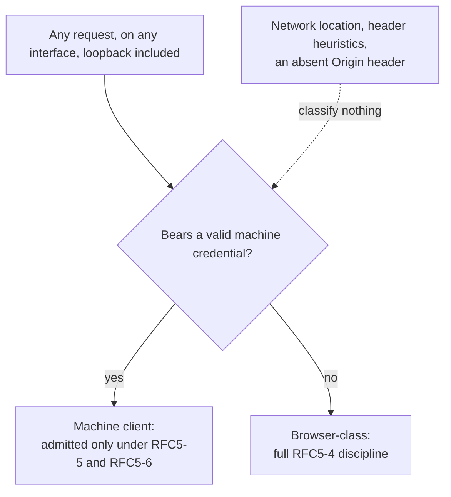
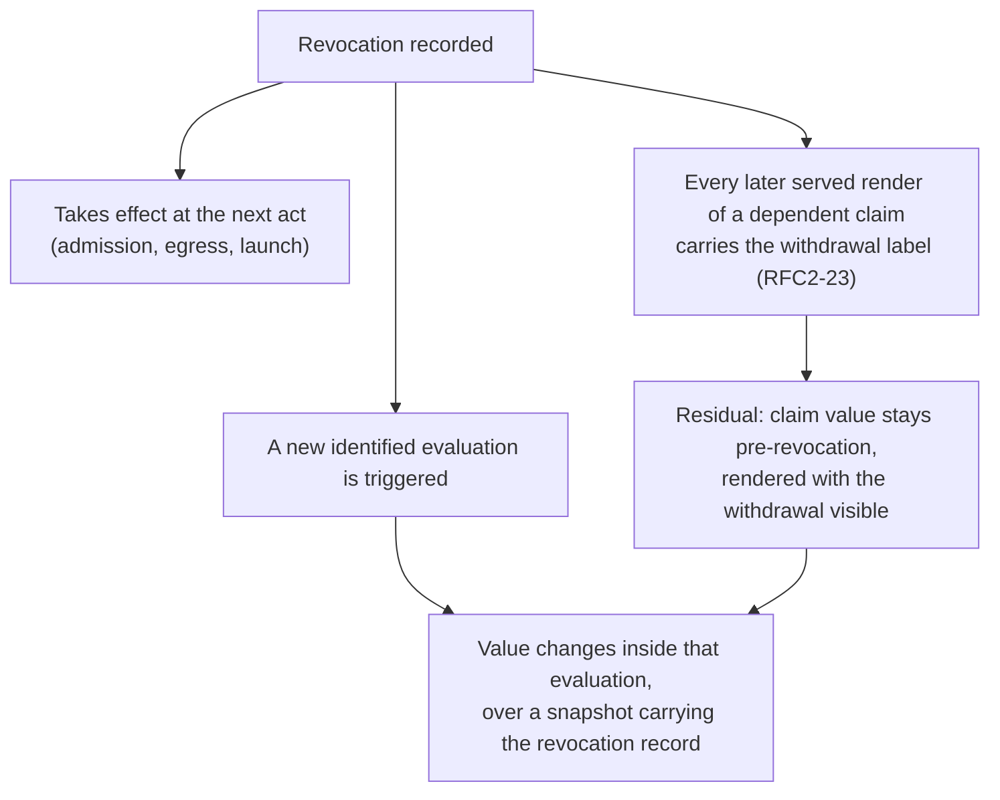
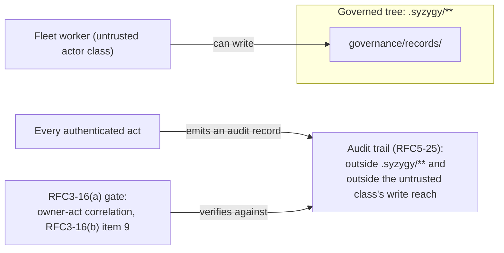

**Status:** Proposed foundational contract (self-declaration at authoring
time). Effective status is established solely by an owner-act record binding
this file's exact content digest — either owner-adopted (bootstrap,
uncorrelated) or Syzygy-verified, with the exact provenance state always
visible (RFC3-16). Absent such a record, this contract binds
nothing.

**Package:** module 1 of 3 of the RFC 0005 contract package. Index, clause map,
lookup rule, package-spanning integration and the package question list:
`README.md`. Rationale, amendment history, alternatives, and answered §8
questions: `../../history/RFC-0005-history.md`.

**Serves:** SEC-1, SEC-4, SEC-5; VIS-5 (adapter authorization); VIS-7/trust
floor. Implements SDR §5 q8's machine-client half and owner decisions **B9**
(session identity is the credential and nothing else), **B4** (revocation forces
an evaluation), and **A1** (where the audit trail lives). Grounded in FD-009
(LAN posture) and OQ-007.

---

## 0. Module scope and reader map (non-normative)

*If this section and a clause disagree, the clause wins.*

This module decides **who may talk to Syzygy at all, and how every act at that
boundary is attributed and revoked**: it answers *may this request in?* Three
clauses carry the weight. RFC5-3 classifies every request by the credential it
presents into exactly two closed client classes; RFC5-11 makes revocation
effective at the next act without disturbing RFC 0002's evaluation
determinism; and RFC5-25 keeps the audit trail outside the governed tree.

- **Place in the package.** The other two modules presuppose this one.
  - An egress check (module 2) or an execution launch (module 3) is performed
    *for* an admitted principal.
  - Both emit into the audit trail defined here (RFC5-25).
- **Four rules carry most of the weight.**
  - **Being local proves nothing.** Classification is by credential
    presented, never network location (RFC5-3); a fresh install serves
    loopback only (RFC5-10).
  - **Exactly two client classes, exhaustive and closed** (RFC5-3, RFC5-5): a
    browser holding a session, or a machine client holding its own machine
    credential. The web UI, the official `syzygy` CLI, an agent-protocol
    adapter (e.g. MCP), scripts, and fleet workers are all covered by those
    two, and no later contract may add a third.
  - **Sessions are the credential and nothing else** (decision B9), so a
    declared maximum lifetime and immediate owner-initiated revocation are the
    *entire* remaining mitigation (RFC5-4).
  - **The audit trail lives outside the governed tree** (RFC5-25) —
    load-bearing, because RFC3-16(a)'s owner-act correlation rests on it.
- **Contract shape only.** RFC5-7 enumerates four machine-credential mechanism
  classes and selects none.
  - That selection is §8 q1, scoped there as a V0-implementation choice that
    cannot change RFC5-6's shape.
- **Where each clause lives.**
  - §3.1 principals and sessions: RFC5-1, RFC5-2.
  - §3.2 client classes: RFC5-3, RFC5-4, RFC5-5.
  - §3.3 machine-credential shape and mechanisms: RFC5-6, RFC5-7.
  - §3.4 exposure modes: RFC5-8, RFC5-9, RFC5-10.
  - §3.5 acts versus claims: RFC5-11.
  - §3.10 adapter credentials: RFC5-24.
  - §3.11 audit and revocation: RFC5-25, RFC5-26.
  - §3.12 the OpenSpec seam, binding the whole package: RFC5-27.

---

## 3. The contract

Clauses are numbered `RFC5-n` for stable citation. Amend in place; retire
rather than renumber.

- A pointer *(history §RFC5-n)* means amendment narrative, prior wording, or
  originating decision text was extracted at the rev10 compaction; that
  material is non-normative and the clause text is the contract.
- Decision identifiers named inline (A1, B4, B9, FD-009, FD-018/FD-029)
  remain binding provenance here.

### 3.1 Principals and the single-owner pre-commitment

**RFC5-1.** Every authenticated act binds to exactly one **principal**. The
V0/V1 principal classes are closed:

- the **owner** (doctrine's single human);
- **machine clients** (agent and CLI processes acting on the owner's behalf
  under their own credentials, never the owner's); and
- **Syzygy itself** (attribution of its writes and adapter effects, SEC-4).

Multi-user operation is deferred [Observed: v1.md deferral table]; three
pre-commitments keep later principals additive rather than structural:

- (a) authorization is evaluated against a principal's **scopes**, never
  against the assumption that exactly one human exists;
- (b) every audit record, consent record, and approval Decision names its
  principal explicitly, never implying "the owner";
- (c) admission ("authenticated") and permission ("authorized") are separate
  tests everywhere.

What multi-user would add (roles, delegation, per-principal consent authority)
is deliberately absent, not implicitly present.

**RFC5-2.** Sessions and credentials are distinct.

- A **session** is a bounded, revocable admission of a browser principal,
  established through an owner-attended act (§3.2).
- A **machine credential** is a durable, scoped, revocable admission of a
  machine client (§3.3).
- Neither is transferable across client classes: a session cookie never
  admits a machine client; a machine credential presented by a browser page
  does not create a session.

### 3.2 Client classes

**RFC5-3.** Every request is classified as exactly one of two client classes,
**by credential presented, never by network location or header heuristics**:

- a request bearing a valid machine credential is a machine client;
- every other request is browser-class.

Loopback location alone never proves client identity (SEC-1), and an absent
browser `Origin` header is neither automatically trusted nor treated as a
browser-origin violation (SEC-1): absence of a header classifies nothing — the
request must satisfy its class's full discipline.

**The two classes are exhaustive, for all present and future clients** *(rev10
scoping, directive §2 / OD-R10-5).* There is no third client class and **no
later contract may introduce one**: any client that is not a browser holding a
session under RFC5-4 is machine-class, admitted **only** under RFC5-5 and
RFC5-6.

- This binds the official `syzygy` CLI, agent-protocol adapters (e.g. an MCP
  server or equivalent), scripts, and fleet workers alike.
- Being first-party, official, packaged with the service, or co-located with
  it grants a client nothing.
- A contract needing a further client class would be **amending this clause,
  not extending it**.

*Diagram (non-normative; the clauses govern):* how RFC5-3 sorts a request into
its client class, and the discipline each class then owes.

**RFC5-4.** Browser-class discipline, **including on loopback**:

- **Session requirement.** State-changing and data-bearing endpoints require
  an established session, minted only through an owner-attended act on a
  trusted channel (first-run pairing on the serving host, or an authenticated
  login under §3.4's non-loopback modes).
- **Session identity is the credential and nothing else** *(ruled at acceptance
  by owner decision B9; history §q2).* A session is **not** bound to a device, a
  device identity, or any network-layer property — the strictest reading of
  SEC-1's "by credential presented, never by network location", declining the
  overlay-network device-identity exception rather than taking it.
- **Lifetime and revocation are therefore binding obligations, not defaults.**
  [Inferred — stated because leaving it implicit would make the ruling less
  safe than the alternative it beat.] With no device binding, an escaped
  session credential is a **complete session anywhere**; how long it stays
  valid and how fast it can be killed are the *only* remaining mitigations.
  So:
  - every session carries a **declared maximum lifetime**, after which it is
    invalid without re-authentication (value is quality-policy material; an
    **undeclared lifetime means sessions do not persist beyond the process**,
    never an unbounded default); and
  - **immediate, owner-initiated revocation of any or all sessions is a
    required capability**, effective at the next request rather than the next
    evaluation — an admission control, not a claim. An implementation
    offering no revocation path does not conform.
- **Anti-CSRF proof.** Every state-changing request carries a per-session
  anti-forgery proof (token or equivalent) a foreign origin cannot read.
  - A present `Origin` or `Sec-Fetch-Site` header is validated against the
    mode's allowlist.
  - When absent the proof alone decides — per RFC5-3, absence neither admits
    nor condemns.
- **DNS-rebinding defense.** Every browser-class request's `Host` header is
  validated against the closed hostname set of the active exposure mode
  (§3.4); an undeclared host is refused before any application logic runs.
  - A browser-originated `localhost` fetch from an arbitrary web page must
    fail both origin validation and the anti-forgery proof — the SEC-1
    violation example must be structurally impossible, not merely
    discouraged.

**RFC5-5.** Machine clients are admitted **only** through an explicit
machine-client authentication mechanism (SEC-1). There is no anonymous machine
access on any interface, loopback included; a request with neither session nor
machine credential may reach only the endpoints an unauthenticated visitor may
see, and that set is closed: liveness/health and the authentication bootstrap
itself, neither exposing portfolio data. **The closed set is
interface-qualified**, because SEC-1 permits unauthenticated reachability
**only on the loopback interface**: on a non-loopback serving mode the two
endpoints are reachable only from behind that mode's device restriction
(RFC5-9), and **the bootstrap endpoint never issues a credential outside
RFC5-6's owner-attended ceremony** on either interface. Without the
qualification a conforming implementation could expose credential bootstrap on
a LAN address on this clause's plain text, which SEC-1 forbids [Inferred —
composition with SEC-1, RFC5-6 and RFC5-9; the residual risk was already small,
the silence was the defect].

**Named machine-class clients** *(rev10 scoping, directive §2 / OD-R10-5).* The
official `syzygy` CLI, agent-protocol adapters (e.g. MCP), scripts, and fleet
workers are machine clients **without exception**.

- Each presents its own machine credential under RFC5-6 naming its own
  machine-client identity — never the owner's (RFC5-1).
- None is admitted by co-location, packaging, first-party status, or the fact
  that one canonical Syzygy service serves all clients over one semantic API.
- Any future client of that service is admitted by this clause or not at all.

### 3.3 Machine-client credentials: the contract shape

**RFC5-6.** A machine credential's contract shape, binding whatever mechanism
is chosen:

- **Identity.** Each credential names one machine-client identity (e.g.
  "beads-adapter on host X", "owner CLI"), minted at issuance, opaque and never
  reused. Identity survives rotation; revocation is per-identity or
  per-credential-instance.
- **Issuance.** Only through an owner-attended ceremony on an already-trusted
  channel (an authenticated session, or the serving host's own console).
  Credentials are never self-issued, never minted by another machine
  credential, and never distributed through an observed project's content.
  The sole RFC3-16(d) URL-dossier OS-local class instead uses its fixed adopted issuance/scoping policy and one trusted host controller, not per-instance adoption/owner ceremony or authority delegated through another machine credential. Parent rule/policy adoption and all owner classes remain unchanged.
- **Scoping — deny by default.** A credential carries an explicit scope set:
  which projects it may read, whether it may submit proposals, trigger
  evaluations, or reach adapter-mediated effects. An unscoped credential is
  invalid, not all-powerful. Scope enumeration granularity is RFC 0003/0006
  schema material; the deny-by-default rule is this clause's.
- **Rotation.** Supported without identity change; the old instance is retired
  with an overlap window the owner declares (which may be zero). The RFC3-16(d) class uses exactly zero overlap fixed by its adopted policy; identity survives and next-act revocation still binds.
- **Revocation.** Effective at the next request (§3.5, acts rule); recorded.
- **Storage.** Syzygy stores only a verifier (hash or public key), never the
  presentable secret; the credential record (identity, scopes, issuance,
  expiry, revocation state) is a governance-plane artifact and contains no
  secret material (SEC-5). For RFC3-16(d) only, that canonical governance-plane operational data is secret-free, Syzygy-maintained and authorization-bearing under the adopted rule/policy derivation, without individual adoption. Its declared observing-Syzygy policies home, closed writer/schema and current protected lifecycle are mandatory; a local verifier projection has no authority. Every other credential artifact follows RFC3-16(a/b), with no broader mutable-policy exemption.

**RFC5-7.** The concrete mechanism is an **enumerated choice for acceptance**
(§8 q1), each satisfying RFC5-6:

- (a) per-client bearer tokens over TLS (or loopback), random, hashed at rest;
- (b) mutual TLS with per-client certificates;
- (c) per-client keypairs with signed requests;
- (d) an OS-mediated local channel with kernel-verified peer identity (e.g. a
  Unix domain socket with peer credentials) — which is *not* "loopback
  location as identity": the kernel attests the peer process's identity, a
  TCP source address attests nothing.

More than one mechanism may be enabled concurrently (e.g. (d) locally, (a)
over the tailnet).

### 3.4 Exposure modes

**RFC5-8.** The exposure-mode set is **closed**:

- **loopback**;
- **owner-controlled overlay network with device identity and TLS** (the
  "tailnet" mode — *e.g. Tailscale Serve, named parenthetically only because
  doctrine's decision record names it, OQ-007/FD-029; the class term is the
  normative noun and no product is chosen here*); and
- **owner-configured TLS LAN** (FD-009).

Each non-loopback mode requires authenticated, TLS-protected access limited to
the owner's own devices (SEC-1). Enabling any non-loopback mode is an
explicit, recorded owner act naming the mode and its hostname set; an
unauthenticated network-exposed configuration is not a weaker mode — it is an
invalid configuration, and Syzygy **refuses to serve** rather than serve it
(fail closed).

**RFC5-9.** Per-mode obligations:

| Mode | Transport | Device restriction | Syzygy-layer auth |
|---|---|---|---|
| Loopback | Cleartext permitted on the loopback interface only | The serving host | **Full** RFC5-4/5 discipline — loopback never proves identity |
| Overlay network (tailnet) | TLS terminated by the overlay | The owner's overlay devices; network-layer device identity **may satisfy the device-restriction requirement, never the client-classification requirement** — sessions and machine credentials still apply | Full |
| TLS LAN | TLS with owner-provisioned certificates | Owner-declared; no overlay identity exists, so Syzygy-layer auth is the only identity | Full |

**RFC5-10.** A fresh install serves loopback only. Portfolio data is never
served on a non-loopback interface absent the RFC5-8 owner act — the SEC-1
violation ("a fresh install serving portfolio data on a LAN address with no
credential") is a configuration Syzygy must be unable to reach.

### 3.5 Acts versus claims: the temporal rule at the boundary

**RFC5-11.** RFC 0002's temporal machinery (identified evaluations, as-of
instants, degradation-only) governs **truth claims**. Boundary enforcement —
admitting a request, permitting an egress, launching a run — is an **act**,
judged at the instant it is attempted against the then-current credential,
consent, and profile state. Revocation therefore takes effect at the next act,
immediately, without waiting for a new evaluation; the *recomputation* of its
consequences on claims flows through RFC 0002's evaluations. [Inferred —
without this clause, RFC2-4 read literally would delay revocation until
someone triggers an evaluation, which no security rule could tolerate.]

**The rendering obligation.** Recording a revocation **immediately obliges
every subsequent served render of a dependent claim to carry the withdrawal
label** (RFC2-23, "Consent withdrawn"), before and independent of the next
evaluation; the obligation attaches at the revocation record, not at the
evaluation that processes it.

- The claim is **not** recomputed outside an evaluation — RFC2-4's evaluation
  identity and degradation-only rule are untouched and no claim changes value
  as a side effect of a security act.
- What changes is that the surface may no longer present withdrawn-source
  content **unlabelled**.

**Revocation forces an evaluation** *(strengthened at acceptance by owner
decision B4; history §q6).* Recording a revocation **triggers a new identified
evaluation** rather than waiting for the next human-triggered one, so the
residual window lasts as long as that evaluation takes, not as long as it
takes someone to run one.

- **This does not weaken RFC2-4:** the act changes no claim's value directly,
  it *schedules* an evaluation, and the value changes inside that evaluation
  over a new snapshot carrying the revocation record as an authoritative input
  — the improvement route RFC2-4 itself names.
- **The residual is explicit:** until that evaluation completes, a dependent
  claim's *value* is the pre-revocation one and renders **with the withdrawal
  visible**, never as current.

[Inferred — the forced trigger is the owner's decision; its reconciliation
with RFC2-4 is this RFC's, and is why the trigger is lawful rather than a
carve-out.]

*Diagram (non-normative; the clauses govern):* what a recorded revocation does
at once, and what waits for the evaluation it forces.

### 3.10 Adapter credentials

**RFC5-24.** Credentials Syzygy itself holds to reach external authorities
through typed adapters (scheduler, version control, CI — VIS-5) are a distinct
credential population from both machine-client credentials (§3.3) and
execution-profile injections (RFC5-20). They are:

- enumerated per adapter and per authority;
- scoped to the adapter's authorized effect set;
- stored under SEC-5 discipline (never in any indexed store or surface); and
- never visible to observed-project code.

**The injection prohibition, at its proper width:** **no execution profile may
name as an injectable any credential that authenticates to Syzygy itself.**
That covers adapter credentials **and machine-client credentials (§3.3)
explicitly**, and any future credential population admitted at Syzygy's own
boundary.

- Rationale, in one line: **SEC-3 classes observed code as untrusted
  everywhere, so it may never hold an authenticated route to the authorized
  surface** — an injected machine credential would satisfy RFC5-3's
  classification and RFC5-5's no-anonymous-access rule *by itself*, turning
  the isolation floor inside out into an escalation path.
- This binds together with RFC5-20's network-policy exclusion and RFC5-21's
  floor: no credential to Syzygy, and no route to Syzygy.

Every adapter effect is an authenticated act attributed to Syzygy and audited
(§3.11).

### 3.11 Audit and revocation

**RFC5-25.** **Every authenticated act is attributable.**

- Each admission, denial, egress, run launch, adapter effect, consent grant or
  revocation, credential issuance, rotation, or revocation emits an **audit
  record**: principal, credential or session identity, act, subject, exposure
  mode, instant, and outcome.
- Audit records are **Evidence artifacts** in RFC 0001's sense — durable,
  identified, integrity-verifiable, carrying source, capture time, scope, and
  provenance — and are therefore citable by claims and consumable by
  evaluations.
- They contain no secret material and no excluded content bodies (RFC5-17): a
  rejected request's offending payload is recorded by digest, never by value.

**Where the trail lives — a normative constraint, not a schema choice.** The
audit trail lives **outside `.syzygy/**` and outside the untrusted actor
class's write reach** (SEC-3 as extended at RFC3-16(a)). This is
load-bearing, not organizational:

- RFC3-16(a)'s class of acceptable owner-act verification mechanisms includes
  correlation to a Syzygy-mediated ceremony **recorded in this trail**, and
  RFC3-16(b) item 9 requires the binding to be verifiable against it;
- a trail placed in the governed tree (including `governance/records/`, which
  the untrusted class can write) would let any fleet worker forge the very
  correlation every RFC3-16(a) gate rests on, defeating the predicate with no
  downstream check able to notice.

The trail's storage schema and medium remain implementation-slice choices; its
exclusion from the governed tree and from untrusted write reach does not.
*(Promoted from an open-question annotation to clause text at the rev7 rework
under owner decision A1; history §RFC5-25.)*

*Diagram (non-normative; the clauses govern):* the audit trail sits outside
`.syzygy/**` and outside the untrusted write reach, and RFC3-16(a) verifies
against it there.

**RFC5-26.** Revocation semantics, uniformly: a revocation (credential,
session, consent, profile approval) is a recorded governance act, effective at
the next act per RFC5-11, never retroactive on immutable artifacts, and always
renderable — what was revoked, when, by whom, and what its dependents now
render as (Unknown reasons per RFC 0002). Nothing is ever silently un-revoked:
restoration is a fresh grant with a fresh record.

---

### 3.12 Authority boundary at the OpenSpec seam (binding phase rule)

**RFC5-27.** This contract schedules nothing: **it is not a specification of
record from which implementation work may be scheduled**. No implementation
work for user-observable consequences of this contract — authentication and
session flows, machine-client admission, consent and egress gate behavior,
secret-handling behavior, execution-profile effects, audit and revocation
surfaces — may be scheduled solely from this RFC. Before implementation, every
observable consequence either:

- maps to an approved OpenSpec requirement and scenario in the governance
  root's `openspec/**` plane, or
- carries a reviewed N/A judgment proving it purely structural with no
  independently testable behavior.

**The reviewed N/A judgment's home and gate.** A reviewed N/A judgment is a
recorded owner judgment homed in `decisions/` (RFC3-15), and the judgment is
honored only through an effective owner act under RFC3-16(a), in state (1) or
state (2), with that state rendered; absent or invalid acts map nothing and
leave the consequence unmapped and Unknown, never covered (RFC3-16(a)'s effect
rule; VIS-2).

**Rows are per observable consequence, not per clause.**

- A clause with five observable consequences and one mapped requirement is not
  covered; the matrix discloses the consequences it enumerates for each
  clause, so a complete-looking matrix over under-enumerated consequences is a
  defect of the matrix.
- At surface specification a clause-to-requirement coverage matrix over
  RFC5-1..RFC5-27 is produced — **that matrix is review material, never
  authority**.

This clause creates no OpenSpec content now (none may exist during
bootstrap). This clause binds the whole RFC 0005 package, not this module
alone. (Shape-parallel with RFC6-28, RFC7-38, RFC8-32, RFC9-52, RFC10-16,
RFC11-12.)

## 4. Violation cases — this module

*Package numbering is stable; cases are distributed across modules, never
renumbered. Cases 5–6 are in module 2, cases 7–9 and 12 in module 3, case 11
spans two modules and is held in `README.md`.*

1. *(RFC5-3/4)* A loopback endpoint answering an arbitrary web page's fetch; a
   machine client admitted because it connected from 127.0.0.1; a request
   rejected *solely* for an absent `Origin` header.
2. *(RFC5-5/6)* An agent CLI reading portfolio data credential-less "because
   it's local"; a credential minted by another machine credential; a
   presentable token recoverable from any Syzygy store.
3. *(RFC5-8/10)* A fresh install reachable on a LAN address; serving an
   unauthenticated non-loopback configuration instead of refusing.
4. *(RFC5-11)* A revoked credential admitted "until the next evaluation."
10. *(RFC5-24/25)* A profile injecting an adapter credential, **or a
    machine-client credential "so the harness can query the graph"**; a
    profile declaring `loopback-only` and thereby reaching Syzygy's own
    endpoints; an adapter effect with no audit record; an authenticated act
    whose principal cannot be recovered from the audit trail; an audit trail
    written inside `.syzygy/**` or anywhere the untrusted actor class can
    write.
13. *(RFC5-3/5)* An official CLI, MCP adapter, script, or fleet worker
    reaching the service without a machine credential because it is
    first-party or co-located; a later contract defining a third client class
    rather than amending RFC5-3.
    *(New at rev10 with the RFC5-3/RFC5-5 scoping.)*

---

## 5. Integration — this module

- **Relies on RFC 0001:** the Decision entity as approval/revocation warrant;
  Evidence-artifact semantics for audit records (RFC5-25, SDR-8).
- **Relies on RFC 0002:** evaluation identity and the degradation-only rule
  (RFC2-4) that RFC5-11 reconciles against; the withdrawal-label rendering
  (RFC2-23).
- **Relies on RFC 0003:** RFC3-16(a)'s owner-act provenance predicate and
  RFC3-16(b) item 9, which RFC5-25's location constraint exists to keep
  unforgeable.
- **Provides to RFC 0002:** the acts-versus-claims rule (RFC5-11) its temporal
  machinery presupposes.
- **Provides to RFC 0003:** the fields credential records and audit records
  must encode, **including RFC5-25's out-of-tree location constraint**, which
  is normative and not a schema choice; RFC 0003 owns physical schema and
  migration.
- **Provides to RFC 0004:** the adapter-credential discipline (RFC5-24).
- **Provides to RFC 0006 and the surfaces (incl. RFC 0008):** session
  semantics for URL/selection state.
- **Provides to RFC 0010 and RFC 0011:** the closed two-class client contract
  (RFC5-3, RFC5-5, RFC5-6) under which the official `syzygy` CLI,
  agent-protocol adapters, scripts, and fleet workers reach the canonical
  service.
- **Not this module's:** scope-enumeration granularity and wire formats
  (RFC 0003 / RFC 0006); multi-user roles (deferred).

---

## 7. Deliberately deferred — this module

- Concrete schemas for credential and audit records → RFC 0003.
- Session/URL semantics detail → RFC 0006.
- Audit-retention periods → quality/evidence policy (craft).
- Multi-user principals, roles, delegation → post-V1, behind the RFC5-1
  pre-commitments.
- Certificate interactions → post-V1 certificate RFC.

---

## 8. Owner questions owned by this module

Question numbers are **RFC-level and immutable** — q1…q6 keep their numbers
wherever they physically live. See `README.md` for the package question list.

**q1. Machine-client mechanism (SDR §5 q8) — OPEN.** Accept one of RFC5-7's
classes as V0's mechanism — (a) hashed bearer tokens, (b) mutual TLS, (c)
signed requests, (d) OS-mediated peer identity — or accept (d) for local plus
(a) for tailnet as the proposed pairing?

> **Scope ruling (rev10, directive §2 / OD-R10-5) — this ruling does not
> answer the question, and the author does not select a mechanism.**
>
> - The question selects among RFC5-7's four enumerated mechanism classes,
>   **each of which satisfies RFC5-6's contract shape identically**. It
>   therefore **cannot alter the meaning of any specification authored
>   against RFC5-6**: Mission Control (RFC 0010), the official `syzygy` CLI,
>   and an agent-protocol (e.g. MCP) adapter cite the contract shape — one
>   named identity per credential, owner-attended issuance on an
>   already-trusted channel, deny-by-default scoping, rotation without
>   identity change, revocation effective at the next act, verifier-only
>   storage — never the mechanism that carries it.
> - What remains open is **credential technology, not the boundary**.
>   Classification: **must close before V0 implementation; it does not block
>   specification.**
> - The browser-versus-machine-client contract is **closed**: RFC5-3 (two
>   classes, exhaustive for all present and future clients, no third class
>   introducible by a later contract), RFC5-5 (no anonymous machine access;
>   the official CLI, agent-protocol adapters, scripts and fleet workers are
>   machine clients without exception), and RFC5-6 (the contract shape every
>   mechanism must satisfy).

**q2. Overlay-network device identity for browser sessions — ANSWERED (owner
decision B9).** The exception is **declined**: session identity is the
credential and nothing else, with no device or network-layer binding. The
consequence is binding in RFC5-4 (declared maximum lifetime; undeclared = no
persistence beyond the process; immediate owner-initiated revocation) and is
the **entire** remaining mitigation. Question as posed and answer verbatim:
`../../history/RFC-0005-history.md` §q2.

**q5. Rotation overlap default — OPEN.** RFC5-6 lets the owner declare an
overlap window per rotation. Should the default be zero (strict) or a bounded
nonzero grace (operationally kinder)? Proposed: zero.

**q6. Revocation rendering versus re-evaluation (RFC5-11) — ANSWERED (owner
decision B4).** The **stronger form** is taken: revocation forces a new
identified evaluation rather than waiting for the next human-triggered one;
RFC2-4 is unweakened because the security act *schedules* an evaluation
rather than mutating a claim. Binding in RFC5-11. Question as posed and answer
verbatim: `../../history/RFC-0005-history.md` §q6.

---

*End of module 1 of the RFC 0005 package. Clauses RFC5-1 … RFC5-11 and
RFC5-24 … RFC5-27. No retired numbers, no merged numbers, and no clause
identity shared with another module.*
