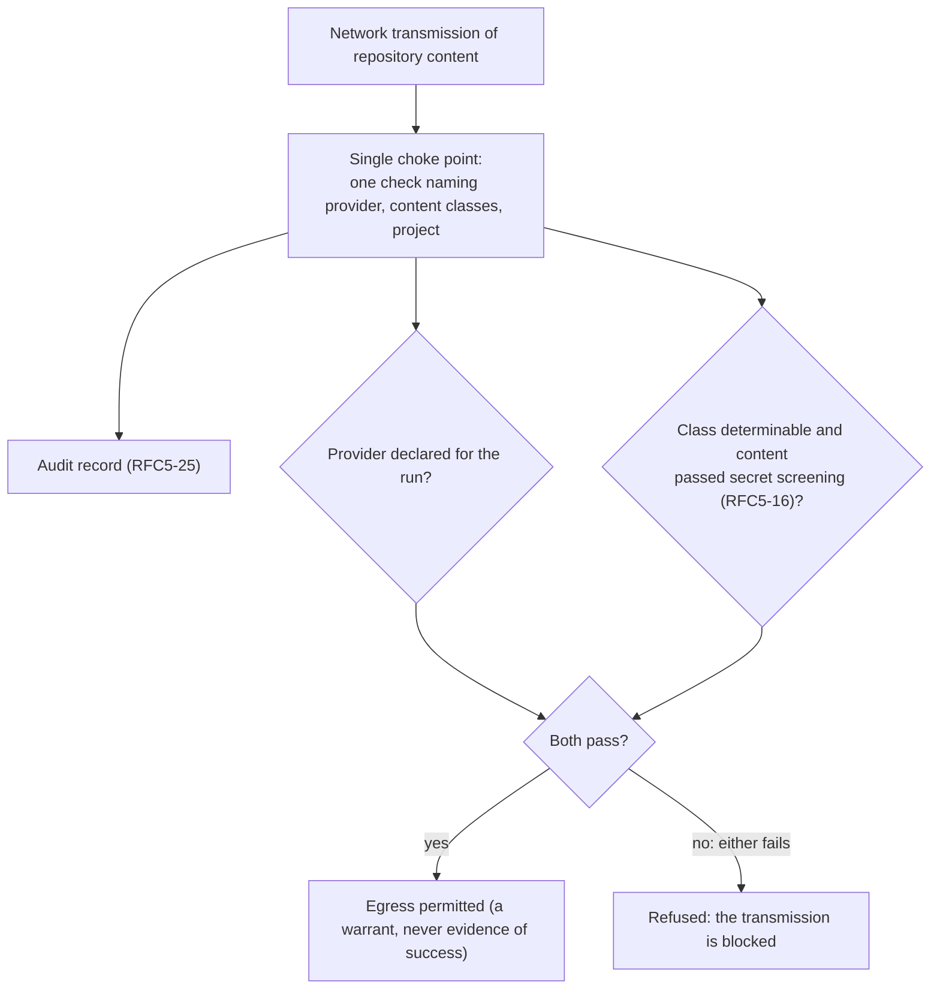
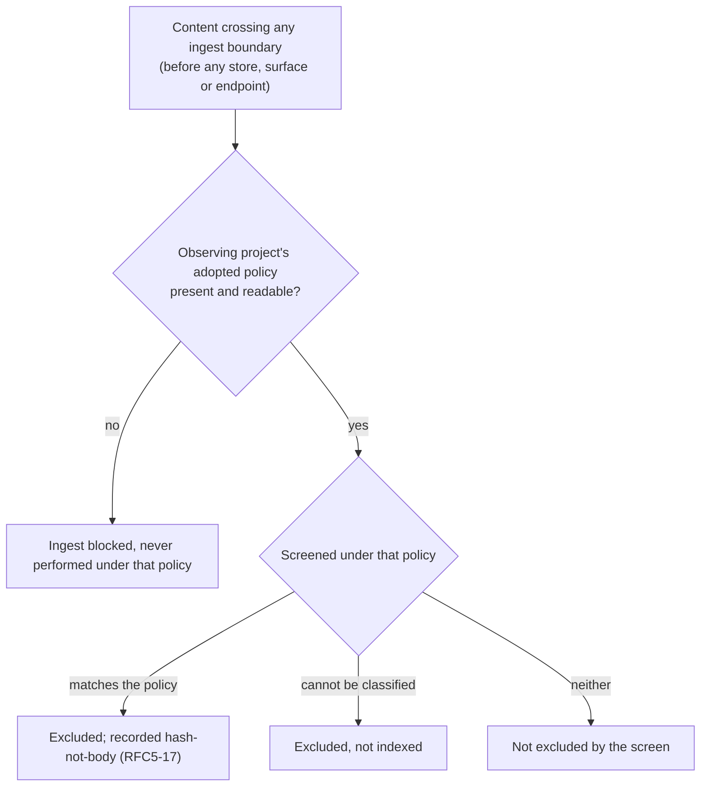
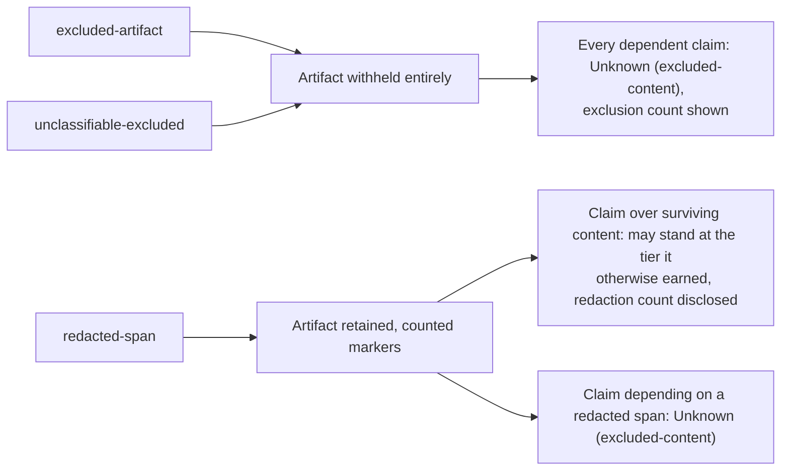

**Status:** Proposed foundational contract (self-declaration at authoring
time). Effective status is established solely by an owner-act record binding
this file's exact content digest — either owner-adopted (bootstrap,
uncorrelated) or Syzygy-verified, with the exact provenance state always
visible (RFC3-16). Absent such a record, this contract binds
nothing.

**Amended by GOVERNANCE-SIMPLIFICATION-D10** (drafted 2026-11-17; in force from the
owner's act recorded in `.syzygy/governance/decisions/GOVERNANCE-SIMPLIFICATION-D10-ACT.md`).
RFC5-12 to RFC5-16 are amended in place to match doctrine as amended by
D10: no observation, egress or execution consent; content goes only to a
provider declared for the run; write consent only for a repository the owner
does not own; secret screening unchanged, and weakening it is the owner's
decision. Where this module and VIS-4 or SEC-1 to SEC-5 disagree, doctrine
governs. Since D10, contracts are agent-maintained under VIS-4 and their
status is read from adoption records (RFC3-16 as amended).

**Amended after doctrine amendment D11** (owner-adopted 2026-11-21; this text
is an agent adoption recorded in `.syzygy/governance/decisions/AGENT-ADOPTIONS.md`).
RFC5-14 and RFC5-15 name SEC-2's one accepted exception: the authoring
session of a Polaris dossier run reads the raw clone through its own agent
tool, and that session's traffic to its model provider does not traverse the
choke point. Everything Syzygy itself transmits still does, and still passes
secret screening.

**Package:** module 2 of 3 of the RFC 0005 contract package. Index, clause map,
lookup rule, package-spanning integration and the package question list:
`README.md`. Rationale, amendment history, alternatives, and answered §8
questions: `../../history/RFC-0005-history.md`.

**Serves:** SEC-2 (egress consent per provider and content class), SEC-5 (secret
handling), VIS-1 (no over-degrading of usable partial evidence),
VIS-7/trust floor (no secret in any surface). Implements owner decision **B8**
(egress-consent granularity). Grounded in FD-009 (remote backing dependencies).

---

## 0. Module scope and reader map (non-normative)

*If this section and a clause disagree, the clause wins.*

This module decides **what may leave the machine and what may enter its
stores**: it answers *may this content cross a boundary, in either
direction?* Three clauses carry the weight. RFC5-12 splits consent into four
separately revocable classes; RFC5-15 sends every egress through one choke
point with a three-part check; and RFC5-16 screens every ingest, failing
closed on anything it cannot classify.

- **Place in the package.** It presupposes module 1.
  - An egress or an ingest is performed for a principal already admitted
    under RFC5-3/RFC5-5.
  - Every egress check emits into the audit trail of RFC5-25.
- **Four rules carry most of the weight.**
  - **One consent class remains** — write consent, for a repository the
    owner does not own; observation, egress and execution consent are retired
    (RFC5-12, D10).
  - **One egress choke point** (RFC5-15) with a two-part check, both of which
    must pass:
    - the provider is declared for the run;
    - the content's class is determinable and the content passed secret
      screening.
  - **Undeterminable fails closed, in both directions** — a composite whose
    class cannot be determined is refused egress (RFC5-14); content that
    cannot be classified at ingest is excluded, not indexed (RFC5-16).
  - **Exclusions are recorded by hash, never by body** (RFC5-17), and the
    three redaction classes map to Unknown differently — a `redacted-span`
    artifact does not blanket-degrade its surviving content.
- **The untrusted-tree premise runs through this module.**
  - The governed tree is writable by fleet workers (SEC-3's untrusted actor
    class, extended to committed artifacts by RFC3-16(a)).
  - So the secret-detection policy is honored only at its adopted bytes,
    and only the owner may weaken it (RFC5-16; SEC-5; RFC3-16 as amended).
- **Where each clause lives.**
  - §3.6 consent classes and revocation: RFC5-12, RFC5-13.
  - §3.7 egress and model providers: RFC5-14, RFC5-15.
  - §3.8 secret handling at ingest: RFC5-16, RFC5-17.

---

## 3. The contract

Clauses are numbered `RFC5-n` for stable citation. Amend in place; retire
rather than renumber.

- A pointer *(history §RFC5-n)* means amendment narrative, prior wording, or
  originating decision text was extracted at the rev10 compaction; that
  material is non-normative and the clause text is the contract.
- Decision identifiers named inline (B8, FD-009) remain binding provenance
  here.

### 3.6 Consent classes and consent records

**RFC5-12.** RFC 0001's **Consent record** entity (RFC1-3) carries one
**consent class**, **write consent** — per repository, for a repository the
owner does not own: Syzygy may write its two namespaces there, push to it, and
reach declared adapter effects in it (SEC-4). Absent: read-only. Syzygy's own
repository and the owner's repositories need none (SEC-4).
*(Amended by GOVERNANCE-SIMPLIFICATION-D10.)*

- **Observation consent — retired by GOVERNANCE-SIMPLIFICATION-D10.** Any repository the
  operator points Syzygy at may be read and indexed, public or private, with
  no per-repository record (SEC-2). A repository Syzygy has not been pointed
  at is still not observed: Unknown, never an empty graph read as absence.
- **Egress consent — retired by GOVERNANCE-SIMPLIFICATION-D10.** Content goes only to a provider
  declared for the run (RFC5-14; SEC-2); the declaration is part of the run's
  record, not a consent.
- **Execution consent — retired by GOVERNANCE-SIMPLIFICATION-D10.** Whether a run builds or runs
  observed code, and in which execution profile, is the agent's choice,
  recorded in the run's record (SEC-3; RFC5-18).

A consent record names its class, subject, scope, granting principal (the
owner), grant instant, and revocation state. Representation (`project.yaml`,
governance-plane schema) is RFC 0003 material.

**RFC5-13.** *(Amended by GOVERNANCE-SIMPLIFICATION-D10: this clause now governs the revocation
of write consent and the withdrawal of a provider declared for a run; the
retired consent classes leave nothing else to revoke.)*
Consent revocation is prospective: it stops future acts (RFC5-11)
and renders dependent claims Unknown (`unconsented-source-or-provider`,
RFC2-24 #6) at the next evaluation — **while every render served in the
interim already carries the withdrawal label under RFC5-11**, so that interval
never presents withdrawn-source content as current.

- Immutable artifacts produced under then-valid consent (observation records,
  inference overlays, execution records) remain, rendered with the withdrawal
  visible (RFC2-23); revocation never rewrites history.
- A revoked provider's overlays are never recomputed and admit no **new**
  challenges; **challenges already admitted are unaffected by the revocation
  and leave the lifecycle only by an RFC2-13 resolution act** — RFC2-13's
  rule, cited not set here.
- This clause's own rule is the revocation side: no recomputation, no new
  admissions, no un-suspension as a side effect of the consent record
  changing.

### 3.7 Egress consent and model providers

**RFC5-14.** Repository content leaves owner-controlled infrastructure only
for a **provider declared for the run** (SEC-2); the run's record names the
provider and the **content classes** sent. Model providers are such
providers. *(Amended by GOVERNANCE-SIMPLIFICATION-D10: no egress-consent record.)* The
content-class vocabulary is closed at this RFC (amend to extend):

| Class | Contents |
|---|---|
| `governance-text` | Doctrine, spec, decision, policy text |
| `code-structure` | Identifiers, paths, symbols, structural graph — no bodies |
| `code-content` | Source and test bodies |
| `project-documentation` | A project's own prose that describes, explains or accompanies the project for its readers and does not govern its development: README, user and developer guides, tutorials, how-to and overview documents, changelogs and release notes, contribution guides, and licence and notice files, ordinarily; the declared policy decides each file |
| `work-history` | Work items, run summaries, telemetry, cost data |
| `evidence-content` | Evidence artifact contents (reports, logs) |
| `derived-composites` | Prompts, summaries, embeddings composed from the above |

- A composite inherits the **highest** class of any content it embeds;
  `derived-composites` consent alone never launders an unconsented class into
  an egress.
- **`project-documentation` is a class of its own, decided by the declared
  policy, per file.**
  - A document the project's declared classification policy places as
    doctrine, spec, decision or policy text is `governance-text`, not
    `project-documentation`; source and test bodies, and comments or
    docstrings inside them, are `code-content`.
  - A file the policy cannot place in exactly one class is undeterminable and
    fails closed (RFC5-15); a file extension, a directory name or a file's
    own claim about itself places a file in this class only through a rule of
    the declared policy, never on its own.
  - A run whose record does not list `project-documentation` among the
    classes it sends does not send that class.
  - The class adds no ordering among classes and changes neither the composite
    rule above nor secret screening at ingest (RFC5-16), which applies to it
    in full.
- The vocabulary is closed here; the **declared policy that classifies
  concrete content into it** is agent-maintained (VIS-4) and honored at its
  adopted bytes on the default branch. A change that would let content the
  secret-detection policy matches, or cannot classify, reach a provider is
  the owner's decision (SEC-5). The one such change the owner has made is
  D11's: a dossier session's own raw reads (SEC-2's accepted exception;
  RFC5-15).
- A provider not declared for the run receives nothing; with no declared
  provider the inferred layer **is not computed** and renders Unknown
  (RFC2-7).
- The run's declared providers are rendered on the project's surface (SEC-2).

**Classification is determinable, provenance-tracked, and fails closed.**

- Content class is a **property of what enters the choke point, tracked from
  where the content originated**, never an attribute the composing step
  asserts about its own output: composition **carries embedded classes
  forward**, so a composite's class is computed from what it embeds and
  remains attributable to them.
- A composite whose class **cannot be determined fails closed** — the egress
  is **refused and the refusal rendered** — exactly as unclassifiable content
  is excluded rather than indexed (RFC5-16).
- The **classification-policy version is a snapshot input** (RFC2-1 item 7),
  so what class was asserted under which policy is auditable at every
  evaluation.

[Inferred] Without the undeterminable case the highest-embedded-class rule has
no floor: a composer that cannot say whether it emitted `code-structure` or an
inlined `code-content` body would default to whatever it claimed, defeating
the run's declared classes and secret screening with every RFC5-15 field
nominally satisfied.

**RFC5-15.** Egress enforcement sits at a **single choke point**: every network
transmission of repository content passes one check naming (provider,
content classes, project) and emits an audit record (RFC5-25). Both parts
must pass:

- the provider is **declared for the run** (RFC5-14); and
- the content's class is **determinable** (RFC5-14 — undeterminable fails
  closed) and the content **passed secret screening** under RFC5-16 (SEC-5:
  matching or unclassifiable content never leaves through Syzygy).

*(Amended by GOVERNANCE-SIMPLIFICATION-D10. The retired third part — a consent record carrying an
effective owner act under RFC3-16(a) — and the owner-act requirement on the
classification policy went with the egress consent class.)*

- A declaration is a warrant to send, never evidence that the transmission
  succeeded or that any transmitted claim is true.
- A feature that transmits as a side effect without traversing the choke
  point is the SEC-2 violation, whatever its intent.
- **A dossier session's own reads are outside the choke point (D11).** The
  authoring session of a Polaris dossier run reads the raw clone through its
  own agent tool, and what it reads reaches that session's model provider
  without passing this check; Syzygy can neither screen nor observe that
  traffic. It is not the side-effect violation above when the provider is
  declared for the run and the run discloses the unscreened read where the
  dossier specification puts its authoring disclosure (SEC-2). Every prompt,
  brief, request or payload Syzygy itself builds and sends still traverses
  the choke point, and no other session or feature gains this exception.
- Remote backing dependencies (a remote database, FD-009) are permitted under
  the same rule — a backing store the owner does not control is a provider and
  is declared.

*Diagram (non-normative; the clauses govern):* the single egress choke point
and its two parts, which must both pass.

### 3.8 Secret handling at ingest boundaries

**RFC5-16.** The declared secret-detection policy (SEC-5,
`.syzygy/governance/policies/`) is applied at **every ingest boundary** —
*before* content enters any Syzygy store, surface, or endpoint. The
enumeration that follows is **illustrative of every ingest boundary, not
exhaustive**:

- observation capture;
- evidence intake;
- adapter reads — **including a cross-project read of an observed source's
  entire tree (RFC3-30)**;
- **workspace-manifest import** (RFC3-11);
- execution-run output capture (RFC5-18);
- telemetry.

A path not on this list is not thereby exempt; if content crosses into a
Syzygy store, it crossed an ingest boundary.

- **The governing policy is the observing project's own** (RFC3-30): Project
  A screens what it ingests from observed source B under **A's** policy,
  never B's — content read from B's governance plane is data, never governing
  policy for A.
- Screening is fail-closed: content matching the policy is excluded; content
  that **cannot be classified is excluded, not indexed**.
- The policy version is a snapshot input (RFC2-1 item 7), so what was
  screened is part of every evaluation's identity.
- **Who may change the policy** *(amended by GOVERNANCE-SIMPLIFICATION-D10)*: a change that detects
  less, admits unclassifiable content, or lets a secret be indexed, rendered
  or sent is the owner's decision (SEC-5; VIS-4); any other change is an
  agent adoption. The policy is honored at its adopted bytes on the default
  branch.
  - A missing or unreadable policy does not fail open: the ingest is
    blocked, never performed without a screen.
  - Adoption warrants use of the policy; it is never evidence that screening
    succeeded or that admitted content is secret-free.

*Diagram (non-normative; the clauses govern):* screening at an ingest
boundary, under the observing project's policy.

**RFC5-17.** Exclusions carry **hash-not-body provenance**: an excluded item is
recorded as (content digest, location reference, policy version, redaction
class) — never the content itself, in any store including the audit trail.
Redaction classes are closed:

- `excluded-artifact` (whole artifact withheld);
- `redacted-span` (artifact retained, matching spans replaced by markers with
  a count);
- `unclassifiable-excluded` (fail-closed default).

Exclusions render with counts (RFC2-23 "Excluded content").

**The classes map to Unknown differently** *(a scoping fix, **not** a vocabulary
extension — no new Unknown reason is added and RFC2-24's closure is untouched)*:

- `excluded-artifact` and `unclassifiable-excluded` withhold the artifact
  entirely, so **every claim that depended on it renders Unknown**
  (`excluded-content`, RFC2-24 #7) with the exclusion count shown.
- `redacted-span` **retains** the artifact with counted markers: a claim over
  the **surviving content** may still stand, **at the tier it otherwise
  earned**, with the redaction count disclosed on the claim; only a claim
  that **depends on a redacted span** renders Unknown (`excluded-content`).
- Mapping the whole artifact to a blanket Unknown would over-degrade usable
  partial evidence, which VIS-1 no more permits than over-claiming does.

A secret reproduced in any surface, store, or endpoint is a trust-floor
violation regardless of this clause's observance elsewhere
(trust-and-evidence.md floor bullet 4).

*Diagram (non-normative; the clauses govern):* how each redaction class maps
to a dependent claim's rendering.

---

## 4. Violation cases — this module

*Package numbering is stable; cases are distributed across modules, never
renumbered. Cases 1–4, 10 and 13 are in module 1, cases 7–9 and 12 in module 3,
case 11 spans two modules and is held in `README.md`.*

5. *(RFC5-14/15)* Source sent to an unnamed model provider; `code-content`
   embedded in a prompt sent under `derived-composites` consent alone; an
   index synced to a third-party service as a feature side effect; a
   composite whose embedded class could not be determined egressing under the
   class its composer asserted; an egress honored on a consent record with a
   missing or invalid owner act (RFC3-16(a)).
6. *(RFC5-16/17)* Unclassifiable content indexed "pending review"; an excluded
   secret's body in the audit trail; a connection string in a map tooltip
   (SEC-5's named violation); Project A screening B's tree under B's
   secret-detection policy; a `redacted-span` artifact rendering its entire
   surviving content Unknown.

---

## 5. Integration — this module

- **Relies on RFC 0001:** the Consent record entity (RFC1-3) this class
  taxonomy specializes; the Decision entity as approval/revocation warrant.
- **Relies on RFC 0002:** snapshot inputs (classification- and secret-policy
  versions, RFC2-1 item 7); Unknown reasons #6 and #7 and the failure-state
  renderings (RFC2-23); RFC2-7's not-computed inferred layer; the RFC2-13
  challenge lifecycle RFC5-13 cites rather than sets.
- **Relies on RFC 0003:** RFC3-16(a), the owner-act provenance predicate the
  egress choke point (RFC5-15) cross-checks — stated once there and cited,
  never restated here; RFC3-7 (consent record shape); RFC3-11
  (workspace-manifest import); RFC3-30 (cross-project read; the
  observing-project policy rule).
- **Relies on module 1:** RFC5-11 (revocation is effective at the next act,
  and the rendering obligation RFC5-13 depends on); RFC5-25 (the audit record
  every egress check emits).
- **Provides to RFC 0002:** the consent-record semantics behind Unknown reason
  #6.
- **Provides to RFC 0003:** the fields consent records must encode; RFC 0003
  owns physical schema and migration.
- **Provides to RFC 0004:** the ingest-boundary screening obligation on every
  adapter read (RFC5-16), under the *observing* project's policy (RFC3-30).
- **Provides to RFC 0006 and the surfaces (incl. RFC 0008):** the
  consent-rendering obligation (SEC-2) and exclusion counts.
- **Provides to RFC 0010 and RFC 0011:** the egress choke point (RFC5-15) and
  ingest screening (RFC5-16) every governed context packet passes.
- **Not this module's:** secret-detection policy *content* and
  classification-policy *content* (quality/policy material); wire formats
  (RFC 0003 / RFC 0006).

---

## 7. Deliberately deferred — this module

- Concrete schemas for consent records → RFC 0003.
- Adapter read-screening mechanics → RFC 0004.
- Secret-detection policy content → quality/evidence policy (craft).
- Extension of the closed content-class vocabulary → amendment to RFC5-14,
  never by a classification policy.

---

## 8. Owner questions

**None owned by this module.** Question numbers are RFC-level and immutable;
q1, q2, q5 and q6 live in `admission-and-boundary.md`, q3 and q4 in
`execution-profiles.md`. See `README.md` for the package question list.

Owner decision **B8** (egress consent: one record per *(project, provider)*,
the per-repository alternative declined) was the resolution of RFC 0003's §8
q3, not a question of this RFC; it is binding in RFC5-12 and recorded at
`../../history/RFC-0005-history.md` §RFC5-12.

---

*End of module 2 of the RFC 0005 package. Clauses RFC5-12 … RFC5-17. No retired
numbers, no merged numbers, and no clause identity shared with another module.*
