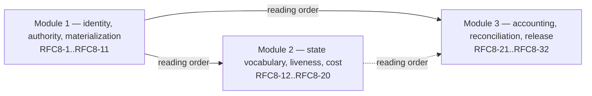
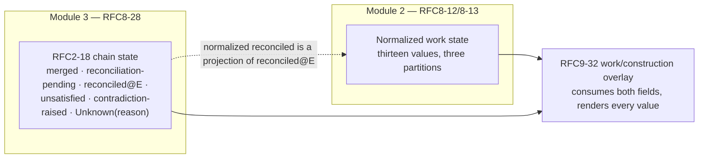

# RFC 0008 — Trajectory (Work Surface)

**Status:** Proposed foundational contract (self-declaration at authoring
time). Effective status is established solely by an owner-act record binding
each module file's exact content digest — either owner-adopted (bootstrap,
uncorrelated) or Syzygy-verified, with the exact provenance state always
visible (RFC3-16). Absent such a record, this
contract binds nothing.

**Date:** 2026-07-30 (amended through 2026-08-02; compacted and split into a
package at rev10). **Rationale, amendment history, rejected alternatives, the
resolved foundation-defect trail, and answered §8 questions:**
`../../history/RFC-0008-history.md` (non-normative).

**Serves:** vision.md Thesis (three states; work is never proof), VIS-1, VIS-2,
VIS-5, VIS-6, VIS-7; architecture.md (typed authority; `work/`); SEC-2, SEC-3,
SEC-5; trust-and-evidence.md. Implements **owner rulings** SDR-5, SDR-6, SDR-7,
SDR-8, SDR-9, SDR-10, SDR-11, SDR-12, SDR-18 and the SDR §2 Trajectory charter;
resolves the work-ontology portion of SDR §5 question 10.

---

This package is the semantic contract for Trajectory, the work surface, split
across three modules. To find a clause, read the `n` of `RFC8-n` and take the
module whose range in the clause map below contains it; citations name
clauses, never modules.

## Clause map and lookup rule

**Every clause identity appears in exactly one module.** One `RFC8-n`
namespace, no duplicated normative clauses, no renumbering.

| Module | File | Clauses |
|---|---|---|
| 1 — identity, authority, materialization | `identity-authority-materialization.md` | RFC8-1..RFC8-11 |
| 2 — state vocabulary, liveness, cost | `state-vocabulary-and-cost.md` | RFC8-12..RFC8-20 |
| 3 — accounting, reconciliation, release | `accounting-reconciliation-and-release.md` | RFC8-21..RFC8-32 |

Module sizes are deliberately **not stated here**. A measurement copied into
contract prose goes stale the moment any module moves, and moves this
package's content digest for a reason that has nothing to do with what the
package says. This artifact is governed by the applicable context-budget
policy; the current measurement lives in the generated budget report
`../../CONTEXT-BUDGET-REPORT.md`, which is regenerated, never transcribed.

**Lookup rule (deterministic).** For any citation `RFC8-n`, read `n` as an
integer and take the first row whose range contains it.

- The three ranges are contiguous and exhaustive over RFC8-1…RFC8-32 with no
  gaps, so the rule never needs a search.
- Modules are numbered for reading order only — citations name clauses, never
  modules.

**No lettered sub-clauses.** Lettered limbs cited inside a clause —
RFC8-2(a)–(c), RFC8-8(a)–(c) — are *parts of that clause*, list items within
one clause body, not separate sub-clauses with their own headings. They
resolve to their parent clause's module.

**Reading order for a cold reader:** module 1 → 2 → 3.

- Module 1 establishes what work exists and under whose authority.
- Module 2 gives the vocabulary every rendering speaks.
- Module 3 accounts for what changed and whether it satisfied anything.
- Modules 2 and 3 are independently readable given module 1.

**Reader groups.**

- Adapter and endpoint authors read module 2.
- Board, queue, and aggregate implementers read module 3.
- Mission Control and dispatch read module 1 for the materialization join,
  then module 2 for the state vocabulary.

## Package reader map (non-normative)

*If this map and a clause disagree, the clause wins.*

Trajectory (`work/`) is the owner's complete, evidence-linked account of the
project's work, and this package is the surface's **semantic contract, not its
UI design**. Four rules carry most of the weight; two invariants span the
package.

- **What the account covers:** what remains, what is approved but
  unmaterialized, planned, ready, active, blocked, under review, merged, what
  it cost, why each piece was authorized — and the distinction no tracker
  carries, **what merged without yet being reconciled against the intent that
  warranted it** [Observed: SDR §2 charter].
- **The four weight-bearing rules:**
  - **The anti-thesis is binding** (module 1, RFC8-2). Trajectory is never:
    - a second editable store of a scheduler-owned field;
    - a view in which closure renders as done;
    - a board that cannot answer "what did the fleet change, at what cost,
      under whose authority" for a past window.
  - **A Syzygy-created scheduler work item with no materialization record
    is a Contradiction, not a badge**, whose only lawful exit is
    adjudication (module 1, RFC8-8/8-10).
  - **Work renders through a closed thirteen-value normalized state
    vocabulary** in three partitions (module 2, RFC8-12/8-13).
    - Every value has a declared derivation and an honest absence behavior.
    - Nothing is guessed or force-fitted.
  - **The four post-merge answers must never share a rendering**, and never
    differ by colour alone (module 3, RFC8-28/8-29).
    - The answers: *reconciled at E with evidence*, *merged, not yet
      evaluated*, *evaluated and unsatisfied*, *evaluated, contradiction
      raised*.
    - The chain vocabulary is closed at six values.
    - At V0 the honest answer for merged work is "reconciliation evidence
      absent".
- **The two package-spanning invariants:**
  - **Cost is independent measures, never a composite "effort" score**;
    absent values are Unknown, never zero; every aggregate discloses coverage
    (RFC8-18/8-19).
  - **Every diff is accounted for.**
    - Work with no traceable warrant renders Unknown-provenance, counted and
      never green (RFC8-23).
    - A change riding a parent work item inherits that warrant only inside
      its declared scope and a declared per-project threshold whose absence
      fails closed (RFC8-25).

*Diagram (non-normative; the clauses govern):* the three modules, their clause
ranges, and the reading order 1 → 2 → 3; every edge is reading order, not
dependency, and modules 2 and 3 are each independently readable given
module 1.

## 2. Doctrine grounding (non-normative)

Doctrine keeps desired, observed-implementation, and execution state
semantically distinct, and rules that scheduled or completed work is never
proof intent is satisfied [Observed: vision.md, Thesis].

- **The failure this surface ends.** The amnesiac orchestration day —
  "oversized diffs and scattered completions with no coherent account"
  [Observed: vision.md].
- **Today's substrate.** The account's lower half is largely non-existent:
  no run identity, no durable gate artifacts, no reconciliation object
  anywhere, warrants as prose, a scheduler that forgets by default [Observed:
  substrate audit — non-authoritative, adopted where cited; citations in
  history].
- **The owner's staging.**
  - Post-hoc telemetry at V1 (SDR-5).
  - Unknown-never-zero (SDR-6).
  - Pre-materialization authority (SDR-7).
  - Reconciliation absence rendered at V0 and computed at V1 (SDR-12).
- [Inferred] **Three failure modes are guarded against**, each individually
  attractive to an implementer and each manufacturing exactly the
  comprehensible fiction VIS-1 forbids:
  - the **mirror** — a second editable copy of scheduler state;
  - the **closure fallacy** — execution closure rendered as done;
  - the **amnesiac board** — current columns, no account of change, cost, or
    authority.

## 4. Violation cases — package-spanning

*Cases 1–3 and 11 are in module 1, 5–7 and 13 in module 2, 8–10 and 14 in
module 3. Numbering is the stable package numbering; cases are distributed,
never renumbered. Only cases 4 and 12 span two modules and are held here.*

4. *(RFC8-11/23)* A substrate `spec_id` edit adjudicated as a warrant
   contradiction — or, worse, adopted as the new warrant.
12. *(RFC8-8/9/13)* Two approved proposals in one exclusivity group listed as
    two queue rows and counted "what remains: 2" — fictitious consensus
    arriving through a count; a queue row or endpoint answer served without its
    scenario context.

## 5. Integration — package-level

Per-module relies-on lists are in each module's §5. Two items are stated once,
here, because they bind across modules.

**The RFC 0009 handoff is two separate fields, not one** (RFC8-12; RFC8-28) —
separate, not orthogonal, since normalized `reconciled` is a projection of the
chain value `reconciled@E` (RFC8-12) — and RFC9-32's work/construction overlay
consumes **both**:

1. the **normalized work state** — RFC8-12/8-13's closed vocabulary (module 2),
   at present **thirteen values in three partitions**, not eight: eight live
   states, the terminal `closed-unmerged`, and four state-local absence values.
   Each partition renders as itself; the absence values are never folded into
   an Unknown-reason aggregate.
2. the **RFC2-18 chain state** — `merged`, `reconciliation-pending`,
   `reconciled@E`, `unsatisfied`, `contradiction-raised`, `Unknown(reason)`
   (module 3) — carried beside the normalized state on every element and every
   aggregate, with **RFC2-17's word reservation binding the overlay**:
   `unsatisfied` and `contradiction-raised` never merge into one count, badge,
   or mark, and neither collapses into `merged`.

Stated as **two fields** rather than a value count on purpose, since a
count-shaped handoff fails silently whenever either vocabulary grows: **a
consumer conforms by consuming both fields and rendering every value each field
currently carries** — the conformance rule, whose single clause home is
**RFC8-12** (this paragraph restates it for orientation) — so an addition to
either vocabulary crosses the seam without amending this paragraph, and a value
the consumer cannot render is a defect in the consumer, never a licence to fold
it into a neighbour.

*Diagram (non-normative; the clauses govern):* the two-field handoff — both
fields travel side by side into RFC9-32's overlay, and normalized `reconciled`
is a projection of the chain value `reconciled@E`.

**One foundation defect is outstanding** — RFC1-28/31 omit the
queued-for-materialization stage; it is held in module 1 §5 with §8 q2.

- Four further defects reported against RFC 0001/0002 are **closed** and the
  trail is preserved in `../../history/RFC-0008-history.md` §5.
- **No RFC 0001 or RFC 0002 change is outstanding on any of the four, and
  none blocks acceptance.**

**Provides to:**

- **RFC 0007** — the SDR-18 boundary (RFC8-9): drafting queue and work
  lifecycle here, contextual intent authoring and adoption there.
- **RFC 0009** — the two-field work-state handoff above, and the
  touched-components measure's dependence on the declared implementation
  mapping (RFC8-18).
- **RFC 0010** —
  - the work-state vocabulary a Mission lifecycle must interoperate with;
  - the materialization join and orphaned-work Contradiction a Mission must
    respect before treating work as authorized;
  - the cost measures a Mission budget is accounted in;
  - RFC8-30's prohibition on rendering closed work as done absent
    `reconciled@E`.
- **RFC 0011** — the compaction preservation set and expired-detail semantics
  a context packet's durable memory binds against (RFC8-26/8-27).

**Not this RFC's:**

- staleness, retention, and measure bound *values* (quality policy);
- board and queue layout and interaction (craft);
- the V1 reconciliation-gap computation (V1 RFC);
- streaming and control (deferred, SDR-5).

## 6. Alternatives considered

Seven rejected alternatives are recorded in
`../../history/RFC-0008-history.md` §6. Two stay load-bearing for reading a
live clause.

- **Leaving the closure-without-merge state unnamed** was rejected because a
  value the contract never names cannot be carried verbatim on a machine
  answer (RFC6-14) or checked for parity, so implementations would spell it
  `closed`, `abandoned`, or `done` with the disagreement release-blocking
  under RFC6-22/23 — hence `closed-unmerged` is named in RFC8-12.
- **A composite effort/health score with disclosed weights** was rejected
  *even disclosed*, because weights are an opinion rendered as a measurement
  (RFC8-18).

## 7. Deliberately deferred — package-level

Per-module deferrals are in each module's §7. Two are stated here.

- Physical schemas for plan items, queue records, materialization records,
  and compaction records → RFC 0003.
- Queue and board presentation, filters, and saved views → craft and personal
  presentation state (VIS-6, exception (a)) — **with one obligation that does
  not defer**:
  - a board laid out as an ordered sequence of columns teaches that the
    states form a monotone progress ladder, which RFC8-12's partition denies
    (the terminal state is not the last rung, the four absence values are
    not rungs);
  - so any such layout **must place the terminal and absence values off the
    ladder, not at the end of it**.

## 8. Owner questions — package index

Numbering is stable across the package and never shifts; each question's full
text lives in the module owning its clause, and answered items' full text and
reasoning are in `../../history/RFC-0008-history.md` §8.

| # | Subject | State | Lives in |
|---|---|---|---|
| q1 | Vocabulary closure (RFC8-12/13) | **answered — owner decision A8** | `state-vocabulary-and-cost.md` §8 |
| q2 | Queue realization (RFC8-7) | **open** | `identity-authority-materialization.md` §8 |
| q3 | Blocked-time cause split (RFC8-18) | **open** | `state-vocabulary-and-cost.md` §8 |
| q4 | Unknown-provenance visibility default (RFC8-23) | **open** | `accounting-reconciliation-and-release.md` §8 |
| q5 | Epistemic class of the normalized state (RFC8-12) | **answered — owner decision B14** | `state-vocabulary-and-cost.md` §8 |
| q6 | The "small" threshold on inherited mutations (RFC8-25) | **answered — owner decision B13** | `accounting-reconciliation-and-release.md` §8 |
| q7 | Unmapped-substrate-value rendering (RFC8-14) | **answered — owner decisions A5 / B15** | `state-vocabulary-and-cost.md` §8 |

## Phase boundary

The phase rule **RFC8-32** binds the whole package: this contract fixes the
semantics of the work surface and is not a specification of record from which
implementation work may be scheduled.

- The clause text is in `accounting-reconciliation-and-release.md` §3.16.
- Its clause-to-requirement coverage matrix must cover **every clause of this
  contract other than RFC8-32 itself, across all three modules** — not module
  3 alone, and not a range that stops moving when a clause is appended.
- RFC8-32 also fixes the home and the provenance gate of the reviewed N/A
  judgment; the clause states both.

---

*End of RFC 0008 package index. Clauses RFC8-1 … RFC8-32 distributed across
three modules. No retired numbers, no merged numbers, no gaps in the range, and
no clause identity in more than one module.*
