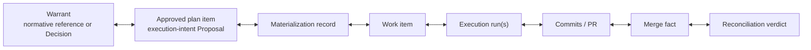
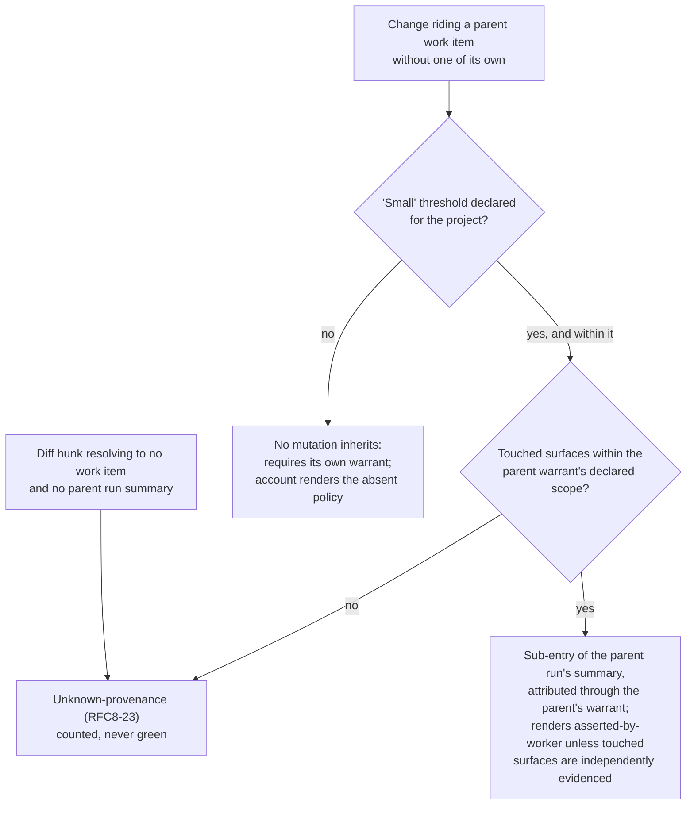
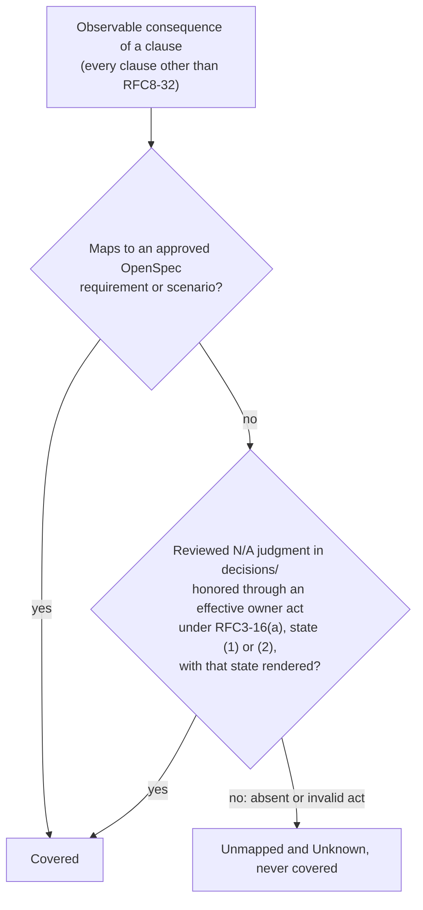

# RFC 0008 — Trajectory (Work Surface): accounting, reconciliation, release

**Status:** Proposed foundational contract (self-declaration at authoring
time). Effective status is established solely by an owner-act record binding
this file's exact content digest — either owner-adopted (bootstrap,
uncorrelated) or Syzygy-verified, with the exact provenance state always
visible (RFC3-16). Absent such a record, this contract binds
nothing.

**Package:** module 3 of 3 of the RFC 0008 contract package. Index, clause map,
lookup rule, package-level integration and deferrals: `README.md`. Rationale,
amendment history, rejected alternatives, and answered §8 questions:
`../../history/RFC-0008-history.md`.

**Serves:** vision.md Thesis (work is never proof), VIS-1, VIS-2, VIS-6,
VIS-7; SEC-5; trust-and-evidence.md (traceable authority; a narrative sentence
doing a badge's work is judged as a badge). Implements **owner rulings**
SDR-9, SDR-10, SDR-11, SDR-12.

---

## 0. Module scope and reader map (non-normative)

*If this section and a clause ever disagree, the clause wins.*

This module decides what the fleet actually changed, under whose authority
and at what cost, and whether any of it has been checked against the intent
that warranted it. The weight sits in four rules — broken joins render
(RFC8-22), warrants never stretch (RFC8-25), tiers never upgrade (RFC8-27),
and the four post-merge answers never share a rendering (RFC8-28) — and in
the phase rule RFC8-32, which binds the whole package.

- **What it owns:** the account of what actually changed and whether it
  satisfied anything.
  - The bidirectional change-accounting chain and its honest thinness
    (RFC8-21).
  - Broken joins that render rather than vanish (RFC8-22).
  - Unknown-provenance work and the RFC2-24 reasons this surface renders
    (RFC8-23/8-24).
  - Inherited-mutation accounting under a fail-closed threshold and a
    warrant-coverage test (RFC8-25).
  - The binding compaction preservation set and expired-detail tier rules
    (RFC8-26/8-27).
  - The four-way post-merge chain-state distinction, its closed six-value
    vocabulary and the forbidden closure fallacy (RFC8-28/8-29/8-30).
  - RFC 0006 conformance, endpoint answerability and this surface's
    non-visual parity floor (RFC8-31).
  - The binding phase rule at the OpenSpec seam (RFC8-32).
- **The question it answers:** *what did the fleet change, under whose
  authority, at what cost — and has any of it been checked against the
  intent that warranted it?*
- **The four weight-bearing rules:**
  - **A broken join renders**; reconstructing one by similarity,
    interpolation, or inference is forbidden (RFC8-22).
  - **A warrant is never extended by execution-side prose** — anything
    outside the parent warrant's declared scope renders Unknown-provenance,
    and where no "small" threshold is declared **no mutation inherits at
    all** (RFC8-25; owner decision B13).
  - **No observer or surface ever upgrades a tier** (RFC8-27).
  - The four post-merge answers — *reconciled at E with evidence*, *merged,
    not yet evaluated*, *evaluated and unsatisfied*, *evaluated,
    contradiction raised* — **must never share a rendering**, and never
    differ by colour alone (RFC8-28).
- **Phase boundary.** RFC8-32 is binding and applies to the whole package: no
  implementation work for user-observable Trajectory behavior may be
  scheduled solely from these RFCs.
- **Neighbours in the package:**
  - The normalized work state that travels beside this module's chain state
    is defined in module 2 (RFC8-12/8-13).
  - The materialization join the chain runs through is in module 1
    (RFC8-10).

---

## 3. The contract

Clauses are numbered `RFC8-n` for stable citation. Amend in place; retire
rather than renumber.

### 3.10 The change-accounting chain

**RFC8-21.** Trajectory must walk, in both directions, the chain: **warrant
(normative reference or Decision) → approved plan item (execution-intent
Proposal) → materialization record → work item → execution run(s) →
commits/PR → merge fact → reconciliation verdict** — joined on the RFC1-25
relations (`motivates`, `materializes`, `produced_by`, `supports`) and the
RFC4-22 adapter joins, each rendered with its declared basis
(`recorded-identity` vs `naming-convention`, the latter `reduced-fidelity`).
**Against today's actuator toolchain this chain is honest but thin**: several
links resolve only by naming convention, and the enrichments that would carry
them to event-time Observed are on the RFC4-29 roadmap and deliberately **not
required**. **That thinness must render as thinness**, and must never be
presented — in this RFC, in the surface, or in an acceptance test — as a chain
awaiting completion rather than one that is complete and weak. [Inferred]

*Diagram (non-normative; the clauses govern):* the change-accounting chain
RFC8-21 walks in both directions, from warrant to reconciliation verdict.

**RFC8-22.** **A broken join renders; it is never silently skipped.**

- Where a link cannot be established at the answering evaluation, the chain
  renders the break at that link — Unknown with its RFC2-24 reason — and
  everything downstream renders with provenance degraded accordingly.
- Reconstructing a join by similarity, interpolation, or inference is
  forbidden (RFC4-22; missing evidence never renders Inferred [Observed:
  trust-and-evidence.md]).

### 3.11 Unknown-provenance work and the reasons this surface renders

**RFC8-23.** A work item, run, or merged change with **no traceable warrant**
renders **Unknown-provenance**: a first-class, filterable, counted rendered
state — never green, never silently pooled into warranted work, and never an
ingest rejection (RFC4-10).

- A substrate-side warrant-field edit is an annotation, not a competing
  warrant (RFC8-11); the human intent behind such an edit surfaces as a
  Proposal against the plan item, where a warrant change belongs.

**Unknown-provenance is not orphaned work, and this clause never absorbs it.**

- An Unknown-provenance item may be legitimate untraceable work — a
  pre-Syzygy backlog item, an import, any unrecorded work item created by a
  writer other than Syzygy's adapter (RFC1-29) — and its route is *surface it*: counted, never green,
  resolvable by supplying a warrant.
- An **orphaned work item** is a Syzygy-created one that no materialization
  record matches: two stores answering one question (RFC8-8; RFC1-29).
  Its **only** lawful exit is adjudication (RFC1-21; RFC2-15; RFC8-8).
- **What separates them is who created the item, never its age, its
  fields or the backlog's size** (RFC1-29). An unrecorded item the
  scheduler's history attributes to another writer is Unknown-provenance
  however many such items there are, even when it carries a warrant
  reference; supplying a warrant resolves it.
- Rendering one as Unknown-provenance mis-routes it, skips minting the
  Contradiction, and skips RFC2-15's Unknown rendering of the affected
  conclusion.
- Where an item is both, the orphaned-work Contradiction governs and is never
  filtered away behind the provenance badge.

**RFC8-24.** The RFC2-24 reasons Trajectory most renders **on its claims**,
each with its route visible:

- `missing-evidence` (no gate artifact behind a claimed outcome — SDR-9);
- `source-uncaptured-or-unreachable` (adapter export unavailable; facts lost
  past the retention horizon before capture, rendered **citing the retention
  event**, never "no work existed" — RFC4-16);
- `no-currency-bound-declared` (undeclared staleness bound, undeclared
  retention bound, **or an undeclared maximum inter-pass interval** —
  RFC4-16(2): the interval is the only thing that *bounds* pre-horizon
  history loss rather than merely rendering it honestly, so until it is
  declared, every claim depending on pre-horizon scheduler history renders
  Unknown on these mechanics, and the fleet-day account renders that
  dependence visibly);
- `stale-beyond-currency-bound`;
- `missing-declaration` (a governing declaration — capability, topology,
  mapping, policy — absent behind a claim).

Unknown aggregation follows RFC2-24's rendering rule: aggregate, disclose
reason counts, expand. **These are claim reasons only:** the normalized
state's four absence values are state-local, take no reason from this list,
and are counted separately — an aggregate of Unknowns never absorbs them
(RFC8-12; RFC6-6).

### 3.12 Inherited mutations (SDR-11)

**RFC8-25.** Small inherited mutations — warranted changes riding a parent
work item without one of their own — appear as **sub-entries of the parent
run's summary** (within the parent's Execution Record), each with rationale
and touched surfaces; never one work item each, never invisible.

- A diff hunk resolving to no work item and no parent run summary renders
  **Unknown-provenance** (RFC8-23) — the honest form of unexplained diff
  coverage, never omitted from the account.

**"Small" is a declared per-project threshold, and its absence fails closed**
*(ruled at acceptance by owner decision B13, answering §8 q6).* The threshold
is **quality-policy material** (`governance/policies/`, RFC3-15): the
obligation to declare it binds now, the value is the owner's and may differ
per project, and the declared value is a snapshot input (RFC2-1 item 7).
**Where no threshold is declared, no mutation inherits** — every change
requires its own warrant, and the account renders the absent policy rather
than assuming a permissive bound. Size, count, and scope-breadth bounds are
the owner's call, never the implementation's and never the worker's.
[Inferred — left undeclared and permissive, "small" is decided by the worker
writing the summary, whose prose RFC4-19 already classes as worker-asserted;
argument in history.]

**Warrant coverage is a test, not a presumption.**

- The fleet-day account attributes an inherited mutation's diff through the
  parent's warrant **only where the mutation's touched surfaces fall within
  that warrant's declared scope** — the requirement, scenario, governance
  clause, or Decision the parent work item's `motivates` edge names (RFC1-25,
  whose warrant classes are closed; trust-and-evidence.md: a work warrant
  requires *traceable authority*).
- **Anything outside that scope does not inherit**: it renders
  **Unknown-provenance per RFC8-23**, counted and never green, exactly as if
  no parent summary existed.
- **A warrant is never extended by execution-side prose**; a worker cannot
  widen the authority under which it acted by describing what it also did.

**The sub-entry's tier is fixed.**

- Its rationale and touched-surface list live in a worker-authored Execution
  Record whose prose fields RFC4-19 classes as optional enrichment, so the
  sub-entry renders **`asserted-by-worker`** (parent label Inferred,
  RFC2-25) — visible, challengeable, and **never a status input** — unless
  the touched surfaces are independently evidenced from VCS or gate
  artifacts, which render at their own tiers.
- RFC8-27 keeps that tier through compaction; this fixes it before.

*Diagram (non-normative; the clauses govern):* how RFC8-25 accounts for a
change riding a parent work item; a change exceeding a declared threshold is
not drawn.

### 3.13 Compaction and retention rendering (SDR-10)

**RFC8-26.** **The preservation set is binding**: structured run summaries,
work warrants, decisions, materialization mappings, known cost/token totals,
evidence identities and hashes, and reconciliation outcomes survive every
compaction.

- Raw transcripts and verbose logs may expire under declared policy.
- A compaction is itself an identified, durable record (RFC8-6).

**RFC8-27.** **Expired-detail rendering.** A claim whose only substantiation
lived in expired material renders Unknown **citing the compaction or retention
event** — never absent, never confidently restated from the summary.

- Preserved summaries render at their recorded tier:
  - a summarized worker assertion stays `asserted-by-worker`;
  - a preserved gate outcome **renders at the tier its evaluation
    recorded** — an observation record is immutable (RFC2-6), and no later
    event at the provider changes what an existing evaluation concluded.
- For RFC4-13 route 2 the snapshot holds the **external-confirmation capture
  artifact** (RFC4-13(a)) and the tier stands on that, so a CI provider
  expiring its check records after ninety days expires nothing in Syzygy.
- A **later re-confirmation is a new observation** in a new snapshot, whose
  evaluation may honestly find the provider no longer confirms and record a
  degraded tier **there** (RFC2-4's new-snapshot path) — degradation happens
  only through a new identified evaluation, never by a stored record's
  meaning shifting under a display query.
- Artifact resolvability alone is still not the test (RFC4-13, amended under
  AS-R3; RFC 0004's alternatives record — `../../history/RFC-0004-history.md`
  §6 — lists "`gate-backed` on retention and format alone" as Rejected): a
  preserved hash with no capture artifact and no other satisfied route **caps
  at `report-fact`**, with the cap visible.
- An artifact simply **gone** drops tier in the next evaluation with the
  dangling reference rendered broken.
- **No observer or surface ever *upgrades* a tier** (RFC4-13); only new
  evidence in a new snapshot can.
- "No records found" must be visually and queryably distinguishable from
  "nothing happened" [Observed: substrate audit, adopted as binding].

### 3.14 Post-merge reconciliation rendering

**RFC8-28.** The RFC2-18 chain states — `merged`, `reconciliation-pending`,
`reconciled@E`, `unsatisfied`, `contradiction-raised`, `Unknown(reason)` — are
**first-class Trajectory states**, queryable and filterable on the durable
identity: *reconciled at E with evidence* vs *merged, not yet evaluated* vs
*evaluated and unsatisfied* vs *evaluated, contradiction raised* are four
different answers and **must never share a rendering**.

- Unqualified "reconciliation" means only the doctrinal sense;
  scheduler-state repair never shares a field, count, or UI string with it —
  and the same reservation binds `unsatisfied` (a gap) against
  `contradiction-raised` (a Contradiction, adjudication only), which
  Trajectory must never merge into one count or one badge (RFC2-17; RFC4-6).

**Six values, closed.** The chain-state vocabulary above is closed at those
six values, and **no implementation may mint, spell, or force-fit one outside
it** — the closure RFC8-12 cites this clause for, stated here in RFC8-12's own
form and for its reason: a value the contract never names can be neither
carried verbatim on a machine answer (RFC6-14) nor checked for parity, and
RFC6-22/23 make the resulting disagreement release-blocking under the trust
floor. Closing the field is what makes it the least-protected load-bearing
facet no longer: it carries the reconciliation truth, and it is the one
vocabulary an implementation would otherwise be free to spell for itself.

**Never a colour-only distinction.** The four post-merge answers, and
`unsatisfied` against `contradiction-raised` in particular, **never share a
mark, a mark's colour, a count, or a legend entry**.

- The map surface binds the identical sentence (RFC9-32), and a distinction
  only colour carries is not a distinction under RFC6-22/23's parity test.
- Two differently-coloured badges do not discharge this clause: the reader on
  the surface that routes a gap to work and a Contradiction to
  adjudication alone must be able to tell them apart **without colour**, by
  label, text, or structure.

**The chain state is a field of its own, separate from RFC8-12's normalized
work state**, and the two travel together — never one in place of the other.

- A rendering showing normalized `merged` without the item's chain state
  collapses the three post-merge answers into a single mark, which this
  clause forbids.
- **Every rendering, filter, count, endpoint answer, and cross-surface
  handoff that carries the normalized state carries the chain state beside
  it**, including RFC9-32's work/construction overlay (§5).

**RFC8-29.** **V0 renders the absence honestly** (SDR-12; RFC2-19): every
merged-but-unreconciled item renders "reconciliation evidence absent /
Unknown," and a wall of such Unknowns on a fleet-built project is correct
output, not a defect.

- Nothing in V0 simulates a verdict.
- **V1 computes** the reconciliation evaluation and renders its gap as a
  navigable object.

**RFC8-30.** **The closure fallacy is forbidden.**

- No Trajectory aggregate, badge, progress bar, or prose sentence renders a
  `closed` work item as done, complete, or satisfied absent a `reconciled@E`
  verdict with gate-backed evidence — a narrative sentence doing a badge's
  work is judged as a badge [Observed: trust-and-evidence.md].
- Progress aggregates over merged work disclose their reconciliation
  composition (n reconciled, m pending, k unsatisfied, c
  contradiction-raised, j Unknown).

### 3.15 Selection, drawer, endpoints

**RFC8-31.** Every Trajectory rendering obeys RFC 0006:

- selection by kernel identity only (no work-item row handles across
  boundaries, RFC6-1);
- the single drawer fact set (RFC6-18/19);
- label parity on every machine answer (RFC6-14);
- evaluation stamping (RFC6-15);
- aggregation disclosure (RFC6-17);
- the **closed navigation-outcome set including `incompatible-scenario`**
  (RFC6-5);
- and **explicit, singular scenario context on every selection** (RFC6-24)
  that **travels with every URL, cross-surface synchronization, and query
  answer** (RFC6-25) — a queue row, a remaining-work count, and an endpoint
  answer each carry the context they were computed under, and a surface may
  never silently swap it.

Trajectory adds **no surface-only facts**: anything it renders — normalized
states, blocked causes, chain joins, cost measures — is queryable with
identical labels, and its answers ("what remains," "what changed," "what
still lacks reconciliation") are endpoint-answerable at a named evaluation.

**Non-visual parity binds this surface too, and is stated here rather than
left to the sibling surfaces.** Polaris binds it at RFC7-33/34; no doctrine
clause distinguishes surfaces, and this surface's distinctions are the ones
routing a reader to work or to adjudication. Two limbs, both binding:

- **Recoverable without colour, position, or layout.** Every normalized work
  state (RFC8-12), every chain state (RFC8-28), every blocked-cause set
  (RFC8-17), the Unknown-provenance state (RFC8-23), and every state-local
  absence value is carried **textually** — by label or structure — on every
  rendering and every export, never by a colour, a column position, or a
  board lane alone. This is RFC6-14's verbatim-carriage rule made a rendering
  obligation: what an endpoint must carry, a human-readable rendering carries
  too.
- **Operable without a pointing device.** The board/queue/drawer handoff
  (RFC6-18) and every traversal between a work item, its chain state, its
  Execution Records and its evidence is operable by keyboard. Recoverability
  governs *encoding*; operability is a separate obligation and both bind — a
  surface whose every unit is recoverable and whose paths between units are
  pointer-only has satisfied neither (RFC7-34's reasoning, applied here).

*(Stated as a limb of RFC8-31 rather than as a new clause: the `RFC8-n` range
is closed at RFC8-32 and this package mints no lettered sub-clauses
(`README.md`). The limb binds exactly as a clause would, and RFC8-32's
coverage matrix reaches it through RFC8-31.)*

### 3.16 Authority boundary at the OpenSpec seam (binding phase rule)

**RFC8-32 — This contract schedules nothing.** This RFC fixes the semantics of
the work surface; it is **not a specification of record from which
implementation work may be scheduled**.

- No implementation work for **user-observable Trajectory behavior** may be
  scheduled solely from this RFC: before implementation, every observable
  consequence of **every clause of this contract other than this one** must
  either **map to an approved OpenSpec requirement or scenario** in the
  governance root's `openspec/**` plane, or carry an **explicit, reviewed N/A
  judgment** recording why that consequence needs no requirement.
- **The reviewed N/A judgment's home and gate.** A reviewed N/A judgment is a
  recorded owner judgment homed in `decisions/` (RFC3-15), and it is honored
  only through an effective owner act under RFC3-16(a), in state (1) or
  state (2), with that state rendered. Absent or invalid acts map nothing and
  leave the consequence unmapped and Unknown, never covered (RFC3-16(a)'s
  effect rule; VIS-2).
- The surface-specification phase must produce, as a deliverable, a
  **clause-to-requirement coverage matrix** for this RFC — every clause
  mapped to requirement identities or to its reviewed N/A — and that matrix
  is review material, never authority.
- This clause creates no OpenSpec content now (none may exist during
  bootstrap); it binds the phase boundary so RFC prose is never quietly
  treated as an implementable behavioral spec.

*Diagram (non-normative; the clauses govern):* the only two ways an
observable consequence of a clause other than RFC8-32 is covered before
implementation work for user-observable Trajectory behavior may be scheduled.

**The scope is stated without a range on purpose.**

- A numeric range copied into a clause goes stale the moment a clause is
  appended, and the appended clause is then the one no coverage matrix
  reaches.
- "Every clause of this contract other than this one" needs no maintenance
  and covers every future append.

**Rows are per observable consequence, not per clause.**

- A clause with five observable consequences and one mapped requirement is
  not covered.
- The matrix discloses the consequences it enumerates for each clause, so a
  complete-looking matrix over under-enumerated consequences is a defect of
  the matrix.

**Why the judgment is gated at all.** It *removes* an implementation
obligation, which makes it authorization-bearing on RFC3-16(a)'s own test —
the same predicate and the same failure posture RFC8-12's derivation mapping
and RFC8-16's staleness bound already invoke in this package.

- `.syzygy/governance/**` is writable by the untrusted fleet-worker class
  (SEC-3, as RFC3-16(a) extends it to committed artifacts).
- An N/A judgment that class could commit is the one artifact that turns
  "this clause needs a requirement" into "this clause needs nothing".

---

## 4. Violation cases

*Package numbering; cases are distributed to the module owning their clauses
and are never renumbered. Cases 4 and 12 span modules and are held in
`README.md` §4.*

8. *(RFC8-21/22)* A chain rendered complete by fuzzy-matching a deleted branch
   name; a broken warrant join skipped so the chain "reads clean."
9. *(RFC8-25/27)* Cleanup hunks invisible in the fleet-day account; a gate
   rendered `gate-backed` after its artifact expired; "no work existed" where
   the honest output is Unknown citing the retention event.
10. *(RFC8-28/30)* "Reconciled: 12" counted from scheduler-repair events; a
    100% progress bar over merged-but-unreconciled work.
14. *(RFC8-25)* A one-line parent work item carrying forty sub-entries across
    three capabilities, attributed through a warrant that never covered them —
    an *accounted* oversized diff.

---

## 5. Integration — this module

- **Relies on RFC 0001:**
  - the RFC1-25 relations the chain joins on (`motivates`, `materializes`,
    `produced_by`, `supports`), whose warrant classes are closed;
  - adjudication-only Contradiction exits (RFC1-21);
  - the derived-absence rule that keeps a gap from becoming a work warrant
    (RFC1-21).
- **RFC 0002:**
  - the reconciliation chain, its reserved word, and the
    deliberately-triggered pass (RFC2-17…2-20);
  - the immutable observation record (RFC2-6) and lawful tier degradation
    only through a new identified evaluation (RFC2-4);
  - the Unknown reason registry and its aggregation rule (RFC2-24);
  - the tier registry (RFC2-25);
  - the Unknown rendering of a conclusion suspended pending adjudication
    (RFC2-15);
  - snapshot inputs for declared policy values (RFC2-1 item 7).
- **RFC 0003:**
  - quality-policy material for the inherited-mutation threshold and the
    `decisions/` home of RFC8-32's reviewed N/A judgment (RFC3-15);
  - the owner-act provenance predicate that judgment is honored under
    (RFC3-16(a)).
- **RFC 0007:** the intent surface's machine-parity and non-visual
  obligations (RFC7-33/34), whose floor RFC8-31 states for this surface
  rather than inheriting.
- **RFC 0004:**
  - Unknown-provenance is never an ingest rejection (RFC4-10);
  - the `gate-backed` provenance predicate and its capture-time confirmation
    (RFC4-13, incl. RFC4-13(a));
  - capture-before-horizon **and its declared maximum inter-pass interval**
    (RFC4-16, incl. RFC4-16(2));
  - the run envelope whose prose fields are class-O optional enrichment
    (RFC4-19);
  - join bases and their declared fidelity (RFC4-22);
  - the co-evolution roadmap that is deliberately never required (RFC4-29).
- **RFC 0005:** machine-client admission (**RFC5-5** — machine clients are
  admitted only through an explicit, revocable admission, and agent and CLI
  clients are machine clients without exception) behind RFC8-31's endpoint
  answers.
- **RFC 0006:**
  - selection by kernel identity (RFC6-1);
  - the closed navigation-outcome set (RFC6-5);
  - outcomes are not Unknown reasons (RFC6-6);
  - label parity (RFC6-14);
  - evaluation stamping (RFC6-15);
  - aggregation disclosure (RFC6-17);
  - the single drawer fact set (RFC6-18/19);
  - scenario context and its travel (RFC6-24/25).

- **Provides to RFC 0009:**
  - the **RFC2-18 chain state** half of the two-field handoff RFC9-32
    consumes (RFC8-28), with RFC2-17's word reservation binding the
    overlay — `unsatisfied` and `contradiction-raised` never merge into one
    count, badge, or mark, and neither collapses into `merged`.
  - The other half is the normalized work state (RFC8-12/8-13, module 2);
    the conformance rule binding both halves is stated once, at RFC8-12
    (README §5 restates it).
  - Also to RFC 0009: the touched-components measure's dependence on the
    declared implementation mapping (RFC8-18, module 2).
- **To RFC 0010:** the reconciliation chain state a Mission must render
  before claiming an objective achieved, and RFC8-30's prohibition on any
  aggregate rendering closed work as done absent `reconciled@E`.
- **To RFC 0011:** the compaction preservation set and expired-detail
  semantics a context packet's durable memory binds against (RFC8-26/8-27).

---

## 7. Deliberately deferred — this module

- The V1 reconciliation-gap computation → V1 RFC (SDR-12 staging).
- The inherited-mutation "small" threshold **value** → quality policy per
  owner decision B13; only the value defers, and until it is declared no
  mutation inherits (RFC8-25).
- The maximum inter-pass interval RFC4-16(2) requires the quality policy to
  declare → quality/evidence policy; the obligation binds now, and Trajectory
  is where an undeclared interval renders (RFC8-24).
- Retention policy for raw transcripts and verbose logs → declared policy
  (RFC8-26).

---

## 8. Owner questions

*Package numbering; question numbers never shift. Answered items keep their
number here and their full text and reasoning live in
`../../history/RFC-0008-history.md` §8. Full package index: `README.md` §8.*

4. **Unknown-provenance visibility default (RFC8-23) — OPEN.** Filterable but
   always counted. Should the fleet-day account view pin it (always visible,
   never filtered out), as the surface's main honesty signal about untraceable
   work? Proposed: yes for the account view; ordinary boards may filter with
   the count disclosed. **Scope limit:** this governs Unknown-provenance only.
   The **orphaned-work Contradiction** (RFC8-8/8-10, module 1) is *not*
   filterable under any answer — its only lawful exit is adjudication
   (RFC1-21; RFC2-15).
6. **The "small" threshold on inherited mutations (RFC8-25; SDR-11).**
   **ANSWERED — owner decision B13:** the threshold is declared per project as
   quality-policy material and **fails closed** — where none is declared, no
   mutation inherits. See `../../history/RFC-0008-history.md` §8 q6, which also
   records the rev9 fallback sentence this ruling superseded.

---

*End of RFC 0008 module 3. Clauses RFC8-21 … RFC8-32, contiguous — no gaps,
nothing merged, nothing retired. RFC8-32 binds the phase boundary for the whole
package.*
