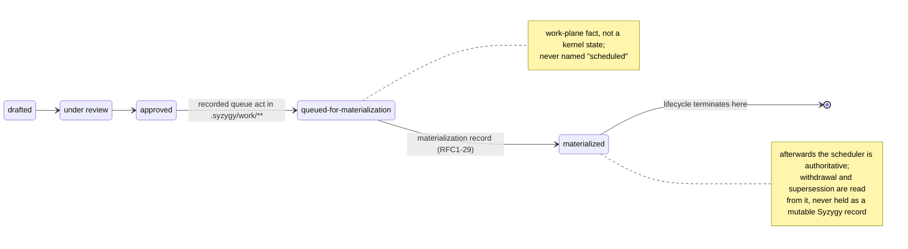
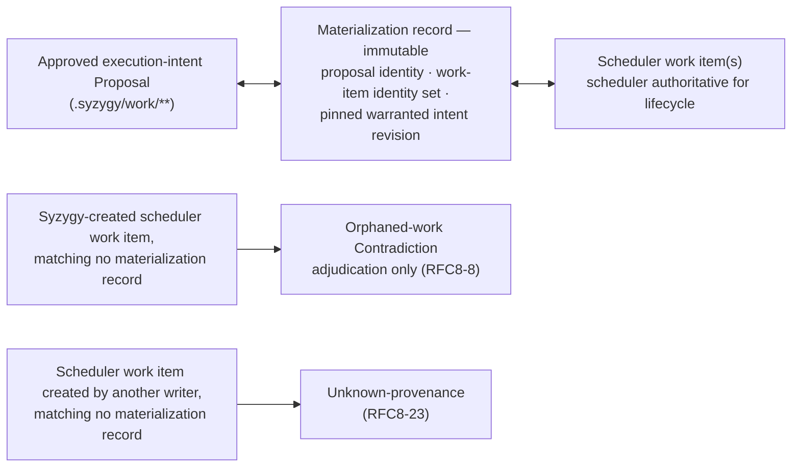

# RFC 0008 — Trajectory (Work Surface): identity, authority, materialization

**Status:** Proposed foundational contract (self-declaration at authoring
time). Effective status is established solely by an owner-act record binding
this file's exact content digest — either owner-adopted (bootstrap,
uncorrelated) or Syzygy-verified, with the exact provenance state always
visible (RFC3-16). Absent such a record, this contract binds
nothing.

**Package:** module 1 of 3 of the RFC 0008 contract package. Index, clause map,
lookup rule, package-level integration and deferrals: `README.md`. Rationale,
amendment history, rejected alternatives, and answered §8 questions:
`../../history/RFC-0008-history.md`.

**Serves:** vision.md Thesis (three states; work is never proof), VIS-1, VIS-2,
VIS-6; architecture.md (typed authority; `work/`). Implements **owner rulings**
SDR-7, SDR-8, SDR-18, and the pre-materialization portion of the SDR §2
Trajectory charter.

---

## 0. Module scope and reader map (non-normative)

*If this section and a clause ever disagree, the clause wins.*

This module decides what work exists, under whose authority, and which store
is allowed to say so. Two rules carry most of the weight: **Trajectory never
holds a second editable store of a scheduler-owned field** (RFC8-2(a),
RFC8-7, RFC8-11), and **a Syzygy-created scheduler work item with no
materialization record is a Contradiction, not a badge** (RFC8-8, RFC8-10).

- **What it owns:** what Trajectory is, what it may never become, what it is
  made of, and who is authoritative at each stage of a work item's life.
  - The three-plane rendering duty and the binding anti-thesis
    (RFC8-1/8-2).
  - The rebuildable-projection rule (RFC8-3).
  - The ontology as a projection of RFC 0001 rather than a fork
    (RFC8-4/8-5/8-6).
  - The approved-Proposal lifecycle and the "What remains?" enumeration with
    its orphaned-work Contradiction and exclusivity rules (RFC8-7/8-8).
  - The SDR-18 ownership boundary against Polaris (RFC8-9).
  - Materialization as a one-way door, with divergence rendered but never
    adjudicated (RFC8-10/8-11).
- **The question it answers:** *what work exists, under whose authority, and
  which store is allowed to say so?*
- **The two weight-bearing rules, in more detail:**
  - **No second editable store.** Post-materialization lifecycle state is
    read at the answering evaluation and re-derived, never merged; capturing
    that a transition *occurred* is a different, permitted act.
  - **Orphaned work is a Contradiction.** Syzygy-created work that no
    materialization record matches is routed to adjudication as its only
    lawful exit, never filtered, never absorbed as ordinary work; unrecorded
    work created by any other writer is Unknown-provenance (RFC8-23).
- **Neighbours in the package:**
  - The normalized work-state vocabulary this module's enumerations feed is
    defined in module 2 (RFC8-12/8-13).
  - The change-accounting chain that runs through RFC8-10's materialization
    join is in module 3 (RFC8-21).

---

## 3. The contract

Clauses are numbered `RFC8-n` for stable citation. Amend in place; retire
rather than renumber.

### 3.1 Identity and plane discipline

**RFC8-1.** Trajectory renders all three state planes relevant to work —
desired (approved intent), execution (proposals-in-flight, work items, runs),
and observed (merge facts, verification evidence, reconciliation verdicts) —
**in one surface without letting any plane impersonate another** (RFC1-22/23).
Every rendered item carries its plane; an item whose plane cannot be
determined is counted and rendered Unknown, never omitted or guessed.

**RFC8-2.** **The anti-thesis is binding.** Trajectory must not be:

- (a) a second editable store of any scheduler-owned field (RFC4-5, inward
  limb);
- (b) a view in which scheduler closure renders as done, green, or complete
  (RFC2-20);
- (c) a board showing current state that cannot answer "what did the fleet
  change, at what cost, under whose authority" for a past window at the
  fidelity the preserved records support.

**RFC8-3.** Trajectory is a **rebuildable projection** (VIS-6) over the kernel,
the `.syzygy/work/**` plane (RFC3-19), and the typed adapters — never
independently authoritative. Every mutation it offers is a synchronous,
attributed adapter or governance-plane act followed by a re-read (RFC4-5) —
never write-locally-and-sync-later.

### 3.2 Ontology: a projection of RFC 0001, not a fork

**RFC8-4.** Trajectory introduces **no new kernel entity**. Its ontology is a
projection of RFC1-5, with these bindings:

| Surface concept | Kernel identity (RFC 0001) |
|---|---|
| Candidate work / drafted plan | Proposal, kind *execution intent*, state drafted/under review (RFC1-27/31) |
| Approved plan / plan item | Approved execution-intent Proposal; decomposition via child Proposals (RFC1-30) |
| Materialization record | Materialization record (RFC1-29) |
| Work item (substrate alias "bead"), incl. epics | Work item, scheduler-issued, mirrored never minted (RFC1-5; RFC4-15) |
| Execution run / attempt | Execution run + its Execution Record (Evidence artifact, SDR-8; RFC4-18/19) |
| Review | Work item (review lane) + hosting PR facts as Evidence (RFC4-11) |
| Verification | Verification run — observed plane, never execution (RFC1-23; RFC4-13) |
| Reconciliation | Reconciliation evaluation and its verdict claim (RFC2-18) |
| Warrant | The `motivates` edge / a Decision — deliberately not reified (RFC1-8) |

**RFC8-5.** **Deliberate non-reifications**, recorded:

- an **idea** is personal presentation state (VIS-6, exception (a)) until
  promoted into a Proposal — never truth-bearing, never enumerated as work;
- a **milestone** is an annotation-profile entity (RFC1-7), a lens for
  aggregation and compaction boundaries, never itself work or a warrant;
- there is **no Feature entity** (RFC1-32): "feature request" is intake
  vocabulary that must resolve to a Capability identity before any status
  attaches;
- a **contradiction** and a **dismissal** render here (as a blocker on a
  conclusion; as *dismissed by decision*) but are never work items, never
  auto-scheduled (RFC1-21/20).

**RFC8-6.** A **compaction record** is a durable, identified record under
`.syzygy/work/**` (schema: RFC 0003) naming what it summarized, what it
discarded, and what remains externally queryable. It is a fact about
retention, never a status claim, and may never alter one
(`accounting-reconciliation-and-release.md` §3.13).

### 3.3 Pre-materialization authority and "What remains?"

**RFC8-7.** Trajectory renders the approved-Proposal lifecycle **drafted →
under review → approved → queued-for-materialization → materialized** over the
RFC1-28 entity, in RFC1-31's state names, **with
`queued-for-materialization` added as a work-plane fact rather than a kernel
state** — RFC1-31 does not carry that name, and this package reports the
omission rather than diverging from it silently (§5, §8 q2).

- `queued-for-materialization` is a **recorded queue act in
  `.syzygy/work/**` on an approved Proposal** — not a new kernel lifecycle
  state and **never named "scheduled"** (scheduling is
  typed-authority-routed to the work scheduler) [Observed: architecture.md,
  typed authority].
- The lifecycle terminates at `materialized` (RFC1-29).

**Post-materialization withdrawal and supersession are scheduler lifecycle
state, and Syzygy never holds a mutable record of it.**

- They are **read from the scheduler at the answering evaluation** (RFC4-15),
  **rendered against the materialization record's join** (RFC8-10/8-11),
  stamped with that evaluation, and discarded and re-derived at the next —
  never merged (RFC4-5, inward limb).
- **No annotation, field, log, or appended entry recording
  post-materialization scheduler state may be written onto the
  materialization record, and no `.syzygy/work/**` transition may record
  it** — the record is immutable (RFC1-29), a durable copy of a
  scheduler-owned mutable field is RFC8-2(a)'s second editable store, and
  RFC8-11 forbids later correction, so such an annotation could never be
  repaired once it diverged.
- Regret is expressed as a **new Proposal citing the old one** (RFC1-31), not
  as a mutation of either store.

**Capturing that a withdrawal or supersession *occurred* is permitted — and
required where a durable Syzygy record depends on the fact (RFC4-16(2)).** An
immutable, evaluation-stamped observation record or Execution Record noting
the transition as historical fact is captured evidence, not a mutable
projection (RFC4-5, inward limb, draws exactly this line): never rewritten,
never presented as the item's current lifecycle state, never joined into or
appended onto the materialization record, and not a `.syzygy/work/**`
**transition** — the prohibition is on Syzygy recording a lifecycle transition
*of its own*, not on the namespace, which houses Execution Records (RFC3-19).
What is forbidden is the second editable store of *current* scheduler state,
not beating the retention horizon: a transition lost to substrate GC before
capture renders **Unknown citing the retention event** (RFC4-16(3)), and
nothing here licenses that loss. [Inferred]

*Diagram (non-normative; the clauses govern):* the approved-Proposal
lifecycle RFC8-7 renders, with the one stage that is a work-plane fact rather
than a kernel state, and the handover to the scheduler at `materialized`.

**RFC8-8.** **"What remains?" enumerates three planes, each labeled:**

- (a) approved normative claims (requirements, governance clauses) covered by
  no approved execution-intent Proposal — at V0 this is absence surfacing,
  not gap computation [Observed: v1.md, V0/V1 gap boundary];
- (b) approved execution intent not yet materialized — from
  `.syzygy/work/**`, queue order visible;
- (c) open materialized work items — from the scheduler read (RFC4-15) at the
  answering evaluation, **each checked against the materialization record**
  (RFC8-10).

Drafted (unapproved) proposals render as *unadopted draft* (RFC2-25 sibling
state) — enumerable, never counted among approved intent, never anchoring any
remaining-work total.

**Orphaned work is a Contradiction, not a badge.** A **Syzygy-created**
scheduler work item (its creation attributed, in the scheduler's own history,
to the identity Syzygy's adapter writes under — RFC4-17) matching **no
materialization record** is an **orphaned-work Contradiction** (RFC1-29,
"Which unrecorded work is orphaned"): two stores answering one question, no
pinned intent revision for RFC2-18 to bind to, no warrant traceable through
`materializes`. An unrecorded item created by any other writer is
Unknown-provenance (RFC8-23), never this Contradiction; one whose creator the
history does not name renders Unknown-provenance with the orphan check
disclosed as undecided.

- Trajectory is the only surface enumerating scheduler work items, so the
  obligation lands here: the enumeration **must**
  - perform the check;
  - mint the Contradiction (RFC1-5/RFC1-18(b));
  - route it to **adjudication as its only lawful exit** (RFC1-21;
    RFC2-15): an agent's recorded adoption, reported and open to the
    owner's veto, or the owner's decision when it falls in an owner class
    (VIS-4), by an agent neither assigned to nor working any affected item
    (RFC1-29, "How an orphan leaves");
  - render the affected conclusion Unknown (reason #8
    `contradicted-pending-adjudication`, `suspended` tier);
  - and render the finding itself — **never silently adopted into a record,
    never silently deleted, never read as evidence that materialization
    happened**.
- It is **exempt from filtering** (§8 q4).
- Re-materialization after a partial failure must **cite and supersede the
  orphan finding** in the new record.
- An orphaned work item is **not** Unknown-provenance and never renders as
  one (RFC8-23).

**Exclusivity binds every enumeration and every total.** Every Proposal
declares an exclusivity group (RFC1-27).

- Trajectory's queue, its "what remains" enumeration, and **every
  remaining-work total, count, or aggregate** must never union — or sum
  across — two proposals in one exclusivity group, or proposals whose
  compatibility is undeclared.
- The honest render is ***N candidate futures*, selectable one at a time**
  (RFC1-27; VIS-1), carrying RFC6-24's explicit scenario context; a context
  naming two members of one group resolves `incompatible-scenario` (RFC6-5),
  never a merged scene and never a summed count.
- Two approved exclusive proposals are **one** unit of remaining work with
  two candidate shapes, never two — the drafted-proposal rule above excludes
  only *drafts* and does not discharge this.

**RFC8-9.** Per SDR-18, **Trajectory owns the drafting queue and the work
lifecycle** — **an ownership asserted against Polaris, not against the work
scheduler**.

- Queue state, assignment, and progress live in this surface and **Polaris
  renders that state read-only** (RFC7-24); Polaris owns the contextual
  intent-authoring and adoption experience.
- Nothing here qualifies architecture.md's typed-authority row: after
  materialization the **scheduler** is authoritative for work lifecycle state
  (RFC8-10; RFC1-29), Trajectory renders it and never stores it (RFC8-2/8-3).
- An intent-shaped queue item (a spec or governance delta) renders in
  Trajectory's queue and adopts through Polaris; the underlying Proposal and
  its state are one and the same in both surfaces (RFC6-3).

### 3.4 Materialization rendering

**RFC8-10.** Materialization renders as a **one-way door** (SDR-7; RFC1-29):
the immutable materialization record — **proposal identity, work-item identity
set, and the pinned warranted intent revision** (RFC1-29; RFC1-5), all three
**required**, none conditional — is the join Trajectory walks in both
directions.

- The pinned revision is load-bearing: RFC2-18's verdict binds to it,
  RFC8-21's chain runs through it, and RFC8-28's four-way distinction has
  nothing to evaluate `reconciled@E` *against* without it.
- Trajectory additionally renders the **materializing evaluation** alongside
  the record — a Trajectory-side extension, not a kernel record component
  (§5).
- After materialization the scheduler is authoritative for lifecycle state;
  `.syzygy/work/**` plan state is never rendered as current for a
  materialized item.
- **A missing record is a finding, not a silent skip:** a Syzygy-created
  scheduler work item no materialization record matches is the orphaned-work
  Contradiction, handled per RFC8-8; one created by any other writer is
  Unknown-provenance (RFC8-23). Neither is ever absorbed as ordinary work or
  treated as evidence that materialization occurred.
- Until the record exists, materialization has not occurred, whatever the
  scheduler holds (RFC1-29).

*Diagram (non-normative; the clauses govern):* the materialization record as
the two-way join between the approved Proposal and the scheduler's work
items, and the orphaned-work branch when a work item joins to no record.

**RFC8-11.** **Divergence renders; Trajectory never adjudicates it.**

- Substrate-side edits of Syzygy-written pointers (the warrant reference,
  RFC4-17) render as substrate annotations ("edited in substrate at T; not a
  warrant claim"): the `.syzygy/work/**` record stays authoritative, the
  pointer is re-asserted at the next evaluation, and no contradiction is
  manufactured on the chain's load-bearing join (RFC4-5, outward limb).
- Divergence between the record and later scheduler state is a fact about the
  scheduler, never grounds to rewrite the record (RFC1-29).

---

## 4. Violation cases

*Package numbering; cases are distributed to the module owning their clauses
and are never renumbered. Cases 4 and 12 span modules and are held in
`README.md` §4.*

1. *(RFC8-2/3)* A planning board stores an editable copy of scheduler status
   and syncs nightly; drag-to-column writes locally and reconciles later.
2. *(RFC8-7)* A `.syzygy/work/**` state named `scheduled`; a plan item edited
   after its materialization record exists; post-materialization supersession
   recorded as a `.syzygy/work/**` transition — **or appended to the
   materialization record as a `superseded_at` / `withdrawn_by` annotation**,
   which within months is a durable Syzygy-owned log of scheduler lifecycle
   transitions that RFC8-11 then forbids correcting.
3. *(RFC8-8)* "What remains" counts drafted proposals among approved intent,
   or omits items whose plane could not be determined.
11. *(RFC8-8/10)* A Syzygy-created work item with no materialization
    record rendered as ordinary open work, or as an Unknown-provenance badge
    filtered off the board with only a count disclosed — no Contradiction
    minted, no adjudication route, the affected conclusion never rendered
    Unknown. *(Amended by U2: an unrecorded item created by another writer is
    Unknown-provenance, and rendering it so is not this violation.)*

---

## 5. Integration — this module

- **Relies on RFC 0001:**
  - the closed entity/relation vocabulary RFC8-4 projects (RFC1-5/25) and the
    warrant edge it deliberately does not reify (RFC1-8);
  - the annotation-profile entity behind *milestone* (RFC1-7);
  - plan-item resolution and one-way materialization including the
    orphaned-work Contradiction (RFC1-28/29/30) and the pre-materialization
    lifecycle state names (RFC1-31);
  - exclusivity groups and *N candidate futures* (RFC1-27);
  - plane assignment (RFC1-22/23);
  - no-Feature (RFC1-32);
  - gap exits and adjudication-only Contradiction exits (RFC1-20/21), with
    Contradiction minting per RFC1-18(b).
- **RFC 0002:**
  - the *unadopted draft* sibling state and the tier registry (RFC2-25);
  - the Unknown rendering of a conclusion suspended pending adjudication
    (RFC2-15);
  - scheduler closure never rendering as done (RFC2-20);
  - the reconciliation verdict that binds to RFC8-10's pinned intent revision
    (RFC2-18).
- **RFC 0003:** `.syzygy/work/**` schemas for plan items, queue acts,
  materialization records, Execution Records, and compaction records
  (RFC3-19).
- **RFC 0004:**
  - the two-limb anti-duplication invariant this module applies in both
    directions (RFC4-5);
  - the faithful scheduler feed read at the answering evaluation (RFC4-15);
  - capture-before-horizon and its declared maximum inter-pass interval
    (RFC4-16, incl. RFC4-16(2)/(3));
  - Syzygy-written pointers and their substrate-side edits (RFC4-17);
  - hosting PR facts as Evidence (RFC4-11);
  - verification runs (RFC4-13);
  - Execution Records (RFC4-18/19).
- **RFC 0006:**
  - the one-and-the-same Proposal across surfaces (RFC6-3);
  - the closed navigation-outcome set incl. `incompatible-scenario`
    (RFC6-5);
  - explicit singular scenario context (RFC6-24).
- **RFC 0007:** Polaris rendering queue state read-only (RFC7-24).

**Foundation defect reported (not silently diverged from) — outstanding.**
**RFC1-28/31 omit the queued-for-materialization stage** of the owner-ratified
pre-materialization lifecycle (SDR-7 context).

- RFC8-7 realizes it as a recorded work-plane fact on the approved Proposal,
  minting no kernel state; RFC 0001 should confirm that reading or add the
  state (§8 q2).
- Four further defects reported against RFC 0001/0002 are **closed**; the
  trail is in `../../history/RFC-0008-history.md` §5, and no RFC 0001 or
  RFC 0002 change is outstanding on any of them.

**Extension flagged (not a defect).** RFC8-10 renders the **materializing
evaluation** alongside the materialization record.

- RFC1-29 and RFC1-5 name three components and do not include it; it is a
  **Trajectory-side rendering extension, not a kernel record component**, and
  this RFC does not add it to a kernel-owned immutable record by assertion.
- RFC 0001 may adopt it as a fourth component if the owner wishes; until then
  nothing binds on it.

- **Provides to RFC 0007:** the SDR-18 boundary (RFC8-9) — drafting queue and
  work lifecycle here, contextual intent authoring and adoption there.
- **To RFC 0010:** the materialization join, the one-way-door rule, and the
  orphaned-work Contradiction a Mission must respect before it may treat work
  as authorized.

---

## 7. Deliberately deferred — this module

- Physical schemas for plan items, queue records, materialization records,
  and compaction records → RFC 0003.
- Queue and board presentation, filters, and saved views → craft and personal
  presentation state (VIS-6, exception (a)), subject to the non-deferring
  layout obligation in `README.md` §7.
- The confirmation-path enumeration behind RFC1-21 → shared with RFC 0002;
  this RFC renders the outcome, not the mechanism.
- Cross-project work views → portfolio profile (SDR-29/30).

---

## 8. Owner questions

*Package numbering; question numbers never shift. Full package index:
`README.md` §8.*

2. **Queue realization (RFC8-7; §5 outstanding defect) — OPEN.** Confirm
   queued-for-materialization as a work-plane fact on the approved Proposal,
   or direct RFC 0001 to add it as a kernel lifecycle state.

---

*End of RFC 0008 module 1. Clauses RFC8-1 … RFC8-11, contiguous — no gaps,
nothing merged, nothing retired. Lettered limbs cited inside their parent
clauses (e.g. RFC8-2(a)–(c), RFC8-8(a)–(c)) are parts of those clauses — list
items within one clause body — not separate sub-clauses with their own
headings.*
