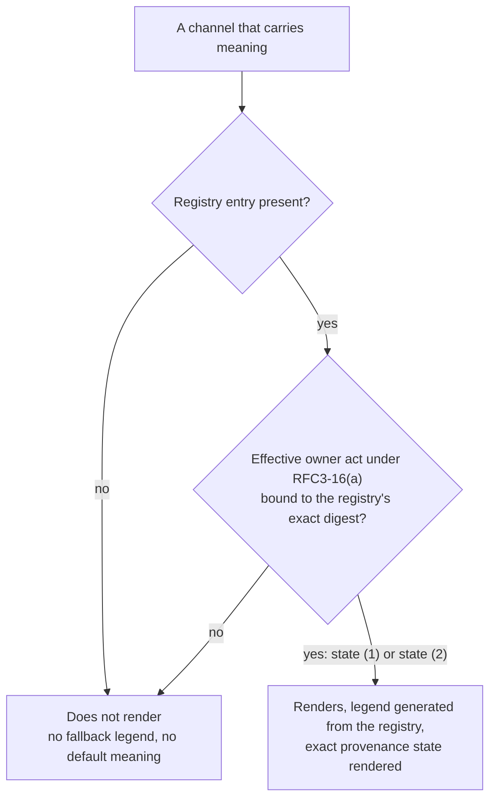
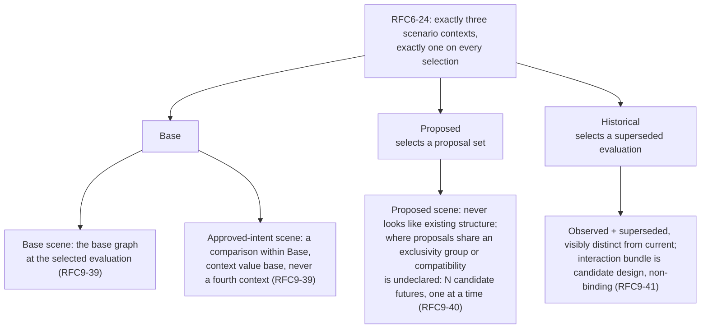
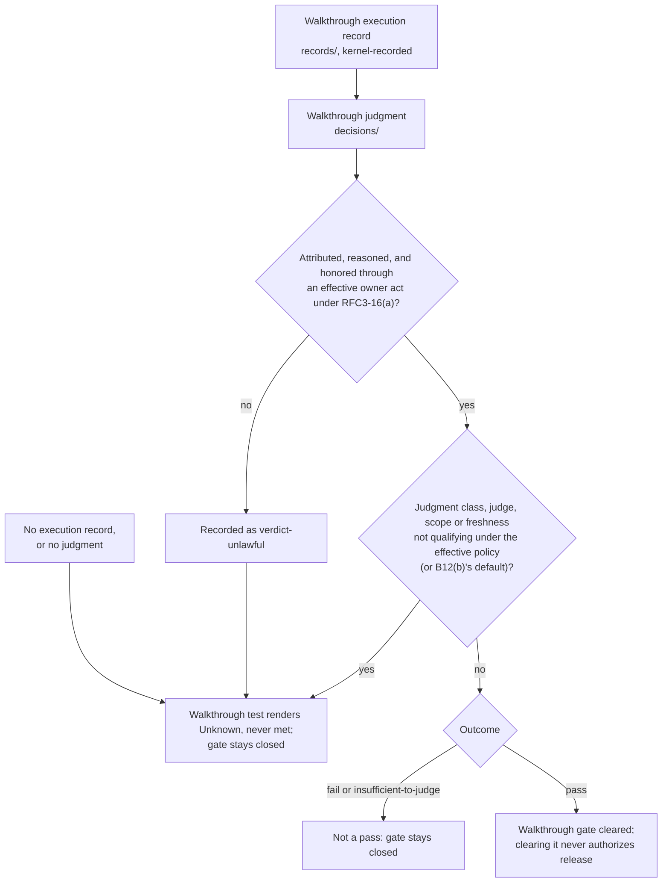

# RFC 0009 — Orrery (Map Surface): visual grammar, lenses, scenes, and aggregation

**Status:** Proposed foundational contract (self-declaration at authoring
time). Effective status is established solely by an owner-act record binding
this file's exact content digest — either owner-adopted (bootstrap,
uncorrelated) or Syzygy-verified, with the exact provenance state always
visible (RFC3-16). Absent such a record, this contract binds
nothing.

**Package:** module 2 of 3 of the RFC 0009 contract package. Index and lookup
rule: `README.md`. Rationale, amendment history, alternatives, and answered §8
questions: `../../history/RFC-0009-history.md`.

**Serves:** VIS-1, VIS-2, VIS-3, VIS-7 (trust floor: legend fidelity, link
rule); SEC-2, SEC-3, SEC-5; v1.md (3D V0 mandate, predominantly-Unknown maps);
SDR §2, SDR-6, SDR-19, SDR-20, SDR-24, SDR-25, SDR-26, SDR-33; doctrine
amendment D1 (map historical scope, adopted).

---

## 0. Module scope and reader map (non-normative)

*If this section and a clause disagree, the clause wins.*

This module owns **what the map is allowed to mean**. Every visual channel is
registered and legended, and an unregistered or unauthorized encoding fails
closed so it never reaches a reader (RFC9-26). **Unknown is a first-class
colour**, visible at every scale and inside every aggregate (RFC9-27,
RFC9-43), so a predominantly-grey map on an undeclared project is correct
output, not a defect (RFC9-45).

- **Visual grammar (§1, RFC9-24..RFC9-30).**
  - The reserved state palette and the channels no lens may repurpose.
  - The channel declaration contract and its fail-closed registry.
  - Unknown rendering at every scale; height, text, and inference treatments.
- **Lenses (§2, RFC9-31..RFC9-35).** The lens contract, overlays, the V0 lens
  set, and the promotion predicate.
- **Scenes (§3, RFC9-36..RFC9-41).** City and Factory scene profiles; base,
  approved-intent, proposed and historical scenarios.
- **Aggregation (§4, RFC9-42..RFC9-45).** Aggregation, semantic zoom, the
  unmapped district, and the grey-map comprehension walkthrough.
- **Questions it answers.** *What does this colour, height or edge mean? May
  this lens or overlay bind that channel? What must an Unknown or an aggregate
  show? What may a proposed or historical scene look like?*
- **Elsewhere in the package.**
  - Position, proximity, layout stability and counting rules:
    `semantic-geography.md` (RFC9-1..RFC9-23).
  - Equivalence, release gates, performance, motion and the OpenSpec
    boundary: `interaction-parity-and-release.md` (RFC9-46..RFC9-52).

---

## 1. Visual grammar: reserved palette and channel contract

**RFC9-24.** **The reserved state palette.** The map renders these states with
reserved, mutually distinct treatments no lens may repurpose. Only **Observed /
Inferred / Unknown** are epistemic labels (exclusive, trust-and-evidence.md); the
rest are sibling states rendered alongside a label, never fourth labels
(RFC2-25):

- **Contradicted** (Unknown base + conflict marker + adjudication route — no
  surface silently picks a winner [Observed: architecture.md]);
- **Dismissed by decision** (struck plate with reason + expiry; never green,
  resolved, or aligned);
- **Proposed/speculative** (wireframe + translucency — never looks like
  existing structure [Observed: trust-and-evidence.md]);
- **Unadopted draft** (proposed treatment + "unadopted" plate; anchors
  nothing);
- **Editorial draft** (RFC7-20's third RFC2-25 sibling surface state — a
  distinct reservation, not the unadopted-draft treatment: an
  `unadopted-draft` awaits an adoption gate into authority, an
  `editorial-draft` awaits a human authorship act into a non-authoritative
  artifact and stays non-citable even after adoption, so a shared treatment
  would tell the reader the wrong thing about what act is owed).

All three sibling surface states are reserved here because RFC9-43 makes them
**mandatory** in aggregate disclosure and RFC9-26 is fail-closed: a state with
no reserved treatment either

- does not render — contradicting RFC9-43 and RFC9-46, a release-blocking
  scene/table disagreement under RFC6-22/23 — or
- renders on an unreserved treatment, which is the unlegended meaning VIS-7
  forbids.

The freshness family — fresh / stale / broken / superseded — applies on top of
any state (RFC2-10):

- stale desaturates with an age plate;
- broken shows last-good marked broken, never failing invisibly;
- superseded ghosts.

Concrete treatment *values* (hues, materials) are design-contract material; the
role reservations are bound here.

**RFC9-25.** **Reserved channels.** Position, district boundary, the epistemic
rim/plate carrier, and saturation/chroma (the freshness carrier) are
lens-invariant. **Freshness owns the saturation channel exclusively: no lens ramp
may vary saturation**, so a desaturated element always means stale and never "low
on this ramp." A lens ramp varies whatever channels the chosen color model leaves
free once saturation is reserved — which channels those are, and how the
reservation is realized, is rendering material this RFC does not bind (RFC9-2),
but the reservation itself is a legend-fidelity obligation and holds in every
profile. Body color, height, heat, and other measured channels are lens-bound
under RFC9-28. [Inferred — operational form of the legend-fidelity floor.]

**RFC9-26.** **The channel declaration contract.** Every channel that carries
meaning declares, in a machine-readable registry from which all legend text is
generated (never hand-authored per channel): its **source metric**, **unit or
category domain** (with measurement window where windowed — the window is part of
the meaning and renders beside the legend), **update cadence**, **freshness
behavior**, **Unknown rendering**, **evidence path** (resolvable per the floor's
link rule), and **legend semantics**. A channel carrying no meaning is declared
inert in its legend. One channel, one meaning at a time, never unlegended (VIS-7
floor bullet 3). **The registry is fail-closed: a channel with no registry entry
must not render.** There is no hand-authored fallback legend and no default
meaning — an unregistered channel is a missing declaration, and rendering it
would put meaning on the scene that no generated legend can account for.
[Inferred]

**An entry present is not thereby an entry authorized:** because all legend text
is generated from this registry, an entry fixes what an encoding *means*, so
entries are honored only through an **effective owner act under RFC3-16(a)**
bound to the registry's exact digest. A valid state-(1) or state-(2) act is
effective, with its exact provenance state rendered; state (1) remains visibly
uncorrelated. An entry without a valid act is treated exactly as an absent one —
the channel does not render. [Inferred] A forged entry is the sharper failure
than a missing one: absence stops the render, while a re-declared meaning leaves
every claim, tier and freshness check passing and re-points the legend under a
correct scene, which is a direct attack on the VIS-7 trust floor that no
downstream status check inspects.

*(RFC9-26's channel registry is one of two artifacts RFC3-16(a) cites as
encoding-meaning-fixing; the other is RFC9-18's **layout version registry**, in
`semantic-geography.md`.)*

*Diagram (non-normative; the clauses govern):* whether a meaning-carrying
channel may render under RFC9-26's fail-closed registry.

**RFC9-27.** **Unknown is never invisible.** Every channel defines a mandatory
Unknown value, visually distinct from both ends of its own scale and from any
"good" reading — never green, never zero/empty/absent-looking:

- an Unknown height is a marked stub, never zero;
- an unmeasured heat region is marked unmeasured, never cold;
- a missing quantity renders Unknown, never 0, SDR-6.

Every Unknown element carries its RFC2-24 reason, rendered verbatim, with the
reason's resolution route as an affordance. No epistemic state is carried by
color alone: each carries at least two of {surface treatment, plate/badge,
label}.

**Unknown is never invisible *at any scale*.** The rule binds per channel per
element and, in the same reserved vocabulary, per channel per **aggregate**: an
aggregated measured channel carries its Unknown contribution rather than quietly
aggregating over only the members that have values (RFC9-43 states the aggregate
form and its legend obligation). Merging elements into a block or district is not
a place where Unknown becomes zero. This is one rule with two scopes, not two
rules.

**Empty-looking is earned, not defaulted:** a **plot, block, or district** renders
*empty* ("declared, nothing built here") only when backed by an executed mapping
coverage record (RFC4-27) covering its declared scope; absent that record it
renders Unknown with reason `mapping-coverage-absent` (RFC2-24 #5) — an
unexecuted mapping is not evidence of absence. The rule binds **every level of
the hierarchy** (plot, block, district) and **every scenario scene, including the
approved-intent and proposed scenes** (§3): nothing anywhere on the map is
permitted to look empty by default, and no level of aggregation is a place where
the obligation lapses.

**RFC9-28.** **Height (SDR-24).** Height has exactly **one declared meaning per
active lens**, always visible in the legend; **no universal height meaning is
frozen** by this contract. A lens's height metric obeys RFC9-26 in full; the
Unknown height treatment of RFC9-27 is lens-invariant. The "software city where
height = LOC is the whole product" is the named anti-thesis, excluded by the lens
contract, not by freezing the channel. *(The rejected alternative — freezing
height to one V0 meaning — is in the history file, §6; the learnability bet is
revisitable by amendment after comprehension walkthroughs.)*

**RFC9-29.** **Text is a channel.** Labels, plates, counts, breadcrumbs, and
tooltips state only what identified artifacts state; truncation is marked, never
silent; an Unknown entity carries an explicit "Unknown" label, never an omitted
one.

- No text may derive from secret-matched or unclassifiable content — a
  connection string in a map tooltip is doctrine's own named violation
  [Observed: SEC-5]; excluded content contributes only a sealed-marker
  disclosure **at a declared minimum aggregation, never a per-element match
  count**.
- A per-building sealed marker carrying its own match count *is* a per-file
  match count rendered spatially — RFC6-27's violation case 10 — disclosing the
  *shape* of the excluded material (which files, how many matches each,
  clustered where) while withholding only its content.
- SEC-5 sanctions rendering **the exclusion**, not its shape; the map is the
  surface where that shape is most legible, so the granularity bound is stated
  here and applies to every sealed marker (RFC9-23).

**RFC9-30.** Inferred contributions render in the inferred treatment (hatched +
provenance) and never raise a status-bearing encoding; an open admitted challenge
suspends the displayed claim to Unknown (`challenge-suspended`, `suspended` tier)
with the deterministic basis visible (RFC2-8/13/14). Absent SEC-2 consent,
inference-dependent renderings degrade to Unknown
(`unconsented-source-or-provider`) — never error out, never fall back to a
heuristic.

---

## 2. Lens contract and the V0 set (SDR-20)

**RFC9-31.** A **lens** is an explicitly selected binding of measured channels
over home geography. A lens may bind: body color, height, heat, banded
footprint-within-reserved-extent, and edge weight — each under RFC9-26. A lens
may never: repurpose a reserved channel or palette state (RFC9-24/25), move an
entity (RFC9-12), suppress an overlay's epistemic content, or render without its
full legend. Exactly one lens is active at a time.

**Overlays are lens-independent, and the rule that makes them so is a constraint,
not an observation: an overlay may never bind a measured-magnitude channel.** An
overlay carrying epistemic content (freshness/staleness) or non-epistemic,
non-magnitude content — including execution-plane fact such as scheduler state
(RFC1-22) — renders as **categorical or state marks**, under the same legend and
channel-declaration discipline a lens obeys (RFC9-26), never as body-colour ramp,
height, heat, footprint band, or edge weight. Otherwise a lens-bound and an
overlay-bound measured encoding would run simultaneously and the reader could not
attribute which channel carries which meaning.

**RFC9-32.** **V0 ships:** primary lenses **Architecture** ("what is this made of
and how does it hang together") and **Verification** ("what is proven here, and
how stale is the proof" — no evidence renders Unknown, never failure and never
success); always-available overlays **work/construction** (scheduler state via
its typed adapter; "scaffolding is never proof the implementation satisfies
intent" — completed work removes scaffolding, it never turns anything green
[Observed: vision.md, Thesis]) and **freshness/staleness** [Observed: SDR-20].
Work/construction qualifies as an overlay **not** because scheduler state is
epistemic — it is execution-plane fact (RFC1-22) — but because it renders as
**categorical state marks** (scaffolding present/absent and its declared work
state) and binds no measured-magnitude channel, per RFC9-31. Scaffolding density
by open-work-item count would be a measured binding and is therefore forbidden to
an overlay.

The declared work state is consumed **verbatim from RFC 0008, and it is two
separate fields, not one** (RFC8-12; RFC8-28) — separate rather than
orthogonal, since normalized `reconciled` is a projection of the chain value
`reconciled@E`, which is exactly why neither field ever substitutes for the
other. The overlay consumes and renders both:

- the **normalized work state** — RFC8-12/13's closed vocabulary, whose values
  are partitioned into live states, a terminal state, and **state-local absence
  values**.
  - The overlay renders each value as itself: an absence value is **never
    folded into an Unknown aggregate**, never counted among RFC2-24 Unknown
    reasons, and never rendered as scaffolding absent — "no work state could
    be determined" and "no work is scheduled here" are different facts, and a
    district that renders them alike has manufactured the second from the
    first;
- the **RFC2-18 chain state** — `merged`, `reconciliation-pending`,
  `reconciled@E`, `unsatisfied`, `contradiction-raised`, `Unknown(reason)` —
  carried on every element and every aggregate that carries a normalized state.
  - **RFC2-17's word reservation binds this overlay**: *reconciled at E with
    evidence*, *merged, not yet evaluated*, *evaluated and unsatisfied*, and
    *evaluated, contradiction raised* are four answers and **never share a
    mark, a mark's color, a count, or a legend entry** (RFC8-28); an
    `unsatisfied` mark and a `contradiction-raised` mark are never merged into
    one, since one routes to a gap and the other to adjudication alone.
  - A district rendering normalized `merged` while dropping the chain state has
    shown scaffolding removed and concealed that nothing was reconciled — the
    closure fallacy at map scale (RFC8-30).
  - **Staging:** per RFC8-29 the verdict-bearing outcomes (`reconciled@E`,
    `unsatisfied`, `contradiction-raised`) are not produced at V0, where the
    field carries `merged`, `reconciliation-pending` and `Unknown(reason)`
    only; the overlay binds on all of them regardless, so the V1 computation
    lands on a surface that already renders its outcomes distinctly.

Neither field's vocabulary is fixed by this clause: the overlay consumes whatever
values each field currently carries, and a value it cannot render is a defect
here, never grounds to fold that value into a neighbouring one (RFC8-13,
RFC8-28).
[Inferred — composition of RFC 0008's two-field handoff with RFC6-6's rule that
non-claim absence values are separately counted, RFC2-17's reservation, and
RFC9-43's aggregate-composition obligation.]

**RFC9-33.** **Staging:** **Change/churn** is the next lens after V0
(VCS-history-sourced, window always rendered, reduced fidelity labelled per
RFC4-11/24). **Risk** and **Runtime** are later: Risk requires a policy-declared
composite — an undeclared risk heatmap is inference wearing a deterministic
costume and the most seductive VIS-7 violation; Runtime is hard-gated by SEC-3
through RFC 0005's execution profiles and by an evidence class for captured
traces — until then flow paths render explicitly unmeasured [Observed: SDR-20;
SEC-3].

**RFC9-34.** No lens may synthesize data to look complete: a lens whose inputs
are absent for a region renders that region in the reserved Unknown treatment
with its reason — a lens never narrows the entity set (that is a filter,
disclosed as one per RFC6-16).

**RFC9-35.** Adding a lens is a contract act: a new lens ships with its channel
declarations (RFC9-26), its Unknown behavior, its legend, and its tabular
equivalent (RFC9-46) in the same increment — never as a 3D-only skin.

**The promotion predicate — one rule, not a per-kind enumeration**: for
**lenses, analytical planes, and profile relations alike**, personal definition
and use is free (VIS-6 exception (a) territory — it affects no truth, work, or
status), and **promotion to a named, governed, versioned artifact others can
select is an owner governance act honored only under RFC3-16(a)** — whether or
not the promoted thing binds a registered channel or mints a relation. A
promotion that registers no channel and adds no relation does not thereby escape
the act: the predicate rides on *promotion itself*, so nothing reaches shared,
selectable status through accretion. *(Owner decisions B12(c)/B17, answering §8
q4 and q9 with one rule.)*

---

## 3. Scene profiles, scenarios, and time

### 3.1 Scene profiles: City V0, Factory later (SDR-19)

**RFC9-36.** **City is the required V0 scene profile.** **Factory is a named
later profile over the same graph and the same truth** — a second emphasis
(dynamics at the same addresses, so spatial memory transfers), never a second
semantic model. All invariants here — geography, palette, legend, evidence paths,
equivalence, counting — bind every profile identically. Factory remains named and
sequenced so it cannot be quietly dropped. [Observed: SDR-19.]

**RFC9-37.** Factory's specific honesty obligations, bound now so its later
contract cannot relax them: the capture window renders at all times; motion stops
and marks when its source stales (continuing motion reads as liveness); an
unmeasured factory renders visibly unmeasured, never as a calm, orderly, working
one; **no flow is ever synthesized for illustration**; live views, when they
exist under the fleet-observability mandate, never contribute to status claims
[Observed: vision.md].

### 3.2 Scenarios and time

**RFC9-38.** Every scene names its evaluation — (source snapshot, as-of instant)
— on the surface, not in a menu; time is an explicit input, never ambient
[Observed: architecture.md].

- A scene rendering an evaluation of a non-default snapshot (a branch or PR
  tree) is Observed truth *about that snapshot* and renders a persistent
  non-default marker (a surface-local restatement of RFC6-24's upstream
  obligation, not a marker this RFC binds alone).
- Between-evaluation motion is a labelled transition; no interpolated frame is
  a claim; time travel is between identified evaluations only, and gaps look
  like gaps.
- A later as-of instant may only degrade a claim (RFC2-4); a building never
  visibly decays by wall clock.
- **Subject to RFC9-41:** rendering motion across *superseded* evaluations is
  map rendering of historical state — constitutionally in scope (doctrine
  amendment D1, adopted), but its concrete interaction design is the
  unapproved candidate bundle RFC9-41 holds. Until the owner approves that
  design, this clause governs motion between *non-superseded* evaluations of
  different snapshots only, and the map offers historical access through the
  drawer. Read alone, this clause licenses no particular historical rendering
  design.

**RFC9-39.** **Base and intended.** The base scene is the base graph at the
selected evaluation. The **approved-intent scene** renders adopted declarations —
the kernel's Desired/intended *state* plane (RFC1-22), named in the kernel's own
vocabulary per RFC9-1 — against observed state; base-vs-intended comparison
renders three visible sets — present-and-intended, present-and-unintended,
intended-and-absent — the last **as absence at V0, never as gap objects**
[Observed: v1.md, V0/V1 boundary]. ("Target" is not used for this scene: the
kernel's words are *desired* and *intended*, and RFC2-16 already spends "declared
**target scope**" on the scope over which convergence is claimed.)

**The approved-intent scene carries scenario context `Base`** — it is a
comparison *within* Base, **not a fourth context**: RFC6-24 enumerates exactly
three contexts and requires exactly one on every selection, and this scene selects
no proposal set (which would make it Proposed) and no superseded evaluation
(which would make it Historical). The context RFC6-25 propagates into this
scene's URLs, cross-surface synchronizations, and query answers is therefore
`base`, and **no implementation may mint a fourth context value for it** — a
minted value would travel outside RFC6-24's exact enumeration into endpoint
answers by RFC6-25's own machinery. RFC9-12 is not engaged: the scene re-marks
home geography and moves no entity. [Inferred — the only reading consistent with
RFC6-24's exact enumeration.]

**Rendered as absence is a positive obligation, not the omission of one.** An
intended-and-absent capability, block, or plot renders as a **marked, labelled,
expandable vacancy** carrying its RFC2-24 reason and that reason's resolution
route — **never negative space, never vacant ground**. RFC9-27's earned-emptiness
rule binds this scene at every level of the hierarchy, and RFC9-22 binds the
identical sentence for unconsented repositories; an unmarked gap here is that
same failure, located where the largest piece of missing work is, and a reader
scanning it would conclude the intent is substantially met. What V0 defers is the
**gap object** — a first-class, selectable, trackable entity for the missing
thing — not the marker.

An intended state whose approved inputs contradict renders the contradicted
region Unknown with its adjudication route — never a resolved intent.

**RFC9-40.** **Proposed.** Proposed scenes obey RFC1-27 and RFC6-24:

- the kernel refuses to union proposals in one exclusivity group or of
  undeclared compatibility — the honest render is *N candidate futures*,
  selectable one at a time;
- **proposed structure never looks like existing structure** in any profile at
  any zoom;
- every proposed scene names its base on-surface (default: the observed base
  graph; proposal-over-intended only as an explicitly labelled stacked
  scenario);
- structurally divergent proposals compare side-by-side in their own address
  spaces with shared declared districts as registration anchors — their union
  is never one scene.

A deterministically computed merge projection is a derived projection in the
proposed treatment, never solid: determinism of a computation is not evidence of
existence.

**RFC9-41.** **Historical.** Drawer and query access to superseded evaluations
rests on VIS-6, exception (b), and needs no doctrine change (RFC6-24).
**Rendering historical state in the map is within `map/`'s constitutional scope**
— unconditionally, by adopted owner amendment D1 [Observed: architecture.md as
amended]. What binds when historical scenes render: they render Observed +
superseded (ghosted or otherwise visibly distinct from current, with the
superseding evaluation named), staleness on the primary surface, and
retention/renderable-evaluation selection per the quality/evidence policy.

**Candidate design, non-binding.** The concrete interaction bundle — ghost-step
opacity for superseded structure, milestone scenes, the timeline scrubber over
identified evaluations — is **candidate design only**. D1's adoption did not
activate it and nothing in this RFC does; it becomes binding only through its own
later owner approval (as a craft/OpenSpec candidate after RFC acceptance). Until
then the map offers historical access through the drawer, and any historical scene
an implementation does render must satisfy the binding sentence above without
claiming the candidate bundle is contract. [Observed: D1; the candidate bundle
Inferred and explicitly non-binding.]

*Diagram (non-normative; the clauses govern):* the three scenario contexts of
RFC6-24 and the scenes RFC9-39..RFC9-41 place in each.

---

## 4. Aggregation, semantic zoom, and unmapped code

**RFC9-42.** **LOD epistemic invariance.** Zoom and level-of-detail may reduce
geometric fidelity and label density freely; they may never change a fact's
epistemic state — only its aggregation. The epistemic treatment set (texture
class, plate presence, proposed-vs-existing distinction) is LOD-invariant,
surviving by substitution: where per-entity treatment is illegible, an Unknown or
proposed *region* renders as an aggregate in the same reserved vocabulary
("Unknown ×40", a wireframed proposed district) — never as ordinary solid mass.
Zoom never fabricates detail: an unavailable interior renders Unknown, not
generic geometry. [Inferred — VIS-1 honest simplification, operationalized.]

**RFC9-43.** Every aggregate discloses its membership count and epistemic
composition and supports expansion to members (RFC6-17; SDR-27). **The disclosed
composition is the full RFC6-22 equivalence tuple** — per-label, per-tier,
per-Unknown-reason and per-freshness-state counts, **sibling surface states, and
the `challenge-pending` disclosure (RFC2-13)**, and — where the aggregate's
members carry them — **per-value counts of the chain state and the normalized
work state of RFC6-19 class 8**, so an aggregate can never satisfy this clause
in full while disclosing nothing about reconciliation (RFC9-32 carries the
element-level obligation these counts aggregate); **per-Unknown-reason counts
are computed over primary reasons only** — one claim instance contributes
exactly one — with secondary annotations (RFC2-24) disclosed separately and
never folded into the primary counts, since divergent totals over one declared
scope are exactly the disagreement RFC6-23 classes release-blocking — the tier
counts covering all six
of RFC2-25's tiers (`gate-backed`,
`report-fact`, `asserted-by-worker`, `reduced-fidelity`, `declared-only`,
`suspended`), and the sibling surface states being the three RFC2-25 places
deliberately outside the registry (*dismissed by decision*, *unadopted draft*,
*editorial draft*, per RFC6-14) — never label and Unknown reason alone. An
aggregate obligation narrower than the equivalence obligation over the very same
objects would let `reduced-fidelity`, `asserted-by-worker`, `stale` and *dismissed
by decision* evaporate at the district layer, and those are precisely the labels
doctrine spends clauses making unloseable [Observed: SDR-33;
trust-and-evidence.md, Staleness — "staleness must be visible on the primary
surface, not buried in drill-down"]. A district disclosing "Observed ×30, Unknown
×10" while all 30 are `reduced-fidelity`, 12 are stale and 3 are dismissed by
decision reads as a well-evidenced, current district — to a human and to an agent
querying the same aggregate under RFC6-13. RFC6-17 binds the same enumeration at
the foundation layer — its own words are "the disclosed composition is the full
RFC6-22 equivalence tuple" — so the two are deliberately identical, and any
divergence is a defect to close rather than a surface-local variation.

**RFC9-46's surface-local additions are not aggregate-composition items, and
this clause does not import them.** RFC9-46 adds two fields to the
**cross-surface equivalence** tuple — the RFC9-9(b) positional-expression
state per rendered `declared-dependency` edge, and both RFC9-15(b) part 4
backlog partition counts. Those are properties of an **edge** and of the
**layout**, not of an aggregate's membership; requiring every district
aggregate to restate them would create an obligation RFC9-47's gate list has
no aggregate-level check for, and RFC9-47(a) part 1 forbids minting a
release-blocking obligation without routing a check for it in the same
logical change. They bind where RFC9-46 binds them: the 3D scene and the
non-3D view must agree on both, over the same declared scope, and RFC9-47
already gates that.

**Aggregated measured channels carry their Unknown contribution — RFC9-27 at
scale.** Where an aggregate renders a lens-bound measured channel over
epistemically mixed members, the aggregate must carry its Unknown contribution in
**the same reserved vocabulary the per-element rule uses**:

- a **marked stub fraction**,
- a **hatched band**, or
- a **refusal to render a magnitude at all**.

The aggregate's per-zoom legend must state which of the three it does.
Aggregating over only the members that have values, and letting the rest vanish,
is Unknown rendered as zero at the map's most legible scale — SDR-6 and RFC2-23's
"no aggregate silently treats absent as 0" — and it is reached without breaking
any other clause: a district of 2 measured and 38 Unknown buildings renders
short, RFC9-42 does not fire because the district is not *wholly* Unknown, and
the reader concludes the district is small. **At V0 this is the normal case, not
an edge case:** v1.md fixes the proving ground as predominantly-Unknown projects,
so an aggregate rule that only bit on wholly-Unknown regions would bite almost
nowhere.

Aggregate legends are per-zoom-level, because a district-level aggregate is not
the same measure as a building-level reading.

**RFC9-44.** **The unmapped district (SDR-25).** Unmapped code is **aggregated by
default** — with count, RFC2-24 reasons, and expandable detail — and **never
disappears**: no filter default, LOD step, lens, or profile may drop it. Its
entities carry a **"path-derived placement (may move on refactor)"** marker
(RFC9-14): what is path-derived and unstable is the *arrangement*, never the
identity. Code-element identity is adapter-minted and stable — explicitly "not
path-only" (RFC1-5; RFC4-12) — so selection references and URLs into the unmapped
district survive refactor under RFC6-1 and RFC6-9. A marker asserting
path-derived *identity* would break both and dangle every bookmark into this
district, which matters most precisely here. On an undeclared proving-ground
project it will be most of the map — the correct output — and its primary
affordance routes to V0's first-pass drafting of declarations for owner sign-off
[Observed: v1.md; SDR-25]. *(Rejected alternative — individual buildings by
default — history file, §6.)*

**RFC9-45.** **The grey map is diagnosis, not breakage.** At 90% Unknown the map
must remain legible and useful: Unknown regions aggregate with RFC2-24 reasons
and resolution routes rendered verbatim. The acceptance posture is v1.md's
comprehension test (within-reader, recorded walkthrough, owner-judged); its first
task on an undeclared project is the grey-map first impression. Binding failure
signature: a reader stating something false that the map supported is a
trust-floor incident, release-blocking. Frame rate, entity count, polish, and demo
reaction are explicitly non-criteria. [Observed: v1.md; SDR §2; signature form
Inferred.]

**Three artifacts, not one.**

1. The **walkthrough execution record** — a `kernel-recorded` durable fact
   (RFC3-2) in **`.syzygy/governance/records/`** (RFC3-15) minted when a
   walkthrough runs:
   - the project and surface walked, the participants, the start/end or
     capture identity, the submission identity, and
   - what was on the screen:
     - the **evaluation** walked ((source snapshot, as-of instant), RFC9-38),
     - the **layout version and layout baseline** in force (RFC9-14(a),
       RFC9-18),
     - the **scenario context** and **active lens** (RFC6-24; RFC9-31), and
     - the **declared filter scope**, including any RFC9-49 narrowing.

   *(The screen-content list is required because a name and a rationale make
   a false pass **attributable**, not **findable**; findability requires
   knowing what was rendered.)* Every listed item is a governed or
   snapshot-identified fact this RFC already requires the *scene* to name. The
   execution record asserts only that a walkthrough occurred as described; it
   judges nothing and authorizes nothing.
2. The **walkthrough judgment** — an attributed human adjudication recorded in
   **`.syzygy/governance/decisions/`** (RFC3-15: a decision is a warrant, never
   evidence), naming the judging party, the outcome (**pass / fail /
   insufficient-to-judge**), the rationale, the execution record(s) judged, the
   scope the judgment covers, its instant, and any earlier judgment it
   supersedes. *(Attribution ruled at acceptance by owner decision B12(b),
   escalating v1.md's success test to a gate.)*
   - The judgment is honored only through an **effective owner act under
     RFC3-16(a)** bound to the judgment's exact digest. State (1) or state (2)
     may supply the judgment, with its exact provenance state rendered; state
     (1) remains visibly uncorrelated.
   - It is an adjudication Decision in `decisions/`, squarely inside that
     predicate's example list, and the home establishes durability, never
     authorship: an owner judgment a fleet worker could commit is not an owner
     judgment.
   - An unattributed or unreasoned verdict is not a lawful gate outcome in
     either direction — a false pass must be findable afterward, and it is
     only findable with a name and reasoning attached.
   - The judgment is **never rendered Observed** and is **never evidence about
     the project**: it is a recorded human judgment about the surface, and no
     claim instance, gate outcome, or reconciliation verdict may consume it as
     project implementation evidence.
3. The **release policy** — an owner-approved, authorization-bearing policy
   under **`.syzygy/governance/policies/`**, honored only through an effective
   owner act under RFC3-16(a) bound to the policy's exact digest. State (1) or
   state (2) is effective, with its exact provenance state rendered; state (1)
   remains visibly uncorrelated.
   - The policy says whether a walkthrough is required for a given release
     class, **which judgment classes qualify and who may judge**, what
     freshness and scope the judgment must have, and that a lawful qualifying
     pass clears this walkthrough gate.
   - **Authority to configure or clear this walkthrough gate comes from the
     effective policy — never from the kernel having stored a verdict.**
   - **Absence of an effective policy is not a permissive default**: with no
     effective release policy, **owner decision B12(b) binds directly**: the
     comprehension walkthrough is required at every release milestone, the
     owner judges, and the walkthrough gate requires a lawful qualifying pass.
   - An effective policy **configures and may narrow** that default (release
     classes, qualifying judgment classes, freshness, scope); only an explicit
     effective owner act under RFC3-16(a), in either state and bound to the
     waiver's exact digest, may waive the walkthrough for a release class, and
     no policy silence ever does.
   - Release policies and waivers are warrants for this gate, never project
     evidence or evidence that any release, deployment or recovery effect
     succeeded.

Orrery **references** the execution record and judgment (drawer-linkable per
RFC6-19); it owns neither, and nothing gate-bearing lives under `.syzygy/map/**`.

**An unlawful outcome does not clear the gate.** The gate is **fail-closed, like
every other closure on this surface** (RFC9-26's registry, RFC9-18's invalid
entry, RFC9-27's absent coverage record; and v1.md for this very test: "absent
its artifact, a test renders Unknown, never met"). Concretely: **where the
walkthrough is required — by the effective release policy, or by B12(b)'s default
when no policy is effective — the walkthrough gate requires a lawful qualifying
pass.**

- An unattributed or unreasoned verdict — in either direction — is not a
  lawful pass, so it blocks release exactly as a fail does. It is recorded as
  **verdict-unlawful** — a state of the judgment record, *not* an RFC2-24
  Unknown reason (that vocabulary is closed at twelve and governs claims about
  the project, not outcomes of Syzygy's own release gates) — rather than
  converted into a fail, because the walkthrough's actual outcome is not
  thereby known and recording a fail would assert something no one judged.
- **A judgment without an effective owner act under RFC3-16(a) is unlawful in
  exactly the same way** — attributed and reasoned prose a fleet worker could
  commit clears nothing — and is recorded as **verdict-unlawful** likewise.
- Absence of an execution record, absence of a judgment, and a judgment whose
  scope or freshness the policy rejects are likewise not a pass.

In every one of these cases the walkthrough test renders **Unknown, never met**
(v1.md's own words), the gate stays closed, and the remedy is to re-run the
walkthrough and record it lawfully. *(This paragraph and RFC7-31 state one
protocol, with the same outcome on both surfaces.)*

**This clause is only a walkthrough/release-policy gate.** Clearing it never
authorizes release or proves that a release occurred. This amendment creates no
deployment or recovery authority; those effects remain unavailable until
separately contracted, specified and authorized.

*Diagram (non-normative; the clauses govern):* how a recorded walkthrough
reaches the RFC9-45 gate where a walkthrough is required.

---

## 5. Violation cases (module-owned)

6. *(RFC9-24/27/39/43)* An Unknown region rendered green because its neighbors
   are; a proposed component rendered solid; an Unknown rendered zero-height or
   absent; an empty plot, block, or district with no coverage record; a district
   aggregate whose measured channel renders short because its Unknown members
   contributed nothing to it; an intended-and-absent capability rendered as vacant
   ground in the approved-intent scene.
7. *(RFC9-26/28)* An unlegended channel carries meaning; legend text
   hand-authored per channel drifts from the palette registry; a heat layer
   renders without its window; height changes meaning with no legend change.
8. *(RFC9-33/37)* A risk heatmap from an undeclared composite; a runtime flow
   animating with no captured trace (SEC-3); motion continuing from a stale
   source.
9. *(RFC9-38/40/41)* A scene with no visible evaluation identity; two
   exclusivity-grouped proposals merged into one future; a computed merge rendered
   solid; the historical interaction bundle (ghost steps, milestone scenes,
   scrubber) shipped as if binding while it remains an unapproved candidate design
   — or a claim that doctrine amendment D1's adoption activated it by itself.
10. *(RFC9-42/43/44)* Zoomed-out Unknown regions solidify into ordinary mass; a
    district aggregate discloses label and Unknown reason while dropping tier,
    freshness, and sibling states; the unmapped district vanishes under a default
    filter; its entities are marked as carrying path-derived *identities*.

*(Cases 1–5 and 3a belong to `semantic-geography.md`; case 11 to
`interaction-parity-and-release.md`.)*

---

## 6. Integration (module-scoped)

- **RFC 0001:** state planes and the proposed plane (RFC1-22); exclusivity
  groups (RFC1-27); code-element identity not path-only (RFC1-5).
- **RFC 0002:** the label + tier + reason + freshness vocabulary rendered
  verbatim (RFC2-10/24/25, incl. `declared-only`); suspension visibility
  (RFC2-8/13/14); the RFC2-18 chain state and RFC2-17's word reservation;
  failure states and "no aggregate silently treats absent as 0" (RFC2-23);
  declared target scope (RFC2-16).
- **RFC 0003:** `kernel-recorded` durable facts (RFC3-2); governance homes for
  records, decisions and policies (RFC3-15); the RFC3-16(a) owner-act
  predicate.
- **RFC 0004:** coverage records behind every empty plot (RFC4-27);
  reduced-fidelity labeling for churn inputs (RFC4-11/24); code-element
  identity continuity (RFC4-12).
- **RFC 0005:** execution profiles gating every runtime-lens input
  (RFC5-20…23; SEC-3).
- **RFC 0006:** aggregation disclosure (RFC6-17); filters disclosed as filters
  (RFC6-16); scenario context (RFC6-24/25); one truth, two consumers
  (RFC6-13); sibling surface states (RFC6-14); drawer links (RFC6-19).
- **RFC 0008:** the two-field work-state handoff (RFC8-12/13, RFC8-28,
  RFC8-29, RFC8-30).
- **Provides to** RFC 0007/0008 the map-side rendering obligations behind
  cross-surface highlights (same reserved palette semantics for shared
  states), and to craft-and-care the legend/palette registry discipline.

**Upstream defects reported from this module's clauses are all resolved**:
RFC6-24's implicit non-default snapshot (defect 3) and RFC6-17's narrow
aggregation disclosure (defect 4) were both closed upstream on 2026-08-01. Trail:
history file, §5.

---

## 7. Deliberately deferred (module-scoped)

- Concrete visual treatment values, legend layout, and lens metric formulas
  and band edges → post-acceptance design contract and per-lens spec + quality
  policy; none may weaken a clause here (RFC9-2).
- Factory's full scene contract → its own later spec under RFC9-36/37's bound
  invariants.
- Historical-scene retention and renderable-evaluation selection →
  quality/evidence policy, active only under RFC9-41.
- V1 gap-object rendering on the map → V1 RFC, over the same identities (V0
  renders absence).
- Certificate rendering (post-V1, future-tagged) and live fleet streaming
  (deferred mandate) are not this module's.

---

## 8. Owner questions (module-owned)

Numbering is the stable package numbering; answered items keep a stub here so
numbers never shift. **None of this module's questions is open.**

- **q3** — historical conditionality (RFC9-41). **Answered — adopted doctrine
  amendment D1**, in part: the amendment is adopted, and the historical *design*
  is held behind its own owner approval, which RFC9-41 states as live contract
  text rather than as an open question. See `../../history/RFC-0009-history.md`
  §8.
- **q4** — analytical-plane governance (RFC9-10, RFC9-18)? **Answered — owner
  decisions B12(c)/B17**, the single promotion predicate stated in RFC9-35,
  which answers q4 and q9 with one rule. See history §8.
- **q8** — is the comprehension test a release gate (RFC9-45)? **Answered —
  owner decision B12(b)**: yes, with attributed judgment. See history §8.
- **q9** — who may adopt a lens (RFC9-32, RFC9-35)? **Answered — owner decisions
  B12(c)/B17**, the single promotion predicate stated in RFC9-35. See history §8.

*(One package-level open follow-on — the RFC9-9 legend/edge-channel pass flagged
by the rev10 RFC-0001 compaction — is owned by `semantic-geography.md` §10.)*

---

*End of module 2. Clauses RFC9-24 … RFC9-45; no lettered sub-clauses, no gaps,
no retired or merged numbers in this range. Amend in place, add lettered
sub-clauses, never renumber.*
