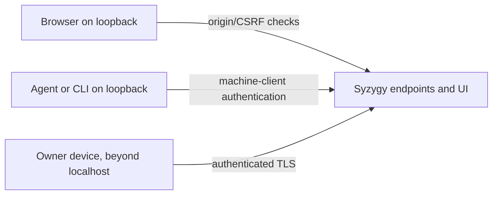

# Security and blast radius

Syzygy treats observed code as untrusted everywhere, stays within the owner's
tailnet, sends content only to a run's declared provider, keeps secrets out,
and writes into other people's repositories only with the owner's consent.

- **Why this needs doctrine:** Syzygy indexes a whole portfolio, listens on a
  network, may execute observed-project code, and writes into the
  repositories it governs.
- **What lives here:** constitutional constraints only. The execution-profile
  and authentication RFCs must satisfy them.

## Non-negotiable rules

**SEC-1 — Authenticated by default.** Only loopback may serve without
authentication, and even there client classes are told apart; loopback
location alone never proves a client's identity.

- **Client classes, told apart even on loopback:**
  - **Browser requests must pass origin/CSRF protections, including on
    loopback.** Browser-originated `localhost` calls and DNS rebinding are in
    scope as attackers.
  - **Non-browser agent and CLI clients are admitted only through an explicit
    machine-client authentication mechanism** (an authentication-RFC matter).
  - Loopback location alone never proves a client's identity.
  - A missing browser `Origin` header is neither trusted automatically nor
    treated as a browser-origin violation.
- **Beyond localhost, the tailnet and nothing else:** access must be
  authenticated, TLS-protected, and limited to the owner's own devices on the
  owner's tailnet. An unauthenticated network-exposed configuration is never
  the default.
- **Exposure beyond the tailnet is the owner's decision (VIS-4).** A public
  address, tunnel, port forward or shared link waits for the owner, and so
  does any release, deployment or multi-user operation. The standing posture,
  in the owner's words: "Network exposure (ingress) should almost never be
  necessary, everything stays within tailnet".
- *Violation:* a fresh install serving portfolio data on a LAN address with no
  credential; a loopback endpoint answering an arbitrary web page's fetch; a
  machine client admitted on loopback location alone; a tunnel or public
  address opened without the owner's decision.

**SEC-2 — Portfolio data leaves owner-controlled infrastructure only for a
declared provider.** Secrets never leave. Repository content, or
anything derived from it, is sent to a store or service the owner does not
control only when that service is a provider declared for the run. No
per-project or per-repository consent is needed.

- **What is covered:** source structure, specs, work history, and anything
  derived from them, including prompts, from any repository Syzygy reads,
  public or private.
- **Model providers are such services.** A run declares its providers (for
  example, the model provider behind the operator's agent tool) in its own
  record, and Syzygy renders them on the project's surface.
- **A provider not declared for the run receives nothing.**
- **Secrets never leave (SEC-5):** content that matches the secret-detection
  policy, or cannot be classified, is never sent, whatever is declared.
- **With no declared provider**, the inferred layer renders Unknown instead
  of being computed.
- **Remote backing dependencies** are allowed under the same rule: a backing
  store the owner does not control is a provider and is declared.
- **The owner's trade-off:** private repositories are read and sent to the
  declared provider without a per-repository question.
- *Violation:* an index synced to a third-party service as a side effect of a
  feature; project content sent to a provider the run did not declare; a
  secret in a prompt.

**SEC-3 — Observed code is untrusted, everywhere.** Syzygy itself never runs
observed-project code. Agents may build and run it in a sandbox without
asking; running it outside a sandbox is the owner's decision.

- **It is untrusted whoever owns the project.**
- **The daemon never executes observed code**, and neither does any other
  Syzygy process.
- **What this binds:** Syzygy, every process Syzygy launches or schedules,
  and every instruction a Syzygy feature gives an agent (a brief, prompt,
  skill or work item).
- **In a sandbox, the agent decides.** A sandbox is an execution profile:
  default-deny, isolated credentials (no Syzygy credential and none of the
  owner's readable), declared network access, resource limits, and gates on
  destructive operations. Any agent session, attended or not, may be told to
  build and run observed code there. Whether to, and in which profile, is
  the agent's call, recorded in the run's record before the instruction is
  given; no owner choice per run or per project is needed.
- **Outside a sandbox, the owner decides (VIS-4, secrets).** Observed code
  running outside a sandbox can reach the owner's credentials, so it is an
  owner decision of the secrets class. A Syzygy instruction may let a session
  build and run observed code outside a profile only when three things hold:
  the session is on the owner's own host; the owner started it and attends
  it, being present to see and stop what it does; and the owner has recorded
  a choice for that one run, naming what the instruction covers, before
  Syzygy issues the instruction. For a repository on the owner's list
  (SEC-4), the owner may instead record one standing choice naming the
  repository; it covers every session the owner starts and attends on the
  owner's own host until the owner withdraws it. For any other repository
  the choice is per run. Syzygy never gives this instruction to a session it started or to
  one left running unattended, and never asks for a process that outlives
  the session. Work the session hands to its own subagents is part of the
  session.
- **What the permitted case costs:** the session runs with the owner's own
  credentials and network, including Syzygy's endpoints and any Syzygy
  credential readable on that host. Observed code it runs can reach them,
  and can change any file the owner can, the clone it runs in included.
  Nothing contains it, so it gives none of a profile's guarantees. The owner
  accepted that risk (D9) over two alternatives: allowing execution only in
  a sandbox, and forbidding it.
- **Wherever it runs:** every claim that rests on that execution is labelled
  Inferred, never Observed; every command the session reports having run is
  disclosed, as the session's own report; and Syzygy keeps every credential
  it holds for its typed adapters where neither the session nor any process
  it starts can read it at the operating-system level, for as long as any of
  them runs.
- **The owner's trade-off:** observed code may be built and run by agents in
  a sandbox without a per-run owner choice.
- *Violation:* the daemon executing observed code; a sandbox that inherits
  the host user's ambient credentials "for convenience"; Syzygy instructing a
  session to run observed code outside a sandbox before the owner's choice
  is recorded, on a standing record for a repository not on the owner's
  list, or in an unattended session; a claim that rests on observed-code execution rendered Observed.

**SEC-4 — Writes are consented, attributed, and revertable.** Syzygy writes
or pushes into a repository the owner does not own only with the owner's
recorded consent for that repository; Syzygy's own repository and the owner's
repositories need none. Every write can be traced and undone.

- **Consent first, where it applies:** a write or push into a repository the
  owner does not own needs the owner's recorded consent for that repository
  (VIS-4).
- **Which repositories the owner owns is the owner's list.** It lives in
  `.syzygy/governance/decisions/OWNED-REPOSITORIES.md`, and only the owner
  changes it: adding a repository, removing one or changing a row is itself
  an owner decision of this class (VIS-4). An agent never edits the list,
  and a repository not on it counts as not owned.
- **Every write** is attributed to Syzygy, atomic, and individually
  revertable.
- **No silent overwrite:** Syzygy never overwrites a governance artifact it
  did not author without surfacing the conflict.
- *Violation:* a push into a repository the owner does not own without the
  owner's consent; an agent adding a repository to the owner's list;
  first-pass doctrine drafting silently replacing an
  existing `.syzygy/governance/` tree.

**SEC-5 — Secrets are never indexed.** Anything that matches the declared
secret-detection policy, or cannot be classified, is excluded; a matching
exclusion is rendered.

- **The policy** is declared in `.syzygy/governance/` and applied during
  observation.
- **Weakening it is the owner's decision (VIS-4):** a change that makes the
  policy detect less, admits unclassifiable content, or lets a secret be
  indexed, rendered or sent waits for the owner. Any other change to the
  screening or classification policy is an agent adoption.
- **Matching content** is excluded, and the exclusion is rendered.
- **Unclassifiable content** is excluded too: classification fails closed.
- **A secret reproduced** in any Syzygy surface, store, or endpoint breaks the
  trust floor (trust-and-evidence.md, floor bullet 4).
- *Violation:* a connection string appearing in a map tooltip or API response.
