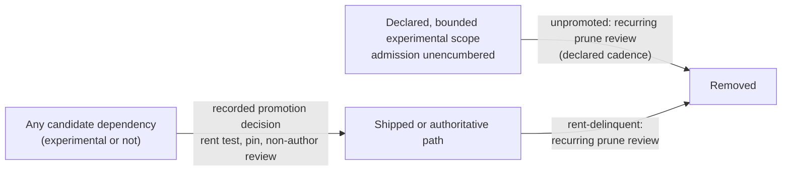
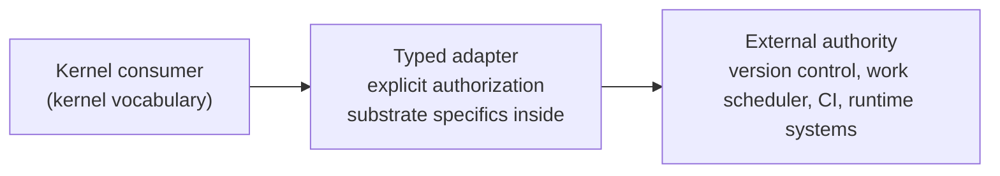

> **Approved** — owner decision D2 (2026-08-01), amendment B21 applied where noted. **This directory (`.syzygy/governance/policies/craft-and-care/`) is the canonical home of these policies.** The bootstrap-phase copy is preserved separately as historical review evidence. Binding force on implementation work begins with the owner's digest-bound acceptance of the foundational design contracts (the act defined in the active acceptance record; the policies cite RFC clauses that bind nothing until then).

# Interfaces and dependencies

The canonical `dependency-hygiene` bar applies by reference; Syzygy's
additions concern identity stability, its schema-versioned namespace, typed
adapters, and a deliberately two-phased dependency posture.

- **The baseline bar:**
  - dependencies point from less stable to more stable; no cycles;
  - minimal deliberate public surface; no god-modules;
  - third-party packages pay rent;
  - versions pinned, upgrades deliberate;
  - test/dev dependencies out of production chains.

## CC-DEP-1 — Liberal experimentation, disciplined promotion

Dependency admission runs under two regimes with an explicit boundary:
liberal inside declared experimental scope, reviewed and recorded promotion
into anything shipped or authoritative.

- **Source:** the owner's dependency character is **"liberal
  experimentation, disciplined promotion"** [Observed — FD-029, amending
  FD-020 E8; recorded in the founder decision log, not in adopted doctrine
  text].
- **Experimentation is liberal.** In spikes, prototypes, and any scope
  declared experimental, dependency admission is unencumbered — velocity
  first.
  - Experimental scope must be *declared and bounded*: a marked branch,
    directory, or artifact status naming what it covers.
  - Nothing in it is authoritative or shippable.
  - A declaration that sweeps an authoritative or shipped path into
    "experimental" is a violation, not a classification call — the regime
    boundary is where the discipline lives.
- **Promotion is disciplined — and reviewed.** A dependency enters a
  shipped or authoritative path only through a recorded promotion decision
  applying the canonical rent test and pinning.
  - The rent test: what it saves over owned code; maintenance health;
    standard-library preference.
  - The promotion decision is **reviewed by a non-author** (CC-BAR-6 — the
    agent that wants the dependency never writes its own admission ticket).
  - The record lives at the project's **named dependency-record home** (the
    single location where the project documents dependencies — fixed by RFC
    or project convention, not chosen per-promotion), never scattered into
    commit bodies.
  - Volatile or heavy dependencies are wrapped behind an owned seam at
    promotion; stable idiomatic ones are not.
- **Pruning is a ritual, not an accident.** Unpromoted experimental
  dependencies and rent-delinquent promoted ones are removed on a recurring
  review.
  - Its **cadence is declared in the same named dependency-record home**.
  - A "recurring review" with no declared cadence is unfalsifiable and does
    not satisfy this clause.
  - Cadence *values* are project detail; the obligation to declare one is
    not [Observed — INTERVIEW_NOTES E8: "prune later" carried into craft as
    a prune ritual].
- *Violation:* a visualization library pulled into a spike, then reaching the
  released rendering path because the spike branch was merged wholesale — no
  promotion decision, no pin record, no seam.

## CC-DEP-2 — Stable identities anchor everything

Kernel entities carry durable identities independent of file paths and
layout, and interface and storage designs key on those identities.

- **Kernel entities:** capabilities, claims, gaps, work items, evidence
  artifacts, components.
- **Grounds:** SDR-2 two-level identity; architecture.md: the map anchors to
  capability identities, not file paths, and refactoring must not randomly
  relocate it.
- **Interface and storage designs must therefore:**
  - key on the durable identity, with substrate-native identifiers as
    qualified aliases, never primary keys (e.g. the abstract work identity
    is primary; a scheduler-native id like `bead_id` is its
    substrate-qualified alias) [Inferred — from the typed-adapter model;
    envelope analysis in the non-authoritative observation brief reaches
    the same conclusion];
  - count and aggregate by identity, not by location (SDR-22);
  - treat identity re-minting (split/merge/rename) as a recorded event with
    continuity links, per the scheme RFC 0001 will fix.
- *Violation:* a component's history keyed on its directory path, so one
  rename orphans its evidence trail and the map "forgets" the component.

## CC-DEP-3 — `.syzygy/**` is schema-versioned; migrations are identity-preserving

`.syzygy/**` is Syzygy's native, schema-versioned namespace; it evolves only
through **explicit, reviewable, identity-preserving migrations**
[Observed — architecture.md, schema ownership].

- **Versioning:** every stored artifact carries its schema version; readers
  reject or explicitly adapt unknown versions — never silently guess.
- **A migration is its own reviewed change** (mandatory independent review,
  CC-REV-1 class 3, when it affects identity).
  - It states what it preserves.
  - It proves durable identities and evidence records survive round-trip.
- **Migrations never rewrite immutable records** (observation records,
  materialization records, execution evidence).
  - Representation may be re-encoded; identity and content-integrity must
    be re-verifiable.
- **`openspec/**` is the opposite regime:** Syzygy writes it only in
  OpenSpec-compatible form and never reorganizes it for its own
  convenience.
- *Violation:* a storage refactor that regenerates all evidence-artifact IDs
  under a new scheme with no mapping table — every historical citation and
  hash link dangles.

## CC-DEP-4 — External effects only through typed, explicitly authorized adapters

No code path affects an external authority except through a typed adapter
with explicit authorization, honoring that authority's own contract (VIS-5;
architecture.md).

- **External authorities:** version control, the work scheduler, CI,
  runtime systems.
- **Adapter contracts are substrate-neutral.** The adapter's consumer speaks
  the kernel vocabulary; substrate specifics stay inside the adapter.
- **Spec anchors:** adapters support resolvable spec anchors, and their
  absence renders Unknown rather than rejecting the project (SDR-32).
- *Violation:* a convenience helper that shells out to the scheduler's CLI
  from surface code "just this once," bypassing the typed adapter and its
  authorization check.

## CC-DEP-5 — Public interfaces are contracts with a compatibility story

Every public interface is a versioned contract that carries epistemic state
faithfully and exposes no more than it promises.

- **Why:** machine-queryable endpoints are first-class product surface from
  V0 (v1.md) — agents are consumers with the same truth guarantees as the
  owner.
- **Public interfaces:** endpoints, adapter contracts, exported schemas.
- **Every public interface:**
  - is versioned, with breaking changes made deliberately, announced in the
    interface's own contract;
  - exposes epistemic state faithfully — Observed/Inferred/Unknown labels
    and freshness travel through the API; no endpoint "simplifies" Unknown
    away for consumer convenience (VIS-1 applies to machine consumers too);
  - exposes what its contract promises and no more (canonical
    dependency-hygiene rule 3) — internal kernel structures are not
    reachable by accident.
- *Violation:* an endpoint that flattens
  `status: unknown (no current evidence)` to `status: ok` because a consuming
  workflow "only handles ok/fail."

## CC-DEP-6 — One kernel; surfaces never fork semantics

Shared semantics live in the kernel and its contracts; the three surfaces
are projections and may not define surface-local variants of kernel
meanings (architecture.md, one kernel three surfaces; SDR §1).

- **A surface needing a new semantic** goes through the kernel contract
  change, not a local helper that reinterprets shared data.
- *Violation:* one surface locally redefining "stale" with a longer horizon
  than the kernel's, so two surfaces disagree about the same record's
  freshness.
