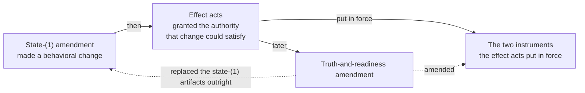

# `docs/` — the implementation plane's working documents

> **Not authority.** Nothing here adopts, accepts, or approves anything, and
> nothing here may be cited as a rule. Authority lives in `.syzygy/**`
> (doctrine, decisions, policies, contracts) and `openspec/**`
> (specifications); current state lives in `PROJECT-STATUS.md`. Where a page
> here disagrees with one of those, **the owning record wins and this page is
> stale** — report the disagreement rather than resolving it here.

This directory is the **implementation plane's** own working record: how the
work was planned, what was reviewed, and what evidence a run actually
produced. It sits beside the governed planes and is written by and for the
people and agents doing the building.

- `.syzygy/**` says what must be true.
- `openspec/**` says what the software must do.
- `docs/` holds the third thing: plans, reviews and run evidence.

## What is here

Named homes, each with a reader and the question it answers. A plan
here is never permission to do the work it describes.

| Path | What it is | Reader, and the question it answers |
|---|---|---|
| `CAPABILITY-1-IMPLEMENTATION-PLAN.md` | The Capability 1 build plan | An implementer: "what is the next lawful implementation step, and under which act?" |
| `PWB-IMPLEMENTATION-PLAN.md` | The Polaris project-wide Butlers-model build plan | Same, for the PWB pipeline |
| `THREE-SURFACE-POC.md` | How to run the bounded POC | Anyone: "how do I start this thing and see it?" |
| `reviews/` | The review corpus — raw reviewer output and its dispositions | A reviewer or repairer: "what did an independent reader find, and what happened to each finding?" |
| `review-campaigns/` | One file per review campaign: its patterns over `reviews/` and its last verdict of record | The same reader: "which campaign does this raw belong to, and where did it end?" |
| `evidence/` | Machine-produced run records (mutation sweeps, browser and fresh-checkout runs), as JSON | Anyone checking a claim: "what did that run actually output?" |
| `retention/` | Frozen source census, conservative plan and live locators | A retention reviewer: "which exact bodies are represented, and which proofs remain unresolved?" |
| `plans/` | Dated design notes for a single bead, written before the work | An implementer picking up that bead: "what shape was already decided, and by whom?" |
| `superpowers/plans/`, `superpowers/specs/` | Spent plans and designs from an external-harness convention, kept as evidence | Someone auditing a past change: "what was the plan the work was actually done against?" |

**A plan here is never permission.**

- Implementation *plans* live here.
- The **authorizing act** for any of that work does not; it lives in
  `.syzygy/governance/decisions/`.
- Find the act first (`AGENTS.md`, "Where authority lives").

## `reviews/` — the corpus, by campaign

Raw reviewer output is stored **verbatim and never edited** (CC-REV-6); the
campaign files route each campaign to its last verdict of record.

- Files ending `-RAW.md` are that verbatim output.
- `-DISPOSITION.md` and `*-PACKET.md` files are the synthesis over them.
- Correcting a RAW file is never the repair. The repair is a new disposition
  that cites it.

Each campaign is one file under [`review-campaigns/`](review-campaigns/):
its display name, the anchored basename patterns that claim its raws, what
was under review, and its last verdict of record with the line it cites. The
files store **no derived figure** — no file count, no recorded-date range, no
total — because each figure went stale the moment a review landed, and two
branches that each retained a raw conflicted on the same lines.

- Print the table, every figure derived at HEAD:
  `python3 scripts/check_docs_review_campaign_partition.py --table`.
- Check the partition: `python3 scripts/check_docs_review_campaign_partition.py --check`.
  It fails on a tracked file under `reviews/` that no campaign's patterns
  claim (`unmatched`), on a file two campaigns claim (`overlap`), on a
  campaign that claims nothing, and on a verdict citation that does not
  resolve to a verdict line.
- A new raw in an existing campaign needs no other edit, unless it moves that
  campaign's verdict of record; then edit that campaign's file. A raw that
  starts a campaign adds one new campaign file, in the same commit as the raw.

**Three things the campaign files cannot show.**

- **The PWB campaigns are a dependency chain, not four independent ones.**
  The act records say so, and only they say it.
  - The state-(1) amendment made a behavioral change.
  - The effect acts then granted the authority that change could satisfy.
  - The truth-and-readiness amendment later replaced the state-(1) artifacts
    outright, while amending the two instruments the effect acts had put in
    force.



- **A `CONFIRM` verdict is a reviewer's finding about frozen bytes, never an
  adoption.** What binds is always the act in `.syzygy/governance/decisions/`.
- **A campaign with nothing open in its own files may still have left
  something open elsewhere.** Examples: the S-slice campaign's `syzygy-e3e`,
  the POC campaign's walkthrough blocker, the recovery campaign's §5.3.

## `plans/` and `superpowers/` — two homes, one role

Both hold plan-and-design notes, split by which harness wrote them, not by
what they are. Prefer `plans/` for anything new.

**`superpowers/` is path-pinned and must not be moved or renamed.**

- The general trusted-bootstrap authorization's impact ledger classifies
  every path under that prefix as spent historical evidence.
- `scripts/build_general_trusted_bootstrap_impact_ledger.py` hard-codes the
  prefix string to do it.
- Relocating a file out of that directory would silently re-classify it on
  the next regeneration.

**One of the four is not spent.** Read the table before treating any of these
as history.

- The ledger's classification is about where a file sits, not about whether
  the work it plans is finished, and those two answers have come apart.
- Read the `bd` issue, never the "REQUIRED SUB-SKILL" line at a file's head,
  which addressed the worker of the day.

| File | Issue | State |
|---|---|---|
| `superpowers/plans/2026-08-24-cap1-runtime-hardening-followups.md` | epic `syzygy-u2a` | **Live.** The epic names it as its *approved implementation guidance* at commit `d11c07e`, and shapes its six implementation children on that file's Tasks 1–6. The epic is open (P1) and its human gate `syzygy-u2a.1` is blocked |
| `superpowers/specs/2026-08-23-cap1-runtime-hardening-followups-design.md` | `syzygy-ydr`, `syzygy-e84`, `syzygy-h84` | Spent. The design the plan above was written from |
| `superpowers/plans/2026-08-27-syzygy-vky-validator-hardening.md` | `syzygy-vky` (closed) | Spent |
| `plans/2026-08-26-syzygy-vky-validator-hardening-design.md` | `syzygy-vky` (closed) | Spent. The design for the same work as the row above — two files, one bead, split only by which harness wrote them. Neither is cited by anything |
| `plans/2026-10-03-smooth-example-roadmap.md` | the beads labelled `self-drivable` | **Live.** The 2026-10-03 roadmap for a smooth functional example: live-run status, ranked steps, the owner decisions batched for one sitting |
| `plans/2026-10-21-greenfield-parity-audit.md` | epic `syzygy-bpyt` | **Live.** The 2026-10-21 greenfield-parity audit at `dd520e8d`: from-scratch estimate, delta table, findings and the beads filed for them, convergence record |

[Added 2026-10-03: the last row is a fifth file. "One of the four is not
spent" above counts the four files present when it was written; with this
row, two of five are live.]

[Added 2026-10-21: a sixth file, the greenfield-parity audit, is now the
last row, so the 2026-10-03 note's "last row" is the one above it. The audit
is live too; three of six are live.]

[Observed — swept 2026-09-06: four files across the three directories; each
searched for `syzygy-*` identifiers in its own text, and each filename searched
across every tracked `.md` and `.py`. Two are cited, both by the general
trusted-bootstrap impact ledger; two are cited by nothing.]

## `evidence/` — run records

Each file is one run's machine output at a named commit, kept because a claim
elsewhere cites it. `PWB-IMPLEMENTATION-PLAN.md` is the route in for 25 of
the 28; the three a reviewer produced route through `reviews/`.
*Stale 2026-11-04 (`syzygy-bpyt.9.1`): "25 of the 28" counts the directory
as swept 2026-09-06; it now holds thousands of files, most in per-review
subdirectories. Route by the generated index below.*

**The route in is the generated index**, printed on demand at the commit you
are asking about and never committed:

```sh
python3 scripts/build_evidence_index.py --summary        # class totals
python3 scripts/build_evidence_index.py --out <path>     # one JSON row per file
```

- One row per tracked file: path, sha256, family, the record's named subject,
  commit and verdict where it carries them, and a reliance class.
- The citer predicate and the ten classes are stated in the script's
  docstring; the denominator is every tracked file under `docs/evidence/`.
- A reliance class says who cites a file, never whether the file is still
  needed (rule 5). "Retention is a separate, owner-gated question"
  is superseded at this sentence (2026-11-04): GP-Q1 in
  `.syzygy/governance/decisions/OWNER-DIRECTION-GREENFIELD-PARITY-ANSWERS-2026-10-21.md`
  selected the verified-index arm. Its execution conditions remain gates.
  The additive [retention locator and conservative plan](retention/README.md)
  keep original bodies in place; they do not complete `syzygy-bpyt.9.2`.
- The index is a generated view, never authority.

- A mutation-run record is valid **only for the commit it names** (`AGENTS.md`
  verification rule 7).
- Reading the file's own contents is the check; the filename is not the
  evidence.

**This directory has no index of its own, and does not need one:
`PWB-IMPLEMENTATION-PLAN.md` is the index.** *Stale 2026-11-04
(`syzygy-bpyt.9.1`): the sentence above, kept as written, no longer holds;
the generated index above is the index, and the plan routes only the files
its tasks name.*

- Every file here is cited, and 25 of the 28 are cited by that plan, at the
  task whose evidence they are. *Stale 2026-11-04 (`syzygy-bpyt.9.1`):
  "Every file here is cited" was true of the 28 swept 2026-09-06 and is not
  true now; see the note under the observation below.* The route in is the plan's task, never a
  listing of this directory.
- The three the plan does not name are the three a *reviewer* produced rather
  than a task (`…-gen2-reviewer.json`, `pwb-recon-gen1-reviewer-…`,
  `pwb-recon-gen2-reviewer-…`).
  - The reconciliation packets in `reviews/` cite those, which is the correct
    home for a reviewer's own run.
- [Observed — swept 2026-09-06: 28 files, each basename and stem searched
  across every tracked `.md`, `.py`, `.ts`, `.json`, `.yml`, `.txt` and `.sh`
  outside this directory; 28 cited, 0 uncited, 25 cited by the plan,
  remainder enumerated above.]
  - *Stale 2026-11-04 (`syzygy-bpyt.9.1`): the observation above, "28 files
    … 28 cited, 0 uncited", stands for its 2026-09-06 population and
    predicate only. The current figure is the generated index's `none`
    class: files that no tracked file cites by path token (the docstring's
    path predicate) or by full sha256, counting citers inside
    `docs/evidence/` and path dumps. That predicate counts no stem and no
    truncated digest, so its figure is not comparable with this one; a
    file in `none` is uncited by that predicate, not proven unused.*

**A JSON here does not say whether the work it evidences is finished.**

- A run that passed at a commit says nothing about the finding a later review
  raised against the same seam.
- `bd show` and `PROJECT-STATUS.md` own that.

## The maintenance contract

This directory is governed by the adopted craft policy
`.syzygy/governance/policies/craft-and-care/review-and-documentation.md`. The
clauses that bind what you write here are cited, not restated.

- **CC-REV-2** — a change that moves a responsibility updates its
  documentation *in the same change*.
  - It does not merge with the contradiction open.
- **CC-REV-3** — documentation **cites** authoritative artifacts; it never
  restates them normatively.
  - A restated rule drifts and becomes a shadow authority.
  - If you find the same question answered in two homes, surface the
    contradiction; do not silently pick a winner.
- **CC-REV-5** — substantive claims carry `[Observed]` (with a resolvable
  source), `[Inferred]`, or `[Unknown]`.
  - Missing evidence renders Unknown, never Inferred.
- **CC-REV-6** — raw reviewer output is stored unchanged before synthesis.
  - Every revise-severity finding is fixed or explicitly overruled with
    recorded rationale. Nothing is dropped.
- **CC-REV-7** — identifiers are stable: amend in place, retire rather than
  renumber.

**In practice, for this directory:**

- A page that no longer has a nameable reader and a question it answers
  should be merged or removed, not left to rot.
- A page that has gone stale is marked stale **with evidence at the stale
  sentence**, never left silently standing behind a general "this page may be
  stale" banner.

## What does not belong here

Code, rules, duplicated state and harness scratch each have another home.

- Implementation code (it belongs in `apps/**`, `packages/**`, `scripts/`).
- Anything normative — rules, acceptance, adoption, approval. Those are owner
  acts under `.syzygy/governance/` (VIS-4).
- A second copy of state `PROJECT-STATUS.md` already owns.
- Per-tool scratch conventions from an external harness. If a tool wants a
  directory of its own, it gets one outside `docs/`.
