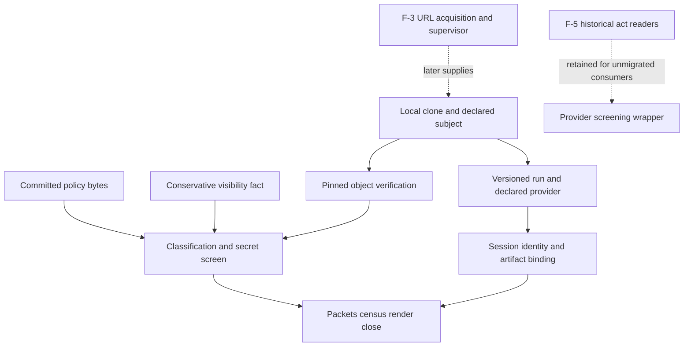

# R-D10-F1-SCOPE-1 — independent early dependency/scope review

Date: 2026-11-18. Reviewer: independent scope-review agent, not implementation author.
Frozen subject commit: `4e526b704f613310c866746cfffb73049f664158`; tree object: `602a68773f5c766d70ac87a7e1dfc8f019fd9511`.
Source retrieval: `git show` at that exact commit; no checkout switch, source mutation, product test, provider operation, observed-repository read, credential read, lifecycle action or act recording.
Scope input SHA-256: `27442d4c5a30bbd0f0efe80c6ae69d3e426c22e7de438dd3e8b0d06f4336d394` (`d10-f1-packet.md`).
Authority-check receipt SHA-256: `91207e9c644a6002f6fd2bd04a6eecf7b0ef0eda945b47d3a5762146addd4e3f` (`d10-followon-authority-check.json`).

## Verdict and authority

**REVISE SCOPE — independently landable with caller closure; the named-file-only interpretation is not independently verifiable.**

[Inferred] F-1 can remain one coherent package and F-5 can remain separate. F-1 must include the bounded runtime adaptations needed to make its consolidated rules true for a local-clone run. Those adaptations cross several files listed under F-3. F-3 can retain URL acquisition, no-record supervisor orchestration, default-branch/clone shape and its end-to-end completion criterion. If the coordinator cannot allocate that caller closure to F-1, treat F-1/F-3 as a coordinated delivery dependency; do not merge the consolidated behavior spec with the old gates still enforced and call F-1 complete. This is an early diagnostic, not an owner gate or code-readiness verdict.

[Observed] FOLLOW-ON F-1 explicitly combines REQ-polaris-generation-033, -046 and the public-Git-source entry; its five named code locations are gate implementations, not a closed dependency set. F-3 starts with “The F-1 code above, then” its other callers. F-5 separately owns generic digest/versioned readers and recorder/check retirement. The supplied read-only authority receipt reports PASS for the frozen tree and explicitly does not establish parent integration.

[Observed] Installed VIS-4 (vision.md:170-212) says “agents decide everything else” and removes per-read/per-provider records entirely. Adoption reporting/version tags are change-level requirements (192-196), not per-repository authorization. SEC-2 (security.md:49-65) requires declared providers and says “Secrets never leave.” SEC-5 (146-157) retains exclusion of detector matches and unclassifiable material. SEC-3 (74-102) permits agent-selected sandbox execution, but outside-sandbox execution still requires the owner's one-run choice, host and attendance. FOLLOW-ON's abbreviated execution wording cannot override SEC-3. Removing ceremony alone is agent-decided; weakening detectors/fail-closed secrecy, treating private as public to expose withheld metadata, or agent-authorizing outside-sandbox execution is reserved-owner-class.

## Dependency evidence and findings

Paths below are relative to the repository and line numbers refer only to the frozen subject.

**1. High: run-record removal has immediate producer and reader closure in F-3 files.**

[Observed] `packages/polaris-dossier/src/run-record.ts:27` writes `polaris-dossier-run/1`. Its subject requires consentRecord, startGates and providerStatement (43-47); exact-key validation requires them (159-180). `init.ts:209-239` derives identity/pin admission from consent records, checks registry/policy acts, and constructs these exact fields at 267-274. `reverify.ts:118-136` repeats the consent/registry/policy gates, and 149-177 repeats drawer/statement classification and returns live consent provenance. `run-dir.ts:46-61` projects that result to every opened run.

[Inferred] Simply making run-record fields optional breaks the declared format or leaves later steps rejecting valid new records. Include a coherent producer/decoder/reverification/projection change. Preserve the full pinned commit and the rehashing object reader; retired consent validity and physical Git-object integrity are different predicates. Retain declared-provider/brief consistency checks (`reverify.ts:80-95,129-134`) without retaining the statement rationale. `close.ts:137,149` and `render.ts:852` must stop reporting consent verification that no longer happened.

**2. High: removing provider statements without replacing their class and session roles either silently withholds content or keeps retired gates.**

[Observed] `session-statement.ts:49-80` treats a null statement as a fast path, otherwise reloads statements and validates tool/provider/classes. `session-handover.ts:293-307,502-507` independently applies the same gates before handing over/delivering packets. `inventory.ts:387` and `review.ts:269` recheck when work counts. `class-gate.ts:33-36` interprets null classes as permitting only code-content; undefined classification is always withheld. Its consumers include `census.ts:67`, `check-model.ts:82`, `review-packet.ts:131`, `render.ts:325-328` and `review-reach.ts:55`. `launch-sources.ts:34-38,54-58` overlays consented revisions/provider statements onto the old GateSources.

[Inferred] Setting providerStatement/contentClasses to null is not a complete removal: documentation/governance text would remain withheld for nonexistent consent. Replace the consent-based artifact eligibility interface with screening-derived eligibility, keeping undefined classification excluded and keeping detector/redaction checks on bodies and agent-authored artifacts. Session records should retain actual declared provider/tool identity and binding to the reviewed subject, without an act-shaped substitute. Remove or bypass the launch overlay on the new dossier path; leave unrelated historical readers for their owners rather than fabricating successful gate answers.

**3. High: v8 visibility is security input, not removable ceremony metadata.**

[Observed] The installed policy version is `1.9.0-public-source-candidate.1.none.code-all.redact-span.v5-bcd.v6-p.v7-s.v8-pv`. Policy lines 38-43 bind visibility to consent carriers and explicitly explain private-source digest/size guessing risks. `screen.ts:216-239` currently loads act-bound policy bytes/class status and calls `pairVisibilityAt`; the latter reads both launch and act records (`source-visibility-gate.ts:51-74`). `screen.ts:133-136` defaults a v8 screen to private when no decision is supplied; `screen.ts:185-189` applies `redactionFor`; `polaris-generation-core/src/secret-redaction.ts:109-112` disables partial redaction for private. `render.ts:398,682` suppresses private excluded/withheld object ids. `source-visibility.ts:15-57` pins the policy prose, so editing carrier wording without updating its parser pins refuses the policy.

[Inferred] Define a consent-free visibility input and provenance as part of F-1's effective screening boundary. Unknown/absent evidence must receive conservative private treatment or an explicit refusal, never public. A positive public choice must be a declared, attributable fact with stated trust limits, not a host/scheme guess or an implicitly successful act. Preserve policy-version parsing, malformed-policy refusal, detectors including v6's config-secret-directive, v7 behavior, private whole-body exclusion, and private withheld metadata suppression. For legacy runs, retain a conservative treatment of old private/ambiguous carriers if importing their declaration as historical data; do not silently reinterpret them as public. Tests must compare effective redaction behavior, not just the raw `secretRedaction` boolean, which stays true for a private v8 screen although effective redaction is disabled.

**4. High: exported policy/class readers have a second consumer; D10 fallback also belongs to generic machinery.**

[Observed] `polaris-generation-consent/src/index.ts:3` and `live.ts:9` publicly re-export policy/class/digest/versioned readers. `apps/three-surface-poc/src/polaris-generation/public-source-screening.ts:70,104-114` imports/calls both policy/class readers. Its loader at 155-170 validates an act-shaped policy input. At 176-184 it refuses private repositories and missing v8 public decisions; its target screen at 233-237 uses ordinary redaction, because private never reaches it. In dossier mode the private screen instead uses effective-redaction suppression. `package-reader.ts:517` calls `supersededByD10` from class validation, but `795` also calls it through `boundMismatch`; generic `readDigestBoundActState` reaches that path at 814. `gate-sources.ts:487,550` still consumes generic digest/versioned readers.

[Inferred] Do not delete shared exports/functions or `supersededByD10` solely because dossier screen stops importing them. Either adapt the provider-wrapper policy input in the same bounded package while retaining its existing private/acquisition refusal, or retain the old exported readers until that consumer is migrated. Keep the generic fallback with F-5 until its remaining callers retire. Avoid unifying dossier/provider screens as part of this gate removal: their private behavior is intentionally different. Moving policy/class data into a neutral immutable-bytes interface is preferable to making core parsing depend on dossier orchestration. No new package or dependency is needed merely to remove calls.

**5. Medium: F-1's new local-clone entry must bypass an active consent-launch path, while F-3 keeps URL orchestration.**

[Observed] `init.ts:176-204` invokes `launchConsent` and wraps launch records before creating the run. `launch.ts:375-410` still computes missing observation/drawer/provider records and requires write consent. `launch-cli.ts:58-70` separately gates nonpublic admission through the policy act chain. `preflight.ts:39-57,65-80` requires consent identity/revisions and prints clone commands from them. `polaris.ts:366-374` consumes those exact report fields to choose/fetch a commit; 355 creates the shallow clone shape. Thus the local-run interface and URL supervisor interface share data but are not the same operation.

[Inferred] Deliver a concrete declared-subject/pinned-clone local-run entry under F-1, with no active retired ceremony branch. F-3 can subsequently supply that entry from URL/default revision acquisition and repair clone shape. Keep F-3's report/CLI migration explicit; do not preserve misleading `consentedRevisions`/`ready` semantics through synthetic success records. F-4 still owns build reader identity/version replacement: F-1 may remove the registry act check while retaining truthful reader identity/version facts; do not erase that requirement or claim F-4 delivered (`gate-sources.ts:565-585`).

**6. Medium: historical format compatibility must be decided before source edits.**

[Observed] The run decoder validates exact subject keys and one format (run-record.ts:122-124,159-180), but intentionally reads a legacy URL form and normalizes without rewriting (145-168). Prompt records already have missing/null/cited-statement compatibility semantics (session-statement.ts:20-23,56-62). Close records include the full subject and consent-specific fields (close.ts:136-149). Public dossier subpaths expose gate-sources, init and screen (package.json:43-59,73-78); consent exports expose both root and live surfaces.

[Inferred] Prefer a new run-record format for new records, with an explicit bounded read-only legacy decoder that preserves original bytes and keeps historical consent citations as historical facts, not current authorization. Alternatively explicitly refuse legacy records with a migration/restart explanation; silent semantic mutation under `/1` is unsafe. Decide old prompt/review/check/close compatibility and packet-digest invalidation together: new packet contents may retire old verdict bindings, never pretend an old review covered new bytes. Preserve URL normalization and bounded JSON validation. This is agent-decided compatibility/spec work, not a new owner approval.

## Minimal independently verifiable package

[Inferred] The smallest credible F-1 delivery is (a) one consolidated behavioral specification retaining IDs/predecessor provenance and the retained obligations of 034-036/047; (b) a committed-policy-bytes loader plus policy-derived classification and conservative consent-free visibility; (c) a declared subject/pin/provider/execution record and local-clone init/reverify closure; (d) session/artifact eligibility, renderer/close disclosures and affected public export adaptations; and (e) focused conformance/regression evidence. The five named source locations are starting points, not a file whitelist. F-3 retains URL acquisition/supervisor/clone-shape completion. F-5 retains generic ceremony deletion and the fallback needed by those live readers. No spec text or implementation is authored by this review.

[Inferred] Verification plan before claiming F-1 done: local-clone run with no consent/statement/registry-act records; governed and non-governed trees; malformed/unknown classification refusal; policy drift from the committed subject; pinned-object tampering refusal; undeclared/mismatched provider refusal; statement-free inventory/review/delivery binding; public partial redaction versus private whole-body exclusion plus withheld digest/size suppression; unchanged provider-wrapper private refusal; strict new/legacy record matrix and existing URL compatibility; packet mutation retiring verdicts; execution-profile declaration before instructions and outside-sandbox owner-choice refusal. Use small differential populations across public/private/unknown visibility and every detector/category, plus targeted mutations for each retained fail-closed predicate. Test the retained generic D10 fallback separately if it remains. No product tests were run in this diagnostic review.

## Method and limitations

[Observed] Frozen own-repository sweep: 649 tracked TS/JSON paths under packages/apps; 304 TS paths after excluding `.test.ts`/`.testkit.ts` suffixes. These counts include support/testing entry modules and are not a claim that every path ships. The gate/caller expression `readClassActState|readPolicyActChain|supersededByD10|providerStatementGate|statementContentClasses|recheckSessionStatement|consentedRevisionsFor|withLaunchRecords|loadDossierScreen|screenLoaderOf|readRunRecord|encodeRunRecord` matched 24 non-test/testkit TS/JSON files. A second NUL-delimited tree census and `git grep -l -E` independently confirmed population counts and 24 matching files. A second targeted property/class/visibility sweep matched 28 of the 304 TS paths. Relevant hits were inspected; this is not a whole-repository absence or dependency-cleanliness claim.

[Observed] Relative import mapping across the dossier's 66 non-test/testkit source TS modules found 305 edges including type-only edges. It exposed structural type cycles (`check-model` -> `review-reach` -> `check-derive` -> `check-model`, and `review`/`review-packet`/`design-review`). Inspected closing edges include check-model.ts:13 and design-review.ts:9 and are type-only; this is not a claim of runtime execution cycles. Under dependency-hygiene rule 2 they are pre-existing coupling findings, advisory for this scope; prefer the existing model/type leaves for touched interfaces rather than adding more orchestration imports. This diagnostic does not require a broad cycle refactor.

[Unknown] Parent/default-branch integration, final adopted F-1 scope, proposed code/spec bytes, final compatibility choice, actual product-test results, source egress, and end-to-end URL success were not established. PR817's proposed text was not reviewed; its supersession is observed from FOLLOW-ON only. Review references are frozen own-repository code, not third-party source bodies. The skill's introductory old doctrine summary was not used as authority; installed frozen VIS-4/SEC clauses govern.

## Selected frozen file SHA-256 anchors

| Frozen path | SHA-256 |
|---|---|
| .syzygy/governance/contracts/candidates/governance-simplification-d10/FOLLOW-ON.md | a24402aa65e8eb2427bfa3c3072df19279071541fa664fb43b4f6e3bbfcfe8d5 |
| .syzygy/governance/doctrine/vision.md | fc222427c85c6ce39f02cb2b595b75fec23f6890c013d249f0b43baa52788bc3 |
| .syzygy/governance/doctrine/security.md | 9d3f46528e37143ae1d63c755c7a50c6a5b139d28bef5c9de45d62b5c1ac71bf |
| packages/polaris-dossier/src/screen.ts | 07ac33d257355c78d6f706f798aa9d68f97b481f68c8289ea7be1dc4079fbab8 |
| packages/polaris-generation-consent/src/package-reader.ts | 742652f5b965ce937bf614fa2ac2dd582af006af7297a2a454c8705fc652c3d1 |
| packages/polaris-dossier/src/run-record.ts | b64279e651138283623fa41518bd1f0510eb7a884cc122f11b1f2676d0c56ea9 |
| .syzygy/governance/policies/POLARIS-BUTLERS-SECRET-CLASSIFICATION-POLICY-CANDIDATE.json | 44153bbe210c7a724f224f2bc1c9255db43cf0887b6ad22dd24884514f21bbe8 |
