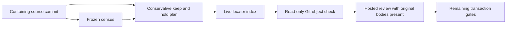

# Evidence retention preparation

[Observed] This is the additive prerequisite of `syzygy-bpyt.9.2`: original
evidence bodies remain in place. The owner selected the verified-index arm
in GP-Q1 of
`.syzygy/governance/decisions/OWNER-DIRECTION-GREENFIELD-PARITY-ANSWERS-2026-10-21.md`.
That record owns the four execution conditions and the R0/R1 prohibition.
This directory is implementation data and guidance, never authority.

The on-demand census and the persistent locator answer different questions.
`scripts/build_evidence_index.py` reports who cites each current file. Its
`commit` is a commit **named in a record**, which need not contain that
record. `SOURCE.json` names the full **containing source commit** of the
frozen census. `INDEX.jsonl` gives every retained live body an identity.
CI verifies the bodies, source, generated plan, and locator rows against
actual Git objects; a successful additive check does not authorize a move.



[Observed] `SOURCE.json` computes the source denominator, family count,
citation classes and snapshot/plan/tree digests. `PLAN.jsonl` enumerates
every source file: original path/digest, containing commit, record-named
commit, census family, unresolved equivalence family, protection class,
keep/hold disposition and witnesses. Witness lists are represented by their
count, digest, kind counts and first three examples. The full list is
reproducible with `--witness-out`; administrative snapshots and indices do
not establish their own reliance.

[Inferred] These are conservative protection classes, not new findings of
adoption or actual reliance. A governed digest witness or verbatim raw
preserves R0; code, governed, raw and digest witnesses preserve R1 while
dependence is undischarged. Other files remain held because lexical absence
does not establish R2. The extended sweep includes nested basenames, stems,
wrapped tokens, full digests, directories and conservative glob matches with a literal prefix. A
star may span a slash in this extra sweep, deliberately over-retaining.
Unscoped globs, dynamic readers, actual glob semantics,
preservation language, sidecars and replay inputs remain unresolved rather
than silently cleared. The source census predicate remains unchanged.

[Unknown] The eligible archive population and newest interchangeable family
members have not been established. No family equivalence or recency is
inferred from a filename, version suffix or commit timestamp. The selected
move population in this preparation is empty; that is not a measurement of
eligibility. No docs-navigation citation has been discharged or repaired.
The historical estimates in the bead are not current counts.

Generate or verify the preparation:

```sh
python3 scripts/evidence_retention.py plan --source <full-containing-commit> --out <directory> --witness-out <external-sweep.jsonl>
python3 scripts/evidence_retention.py check
python3 scripts/evidence_retention.py selftest --receipt <external-matrix.json>
```

The schema is version 1 JSONL, with exactly the documented tool fields.
Live rows contain `kind`, canonical evidence `path`, full `sha256`, census
`family`, and conservative `basis`. Archive rows additionally name a full
containing `commit` and annotated monthly `tag`. Object validation resolves
literal paths with `ls-tree -z`, reads regular blobs with `cat-file`, hashes
their bytes, checks the annotated tag, and checks ancestor reachability.
It never executes a record, automatically fetches a revision, or trusts a
record's commit as its containing commit. The additive checker deliberately
refuses archive use: it does not turn a local protection boolean or a
citation census into a move authorization.

Git must support `--no-lazy-fetch`; an unsupported option fails closed.
Object reads and ancestry checks use that option and `GIT_NO_LAZY_FETCH=1`,
including the batch blob reader. Missing promisor objects remain
missing. The selftest compares guarded refusal with an unsafe mutation
control using only its own temporary local-file remote.

[Unknown] The complete transaction still needs affirmative family/reliance
adjudication, explicit comparable capture/run instants, a freshly frozen
source and consumer plan, independent review, effective origin protection
readback, a protected annotated tag verified on origin, and hosted CI on
both the additive and removal heads. The final checker must validate that
reviewed archive plan and protection receipt before removal. R0/R1 paths,
raws, replay inputs and every digest-bound byte stay in place. The existing
raw-review fresh-checkout-demo glob remains unchanged.

Read-only planning cannot remove anything. Retention batches and shared
procedure edits are serialized by the coordinator. Source, consumer, index,
tag or protection drift retires a move plan; no new file is silently added
to a removal batch. Exact regeneration is a replay with identical bytes.
A partial failure retains the original body or restores it from the
protected object before retry. Rollback restores bodies in an ordinary new
commit, retaining historical rows and the protected tag. No tag is rewritten
or deleted.

Recover a historical body only from its verified archive row. First run the
checker that supports the reviewed final transaction; then read the literal
blob at its containing commit and path with `git cat-file`, and compare its
sha256 with the row. Use `git ls-tree -rz <commit>` to obtain the blob ID
without shell interpretation of a path. A missing object, shallow history,
unannotated/unreachable tag or digest mismatch is a refusal, never an empty
body. This preparation supplies no real archive rows or remote tags.

[Observed] Archiving reduces working-tree and review noise. It does not
shrink `.git`: the protected tag keeps the objects reachable.
