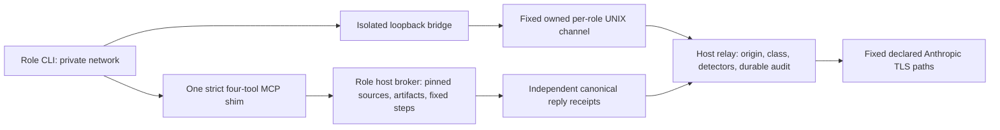

# URL acquisition, provenance and unavoidable transport

[Inferred] Candidate design only. Resolve one remote advertised full identifier, acquire or validate one strict detached clone, verify the immutable commit, then retain local admission/check/review/render behavior.047 owns the separately declared Inferred Git source-transport provider/destination and closed metadata-only egress gate, safe HTTPS/SSH locator/selector metadata, original validated transport locator, exact tip capture, bounded working-memory wire reception/pack decoding and whole-closure admission before source storage, supplied-clone read-only equality, SHA-256 required settings and cleanup. Direct local init performs no network and uses existing HEAD. Private is the conservative declaration; URL syntax and credentials prove no publicity.

The arrows describe the inference route's required future behavior, not observed containment. A separate required source route runs before selection: validated canonical HTTPS/SSH destination -> attributed Inferred source-transport provider/class declaration -> exact supported command/protocol metadata preparation and common policy check -> protected durable safe audit -> fixed native helper/connect or Git-v2 write. Anthropic configuration never authorizes this route. Complete URL/ref/selector/OID/protocol/control/capability metadata and applicable composition are independently typed code-structure and screened before use. Each permission binds destination/project/run-acquisition/policies, exact prepared bytes/count/digest and native executable/nonsecret environment/configuration profile. Check-to-use drift, unknown/secret fields, missing declaration or audit failure blocks dependent traffic. Connect denial produces no helper/GET; fetch denial no write/POST, with equivalent SSH evidence. Native fixed framing/authentication is supported-profile behavior; these identities do not claim exact libcurl headers or TLS ciphertext. No redirects, ambient helper/proxy/config destination, arbitrary/body upload or unaudited auxiliary channel is available. Credentials stay in the fixed host transport/authentication channel, outside source/role/context/records. Independent native safe/tamper/failure captures and before-send audit ordering are mandatory; send/acknowledgment uncertainty is Unknown, never zero or blind replay. No role has a host/external route or inherited network descriptor. The bridge offers only its isolated loopback endpoint and fixed host-relay socket; only the host relay opens declared provider TLS requests. Base URL configuration supplies compatibility, not security. Redirect/proxy/alternate hosts/paths/auxiliary requests cannot bypass the one check. There is no provider SDK or Syzygy inference engine: the CLI constructs requests and consumes supported complete responses; Syzygy implements checked HTTP forwarding.

The role has no raw clone, Syzygy checkout, other role state, shell/read/write builtin or arbitrary external tool. Exactly source_read, artifact_read, artifact_write and dossier_step cross strict bounded schemas to the fixed per-role broker. The host enforces role/path/pin/policy/operation species and screening before any read delivery, write/effect or result registration. Canonical successful reply bytes/digest, arguments, role/run/pin/policies and actual origin classes form protected receipts. Provider tool-use names/arguments are validated before delivery; later results must independently match issued id and canonical receipt plus exact independently fixture-pinned CLI/configuration-profile LF/reminder/cache-control presence-or-absence wrapping. Tool id alone is insufficient. Original packet meaning/bytes/digest and review denominator remain035's whole frozen subject; F6 explicitly replaces only URL rendered-design delivery bytes with035's authenticated reversible whole-packet view, separate representation identity and added currentness checks. No raw active renderer packet gains an ordinary compose/egress receipt.

The first request is checked against a pre-existing independent CLI executable/version/scaffold/tool-schema/template registry; first-payload learning is forbidden. That registry may prescribe only the exact known protocol-control projection: discard the recognized received CLI device/account metadata slot without persistence, insert known host user_id and fixed tool_choice auto/disable_parallel_tool_use:true when the captured incoming profile has no tool_choice. Independently identify/hash received envelope, projection/profile and prepared send; screen and durably audit the exact prepared bytes. Arbitrary/conflicting values refuse, model/prompt/source/tool/provider semantic content is unchanged, and provider responses with more than one tool call still refuse in full. Only classified supported variable slots may vary. Provider blocks are buffered to bounded complete semantic units, checked before persistence/delivery and registered exactly with their admitted request-origin class union plus derived-composites. Subsequent reuse requires exact registered blocks and fresh screening. Unknown/signed/opaque/thinking/image/binary/compressed forms refuse. Thinking must be disabled by a supported configuration established independently offline before role launch, otherwise launch refuses; `--safe-mode` is unsuitable because it disables explicit MCP. This closed choice can block a live model until actual compatibility exists; no guessed CLI flag or signature waiver is used.

Every ingest is a separate gate, even if no later provider request occurs. Owned acquisition receives/decodes source bytes in bounded working memory only: no fetch/import/index-pack/raw pack/body/index/temp/spool/log or checkout before whole-closure admission. Every hash-verified selected commit envelope/message, tree structural field and path, complete blob and every alias/mode must pass exact typed classification and unchanged detectors before the first source object/body write. Source span, artifact payload, provider text/tool arguments, clarification and broker reply must likewise classify/screen before storage, role delivery, result registration or effect. A refused stream cannot have leaked via partial SSE. The outbound gate then validates the complete composed request, per-field and cross-fragment/field detector population, full provenance graph, determinable inherited classes and explicit effective declaration subset. Source excerpts retain their original inert span policy; arbitrary composed text obtains no source-extension exemption. The proposed origin/species policy supplies typed control/scaffold/provider/clarification/report treatment without changing base secret detectors, unknown exclusion or private withheld metadata rules. F6 additionally names one explicit local first-party renderer-product boundary: complete actual producer/input lineage and class coverage, unchanged raw whole/file/decoded/composed secret checks before persistence, and unconditional independent page-sink/CSP/context-encoding/empty-script verification. Raw generic active findings stay FAILED and deny ordinary raw registration/delivery. Only this exact local product may be retained under the specialized page-sink treatment, and only its fully screened, independently round-tripped seven-key whole-packet inert view may enter the URL design role/provider route.

Before sending,048 authenticates the exact machine client/instance through kernel-verified OS-local identity and separately authorizes current project/operation scopes. An unidentified requester refuses. A protected durable integrity-verifiable audit event records RFC5-25 principal/session identity (optional/historical attribution Unknown if unavailable, never authentication), act/subject/exposure/instant/outcome plus role/run/project/pin/policies/provider, actual classes/receipt ids and body size/digest. No raw bodies, offending payloads, authentication or unsafe metadata enter the trail. Audit is outside governed and role/untrusted write reach; failure to persist blocks send. Attempt, send outcome and provider receipt are separately captured; uncertainty blocks blind replay. Credentials travel only process-to-process as supported fixed transport authentication headers, never context/log/audit. No new credential broker or proof of all ambient credential isolation is claimed.

Legacy run/2 remains strict and compatible, with its three repository-body eligible classes and operator-agent/no-provider reason valid only for operator-started mode. URL mode's separately validated overlay supplies effective authoringMode, actual planned classes and local-supervisor/no-scheduler reason, with acquisition/launch/relay/audit provenance and the distinct source-transport provider/destination/code-structure declaration plus protected prepared-command/protocol source-operation capture. The inference provider is not the sole destination field; every effective reader discloses both routes and their actual capture scope, with Unknown missing source sends/outcomes. Every reader (human appendix, machine form, close/current-authority and Execution Record projection) uses that same scope; absent/mismatched URL bindings refuse continuation. Stored core, launch and protected audit remain Inferred history; only live independently scoped observations and reverified object/packet/check facts obtain corresponding Observed labels. Missing usage or uncaptured send populations remain Unknown, never zero. The agent's discovery account remains036's separate Inferred self-report.

Positive finite limits bind acquisition, source/object reader, every CLI/bridge/broker/relay operation, request/response/SSE semantic unit and output. Existing reader bounds remain4096 sources,1048576 bytes/source,134217728 source bytes,65536 tree entries and1073741824 object bytes. Owned acquisition separately binds supported tested transport/executable/configuration/protocol/object-format/delta profile and positive finite wire/expanded/per-object/count/packet/delta/buffer/memory/CPU/wall limits, checked before allocation/expansion. Any missing, duplicate, extra, malformed, nonclosure/tag/parent object, external delta base, hash/trailer/count/end mismatch, unsupported metadata/path/mode, excluded/secret/binary/redaction-dependent required body or alias refuses the entire acquisition in memory. No incomplete clone, changed original hash, silent repin or partial-source adapter substitutes. Only after the complete depth-one closure passes may exact admitted objects be deterministically re-encoded as loose objects and fixed strict detached metadata; necessary worktree files may then materialize exact admitted bytes with no filters/hooks, followed by independent full-reader verification. A supported profile needs independent evidence for the requested transport/object format/deltas; installed experimental helper capability or a three-object local HTTP probe supplies no wider compatibility proof. Trusted metadata and post-admission writes inherit a hard OS per-file limit plus sampled aggregate-byte/entry budgets; the sample may overshoot and measured breaches/census failure stop with residual disclosure. Planned acquisition defaults are256MiB/file,512MiB aggregate,262144 entries,100ms sample,120s wall and2MiB metadata/output; actual values are recorded before use. Unsupported limiting capability refuses rather than silently falling back.

The supervisor acknowledges long stages, uses the original deadline/repair/question gates, terminates owned child trees on refusal/timeout/stop and verifies termination before claiming cleanup. Retained inspection views are not live agent work. Detach is not stop, attach does not duplicate, and resume re-establishes the same protected boundary without repinning, changing policies/provider or replaying uncertain sends. Raw acquisition buffers are discarded on every outcome; resume cannot reuse raw input or repin. Before brief only owned metadata or already admitted acquisition bytes are removed; after brief only the admitted clone remains with disclosed operator-removal retention. Cleanup failures name safe stage-specific residuals. Supplied clones remain external read-only sources with unchanged per-read exclusion, never Syzygy-acquired stores and never subject to this new whole-closure scan. Independent continuous filesystem-effect evidence must cover transfer, decoder, interruption and materialization, including a transient raw-pack-write mutant; a final empty-directory sweep is insufficient. No host swap/core-dump/crash guarantee is claimed. All roles are no-execution and no permitting instruction/profile is enabled.

[Inferred] Rejected alternatives: conventional fetch or disk/tmpfs/anonymous-file quarantine before admission (stores excluded bodies); partial-source adapter or redaction under an original object hash (changes the strict full-clone contract); input-only screening or prompt promises (fail RFC5-15); shared host network/base URL only (bypass); builtin Read/Bash (unbounded provenance/effects); tool-id-only receipts or first-payload scaffold trust (self-authentication); blanket all-seven/derived-only classification (laundering); signed unknown/thinking waiver (SEC5); importing040–045 wholesale, broad clone/history, owner ceremony or an execution profile (unneeded scope). [Unknown] Actual runtime enforcement, supported fixture coverage, authentication/refresh and production activation require implementation and fresh evidence; this design claims none.

[Inferred] URL model selection uses an explicitly recorded independently verified supported model/configuration profile or a disclosed verified default, with exact identity/configuration digest and actual selection origin before brief/launch. An explicit unsupported request refuses without silent fallback; no ambient CLI default or configured model supplies evidence of the model served. Default no-thinking compatibility requires independent offline proof; this candidate hardcodes no unverified model or switch.

[Inferred] F6 amends complete025/035/048 and the same proposed origin policy for the URL-design-only view. Exactly seven canonical members bind format polaris-dossier-url-design-inert-view/1, encoding html-entities-five/1, originalSha256/originalBytes, payloadSha256/payloadBytes and payload. Fixed one-pass &, <, >, double-quote/apostrophe entities preserve exact original bytes via independent strict inverse/re-encoding; complete envelope digest/count stays separate. The original is rebuilt from current admitted inputs and actual pinned renderer/builders, with complete per-byte/span/full-blob parent coverage; an0..2000 excerpt cannot authenticate a whole renderer input. Fixed first-party HTML/CSS implementation scaffold is code-content plus derived-composites and every genuine dynamic input class, never blanket HTML code-structure or unrelated preparation/all-seven evidence. Independent every-page sink/CSP/encoding/empty-script proof is required regardless of conditional fallbacks or producer markers.

[Inferred] Unchanged secret detectors run on raw whole/per-file/decoded-field/cross-file populations before product persistence or encoding, and on the authenticated inverse contribution with surrounding request text for secret compositions. Single-reply history retains its complete physical view and wrapper checks. The ordered profile checks each actual part, its wrapper and the complete actual request through acknowledgment. Its independently assembled private logical view and complete wrapper retain the full original detector and composed-input checks. Raw active failure remains FAILED; it is not F5 raw025 admission. Backticks/unsafe Markdown/unknown lineage, class, policy/revocation, malformed schema, overflow or audit failure refuse without alternate encoding, partial summary, raw fallback, model normalization or semantic request rewrite. Verdict.packetSha256 remains the original035 digest; separate protected delivery/audit binds view/encoding/producer/complete parents. Review-check/render/resume rebuild both and retire on drift. Review original full pages/files/evidence view/sizes/denominator; round-trip does not prove comprehension or a passing review.

[Inferred] Record limits before processing: original/payload/envelope each at most2,097,152 bytes;4,096 files/input-parent receipts;65,536 parsed nodes/depth32; each transform pass at most2,097,152 input code units and at most four verification passes. JSON escaping/wrapper/request expansion counts separately; stricter existing limits/deadline/wall bounds win. Bounds require complete input origins, files and delivery; authenticated parts count only through the complete ordered plan. The retained five-key assessment probe is feasibility evidence only; it is not the new seven-key representation's identity or production/reviewer proof. This candidate binds nothing; confirmed F5 bytes/review remain immutable, unadopted predecessor evidence.

[Inferred] F8 retains the kernel authentication and actual-mode provenance requirements introduced by F7; its missing governing-adoption exception is repaired explicitly below. URL machine callers use RFC5-7(d), kernel-attested peer/process lifetime and dedicated channel binding to distinct client/instance/kind/role/run, with separate deny-default project/source/run/operation scopes. Same UID/path/loopback/claimed fields or an authenticated bridge with anonymous upstream cannot substitute. Current authoritative identity/scope/expiry/revocation and verified local projection are checked on every next act, even an open connection/queued message/resume. Fixed trusted controller issuance under current VIS-4, finite expiry<=original deadline, identity-stable zero-overlap rotation and identity/instance revocation are explicit; no owner prompt, browser-session inheritance/client self-issuance or reusable bearer/adapter secret in role/observed namespaces. Unsupported mechanism refuses; current filesystem-only sockets are not proof.

[Inferred] F8 explicitly amends governing RFC3-2/15/16/(a)/(b) and RFC5-6, adding RFC3-16(d), in proposed/contracts/DOSSIER-URL-LOCAL-MACHINE-CREDENTIAL-AMENDMENT.md. F7's applicability-only runtime-authority route failed independent review F7-1 and is not adopted. Existing authorization-bearing bytes require their own adoption; a parent policy/path/mechanical writer cannot silently exempt them. The new explicit bounded class becomes available only after real ordinary VIS-4 default-branch adoption of the amendment, fixed issuance/scoping policy and owning successor. Only then do exact polaris-dossier-local-machine-client/1 runtime instances at .syzygy/governance/policies/dossier-machine-clients/<opaque-client-id>.json in observing project:syzygy derive operational authority from that adopted rule/policy plus every current canonical instance/kernel/scope/atomic/anchor/audit predicate, without individual instance commits/adoption/ceremony. Parent normative bytes still need adoption; no arbitrary future-byte approval or per-instance adopted status follows. Closed immutable bindings, sole typed Syzygy-maintained controller writer, one-way bounded lifecycle and protected verifier-only projection remain. A protected high-water revision/digest/lifecycle anchor coupled to durable audit detects replay of canonical bytes plus ordinary projection; missing/reset/partial/unsynchronized state refuses. Every next live/queued/resumed act rechecks actual parent adoption, instance and kernel/scope currentness. Parent veto/retirement/change stops dependent work without automatic migration/re-adoption. The explicitly authorized local-machine-verifier adapter cannot adopt policy or become authority; no code under .syzygy, foreign source write, owner credential, secret waiver, new namespace or broad policies exemption is created. Actual supported kernel/currentness/anchor enforcement remains Unknown.

[Inferred] F7 scopes035 provenance to actual mode in human and machine forms: operator-started helpers retain attributed terminal provenance; URL helpers retain the separately attributed supervisor launch with matching run/role/session-directory record, never an operator-started assertion. Freshness/independence/authorship/unaltered reading/inventory completeness remain Inferred. Codec schema/map/identities remain unchanged: reject leading original/envelope UTF-8 stream BOM and raw/decoded NUL, preserve embedded ordinary-string U+FEFF as data subject to all other checks. F6 local renderer/active FAILED/complete-parent/secret/sink/inert/request/currentness obligations remain intact. No adoption/runtime proof follows.

## Ordered rendered-design exchange

[Inferred] Assemble and independently check the canonical view and exact plan in protected host memory. Preflight through the maximum supported verdict and acknowledgment. The selected design profile pins the prepared event, exact wrappers and part selectors. At zero, prefix and full delivery, screen the complete actual request and the private full logical view with its original surrounding non-transfer fields.

[Inferred] Every result is linked to the checked prior response and exact receipt. The relay records prepared admission, actual attempt and outcome, and complete admitted response. The last part's matching response can authorize the exact verdict call. That call stages its validated output privately and returns the bounded pending acknowledgment. Verify the actual acknowledgment exchange and current identity before an atomic eligible disposition. Historical readers revalidate the successful durable chain and separate fresh currentness. They cannot promote a stage or replay it. Other role choices use their established profiles.
