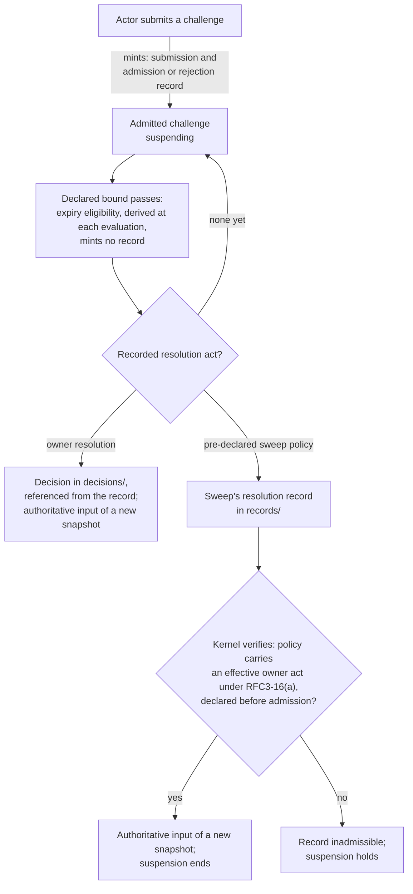
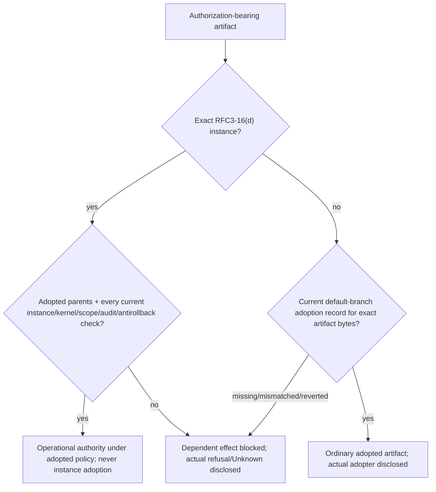

# URL dossier local machine credential governing-contract amendment — candidate F8

[Inferred] This file proposes six complete clause replacements and one new clause, solely for the URL-dossier delivery category. It binds nothing. The installed and mirrored contracts are unchanged. Stable identifiers remain intact; RFC3-16(d) is new and defined here. Apply these reviewed replacements together at actual ordinary VIS-4 default-branch adoption, with the fixed issuance/scoping policy and owning behavioral successor. Future runtime instance operations derive only under the adopted RFC3-16(d); this candidate supplies no operational authority.

[Observed] EXACT-REPLACEMENTS.json contract_sections binds exact current source paths, whole source/old/new clause digests and byte-derived unified diffs; it is evidence, not a second normative rule. Only the replacement text under each Clause heading below is normative candidate content. Unchanged clause text is intentionally preserved within each complete replacement. No old adopted bytes or record is edited here.

## Clause: RFC3-2

Operation: MODIFIED

Source: .syzygy/governance/contracts/rfcs/RFC-0003/manifests-and-namespace.md

**RFC3-2.** **Every manifest field names exactly one write authority**, from
**four** classes:

- **owner-adopted** (only the owner adopts the value; Syzygy may draft, per
  VIS-4);
- **Syzygy-drafted** (Syzygy authors, value renders unadopted until owner
  sign-off);
- **Syzygy-maintained** (mechanical values Syzygy writes under this RFC's own
  rules, e.g. schema-version stamps under §2.6);
- **kernel-recorded** (values the kernel writes as a factual record of a
  **non-owner actor's** submission).

For the narrow RFC3-16(d) URL-dossier local machine-credential instance class, every closed-schema identity, binding, verifier and lifecycle field has the **Syzygy-maintained** authority, exercised only by the one policy-pinned typed trusted controller under that clause. This is an explicit authorization-data maintenance rule of this RFC, not kernel-recorded authority, generic permission for mutable policies or a second writer. The adopted parent rule/policy fields retain their ordinary adoption authority.

No field has two writers; a field whose authority is not declared by its
governing RFC may not exist.

**The fourth class, `kernel-recorded`** (owner decision **B19**, minted with
RFC3-15's `records/` category), covers a fact the kernel authors **on someone
else's act**: a challenge admission or rejection record, a submitted
withdrawal, a walkthrough execution record.

- The writer is single, so the one-writer rule holds; what distinguishes the
  class is that the **content originates outside the kernel and outside the
  owner**, so the record asserts *that a submission occurred*, never that its
  content is true.
- **A `kernel-recorded` value is never authorization-bearing**: it records,
  and recording authorizes nothing.
- Anything in this class that *would* authorize — a resolution policy, a
  sweep policy, an approval — is by that fact not in this class and falls
  under RFC3-16(a) instead.

**Which lifecycle transitions mint a record.** A `records/` fact is minted
on exactly **two triggers**, and no others — the same set RFC3-15's
`records/` cell states, so the two clauses can never be read apart:

- **(1) an actor's submission** — a challenge submitted (and its admission or
  rejection), a withdrawal submitted, a walkthrough run submitted;
- **(2) the pre-declared deterministic challenge-sweep policy resolving an
  expiry-eligible challenge as `expired`** (RFC2-13; owner decision B1).

**Owner resolution acts** — upholding, dismissing, or expiring a challenge by
decision — are Decisions in `decisions/` (RFC3-15), referenced from the
record, never minted into `records/`. **Kernel-computed expiry
*eligibility*** — a challenge's declared bound having passed (RFC2-3,
RFC2-13) — is **derived state computed at each evaluation** from the
admission record's instant and the declared bound; the *eligibility* mints
**no record**, because it involves no act and is reproducible from snapshot
inputs the tree already holds, so minting it would add a snapshot input
(RFC2-1 item 9) that pure recomputation created.

The **resolution** that ends the suspension is a different thing:

- Per RFC2-13 (owner decision B1), an expiry-eligible challenge keeps
  suspending until a **recorded resolution act** — a human resolution in
  `decisions/`, or the pre-declared deterministic policy sweep's resolution
  record in `records/` (RFC3-15's `records/` cell names it) — and that act is
  an authoritative input of a new snapshot.
- The sweep's resolution is not eligibility wearing a record: eligibility is
  a pure function of (snapshot, as-of) and re-derives at every evaluation,
  while the resolution happens **once, at the sweep execution's own
  instant** — *when* the suspension lifted is derivable from no snapshot
  input the tree already held, and that instant is exactly what the record
  fixes as the new snapshot's authoritative input.
- And the record authorizes nothing of itself: its authority is the kernel's
  verification that the resolving policy carries an effective owner act under
  **RFC3-16(a)** and was declared before the challenge was admitted (RFC2-13's
  pre-declaration requirement) — never the record's own say-so — so an
  unbacked resolution record is inadmissible and the suspension holds.
  (Shape-parallel with RFC3-17(a)'s admission-record authority rule.)

*Diagram (non-normative; the clauses govern):* which steps in a challenge's
expiry path mint a `records/` fact.

## Clause: RFC3-15

Operation: MODIFIED

Source: .syzygy/governance/contracts/rfcs/RFC-0003/governance-homes-and-owner-acts.md

**RFC3-15.** The **five** constitutional categories of `.syzygy/governance/`
hold, exclusively — "exclusively" bounding what each category may contain,
and the five-category set itself being closed except by the two lawful
widenings this RFC records:

- the owner amendment that minted `records/` (B19, RFC3-15(a)) and
- the **reservation** of `declarations/` at RFC3-17, which sits beside the
  five as an additional reserved category (drafted default; §5 q4 OPEN)
  rather than inside any of them.

A plane validator therefore accepts exactly these six names and rejects a
seventh; neither rejecting `declarations/` nor admitting an unreserved
directory is conforming:

| Category | May contain | Install gate |
|---|---|---|
| `doctrine/` | Adopted doctrine artifacts; Syzygy-drafted doctrine for undeclared projects, stamped unadopted | Owner adoption (`ADOPT DOCTRINE` in this repo's bootstrap; explicit owner adoption generally). Amendment: owner-only (VIS-4) |
| `contracts/` | Accepted load-bearing contracts (RFCs), including normative data contracts and external service contracts | Agent adoption under VIS-4 (amended by GOVERNANCE-SIMPLIFICATION-D10): a row in `decisions/AGENT-ADOPTIONS.md` naming the commit, reported to the owner, undone by veto. The foundational set's digest-bound acts in the active acceptance record remain history |
| `policies/` | Quality, evidence, and security policies — including currency-bound declarations (RFC2-9), the secret-detection policy (SEC-5), deterministic challenge-resolution policies and challenge sweep policies (RFC2-13) | Agent adoption, as for `contracts/`, except that weakening the secret-detection policy is the owner's decision (SEC-5); policy versions are snapshot inputs (RFC2-1 item 7). The sole mechanical-instance exception is RFC3-16(d): its parent amendment and fixed security policy require ordinary adoption; only its exact bounded runtime credential data instances derive operational authority under that adopted rule without individual adoption. No other policy/path gains this exception |
| `decisions/` | Recorded owner decisions: adoptions, dismissals (reason + expiry), adjudications, consent records (RFC3-7), overrules | Recording by the owner (or attributed on the owner's behalf), or an agent adoption row; a decision is a warrant, never evidence |
| `records/` | **Kernel-authored durable facts minted on a non-owner actor's submission, or by the pre-declared deterministic challenge-sweep policy resolving an expiry-eligible challenge as `expired` (RFC2-13; owner decision B1 — the sweep's policy lives in `policies/`, its resolution record here, and that record is the new snapshot's authoritative input; the record's authority is the kernel's verification that the policy carries an effective owner act under RFC3-16(a), declared before the challenge was admitted — never the record's own say-so, shape-parallel with RFC3-17(a) — and an unbacked resolution record is inadmissible, the suspension holding)** (the only minting triggers — see RFC3-2's transition rule; expiry *eligibility* derives at evaluation and mints nothing): **challenge submissions** (RFC1-5, RFC2-12 — the submission is itself a distinct recorded artifact, per RFC3-17(a)), their admission and rejection records and submitted withdrawals (RFC2-13), and **walkthrough execution records** (the fact a comprehension walkthrough ran and what it walked — RFC7-30, RFC9-45; **this artifact class exists only where those contracts are accepted and active**, so until then the category admits no member of it and a conforming validator rejects one). *Never* owner decisions, never policy, never claims — a walkthrough **judgment** (pass/fail and rationale) is an adjudication and lives in `decisions/` | **No install gate — these are recorded facts, not authorizations.** Minted by the kernel under its own rules; the *submission* they record is attributed, and the record itself is neither adopted nor adoptable. The one non-submission member — the sweep's expiry-resolution record — answers to a gate all the same: the resolving policy's owner-approval gate in `policies/` and its effective RFC3-16(a) act state, carried into the record by the kernel's verification, so no authorization enters this category by riding a record |

## Clause: RFC3-16

Operation: MODIFIED

Source: .syzygy/governance/contracts/rfcs/RFC-0003/governance-homes-and-owner-acts.md

**RFC3-16.** **Lifecycle status: a self-declaration inside content, an
effective status outside it.**

**Category-appropriate lifecycles — there is no universal one.** Each
governance category carries the lifecycle its content class admits, and only
that:

| Content class | Lifecycle | Notes |
|---|---|---|
| `doctrine/`, `contracts/`, `policies/`, `declarations/` (normative artifacts) | draft → adopted/accepted → amended → retired | The adoptable class; RFC3-16(a) governs every act |
| `decisions/` and consent records | active → superseded / revoked / expired | A decision is **made**, never "adopted"; supersession and revocation are themselves recorded acts |
| `records/` (kernel records) | immutable recorded fact; plus withdrawal, supersession, or the sweep's recorded expiry resolution where its governing contract defines them (RFC2-13 — expiry *eligibility* derives; the resolution is a recorded act whose authority is the resolving policy's RFC3-16(a) provenance, never the record's own say-so) | **No adoption lifecycle exists for this class** — nothing here is adopted or adoptable (RFC3-15) |
| Governed presentation artifacts (e.g. the Polaris narrative, RFC 0007) | draft → adopted/published → superseded | Non-authoritative content with an adoption gate on publication |
| RFC3-16(d) closed URL-dossier local machine-credential instances in `policies/` | instantiated → rotated / expired / revoked | Authorization-bearing operational data under the adopted rule/policy and current protected lifecycle, **not independently adopted policy**; only RFC3-16(d) defines the exception |
| `cache/`, `local/` | none | No governance lifecycle; rebuildable / personal (RFC3-20/21) |

**The self-declared stamp.** An artifact of an adoptable or gated class
carries its **self-declared lifecycle status** as machine-readable content,
captured in the snapshot "with adoption status as a fact, not formatting"
(RFC2-1 item 2). A tree-resident stamp is **never self-authenticating**:
`accepted` written in a file is a claim by whoever wrote the file, not proof
of acceptance.

**Effective status is read from the adoption record, not from the stamp.**
*(Amended by GOVERNANCE-SIMPLIFICATION-D10.)* Except for the sole RFC3-16(d) bounded mechanical-instance class, the **effective** lifecycle status of a normative
or authorization-bearing artifact is determined by its **adoption record** on
the default branch:

- for doctrine and the four owner classes (VIS-4), an **owner decision
  record** — the owner's words, dated, naming the commit that applies them;
- for everything else, an **agent adoption row** in
  `decisions/AGENT-ADOPTIONS.md` naming the commit, what changed, why, and
  the revert command.

The commit identifies the exact content, so no separate phrase or digest is
transcribed. Consequences that bind:

- **Adoption does not edit the artifact.** An artifact self-declaring
  `draft` whose commit carries an adoption record **is effectively adopted**;
  the self-declaration is read as the state at authoring time.
- **A later edit is a new adoption, not a broken one.** An artifact edited
  after its adoption is governed by the newest adoption record that covers
  it. Acts performed before D10, and their digests, are history, not locks.
- **The two must be readable apart.** Every surface and query answer
  distinguishes the self-declared stamp (untrusted content) from the
  effective status; where they disagree, the effective status governs and the
  disagreement renders as a disclosed fact, never silently reconciled.
- Outside the sole RFC3-16(d) instance class, an artifact with **no** adoption record at all has effective status
  **unadopted** whatever its stamp claims: it binds nothing, anchors nothing,
  and renders unadopted everywhere (v1.md drafting rule; RFC2-25
  `unadopted-draft`).
- A vetoed adoption is reverted, and the artifact's effective status is that
  of the adoption before it.
- **How other clauses read this one.** Wherever another contract clause
  says an artifact, policy, entry, bound, judgment or amendment is honored
  only through an "effective owner act under RFC3-16(a)", an "owner-act
  record", an "owner decision", an "owner ruling" or "owner sign-off", it
  reads "an adoption record under RFC3-16 as amended": an agent adoption row,
  or an owner decision record where the matter falls in an owner class
  (VIS-4). Wherever a clause requires a consent record before a repository is
  observed or before content goes to a provider, it reads as RFC3-7 and
  RFC5-12 as amended: observation needs no record, and egress needs the
  provider's declaration in the run's own record. Write consent, secret
  screening and the other owner classes are unchanged.

**Scope.** This clause and the RFC3-16(a) predicate govern
**authorization-bearing and normative artifacts** — the adoptable class,
decisions/consents, and gated presentation artifacts. RFC3-16(d) instances remain authorization-bearing and inside this predicate, but obtain operational authority only through that explicit adopted-rule exception, never a self-declared stamp or implicit policy-path exemption. They render `authorized-under-adopted-policy`, `refused` or `Unknown` with their actual parent and current instance bindings, never `agent-adopted`/`owner-decided` per instance. Kernel records carry no
adoption lifecycle and are outside both (their authority is RFC3-2's
`kernel-recorded` class); `cache/` and `local/` are outside governance
entirely.

## Clause: RFC3-16(a)

Operation: MODIFIED

Source: .syzygy/governance/contracts/rfcs/RFC-0003/governance-homes-and-owner-acts.md

**RFC3-16(a). The owner-act provenance predicate.** An
**authorization-bearing governance artifact** is any artifact whose presence
**authorizes a dangerous act, unblocks or widens a claim class, fixes the
meaning of a rendered encoding, or otherwise binds project truth in a way no
downstream status check can falsify**.

[Inferred] The fourth limb is deliberately the vaguest and is retained for
that reason: the first three were derived from failures already found, and a
predicate that reaches only the failures already found is an enumeration
wearing a predicate's clothes. Where the fourth limb is the *only* one that
catches an artifact, the honest reading is that the artifact's class has not
yet been thought about properly — treat that as a finding, not as settled
coverage.

**That predicate is the scope; the list below is not.** An artifact
satisfying the predicate is in scope whether or not it appears among the
examples, whether or not the RFC introducing it cites this clause, and
whether or not it existed when this clause was written — a subject fixed by
enumeration leaves whichever class was added or patched last unguarded, the
failure mode this form exists to prevent. A gate reading an artifact not
listed here does not escape the predicate; it applies it. The classes that
follow are **non-exhaustive examples**, load-bearing as illustration and never
as the boundary:

- a **consent record** — observation, write, egress, or execution (RFC3-7;
  RFC5-12);
- an **approval, adjudication, or overrule Decision** (RFC3-15,
  `decisions/`), including the execution-profile approval (RFC5-18(c));
- an **adoption/acceptance stamp** (RFC3-16);
- an **owner-approved policy declaration whose effect is to unblock or widen
  what Syzygy may honor** (RFC3-15, `policies/`) — the marker-adoption policy
  (RFC4-26), the scheduler retention bound (RFC4-16), the currency-bound
  declaration (RFC2-9), the trusted-external-oracle declaration (RFC4-13),
  and the **substrate-to-normalized work-state derivation mapping**
  (RFC8-12) — a mapping row projecting a custom substrate status into `ready`
  or `active` makes the board and the endpoints report dispatch-eligible and
  live work, so a mapping an untrusted writer could mint would widen exactly
  what the surface says remains, is live, and is blocked.
- an artifact that **fixes the meaning of a rendered encoding** rather than
  reporting a fact under it — the channel registry from which all legend text
  is generated (RFC9-26) and the layout version registry (RFC9-18).
  [Inferred] This limb is not about widening a claim, which is why
  enumeration alone would have missed it: a forged registry entry leaves
  every claim, tier, and freshness check passing and changes what a *correct*
  render means, so no downstream status check can catch it (VIS-7's trust
  floor).

**The predicate** *(amended by GOVERNANCE-SIMPLIFICATION-D10)*. Outside the sole explicit RFC3-16(d) mechanical-instance exception, such an artifact is honored
only at bytes that carry an **adoption record** under RFC3-16: an owner
decision record where the artifact falls in one of VIS-4's four owner classes
(for example, a write consent for a repository the owner does not own, a
weakening of the secret-detection policy, or a configuration exposing Syzygy
beyond the tailnet), and an agent adoption row otherwise. Being present and
well-formed *in the tree* is not sufficient; being committed to the default
branch with its record is. RFC3-16(d) does not remove an artifact from this authorization-bearing predicate: it defines a separate, closed derivation of operational authority from an actually adopted governing amendment and fixed issuance/scoping policy, plus every current instance, kernel, scope, protected audit and antirollback check. An applicability judgment, controller assertion, well-formed record or policy filename cannot create this exception. Any member or write outside its exact class uses the ordinary per-artifact adoption predicate.

**The trust premise, stated honestly.** The plane is in-tree and agents
commit into it, so every record, owner decision records included, lies within
agent write reach. The project trusts its git history and the owner's review
of what agents report, with veto; it does not claim that a record proves who
wrote it, and no surface claims independent verification for any adoption. A
machine may record an owner decision only from the owner's own words, and may
never mint, widen or reinterpret one; a forged owner decision is a
trust-floor violation, not authority.

**The state-(2) mechanism class** (decision A1: correlation through an
independently kept audit trail) remains available for owner decisions as a
future option; no gate requires it.

## Clause: RFC3-16(b)

Operation: MODIFIED

Source: .syzygy/governance/contracts/rfcs/RFC-0003/governance-homes-and-owner-acts.md

**RFC3-16(b). What an adoption record binds** *(amended by GOVERNANCE-SIMPLIFICATION-D10;
formerly "What an owner act binds: protocol-neutral semantics")*. Every
adoption record, owner or agent, binds at minimum:

1. the **project identity**;
2. the **stable identity of the artifact** adopted;
3. the **commit** that carries the adopted bytes — approving a path never
   approves future content at that path; a later edit needs its own record. The sole RFC3-16(d) exception permits only that explicitly adopted fixed-policy mechanical operational-instance transition, not arbitrary future bytes or parent-policy edits;
4. the **kind** of adoption (adopt, amend, retire, consent, revoke, veto);
5. **who decided** — the owner, or the agent session that adopted;
6. the **date**;
7. the **scope**, where the kind carries one (a write consent's repository);
8. what earlier adoption, if any, it **replaces or reverts**;
9. *(retired by GOVERNANCE-SIMPLIFICATION-D10: the A1 audit-record identity or its explicit
   absence; no adoption claims independent verification.)*

For an agent adoption, items 1 to 8 are the `AGENT-ADOPTIONS.md` row and its
revert command; no phrase is typed and no digest is transcribed.

**Effect when the adoption record is missing.** For ordinary artifacts and for the parent amendment/fixed policy of RFC3-16(d), a missing, mismatched or
reverted adoption record blocks the dependent effect and renders the authorization
Unknown. An RFC3-16(d) instance instead must satisfy every adopted-rule derivation/currentness predicate of that clause at the next act; missing instance adoption alone is not a failure only within that exact exception. Any failed parent or instance predicate blocks the effect and renders its operational authorization refused/Unknown as warranted; for an owner-class artifact it also routes to the owner. Blocking is
not deletion: the artifact and its record state both remain rendered.

**One predicate, one home.** Every consuming gate **cites this clause rather
than restating the obligation**. The gates today:

- RFC5-15 and RFC5-18(c) cross-check it before acting;
- honored only under it are RFC5-14, RFC5-16 (also read at RFC4-12 and
  RFC3-30), RFC4-13, RFC4-13(b) (a governed checker that can unblock positive
  status fixes the meaning of a certification), RFC4-16, RFC4-26, RFC4-7,
  RFC2-13, RFC4-23(2), RFC8-16, RFC9-26, RFC9-18, RFC9-45's walkthrough
  release policy and its leg-2 map walkthrough **judgment**, and RFC 0007's
  owner judgments RFC7-21, RFC7-25 and RFC7-31.

On both walkthrough surfaces the *execution record* is `kernel-recorded` and
authorizes nothing, so it sits outside this predicate. [Inferred] Stating the
obligation per artifact class instead would leave whichever class was patched
last unguarded — the failure mode this single-predicate form exists to
prevent, and the same reason the clause's **subject** is the predicate rather
than the examples beneath it. **This list tracks the gates; it does not bound
them.**

*Diagram (non-normative; the clauses govern):* how a gate treats an
authorization-bearing artifact under RFC3-16(a) and RFC3-16(b).

## Clause: RFC3-16(d)

Operation: ADDED

Source: new clause in .syzygy/governance/contracts/rfcs/RFC-0003/governance-homes-and-owner-acts.md

**RFC3-16(d). Bounded mechanically instantiated URL-dossier local machine-credential data.** This is the sole explicit exception to RFC3-16/(a)/(b)'s individual-adoption-of-authorization-bearing-bytes rule. It defines operational application of an adopted rule, not adoption of new intent or policy at runtime. It applies only when **all** of the following hold; a path, format label, controller claim or parent policy alone supplies no authority.

1. **Adopted parents before use.** This exact governing amendment and the fixed URL-dossier issuance/scoping/origin policy SHALL each have current effective ordinary default-branch adoption under RFC3-16/(a)/(b) and VIS-4 in the observing project:syzygy governance root. The package's behavioral specification version receives its required tag. The rule/policy adoptive commit, artifact identity and exact content identities, project/root, policy schema/scopes, supported kernel/controller/adapter profile and installed controller identity SHALL be independently resolved and bound before any instance grant. Their self stamps or candidate presence never suffice. Parent amendment/policy edits are ordinary new adoptions, never mechanical-instance writes. Missing/unknown/mismatched/reverted/vetoed/retired parent or changed unsupported controller/policy profile refuses every next act; no grandfathering or automatic migration/re-adoption escapes a veto.

2. **Closed class and canonical data home.** Members are exclusively secret-free polaris-dossier-local-machine-client/1 data instances for one bounded URL-dossier run's pinned role-cli/mcp-shim/inference-bridge machine clients under RFC5-7(d), in .syzygy/governance/policies/dossier-machine-clients/<opaque-client-id>.json of the **observing Syzygy project**. No observed foreign repository or supplied clone is written. The fixed adopted policy SHALL close the exact record/instance/verifier schema, immutable project/source pin/run/role/kind/scopes/policy/client/issuance bindings, finite timestamps and bounds, nonsecret attested process/channel verifier metadata and one-way lifecycle transitions specified by complete REQ-polaris-generation-048. The policy is normative and adopted; an instance is authorization-bearing operational governance data, never an independently adopted policy, kernel-recorded fact, owner credential, anonymous client class or general exemption for policies/. Outside this exact class, ordinary RFC3-16/(a)/(b) remains mandatory.

3. **Single mechanical writer and immutable boundaries.** Every instance field has RFC3-2's Syzygy-maintained authority, exercised only by the one fixed-policy-pinned typed trusted host controller; a role/MCP/bridge client cannot administer or mint credentials. The only permitted writes instantiate a never-reused identity under an already validated permitted run binding, append a permitted unique increasing instance generation, advance revision, shorten finite expiry, and set one-way retirement/revocation. Immutable identities/policy/project/source/run/role/kind/scopes and historical verifier bindings cannot be changed or deleted under an existing identity. No new scope, operation species, provider, client kind, policy discretion, arbitrary authorization artifact or secret may be added by runtime. A genuinely different binding requires a new policy-permitted never-reused identity and cannot bypass an existing identity/run revocation. No reusable bearer or adapter secret enters role/observed namespaces; implementation code stays outside .syzygy. The explicitly authorized typed local-machine-verifier adapter writes only bounded protected verifier projection/currentness anchor and lifecycle audit at its fixed host state root, never governing policy or foreign repository content.

4. **Effective operational authority, not individual artifact adoption.** A current member derives permission only from the conjunction of current adopted parent identities, validated fixed-policy membership/transition, complete atomic expected-revision canonical publication, matching protected verifier/currentness projection, actual independently supported kernel peer/process-lifetime/dedicated-channel binding and separately authorized deny-default project/source/run/role/operation scope. The canonical governance record is the current identity/scope/lifecycle datum required by RFC5-6; the policy/rule is its authorization warrant, and the protected projection is only a verifier/currentness safeguard, never independent governance authority. Neither absent individual default-branch commit/adoption row/tag nor absence of a per-instance owner ceremony blocks a member that satisfies this explicit rule; no such per-instance act is required or fabricated. Conversely these operational bytes do **not** acquire agent-adopted/owner-decided status, and earlier parent or path adoption never approves arbitrary future content. Readers disclose the actual adopted parent commit/policy identities, current instance/revision and operational-authority state with captured scope, never independent proof of adoption or a false per-instance adoption claim.

5. **Every-next-act currentness and antirollback.** Before any protected data delivery, reply registration, tool/adapter effect or dependent forwarding, including queued work/open connections/attach/resume, re-read current parent effective adoption, actual canonical instance, protected projection/currentness anchor, kernel identity/lifetime, policy membership, expiry/revocation and separate scopes. Enforce monotonic revision/generation/never-reused issuance identity and an independently protected per-client high-water revision/digest/lifecycle binding, coupled to the durable lifecycle trail. A replay of old canonical bytes or both file and ordinary projection cannot reset revocation/currentness. The anchor is not governing authority and cannot grant on its own; its protection/rollback-detection scope SHALL be independently proved for the supported profile. Missing, inconsistent, unreadable, reset, partial, tampered, rolled-back or unsynchronized parent/record/anchor/audit state refuses; do not reconstruct a grant from mutable run history or an unverified projection. Atomic compare-and-publish and mediation serialization prevent a stale concurrent writer from winning; failed publication/synchronization/audit has no grant. Exactly zero-overlap identity-preserving rotation retires the old instance; identity/instance/run stop, expiry or revocation blocks the next act even on existing connections. Resume cannot restore retired authority or widen original deadline/pin/policy/provider/role. Already attempted sends are truthfully captured, never represented as undone.

6. **Protected evidence, finite limits and unchanged safeguards.** Safe durable integrity-verifiable lifecycle audit binds actual trusted controller/client/instance/project/run, parent commit/policy identities, previous/next revision/digest, issuance/rotation/revocation/publication/currentness decision, time/outcome and scope **before** any corresponding grant/effect. No bodies/secrets/unsafe metadata enter it; failure blocks. Maintain finite record/instance/client/parse/I/O/lock/output/wall bounds under the original run deadline, rejecting exhaustion instead of dropping revocation/history or silently reissuing identities. Captures remain attributed Inferred history, missing evidence Unknown; supported live kernel/currentness observations name their actual scope/instant, never prove all past behavior. Independent positive and missing-parent, wrong-peer/scope, unsupported writer/field, rollback, atomic race, audit failure, next-act revocation and resume counterexamples are mandatory. Every source admission, complete request screening, provider declaration, no-observed-code-execution, secret fail-closed rule and owner class remains unchanged; this exception cannot authorize an owner-class change. Actual adoption of this amendment and fixed policy is prerequisite to activation; this candidate creates none.

## Clause: RFC5-6

Operation: MODIFIED

Source: .syzygy/governance/contracts/rfcs/RFC-0005/admission-and-boundary.md

**RFC5-6.** A machine credential's contract shape, binding whatever mechanism
is chosen:

- **Identity.** Each credential names one machine-client identity (e.g.
  "beads-adapter on host X", "owner CLI"), minted at issuance, opaque and never
  reused. Identity survives rotation; revocation is per-identity or
  per-credential-instance.
- **Issuance.** Only through an owner-attended ceremony on an already-trusted
  channel (an authenticated session, or the serving host's own console).
  Credentials are never self-issued, never minted by another machine
  credential, and never distributed through an observed project's content.
  The sole RFC3-16(d) URL-dossier OS-local class instead uses its fixed adopted issuance/scoping policy and one trusted host controller, not per-instance adoption/owner ceremony or authority delegated through another machine credential. Parent rule/policy adoption and all owner classes remain unchanged.
- **Scoping — deny by default.** A credential carries an explicit scope set:
  which projects it may read, whether it may submit proposals, trigger
  evaluations, or reach adapter-mediated effects. An unscoped credential is
  invalid, not all-powerful. Scope enumeration granularity is RFC 0003/0006
  schema material; the deny-by-default rule is this clause's.
- **Rotation.** Supported without identity change; the old instance is retired
  with an overlap window the owner declares (which may be zero). The RFC3-16(d) class uses exactly zero overlap fixed by its adopted policy; identity survives and next-act revocation still binds.
- **Revocation.** Effective at the next request (§3.5, acts rule); recorded.
- **Storage.** Syzygy stores only a verifier (hash or public key), never the
  presentable secret; the credential record (identity, scopes, issuance,
  expiry, revocation state) is a governance-plane artifact and contains no
  secret material (SEC-5). For RFC3-16(d) only, that canonical governance-plane operational data is secret-free, Syzygy-maintained and authorization-bearing under the adopted rule/policy derivation, without individual adoption. Its declared observing-Syzygy policies home, closed writer/schema and current protected lifecycle are mandatory; a local verifier projection has no authority. Every other credential artifact follows RFC3-16(a/b), with no broader mutable-policy exemption.

